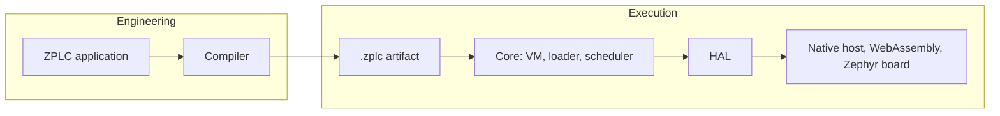

# System architecture

ZPLC keeps what you write apart from what runs the machine. This page shows where the lines are, what sits on each side, and which rules keep them there. Read it before you port ZPLC, add a language path or judge what a result in one place says about another.

## The parts and how they connect

| Boundary    | What is on each side                                                                                   | What crosses it                                    |
| ----------- | ------------------------------------------------------------------------------------------------------ | -------------------------------------------------- |
| Authoring   | You, the ZPLC application and the command line, working in ST, IL, LD, FBD or SFC                      | Project files: source, `zplc.json`, scenarios      |
| Compilation | The compiler (`packages/zplc-compiler`) and the language transpilers of the application                | A `.zplc` artifact and its debug map               |
| Runtime     | The C99 core in `firmware/lib/zplc_core/src/core`: the VM, the loader and verifier, the scheduler core | Calls to the `zplc_hal_*` functions                |
| Platform    | A HAL port: Zephyr, POSIX, WebAssembly or FreeRTOS                                                     | The clock, pins, storage and network of the device |

## Who owns what

**The ZPLC application** is where a person works: it edits the five languages, builds, simulates, watches, forces, deploys and runs lessons. The build and test steps are also available from the command line, so a project can be compiled and checked without a window. See [the language guides](../languages/index.md).

**The compiler** turns every language into the one artifact. Instruction List, Ladder, Function Block Diagram and Sequential Function Chart are transpiled to Structured Text by the transpilers in `packages/zplc-ide/src/compiler/transpilers`, and the compiler turns that into bytecode. Because there is one artifact format, a program behaves the same whichever language wrote it. The artifact is checked again when it is loaded; it is not trusted because the compiler made it.

**The core** is `libzplc_core`, written in C99. It owns what a program means: the instruction set, the five memory regions, the loader that verifies an artifact before anything runs, and the scheduler core that decides which task runs when. It never touches registers, drivers or sockets. See the [runtime overview](../runtime/index.md), the [memory model](../runtime/memory-model.md) and the [scheduler](../runtime/scheduler.md).

**The HAL** is the one header, `firmware/lib/zplc_core/include/zplc_hal.h`, through which the core asks a platform for time, I/O, storage, locks and a log line. Four ports implement it. See the [HAL contract](../runtime/hal-contract.md).

## Where a program can run

| Runtime                            | Built from                                                                | Evidence it gives                                                                                                |
| ---------------------------------- | ------------------------------------------------------------------------- | ---------------------------------------------------------------------------------------------------------------- |
| Native simulation (`zplc_runtime`) | The core and the POSIX port                                               | Host: the result of every scan, on a host processor and clock                                                    |
| Software runtime (WebAssembly)     | The same session code and scheduler core, built with the WebAssembly port | Host, degraded: no network blocks, no serial, no pins. See [the software runtime](../runtime/browser-runtime.md) |
| Zephyr firmware                    | The core and the Zephyr port, one image per board                         | Emulated target or `cross-build` today; see [hardware support](../reference/capabilities-evidence.md)            |

All three load the same `.zplc` artifacts and answer the same session requests, so a scenario that passes in simulation exercises the logic you will deploy. It does not exercise the timing or the electrical behaviour of a board.

## Rules the design holds

1. **No platform code in the core.** The files in `src/core` include no platform header, and a build target compiles them alone to prove it. Anything that belongs to a pin, a clock, a file or a socket goes through `zplc_hal_*`.
2. **One artifact, one verifier.** Every runtime loads a program through the same loader, which refuses code it cannot prove well formed.
3. **Static memory.** The regions have fixed sizes set at build time, and the core allocates nothing while a program runs.
4. **Shared scan semantics.** One scheduler core decides admission, order, deadlines and the fault latch for every runtime, and tests compare the decisions of the host and the target against one golden trace.
5. **Evidence stays with its level.** A host result is not a board result. Every page that states what works also states whether the evidence is host, QEMU, target build, bench or manual.

## Where to go next

- [Platform overview](../platform-overview/index.md) says what ZPLC is and what it is not.
- [Runtime overview](../runtime/index.md) goes inside the core.
- [Integration and deployment](../integration/index.md) connects a device to other systems.
