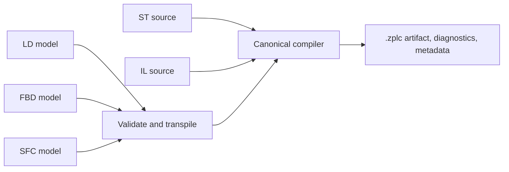

# Compiler Workflow

ZPLC uses a canonical compiler path for source and supported visual models.

## Quick path

1. Compile the folder-backed project.
2. Read diagnostics and the produced artifact identity.
3. Run temporal tests and native POSIX simulation against that artifact.
4. Only then consider the separate human hardware flow.

## Pipeline

## What the compiler accepts

All languages share one backend, but each accepts only the constructs its editor,
transpiler, and compiler support. The languages do not have identical features
or identical debugging behavior. Check the compiler output and a scenario result
for your own project.

## Artifact boundary

The artifact is verified before runtime loading. A successful host compile does
not prove a board can flash, restore, meet timing, or drive an output. Those
need a run on that board; see [deployment](./deployment.md).
