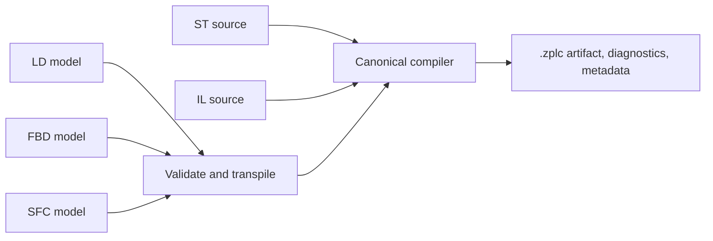

# Compiler Workflow

ZPLC uses a canonical compiler path for source and supported visual models.

## Quick path

1. Compile the folder-backed project.
2. Read diagnostics and the produced artifact identity.
3. Run temporal tests and native POSIX simulation against that artifact.
4. Only then consider the separate human hardware flow.

## Pipeline

## What the compiler accepts

All languages share one backend, but each accepts only the constructs its editor,
transpiler, and compiler support. The languages do not have identical features
or identical debugging behavior. Check the compiler output and a scenario result
for your own project.

## Debug map

The compiler writes a debug map beside the artifact. Two builds of the same
project give the same bytecode and the same map, byte for byte: the map carries
no build time, and `compilerVersion` is the version of the compiler package.
Each statement has the range of all the instructions it generates, with its line
and column, so any program counter inside a statement resolves to that
statement. The end of a function and the helper routines after the cycle belong
to no statement.

## Assembler operands and directives

The code generator writes assembly text and the assembler turns it into the
bytecode of the artifact. An operand has to fit its field. A value that does not
is an error that names the line and the field; the assembler never truncates it.

| Field | Opcodes | Accepted values |
|---|---|---|
| 8, 16 or 32-bit immediate | `PUSH8`, `PICK`, `PUSH16`, `PUSH32` | from -2^(n-1) to 2^n - 1: written signed or unsigned, the VM sign-extends it |
| 16-bit memory address | `LOAD8` to `STORE64` | 0 to 65535 |
| 16-bit code address | `JMP`, `JZ`, `JNZ`, `CALL` | an instruction of the code, 0 to 65535 |
| signed 8-bit offset | `JR`, `JRZ`, `JRNZ` | -128 to 127 from the next instruction |
| 32-bit kind | `COMM_EXEC`, `COMM_STATUS`, `COMM_RESET` | 0 to 4294967295 |

A jump to a label after the last instruction, to a numeric target outside the
code, or to a label further than 127 bytes with a relative jump is an error. So
is an entry point, a tag field or a relocated address that does not fit its
field: `relocateBytecode` leaves the bytecode unchanged when one address would
pass 65535.

| Directive | Effect on the output |
|---|---|
| `.ORG addr` | The next byte is at `addr`; the gap is filled with `NOP` bytes. Moving backwards is an error. |
| `.ENTRY label` or `.ENTRY addr` | Sets the entry point of the file; it has to be an instruction of the code. |
| `.DB v, v, ...` and `.BYTE` | Emits each value, from -128 to 255, as one byte at this place. A label after it is past the bytes. The loader verifies the code segment as instructions, so the bytes must decode as such. |
| `.TAG addr type id value` | Adds a variable tag to the TAGS segment; the four numbers have to fit 16, 8, 8 and 32 bits. |

## Artifact boundary

The artifact is verified before runtime loading. A successful host compile does
not prove a board can flash, restore, meet timing, or drive an output. Those
need a run on that board; see [deployment](./deployment.md).
