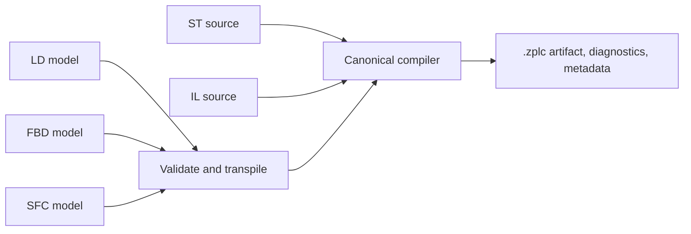

# Compiler Workflow

ZPLC uses a canonical compiler path for source and supported visual models.

## Quick path

1. Compile the folder-backed project.
2. Read diagnostics and the produced artifact identity.
3. Run temporal tests and native POSIX simulation against that artifact.
4. Only then consider the separate human hardware flow.

## Pipeline



## What the compiler accepts

All languages share one backend, but each accepts only the constructs its editor,
transpiler, and compiler support. The languages do not have identical features
or identical debugging behavior. Check the compiler output and a scenario result
for your own project.

## Debug map

The compiler writes a debug map beside the artifact. Two builds of the same
project give the same bytecode and the same map, byte for byte: the map carries
no build time, and `compilerVersion` is the version of the compiler package.
Each statement has the range of all the instructions it generates, with its line
and column, so any program counter inside a statement resolves to that
statement. The end of a function and the helper routines after the cycle belong
to no statement.

## Errors

An error stops the build and produces no artifact. A build reports every
independent error of the sources it read, each with its **code**, its message and
its position: the line and column where it starts and where it ends, and the
file. The code names the kind of problem (`UNKNOWN_IDENTIFIER`,
`TYPE_MISMATCH`, `WORK_MEMORY_EXCEEDED`) and does not change when the message is
reworded, so a script or a person can search for it:
[Diagnostic codes](../reference/diagnostic-codes.md) lists every code with a
program that provokes it.

The command line prints the code at the end of the line, in brackets:

```text
src/Motor.st:12:5: Unknown identifier 'Speed' [UNKNOWN_IDENTIFIER]
```

A program that does not fit the memory of the target says how much it needs, how
much the target has and what takes the most, for the work memory, the retentive
memory and the code:

```text
CODE exceeds the target memory profile: 46012 bytes required, 45056 bytes available (the code memory of the target profile). Largest consumers: Program Main (41000 bytes), Function Scale (3100 bytes), Helper: byte copy (900 bytes)
```

## Warnings

A build that succeeds can still tell the author what deserves a look. Every
warning has a stable code, a position and, in a project, the file it belongs to;
Studio, the CLI (`Warning:`) and the Tool API show the same warnings for the
same project.

| Code | Reported when | Level |
|---|---|---|
| `NON_IEC_HEX_LITERAL` | `0xFF` is written; IEC 61131-3 writes `16#FF` | `default` |
| `NON_IEC_REAL_LITERAL` | a real literal has an exponent and no fraction, `1e3`; IEC writes `1.0E3` | `default` |
| `IMPLICIT_NARROWING` | a value is stored in a narrower type and keeps its low bits (an error under `compiler.strictTypes`) | `default` |
| `UNREACHABLE_STATEMENT` | a statement follows `RETURN`, `EXIT` or `CONTINUE`, or an `IF` or `CASE` with an `ELSE` whose every branch leaves, in the same list: one warning for the rest of the list | `default` |
| `UNUSED_VARIABLE` | a `VAR` or `VAR_TEMP` variable is never read nor written | `default` |
| `WRITE_ONLY_VARIABLE` | a `VAR` or `VAR_TEMP` variable is written and never read | `all` |
| `OPTION_IGNORED` | an option of `zplc.json` has a value that changes nothing | `default` |
| `SOURCE_NOT_COMPILED` | a Structured Text file of the project folder is in neither `src` nor a listed library | `default` |
| `WATCHDOG_RESET_NO_EFFECT` | `WATCHDOG_RESET()` is called: it does nothing, the runtime feeds the hardware watchdog itself after each completed scan | `default` |

A branch that a constant condition disables (`IF FALSE THEN`) is not
unreachable code: IEC 61131-3 defines no rule for it and the compiler evaluates
no condition. The variables that are not checked are the inputs, outputs and
in-out variables of a unit, the globals, the variables with a direct address
(`AT %Q0.0`) and the ones with a communication tag; a function block member that
another unit reads as `instance.member` counts as used.

## Project options

| Option | Values | Default | Effect |
|---|---|---|---|
| `compiler.warnings` | `none`, `default`, `all` | `default` | Which warnings the build reports. `none` reports none, `all` adds `WRITE_ONLY_VARIABLE`. |
| `compiler.strictTypes` | `true`, `false` | `false` | An implicit narrowing is an error at the value, naming both types, instead of the warning `IMPLICIT_NARROWING`. |
| `compiler.debug` | `true`, `false` | `true` | The debug map carries the statement ranges and line mappings that breakpoints and the current line need. With `false` it lists the variables and the memory only; the code is the same. |
| `compiler.optimization` | `none`, `size`, `speed` | `none` | The compiler has one code generator: the code is the same at every value. `size` and `speed` are accepted so that old projects build, and the build warns with `OPTION_IGNORED`. |
| `build.generateDebugInfo` | `true`, `false` | `false` | `zplc-cli compile <workspace> --output <file>` also writes the debug map beside the artifact, as `<file>.map.json`. |
| `libraries` | list of folders | none | Folders of source files compiled with the project, see below. |

A value that is not in the table is a project error that names the option.

## Libraries

`libraries` in `zplc.json` lists folders, relative to the project, whose
source files are compiled with the project: the functions, function blocks,
types and globals they declare are seen by every program, as the ones of `src`
are, and a declaration made in a library and in `src` is an error that names
both files.

```json
{ "libraries": ["lib/motors", "lib/valves"] }
```

A folder is read as `src` is: its files directly, no deeper, and no link is
followed. A task runs programs of `src`; the files of a library declare blocks
and types and run only where a program uses them. `src` itself keeps working as
it did, and a folder that is not listed is not compiled: the build warns with
`SOURCE_NOT_COMPILED` and names each Structured Text file it leaves out. The
debug map names the file of each library block in its `sourceRef`.

## Assembly listing

The compiler turns Structured Text into assembly text and the assembler turns it
into the bytecode. The text stays available for inspection: Studio shows it in
the generated-code dialog, and the CLI gives it with `--emit asm`, printed or
written to `--output`:

```bash
zplc-cli compile <workspace|source-file> --emit asm --output build/main.asm
```

For a workspace the listing holds the code of every program, in the order of the
bytecode, each under a comment that names it. It is a view of the build and not
a source: assembling it gives the bytecode of the artifact, and nothing is proven
by reading it.

## Assembler operands and directives

The code generator writes assembly text and the assembler turns it into the
bytecode of the artifact. An operand has to fit its field. A value that does not
is an error that names the line and the field; the assembler never truncates it.

| Field | Opcodes | Accepted values |
|---|---|---|
| 8, 16 or 32-bit immediate | `PUSH8`, `PICK`, `PUSH16`, `PUSH32` | from -2^(n-1) to 2^n - 1: written signed or unsigned, the VM sign-extends it |
| 16-bit memory address | `LOAD8` to `STORE64` | 0 to 65535 |
| 16-bit code address | `JMP`, `JZ`, `JNZ`, `CALL` | an instruction of the code, 0 to 65535 |
| signed 8-bit offset | `JR`, `JRZ`, `JRNZ` | -128 to 127 from the next instruction |
| 32-bit kind | `COMM_EXEC`, `COMM_STATUS`, `COMM_RESET` | 0 to 4294967295 |

A jump to a label after the last instruction, to a numeric target outside the
code, or to a label further than 127 bytes with a relative jump is an error. So
is an entry point, a tag field or a relocated address that does not fit its
field: `relocateBytecode` leaves the bytecode unchanged when one address would
pass 65535.

The code generator writes only instructions of the generated opcode table: the
type of the lines it emits is built from that table, and every line is checked
when it is written. A line that is not in the table is an internal compiler
error that names it; it never reaches the assembler.

| Directive | Effect on the output |
|---|---|
| `.ORG addr` | The next byte is at `addr`; the gap is filled with `NOP` bytes. Moving backwards is an error. |
| `.ENTRY label` or `.ENTRY addr` | Sets the entry point of the file; it has to be an instruction of the code. |
| `.DB v, v, ...` and `.BYTE` | Emits each value, from -128 to 255, as one byte at this place. A label after it is past the bytes. The loader verifies the code segment as instructions, so the bytes must decode as such. |
| `.TAG addr type id value` | Adds a variable tag to the TAGS segment; the four numbers have to fit 16, 8, 8 and 32 bits. |

## Build identity

An artifact carries a build identity, and the debug map of the same build records
it as `buildId`: the same 8 hexadecimal digits. Studio and the CLI use it when a
map is attached to a program: a map whose identity is not the one of the program
is refused, with both identities, and a program or a map without one is said to
have none rather than matched. The identity is a function of the code and the
task table, so two builds of the same project have the same one. The task table
also records the evaluation-stack depth and the call depth of each task, which the
build checks against the target; see the
[instruction set](../runtime/isa.md#task-depth-and-build-identity).

## Artifact boundary

The artifact is verified before runtime loading. A successful host compile does
not prove a board can flash, restore, meet timing, or drive an output. Those
need a run on that board; see [deployment](./deployment.md).
