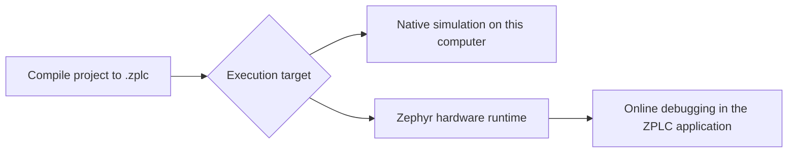

# Integration & Deployment

This page maps the road from a compiled program to a running target, and says what you must do when your hardware is not one of the boards ZPLC already builds.

## Where a program goes

The compiler turns a project into one `.zplc` file. You choose where it runs:

Simulation needs no board. For hardware, flash the runtime once ([Flash the firmware](../guides/flash-firmware.md)), then deploy programs to it from the application ([Deployment](../ide/deployment.md)). The two steps are different operations, and you start both.

## Use a board ZPLC already builds

Seven boards are in the manifest, all at the `cross-build` level: the firmware compiles and fits its budget in continuous integration, and no board has a hardware record. The list, with the build command of each, is in [Boards](../reference/boards.md). To add one, follow [Port ZPLC to a new board](../guides/port-to-a-board.md).

## Embed the runtime in custom firmware

If you make your own hardware, or you do not want the ZPLC application image, embed the core yourself:

1. **Link the core.** Add the ANSI C99 library `firmware/lib/zplc_core` to your CMake build.
2. **Implement the HAL.** Supply the C functions of the [HAL contract](../runtime/hal-contract.md) for your pins and drivers, such as `zplc_hal_tick`, `zplc_hal_gpio_read` and `zplc_hal_gpio_write`.
3. **Start the scheduler.** From your `main()` thread, call `zplc_sched_init()`, load a program with `zplc_sched_load()` and start it with `zplc_sched_start()`. The calls are in the [Runtime API](../reference/runtime-api.md).

The core does not touch hardware except through the HAL, so the port is the HAL. The cross-build of a custom port proves that it compiles. It does not prove its timing or its I/O.

## Check the hardware for the protocols you need

A protocol needs the layer under it on the board:

| Protocol   | The board needs                                           |
| ---------- | --------------------------------------------------------- |
| MQTT       | A Wi-Fi or Ethernet interface in the Zephyr configuration |
| Modbus TCP | An Ethernet or Wi-Fi interface and its sockets            |
| Modbus RTU | A UART with an RS-485 transceiver on the board            |

Each board's network class is in [Boards](../reference/boards.md). What was exercised for each protocol, and at which evidence level, is in [Connectivity](../runtime/connectivity.md).
