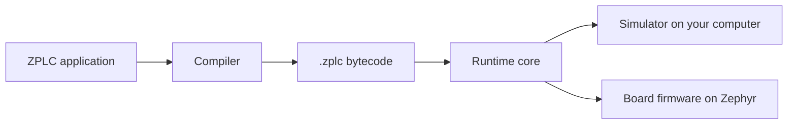

# Platform Overview

This page is the map of ZPLC. It names the four parts, shows the path a program takes, and says what kind of evidence
each part has, so you know what to trust before you read the detailed pages.

## The parts

| Part                                 | What it is                                                                                                                   | Where it lives                                        |
| ------------------------------------ | ---------------------------------------------------------------------------------------------------------------------------- | ----------------------------------------------------- |
| **ZPLC application**                 | The desktop program in which you write, compile, test and simulate. It also holds the Learn course.                          | `packages/zplc-ide/`                                  |
| **Compiler**                         | Turns Structured Text, Instruction List, Ladder, Function Block Diagram and Sequential Function Chart into `.zplc` bytecode. | `packages/zplc-ide/src/compiler/` and the transpilers |
| **Runtime core**                     | A C99 bytecode interpreter with program validation, runtime state and a portable scheduler. The same code runs everywhere.   | `firmware/lib/zplc_core/`                             |
| **Hardware abstraction layer (HAL)** | The small interface that the core uses for clocks, storage, I/O and transports. A port implements it for a platform.         | `firmware/lib/zplc_core/` and the board ports         |

## How a program travels

1. You write the program in the application, in any of the five languages.
2. The compiler checks it and writes one `.zplc` file, with the tasks and the declared safe values of the outputs.
3. The **simulator** loads that file on your computer. It is the same runtime core, built for the host.
4. For a board, you build the firmware, flash it, connect, deploy the `.zplc` file and run it. A person starts each of
   these steps, and AI and MCP tools cannot start any of them.

The loader on the runtime refuses a program that was built for another version of the contract, so you rebuild a program
when you update ZPLC.

## What to trust, and why

ZPLC states the evidence level of every claim. A result at one level never proves a higher one.

| Level                 | What it shows                                                                      |
| --------------------- | ---------------------------------------------------------------------------------- |
| Host                  | The logic is right on your computer, on the simulator's virtual clock.             |
| QEMU and `native_sim` | The runtime and scheduler run on an emulated processor. No board.                  |
| Target build          | The firmware for a board builds and fits its flash and RAM budget (`cross-build`). |
| Bench and manual      | A person ran it on a physical board and recorded it. No board has a record today.  |

[Hardware support](../reference/capabilities-evidence.md) lists the level of every board, and
[Safety and limitations](../safety-and-limitations.md) says what ZPLC is not: not a safety PLC, no timing guarantee, not
for controlling machinery.

## Design rules

- **Bounded memory.** The core uses fixed, declared memory regions, and each board profile sets its own sizes.
- **The HAL is the only door to hardware.** The core never touches a device, so a platform can be tested apart from the logic.
- **Outputs fail safe.** Every output has a safe value, normally off. A stop, a fault or an invalid program never resumes by itself.
- **One scheduler core.** The simulator and the firmware make the same scheduling decisions from the same code.

## Continue with

- [Getting Started](../getting-started/index.md): install ZPLC and run a program.
- [System Architecture](../architecture/index.md): the boundaries in detail.
- [Runtime](../runtime/index.md) and the [scheduler](../runtime/scheduler.md): how a program runs.
