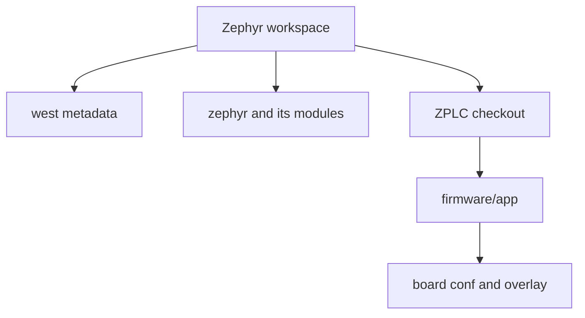

# Zephyr Workspace Setup

This page gets you from a fresh machine to a first firmware build. ZPLC builds on the Zephyr tree that `west.yml` pins, so you need that tree and a toolchain before any board builds.

:::note What a build proves
A finished build proves that the profile compiles and fits its flash and RAM budget. It does not prove that the image flashes, boots, drives a pin, keeps time or keeps a program after a power cut. Every board is at the `cross-build` level today ([Hardware support](./capabilities-evidence.md)).
:::

## What is pinned

`west.yml` names one project, Zephyr, at a fixed commit, and imports the modules Zephyr itself needs. ZPLC is the `self` entry of that manifest, so the checkout is the manifest repository of the workspace.

| Input                              | What it fixes                                           |
| ---------------------------------- | ------------------------------------------------------- |
| `west.yml`                         | The Zephyr revision and the modules it imports          |
| `firmware/app/CMakeLists.txt`      | The application that is built for every board           |
| `firmware/app/boards/boards.json`  | The board manifest: targets, memory sizes, I/O, budget  |
| `tools/firmware-test/setup.sh`     | The script that creates and verifies the workspace      |

## Create the workspace

The script builds the workspace outside the repository, in `~/zplc-zephyr-ws` (set `ZPLC_FW_WS` to put it elsewhere). It makes a Python virtual environment with `west`, links your checkout as the manifest repository and fetches the pinned Zephyr tree. It installs nothing into the Zephyr SDK or the repository, and every step is safe to repeat.

```bash
tools/firmware-test/setup.sh
```

You install the Zephyr SDK yourself. The requirements, the disk space and what the script prints are in [Firmware testing](../development/firmware-testing.md#one-time-setup).



## Build a board

The board page lists the exact build command of every profile. For the Raspberry Pi Pico it is:

```bash
west build -b rpi_pico/rp2040 firmware/app --pristine
```

[Build the firmware from source](../guides/build-firmware.md) shows the repository script that builds a board and checks its budget in one step.

## Flash and recovery

Build, flash, program deploy and run are four separate operations, and you start each. A build says nothing about whether `west flash` or a recovery procedure is safe on your device. Read the board's procedure first: [Flash the firmware](../guides/flash-firmware.md) and [Recovery boundaries](../operations/recovery.md).

## Related pages

- [Boards](./boards.md): the generated list of profiles.
- [Hardware support](./capabilities-evidence.md): what each level means.
