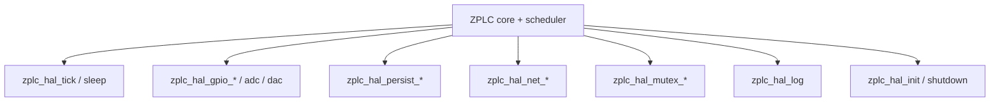
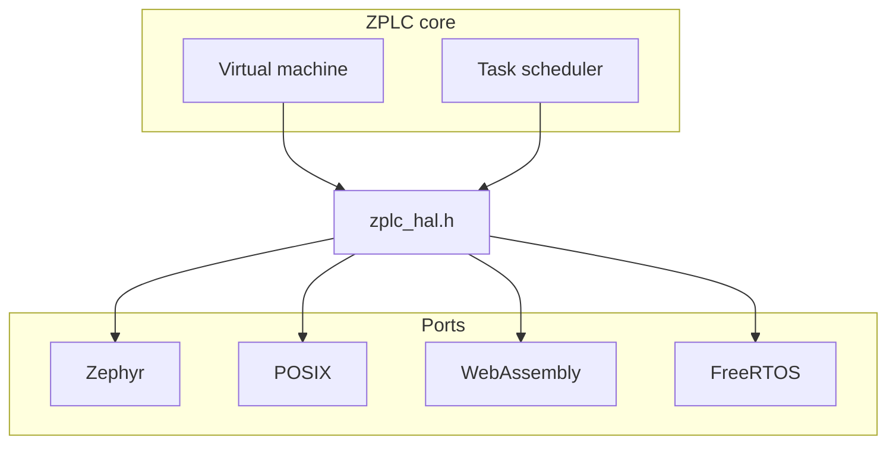

# Hardware Abstraction Layer (HAL) Contract

`firmware/lib/zplc_core/include/zplc_hal.h` is the public contract between the ZPLC core and any concrete platform.

That includes:

- Zephyr targets
- host/POSIX runtimes
- a browser/WebAssembly port (the runtime of the browser simulation, built with ZPLC)
- any future board-specific port

The functions below, the scheduler port and the conformance suite that every port passes are on one generated page:
[Port interface and conformance suite](./port-interface.md).

## Core rule

The portable core must not reach directly into platform APIs.

If a behavior belongs to GPIO, timing, persistence, networking, sockets, or synchronization,
the core should consume it through `zplc_hal_*` instead.

The portable core owns execution semantics. The HAL owns platform integration.

## HAL surface by responsibility



## Timing

- `zplc_hal_tick()` supplies the runtime scheduler clock in milliseconds
- `zplc_hal_sleep()` provides blocking sleep for timing control outside logic execution

This is the contract the scheduler depends on for cycle timing and uptime-driven behavior.

## Digital and analog I/O

The public I/O surface is channel-based:

- `zplc_hal_gpio_read()`
- `zplc_hal_gpio_write()`
- `zplc_hal_adc_read()`
- `zplc_hal_dac_write()`

The core addresses I/O by **logical channel**, not by board pin. Which channels a board has, where each one sits in
the process image and which pin it is, is data: the board I/O description in
`firmware/app/boards/boards.json` (see [Boards](../reference/boards.md)).

### The I/O table

The Zephyr build turns the entry of the board into one constant table, `zplc_io_table()`, with
`firmware/zephyr/scripts/gen_io_table.py`. Each row carries the channel id, the pin name, the byte and bit of the
process image, the kind, the direction, the HAL channel number, the safe value and whether the channel is required.
The scheduler synchronizes the image through the table (`zplc_io_channel_at()`, `zplc_io_read_channel()`,
`zplc_io_write_channel()`), so adding a channel to a board is an edit of the JSON and of the devicetree overlay and
changes no C source.

- The description and the devicetree must agree. The generated file asserts, for every channel, that the devicetree
  has the alias, that the alias is on the described pin and that the pin belongs to the described controller; a
  disagreement stops the build with a message that names the channel.
- Peripherals are configured in `zplc_hal_init()`, before the runtime can enter RUN: every GPIO and every analog
  input of the description, not on the first scan. A required channel that cannot be configured fails the
  initialization.
- Digital outputs are numbered first and then digital inputs; analog inputs have their own numbers, in image order.
- A board that is not in the manifest (`native_sim`, a custom board) uses the default alias profile of
  `firmware/zephyr/io-default.json`: `led0` to `led3` are the outputs, `sw0` to `sw3` the inputs and the converter
  labelled `adc` channels 0 to 4 the analog inputs, each bound when the devicetree has it.
- The POSIX and WebAssembly ports list no channel: the host runtime exchanges the process image with the ZPLC application.
- No port drives an analog output, so no description lists one (`zplc_hal_dac_write()` answers
  `ZPLC_HAL_NOT_IMPL`).
- The image sizes are what the channels need, with `CONFIG_ZPLC_IO_INPUT_IMAGE_BYTES` and
  `CONFIG_ZPLC_IO_OUTPUT_IMAGE_BYTES` to reserve more. The memory behind the images is still the 4 KB of the
  instruction set: shrinking it changes the binary contract and is a separate step.

The firmware reports the identity of its description with `sys io --json` (board id, hash, channel count and
image bytes; a command of its own, so that the keys of `sys info --json` do not change), and the ZPLC application refuses to deploy a program that uses I/O to firmware whose description is not the one it
holds, or to a board that has no channel for what the program touches.

### Not supported

An operation a board cannot perform returns `ZPLC_HAL_NOT_IMPL`; that is the defined "not supported" result.
`ZPLC_HAL_NOT_IMPL` from an optional channel is skipped by the scheduler, from a required channel it is an error, and
a function a port does not implement is a build or test failure, not a silent stub.

## Persistence

The HAL owns persistence through:

- `zplc_hal_persist_save()`
- `zplc_hal_persist_load()`
- `zplc_hal_persist_delete()`

These primitives let the portable core use a backend-independent program store.
They do not provide source-level `RETAIN` allocation, restore, or qualified
end-to-end retention; those declarations are currently unsupported.

## Networking and sockets

The public networking-facing HAL surface includes:

- `zplc_hal_net_init()`
- `zplc_hal_net_get_ip()`

The Zephyr, POSIX, WebAssembly, and FreeRTOS ports each implement these functions. Name resolution and sockets are not part
of the port interface: the application opens its own sockets with per-socket timeouts through the Zephyr resolver
and SNTP. The HAL used to declare a DNS function and four socket functions that nothing called; they were removed
so that every declared function has a caller (IO-007).

## Synchronization

Because the runtime also exposes shared-memory and multitask behavior, the HAL contract includes mutex primitives:

- `zplc_hal_mutex_create()`
- `zplc_hal_mutex_lock()`
- `zplc_hal_mutex_unlock()`
- `zplc_hal_mutex_destroy()`

Those matter when the runtime path needs platform-owned synchronization for safe concurrent access.

## Logging and lifecycle

The public lifecycle endpoints are:

- `zplc_hal_init()`
- `zplc_hal_shutdown()`
- `zplc_hal_log()`

## Checked on every change

`python3 tools/ci/check_hal_contract.py` reads `zplc_hal.h`, the four port sources and the callers. It fails when a
declared function has no implementation on a port, or no caller and no entry in the ledger, and when a ledger entry
is stale. It is a text check: it proves that a definition and a call site exist, not that the code behind them is
right.

## Related pages

- [Runtime Overview](./index.md)
- [Memory Model](./memory-model.md)
- [Connectivity](./connectivity.md)

## The HAL ports

The [HAL contract](./hal-contract.md) says what the portable core asks of a platform.
This page says what each port in the source tree does with it, and what adding a port
takes. The contract is `firmware/lib/zplc_core/include/zplc_hal.h`; the ports are the
four directories below `firmware/lib/zplc_core/src/hal/`.



### The four ports

|                        | Zephyr                                                                                                                                                               | POSIX                                                                                                                          | WebAssembly                                                                                                                                                                                | FreeRTOS                                                                                                                                                                                                    |
| ---------------------- | -------------------------------------------------------------------------------------------------------------------------------------------------------------------- | ------------------------------------------------------------------------------------------------------------------------------ | ------------------------------------------------------------------------------------------------------------------------------------------------------------------------------------------ | ----------------------------------------------------------------------------------------------------------------------------------------------------------------------------------------------------------- |
| Source                 | `zephyr/zplc_hal_zephyr.c`                                                                                                                                           | `posix/zplc_hal_posix.c`                                                                                                       | `wasm/zplc_hal_wasm.c`                                                                                                                                                                     | `freertos/zplc_hal_freertos.c` and `freertos/zplc_persist_freertos.c`                                                                                                                                       |
| Used by                | The firmware of every board                                                                                                                                          | The native simulator, `zplc_runtime`, that the ZPLC application and the command line run programs and scenarios on             | The software runtime of the ZPLC application (`tools/wasm-core` builds it with `clang` and `wasm-ld`), where the native runtime cannot start. See [Software runtime](./browser-runtime.md) | The FreeRTOS port, built by `ZPLC_PORT=freertos` against the FreeRTOS POSIX/GCC simulator and shown there only: the second embedded port that is not Zephyr (decision D-06). No FreeRTOS board is qualified |
| Time                   | `k_uptime_get()`, and `k_msleep()` to sleep                                                                                                                          | `CLOCK_MONOTONIC`; a scenario can replace it with a logical clock (`zplc_hal_posix_set_tick_override`)                         | The page's clock, through the import `zplc_host.clock_ms` (`performance.now()` in ZPLC); the scenario clock of the POSIX port is also here                                                 | The tick of the kernel, 1 kHz, and `vTaskDelay()` to sleep; the scenario clock of the POSIX port is also here. The simulator is not real-time: its tick runs slower than the wall clock under load          |
| Digital and analog I/O | GPIO and ADC drivers, for the channels of the board description in `boards.json`: outputs are numbered first, then inputs. Analog outputs answer `ZPLC_HAL_NOT_IMPL` | None: the functions answer `ZPLC_HAL_NOT_IMPL`, because the host runtime exchanges the process image with the ZPLC application | None: the functions answer `ZPLC_HAL_NOT_IMPL` and the I/O table is empty, as on the POSIX port                                                                                            | A simulated board, `freertos-sim`: eight digital outputs, eight digital inputs and one analog word each way, behind pins that a test writes and reads. A channel past those answers `ZPLC_HAL_NOT_IMPL`     |
| Persistence            | NVS on the `storage_partition` of the board when `CONFIG_NVS` is on, and `ZPLC_HAL_NOT_IMPL` when it is off                                                          | One file `<key>.bin` per key, in `$ZPLC_PERSIST_ROOT` when that variable is set, and in `~/.zplc` otherwise                    | The imports `persist_save`, `persist_load` and `persist_delete` of the page, which keeps the `RETAIN` records in the `build/retain` folder of the open project                             | One file `<key>.bin` per key, written to a temporary name, flushed and renamed, in `$ZPLC_PERSIST_ROOT` or `~/.zplc`: the flash model of the simulator, which a board replaces with its flash driver        |
| Network and sockets    | The Zephyr network stack when `CONFIG_NETWORKING` is on, and `ZPLC_HAL_NOT_IMPL` when it is off                                                                      | `ZPLC_HAL_NOT_IMPL`                                                                                                            | `ZPLC_HAL_NOT_IMPL`                                                                                                                                                                        | `ZPLC_HAL_NOT_IMPL`                                                                                                                                                                                         |

A function that a platform cannot perform returns `ZPLC_HAL_NOT_IMPL`, which is the
defined "not supported" result; it is never left undefined. The pages on the
[contract](./hal-contract.md#digital-and-analog-io) and on the
[supported boards](../reference/boards.md) say which channels a board has and how the
I/O table is generated.

The scan skips a channel whose operation answers `ZPLC_HAL_NOT_IMPL`, so that one missing converter does not stop the controller, and it does not hide it: the runtime counts the input and output channels it could not serve (each channel once) and reports them. The `zplc status` command lists them in `warnings` (`io_unsupported`) with the counts, prints a warning in its text form, and the device link sends a warning on its log events whenever the count changes (and to a client that subscribes later). The ZPLC application shows the line in the console of the connected device. This is verified with C tests on the host and with a test of the application; what a particular board does with a missing converter is not verified on hardware.

### What a Zephyr board sets

The sizes of the program store and of the memories are Kconfig symbols of the module.
A board that has less memory than the defaults sets them in its
`firmware/app/boards/<board>.conf`, and the manifest repeats the same numbers (a
build fails when the two differ):

```ini
# default 8192
CONFIG_ZPLC_WORK_MEMORY_SIZE=8192
# default 4096
CONFIG_ZPLC_RETAIN_MEMORY_SIZE=4096
# default 45056
CONFIG_ZPLC_CODE_SIZE_MAX=24576

# Persistence: NVS needs the flash driver, the partition map and a storage_partition
CONFIG_FLASH=y
CONFIG_FLASH_PAGE_LAYOUT=y
CONFIG_FLASH_MAP=y
CONFIG_NVS=y
```

The board overlay defines `storage_partition` unless the upstream board already does.
The [Kconfig reference](../reference/kconfig.md) lists every symbol with its default
and range.

### Adding a port

1. Add `src/hal/<platform>/zplc_hal_<platform>.c` next to the other ports and define
   every function that `zplc_hal.h` declares. Answer `ZPLC_HAL_NOT_IMPL` for what the
   platform cannot do.
2. Build it with the core: the portable sources are `src/core/*.c`, which must not
   include a platform header (a target of that CMake builds them alone and stops on a
   platform include), and the port is listed in the CMake of
   `firmware/lib/zplc_core` the way the POSIX port is.
3. Add the port to `PORTS` in `tools/ci/check_hal_contract.py` and run it. It fails when a
   declared function has no definition on a port, has no caller outside the ports and
   the tests, or has a stale entry in `tools/ci/hal-contract.json`:

   ```bash
   python3 tools/ci/check_hal_contract.py
   ```

4. Run the core tests (`bun run test:core`), which build the core with the address and
   undefined-behaviour sanitizers. A port that is not the host build runs the conformance
   suite on its own build, as the FreeRTOS port does with `bash tools/freertos/test.sh`.

For a board, and not a platform, see [Port ZPLC to a new board](../guides/port-to-a-board.md).

### What is verified, and what is not

| Part                                                                                               | Verified                                                                                                                                                                     | Level            |
| -------------------------------------------------------------------------------------------------- | ---------------------------------------------------------------------------------------------------------------------------------------------------------------------------- | ---------------- |
| Each port defines every function of the contract, and each function has a caller or a ledger entry | `tools/ci/check_hal_contract.py` in CI                                                                                                                                       | Host             |
| The statements of the table above                                                                  | Read from the four port sources on the date of this page; they are not behind a test of their own                                                                            | None             |
| The FreeRTOS port passes the port conformance suite                                                | `bash tools/freertos/test.sh` on the FreeRTOS POSIX simulator; the `freertos-port` job of CI runs the same commands (the workflow is written, and has not run on GitHub yet) | Host (simulator) |
| A FreeRTOS board behaves as the contract says                                                      | Not applicable: no FreeRTOS board port exists                                                                                                                                | None             |
| A port other than the four behaves as the contract says                                            | Not applicable: no other port exists                                                                                                                                         | None             |
