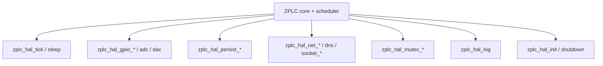

# Hardware Abstraction Layer (HAL) Contract

`firmware/lib/zplc_core/include/zplc_hal.h` is the public contract between the ZPLC core and any concrete platform.

That includes:

- Zephyr targets
- host/POSIX runtimes
- a browser/WebAssembly port (in the source tree, not shipped in this release)
- any future board-specific port

The functions below, the scheduler port and the conformance suite that every port passes are on one generated page:
[Port interface and conformance suite](./port-interface.md).

## Core rule

The portable core must not reach directly into platform APIs.

If a behavior belongs to GPIO, timing, persistence, networking, sockets, or synchronization,
the core should consume it through `zplc_hal_*` instead.

The portable core owns execution semantics. The HAL owns platform integration.

## HAL surface by responsibility

## Timing

- `zplc_hal_tick()` supplies the runtime scheduler clock in milliseconds
- `zplc_hal_sleep()` provides blocking sleep for timing control outside logic execution

This is the contract the scheduler depends on for cycle timing and uptime-driven behavior.

## Digital and analog I/O

The public I/O surface is channel-based:

- `zplc_hal_gpio_read()`
- `zplc_hal_gpio_write()`
- `zplc_hal_adc_read()`
- `zplc_hal_dac_write()`

The core addresses I/O by **logical channel**, not by board pin. Which channels a board has, where each one sits in
the process image and which pin it is, is data: the board I/O description in
`firmware/app/boards/boards.json` (see [Supported Boards](../reference/boards.md)).

### The I/O table

The Zephyr build turns the entry of the board into one constant table, `zplc_io_table()`, with
`firmware/zephyr/scripts/gen_io_table.py`. Each row carries the channel id, the pin name, the byte and bit of the
process image, the kind, the direction, the HAL channel number, the safe value and whether the channel is required.
The scheduler synchronizes the image through the table (`zplc_io_channel_at()`, `zplc_io_read_channel()`,
`zplc_io_write_channel()`), so adding a channel to a board is an edit of the JSON and of the devicetree overlay and
changes no C source.

- The description and the devicetree must agree. The generated file asserts, for every channel, that the devicetree
  has the alias, that the alias is on the described pin and that the pin belongs to the described controller; a
  disagreement stops the build with a message that names the channel.
- Peripherals are configured in `zplc_hal_init()`, before the runtime can enter RUN: every GPIO and every analog
  input of the description, not on the first scan. A required channel that cannot be configured fails the
  initialization.
- Digital outputs are numbered first and then digital inputs; analog inputs have their own numbers, in image order.
- A board that is not in the manifest (`native_sim`, a custom board) uses the default alias profile of
  `firmware/zephyr/io-default.json`: `led0` to `led3` are the outputs, `sw0` to `sw3` the inputs and the converter
  labelled `adc` channels 0 to 4 the analog inputs, each bound when the devicetree has it.
- The POSIX and WebAssembly ports list no channel: the host runtime exchanges the process image with Studio.
- No port drives an analog output, so no description lists one (`zplc_hal_dac_write()` answers
  `ZPLC_HAL_NOT_IMPL`).
- The image sizes are what the channels need, with `CONFIG_ZPLC_IO_INPUT_IMAGE_BYTES` and
  `CONFIG_ZPLC_IO_OUTPUT_IMAGE_BYTES` to reserve more. The memory behind the images is still the 4 KB of the
  instruction set: shrinking it changes the binary contract and is a separate step.

The firmware reports the identity of its description with `sys io --json` (board id, hash, channel count and
image bytes; a command of its own, so that the keys of `sys info --json` do not change), and Studio refuses to deploy a program that uses I/O to firmware whose description is not the one it
holds, or to a board that has no channel for what the program touches.

### Not supported

An operation a board cannot perform returns `ZPLC_HAL_NOT_IMPL`; that is the defined "not supported" result.
`ZPLC_HAL_NOT_IMPL` from an optional channel is skipped by the scheduler, from a required channel it is an error, and
a function a port does not implement is a build or test failure, not a silent stub.

## Persistence

The HAL owns persistence through:

- `zplc_hal_persist_save()`
- `zplc_hal_persist_load()`
- `zplc_hal_persist_delete()`

These primitives let the portable core use a backend-independent program store.
They do not provide source-level `RETAIN` allocation, restore, or qualified
end-to-end retention; those declarations are currently unsupported.

## Networking and sockets

The public networking-facing HAL surface includes:

- `zplc_hal_net_init()`
- `zplc_hal_net_get_ip()`
- `zplc_hal_dns_resolve()`
- `zplc_hal_socket_connect()`
- `zplc_hal_socket_send()`
- `zplc_hal_socket_recv()`
- `zplc_hal_socket_close()`

The Zephyr, POSIX, and WebAssembly ports each implement these functions. Today the application opens its own
sockets with per-socket timeouts and nothing calls `zplc_hal_dns_resolve()` or the four socket functions; the ledger
in `tools/ci/hal-contract.json` lists them with the decision that is pending (whether the HAL carries a timeout and
keeps them, or they leave the contract with the port interface).

## Synchronization

Because the runtime also exposes shared-memory and multitask behavior, the HAL contract includes mutex primitives:

- `zplc_hal_mutex_create()`
- `zplc_hal_mutex_lock()`
- `zplc_hal_mutex_unlock()`
- `zplc_hal_mutex_destroy()`

Those matter when the runtime path needs platform-owned synchronization for safe concurrent access.

## Logging and lifecycle

The public lifecycle endpoints are:

- `zplc_hal_init()`
- `zplc_hal_shutdown()`
- `zplc_hal_log()`

## Checked on every change

`python3 tools/ci/check_hal_contract.py` reads `zplc_hal.h`, the three port sources and the callers. It fails when a
declared function has no implementation on a port, or no caller and no entry in the ledger, and when a ledger entry
is stale. It is a text check: it proves that a definition and a call site exist, not that the code behind them is
right.

## Related pages

- [Runtime Overview](./index.md)
- [Memory Model](./memory-model.md)
- [Connectivity](./connectivity.md)
