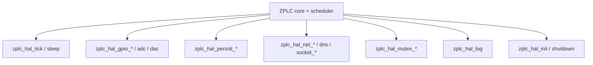

# Hardware Abstraction Layer (HAL) Contract

`firmware/lib/zplc_core/include/zplc_hal.h` is the public contract between the ZPLC core and any concrete platform.

That includes:

- Zephyr targets
- host/POSIX runtimes
- a browser/WebAssembly port (in the source tree, not shipped in this release)
- any future board-specific port

## Core rule

The portable core must not reach directly into platform APIs.

If a behavior belongs to GPIO, timing, persistence, networking, sockets, or synchronization,
the core should consume it through `zplc_hal_*` instead.

The portable core owns execution semantics. The HAL owns platform integration.

## HAL surface by responsibility

## Timing

- `zplc_hal_tick()` supplies the runtime scheduler clock in milliseconds
- `zplc_hal_sleep()` provides blocking sleep for timing control outside logic execution

This is the contract the scheduler depends on for cycle timing and uptime-driven behavior.

## Digital and analog I/O

The current public I/O surface is channel-based:

- `zplc_hal_gpio_read()`
- `zplc_hal_gpio_write()`
- `zplc_hal_adc_read()`
- `zplc_hal_dac_write()`

The core addresses I/O by **logical channel**, not by board pin. The I/O map in the `.zplc` program maps channels to the process image, and the platform port maps channels to hardware.

## Persistence

The HAL owns persistence through:

- `zplc_hal_persist_save()`
- `zplc_hal_persist_load()`
- `zplc_hal_persist_delete()`

These primitives let the portable core use a backend-independent program store.
They do not provide source-level `RETAIN` allocation, restore, or qualified
end-to-end retention; those declarations are currently unsupported.

## Networking and sockets

The public networking-facing HAL surface includes:

- `zplc_hal_net_init()`
- `zplc_hal_net_get_ip()`
- `zplc_hal_dns_resolve()`
- `zplc_hal_socket_connect()`
- `zplc_hal_socket_send()`
- `zplc_hal_socket_recv()`
- `zplc_hal_socket_close()`

The Zephyr, POSIX, and WebAssembly ports each implement these functions.

## Synchronization

Because the runtime also exposes shared-memory and multitask behavior, the HAL contract includes mutex primitives:

- `zplc_hal_mutex_create()`
- `zplc_hal_mutex_lock()`
- `zplc_hal_mutex_unlock()`
- `zplc_hal_mutex_destroy()`

Those matter when the runtime path needs platform-owned synchronization for safe concurrent access.

## Logging and lifecycle

The public lifecycle endpoints are:

- `zplc_hal_init()`
- `zplc_hal_shutdown()`
- `zplc_hal_log()`

## Related pages

- [Runtime Overview](./index.md)
- [Memory Model](./memory-model.md)
- [Connectivity](./connectivity.md)
