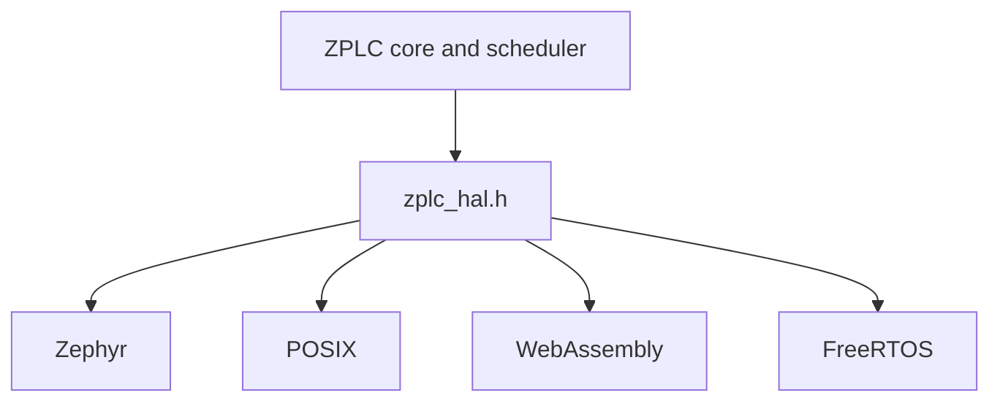

# HAL contract and ports

The hardware abstraction layer (HAL) is the line between the portable core and the platform under it. This page says what the core asks for, what each of the four ports in the source tree does with it, and what you must do to add one. The contract is one header, `firmware/lib/zplc_core/include/zplc_hal.h`. The exact signatures and the conformance suite every port passes are on the generated page [Port interface and conformance suite](./port-interface.md).

## The rule

The portable core must not reach into a platform API. If a behaviour belongs to a pin, a clock, storage, the network or a lock, the core consumes it through `zplc_hal_*`. The core owns what a program means; the HAL owns how the platform provides time, I/O and storage.



## What the core asks for

| Responsibility | Functions | Notes |
| --- | --- | --- |
| Time | `zplc_hal_tick()`, `zplc_hal_sleep()` | The tick is the scheduler clock in milliseconds. Sleep blocks outside program logic. |
| Digital and analog I/O | `zplc_hal_gpio_read()`, `zplc_hal_gpio_write()`, `zplc_hal_adc_read()`, `zplc_hal_dac_write()` | By logical channel, never by board pin. |
| Persistence | `zplc_hal_persist_save()`, `zplc_hal_persist_load()`, `zplc_hal_persist_delete()` | A backend-independent key store under the program store and the RETAIN records. See [persistence](./persistence.md). |
| Network | `zplc_hal_net_init()`, `zplc_hal_net_get_ip()` | Name resolution and sockets are not part of the port: the application opens its own sockets through the Zephyr resolver and SNTP. |
| Synchronisation | `zplc_hal_mutex_create()`, `zplc_hal_mutex_lock()`, `zplc_hal_mutex_unlock()`, `zplc_hal_mutex_destroy()` | Platform-owned locks for the shared process image. |
| Lifecycle and log | `zplc_hal_init()`, `zplc_hal_shutdown()`, `zplc_hal_log()` | |

The header declares 18 functions, and every one has a caller: an earlier DNS function and four socket functions that nothing called were removed.

An operation a platform cannot perform returns `ZPLC_HAL_NOT_IMPL`, the defined result for "not supported". The scheduler skips it from an optional channel, treats it as an error from a required channel, and never accepts a function that a port leaves undefined: that is a build or test failure, not a silent stub.

## How a board describes its I/O

The core addresses I/O by logical channel. Which channels a board has, where each sits in the process image and which pin it is, is data in `firmware/app/boards/boards.json` (see [Boards](../reference/boards.md)).

The Zephyr build turns the entry of the board into one constant table, `zplc_io_table()`, with `firmware/zephyr/scripts/gen_io_table.py`. Each row carries the channel id, the pin name, the byte and bit of the process image, the kind, the direction, the HAL channel number, the safe value and whether the channel is required. The scheduler synchronises the image through the table (`zplc_io_channel_at()`, `zplc_io_read_channel()`, `zplc_io_write_channel()`), so adding a channel to a board edits the JSON and the devicetree overlay and changes no C source.

- **The description and the devicetree must agree.** The generated file asserts, for every channel, that the devicetree has the alias, that the alias is on the described pin and that the pin belongs to the described controller. A disagreement stops the build with a message that names the channel.
- **Peripherals are configured at init.** `zplc_hal_init()` configures every GPIO and analog input of the description before the runtime can enter RUN, not on the first scan. A required channel that cannot be configured fails the initialisation.
- **Numbering.** Digital outputs are numbered first and then digital inputs. Analog inputs have their own numbers, in image order.
- **A board that is not in the manifest** (`native_sim`, a custom board) uses the default alias profile of `firmware/zephyr/io-default.json`: `led0` to `led3` are the outputs, `sw0` to `sw3` the inputs and the converter labelled `adc` channels 0 to 4 the analog inputs, each bound when the devicetree has it.
- **No port drives an analog output**, so no description lists one, and `zplc_hal_dac_write()` answers `ZPLC_HAL_NOT_IMPL`.
- **Image sizes** are what the channels need, and `CONFIG_ZPLC_IO_INPUT_IMAGE_BYTES` and `CONFIG_ZPLC_IO_OUTPUT_IMAGE_BYTES` reserve more. The memory behind the images is still the 4 KB of the instruction set.

The firmware reports the identity of its description with `sys io --json` (board id, hash, channel count and image bytes). The ZPLC application refuses to deploy a program that uses I/O to firmware whose description is not the one it holds, or to a board that has no channel for what the program touches.

## The four ports

The ports are the directories below `firmware/lib/zplc_core/src/hal/`, next to a `common` directory of shared code.

| | Zephyr | POSIX | WebAssembly | FreeRTOS |
| --- | --- | --- | --- | --- |
| Source | `zephyr/zplc_hal_zephyr.c` | `posix/zplc_hal_posix.c` | `wasm/zplc_hal_wasm.c` | `freertos/zplc_hal_freertos.c` and `freertos/zplc_persist_freertos.c` |
| Used by | The firmware of every board | The native simulator, `zplc_runtime`, which the ZPLC application and the command line run programs and scenarios on | The software runtime of the ZPLC application (`tools/wasm-core` builds it with `clang` and `wasm-ld`), where the native runtime cannot start. See [the software runtime](./browser-runtime.md) | The FreeRTOS port, built with `ZPLC_PORT=freertos` against the FreeRTOS POSIX/GCC simulator and shown there only. No FreeRTOS board is qualified |
| Time | `k_uptime_get()`, and `k_msleep()` to sleep | `CLOCK_MONOTONIC`; a scenario can replace it with a logical clock (`zplc_hal_posix_set_tick_override`) | The clock of the page, through the import `zplc_host.clock_ms`; the scenario clock of the POSIX port is also here | The kernel tick, 1 kHz, and `vTaskDelay()` to sleep. The simulator is not real-time: under load its tick runs slower than the wall clock |
| Digital and analog I/O | GPIO and ADC drivers, for the channels of the board description. Analog outputs answer `ZPLC_HAL_NOT_IMPL` | None: the functions answer `ZPLC_HAL_NOT_IMPL`, because the host runtime exchanges the process image with the ZPLC application | None, as on POSIX; the I/O table is empty | A simulated board, `freertos-sim`: eight digital outputs, eight digital inputs and one analog word each way, behind pins that a test writes and reads |
| Persistence | NVS on the `storage_partition` of the board when `CONFIG_NVS` is on, otherwise `ZPLC_HAL_NOT_IMPL` | One file `<key>.bin` per key, in `$ZPLC_PERSIST_ROOT` when set and in `~/.zplc` otherwise | The imports `persist_save`, `persist_load` and `persist_delete` of the page, which keeps the RETAIN records in the `build/retain` folder of the open project | One file `<key>.bin` per key, written to a temporary name, flushed and renamed, in `$ZPLC_PERSIST_ROOT` or `~/.zplc`: the flash model of the simulator |
| Network | The Zephyr network stack when `CONFIG_NETWORKING` is on, otherwise `ZPLC_HAL_NOT_IMPL` | `ZPLC_HAL_NOT_IMPL` | `ZPLC_HAL_NOT_IMPL` | `ZPLC_HAL_NOT_IMPL` |

The scan skips a channel whose operation answers `ZPLC_HAL_NOT_IMPL`, so one missing converter does not stop the controller, and it does not hide it. The runtime counts the input and output channels it could not serve (each channel once) and reports them: `zplc status` lists them in `warnings` as `io_unsupported` with the counts, the device link sends a warning on its log events whenever the count changes, and the ZPLC application shows the line in the console of the connected device. Evidence level: host, with C tests and a test of the application. What a particular board does with a missing converter has not been verified on hardware.

## What a Zephyr board sets

The sizes of the program store and of the memories are Kconfig symbols of the module. A board with less memory than the defaults sets them in its `firmware/app/boards/<board>.conf`, and the manifest repeats the same numbers, so a build fails when the two differ:

```ini
# default 8192
CONFIG_ZPLC_WORK_MEMORY_SIZE=8192
# default 4096
CONFIG_ZPLC_RETAIN_MEMORY_SIZE=4096
# default 45056
CONFIG_ZPLC_CODE_SIZE_MAX=24576

# Persistence: NVS needs the flash driver, the partition map and a storage_partition
CONFIG_FLASH=y
CONFIG_FLASH_PAGE_LAYOUT=y
CONFIG_FLASH_MAP=y
CONFIG_NVS=y
```

The board overlay defines `storage_partition` unless the upstream board already does. The [Kconfig reference](../reference/kconfig.md) lists every symbol with its default and range.

## Adding a port

1. Add `src/hal/<platform>/zplc_hal_<platform>.c` next to the other ports and define every function that `zplc_hal.h` declares. Answer `ZPLC_HAL_NOT_IMPL` for what the platform cannot do.
2. Build it with the core. The portable sources are `src/core/*.c`, which must not include a platform header (a CMake target builds them alone and stops on a platform include), and the port is listed in the CMake of `firmware/lib/zplc_core` the way the POSIX port is.
3. Add the port to `PORTS` in `tools/ci/check_hal_contract.py` and run it:

   ```bash
   python3 tools/ci/check_hal_contract.py
   ```

   It fails when a declared function has no definition on a port, has no caller outside the ports and the tests, or has a stale entry in `tools/ci/hal-contract.json`.
4. Run the core tests (`bun run test:core`), which build the core with the address and undefined-behaviour sanitizers. A port that is not the host build runs the conformance suite on its own build, as the FreeRTOS port does with `bash tools/freertos/test.sh`.

To port ZPLC to a board rather than a platform, see [Port ZPLC to a new board](../guides/port-to-a-board.md).

## What is verified

| Part | Verified | Level |
| --- | --- | --- |
| Each port defines every function of the contract, and each function has a caller or a ledger entry | `tools/ci/check_hal_contract.py` in CI. It is a text check: it proves that a definition and a call site exist, not that the code behind them is right | Host |
| The statements of the port table | Read from the four port sources; they are not behind a test of their own | None |
| The FreeRTOS port passes the port conformance suite | `bash tools/freertos/test.sh` on the FreeRTOS POSIX simulator; the `freertos-port` job of CI runs the same commands, and the workflow has not run on GitHub yet | Host (simulator) |
| A FreeRTOS board, or a port other than these four, behaves as the contract says | Not applicable: no such port exists | None |

## Related pages

- [Runtime overview](./index.md)
- [Memory model](./memory-model.md)
- [Connectivity](./connectivity.md)
