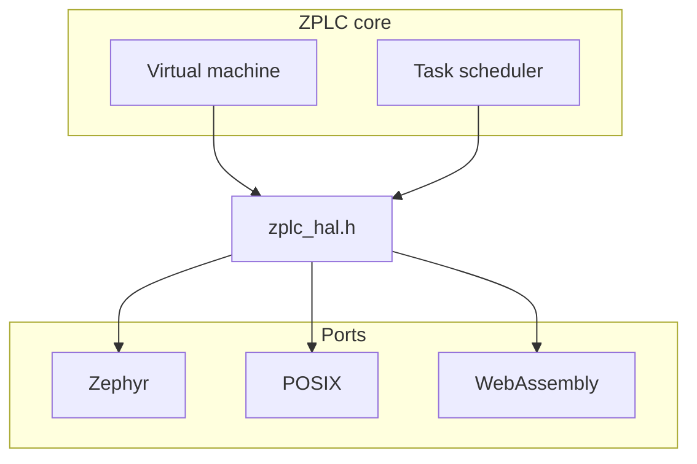

# Hardware Abstraction Layer (HAL): the ports

The [HAL contract](./hal-contract.md) says what the portable core asks of a platform.
This page says what each port in the source tree does with it, and what adding a port
takes. The contract is `firmware/lib/zplc_core/include/zplc_hal.h`; the ports are the
three files below `firmware/lib/zplc_core/src/hal/`.



## The three ports

| | Zephyr | POSIX | WebAssembly |
| --- | --- | --- | --- |
| Source | `zephyr/zplc_hal_zephyr.c` | `posix/zplc_hal_posix.c` | `wasm/zplc_hal_wasm.c` |
| Used by | The firmware of every board | The native simulator, `zplc_runtime`, that Studio and the command line run programs and scenarios on | The browser runtime of Studio (`tools/wasm-core` builds it with `clang` and `wasm-ld`): the web build, and the desktop app where the native runtime cannot start. See [Browser runtime](./browser-runtime.md) |
| Time | `k_uptime_get()`, and `k_msleep()` to sleep | `CLOCK_MONOTONIC`; a scenario can replace it with a logical clock (`zplc_hal_posix_set_tick_override`) | The page's clock, through the import `zplc_host.clock_ms` (`performance.now()` in Studio); the scenario clock of the POSIX port is also here |
| Digital and analog I/O | GPIO and ADC drivers, for the channels of the board description in `boards.json`: outputs are numbered first, then inputs. Analog outputs answer `ZPLC_HAL_NOT_IMPL` | None: the functions answer `ZPLC_HAL_NOT_IMPL`, because the host runtime exchanges the process image with Studio | None: the functions answer `ZPLC_HAL_NOT_IMPL` and the I/O table is empty, as on the POSIX port |
| Persistence | NVS on the `storage_partition` of the board when `CONFIG_NVS` is on, and `ZPLC_HAL_NOT_IMPL` when it is off | One file `<key>.bin` per key, in `$ZPLC_PERSIST_ROOT` when that variable is set, and in `~/.zplc` otherwise | The imports `persist_save`, `persist_load` and `persist_delete` of the page, which keeps the `RETAIN` records in the `build/retain` folder of the open project |
| Network and sockets | The Zephyr network stack when `CONFIG_NETWORKING` is on, and `ZPLC_HAL_NOT_IMPL` when it is off | `ZPLC_HAL_NOT_IMPL` | `ZPLC_HAL_NOT_IMPL` |

A function that a platform cannot perform returns `ZPLC_HAL_NOT_IMPL`, which is the
defined "not supported" result; it is never left undefined. The pages on the
[contract](./hal-contract.md#digital-and-analog-io) and on the
[supported boards](../reference/boards.md) say which channels a board has and how the
I/O table is generated.

## What a Zephyr board sets

The sizes of the program store and of the memories are Kconfig symbols of the module.
A board that has less memory than the defaults sets them in its
`firmware/app/boards/<board>.conf`, and the manifest repeats the same numbers (a
build fails when the two differ):

```ini
# default 8192
CONFIG_ZPLC_WORK_MEMORY_SIZE=8192
# default 4096
CONFIG_ZPLC_RETAIN_MEMORY_SIZE=4096
# default 45056
CONFIG_ZPLC_CODE_SIZE_MAX=24576

# Persistence: NVS needs the flash driver, the partition map and a storage_partition
CONFIG_FLASH=y
CONFIG_FLASH_PAGE_LAYOUT=y
CONFIG_FLASH_MAP=y
CONFIG_NVS=y
```

The board overlay defines `storage_partition` unless the upstream board already does.
The [Kconfig reference](../reference/kconfig.md) lists every symbol with its default
and range.

## Adding a port

1. Add `src/hal/<platform>/zplc_hal_<platform>.c` next to the three ports and define
   every function that `zplc_hal.h` declares. Answer `ZPLC_HAL_NOT_IMPL` for what the
   platform cannot do.
2. Build it with the core: the portable sources are `src/core/*.c`, which must not
   include a platform header (a target of that CMake builds them alone and stops on a
   platform include), and the port is listed in the CMake of
   `firmware/lib/zplc_core` the way the POSIX port is.
3. Add the port to `PORTS` in `tools/ci/check_hal_contract.py` and run it. It fails when a
   declared function has no definition on a port, has no caller outside the ports and
   the tests, or has a stale entry in `tools/ci/hal-contract.json`:

   ```bash
   python3 tools/ci/check_hal_contract.py
   ```

4. Run the core tests (`bun run test:core`), which build the core with the address and
   undefined-behaviour sanitizers.

For a board, and not a platform, see [Port ZPLC to a new board](../guides/port-to-a-board.md).

## What is verified, and what is not

| Part | Verified | Level |
| --- | --- | --- |
| Each port defines every function of the contract, and each function has a caller or a ledger entry | `tools/ci/check_hal_contract.py` in CI | Host |
| The statements of the table above | Read from the three port sources on the date of this page; they are not behind a test of their own | None |
| A port other than the three behaves as the contract says | Not applicable: no other port exists | None |
