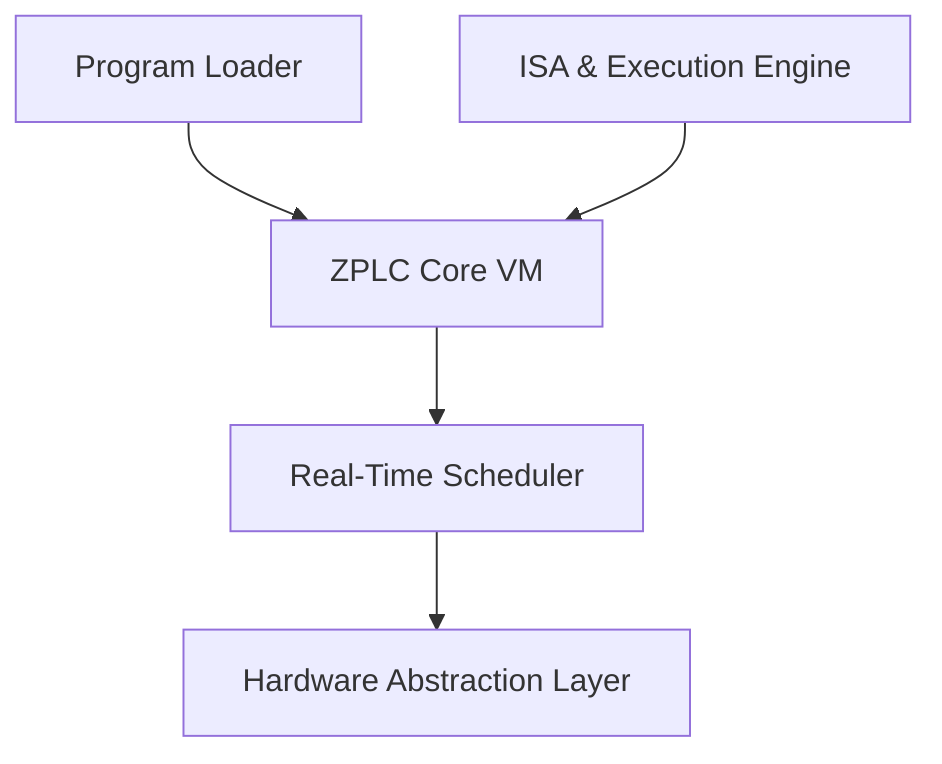

# ZPLC Runtime Engine

The ZPLC internal runtime is the execution core of the platform. Designed specifically for deterministic performance on embedded systems, it safely executes `.zplc` bytecode, manages memory, schedules automation tasks, and integrates with platform-specific hardware.

## Core Responsibilities

The ZPLC runtime provides a comprehensive virtual environment tailored for IEC 61131-3 task execution. Its responsibilities include:

- Loading `.zplc` bytecode programs and their metadata.
- Instantiating Virtual Machines (VMs) with isolated execution contexts.
- Enforcing structural memory boundaries (Process Images, internal Work memory, retained data).
- Scheduling and orchestrating cyclic PLC tasks.
- Yielding physical I/O, networking, and storage operations to the underlying Hardware Abstraction Layer (HAL).

## Subsystem Architecture

## Shared Memory Model

To guarantee both safety and performance in resource-constrained ICs, the ZPLC Runtime Memory Contract defines strict bounds for runtime elements:

- **IPI** (Input Process Image): Isolated memory mapped buffer for safe physical input reading.
- **OPI** (Output Process Image): Buffer mapping logic results to hardware outputs.
- **Work Memory**: Dynamic volatile execution stack allocated during runtime execution.
- **Retain Memory**: Reserved retain address region and HAL persistence primitives; source-level `RETAIN` declarations are currently unsupported.

## Target Portability

By ensuring that the internal runtime delegates bare-metal concerns to a strictly defined HAL, ZPLC easily runs on multiple architectures:

- **Zephyr RTOS**: The primary execution platform for hardware edge controllers. Runs the firmware app natively on bare-metal hardware.
- **Host Native Simulation**: Provides SoftPLC desktop simulation by adapting HAL primitives natively mapping to Windows, macOS, or Linux filesystems and processes.

## Introduction

ZPLC is a portable C99 PLC runtime behind a hardware-abstraction layer (HAL).
The ZPLC application, the native host runtime, and Zephyr profiles use verified `.zplc`
artifacts and the same runtime contracts. It is not a certified safety PLC.

### Quick path

1. Compile the project into a `.zplc` artifact.
2. Verify and load/deploy that artifact. A successful load remains logically
   stopped/READY.
3. Inspect the target and explicitly issue the human `zplc start` command to
   run it.

Firmware build, firmware flash, PLC-program deploy, and RUN/debug are separate
operations. A program load never implies an operational start.

### Runtime surfaces

| Surface                 | Role                                                                  | Evidence boundary                                                                                                                                                                                                     |
| ----------------------- | --------------------------------------------------------------------- | --------------------------------------------------------------------------------------------------------------------------------------------------------------------------------------------------------------------- |
| Core and loader         | C99 VM, ISA, memory model, and `.zplc` verification                   | Host/unit evidence does not qualify hardware behavior.                                                                                                                                                                |
| POSIX native simulation | Headless/local runtime for compile, test, trace, and replay workflows | Host behavior; not target or HIL timing evidence.                                                                                                                                                                     |
| Zephyr profiles         | Firmware runtime and HAL adapters for named board revisions           | Capability and qualification vary by profile.                                                                                                                                                                         |
| WASM                    | Degraded fallback for simulation when the native runtime cannot start | Host evidence; the session, the scheduler core and the retain rules of the native runtime, with no network blocks, no serial, no pins and the timing of the app window. See [Software runtime](./browser-runtime.md). |

### Contracts and references

- [Runtime API](../reference/runtime-api.md) defines the public runtime surface.
- [Persistence](./persistence.md) explains verified program-store behavior and
  its profile limits.
- [Scheduler](./scheduler.md) describes runtime scheduling semantics and
  current evidence boundaries.
- [Source of truth](../reference/source-of-truth.md) identifies canonical
  versions and release contracts.
- [Board reference](../reference/boards.md) lists profiles, capabilities, and
  their evidence tier.

### Safety and evidence boundaries

- Target timing, electrical output behavior, power-cut recovery, and HIL
  results require evidence for the exact board profile.
- The `RETAIN` region and HAL primitives exist, but source-level RETAIN
  declarations are currently rejected and target retention is not qualified.
- Restore publishes the artifact as logically stopped/READY. Output behavior
  before execution is target-profile-specific and requires recorded evidence.
- The runtime does not claim safety-PLC certification.

Use the board reference and the selected profile's recovery procedure before
commissioning or performing a physical operation.
