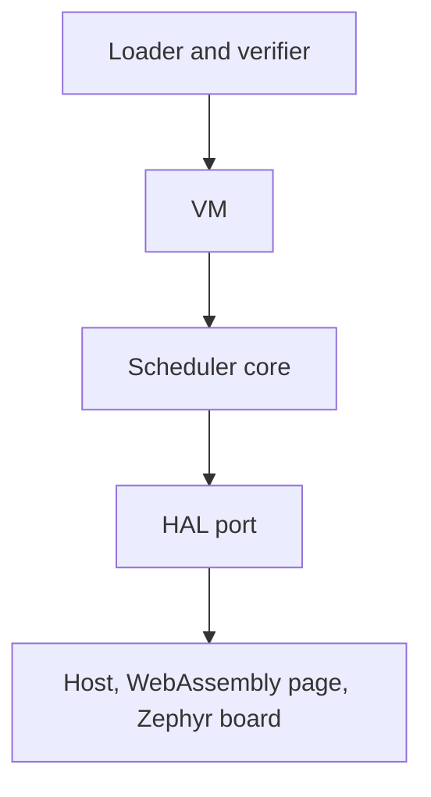

# Runtime overview

The runtime is the part of ZPLC that runs your program: it verifies a compiled `.zplc` artifact, gives it memory, schedules its tasks every cycle and talks to the outside world through the HAL. This page is the map; each part has its own page.

ZPLC is a portable C99 runtime behind a hardware-abstraction layer (HAL). It is not a certified safety PLC, and nothing on these pages says it is.

## What the runtime does

- **Loads and verifies** a `.zplc` artifact. The loader checks the artifact before any instruction runs and refuses code it cannot prove well formed.
- **Gives it memory**: two process images for inputs and outputs, a work region, a retentive region and the code. See the [memory model](./memory-model.md).
- **Runs its tasks**: cyclic tasks, each with an interval and a priority, ordered by one scheduler core. See the [scheduler](./scheduler.md).
- **Keeps what must survive a restart**: the stored program and the `RETAIN` region. See [persistence](./persistence.md).
- **Asks the platform** for time, pins, storage, locks and network through the [HAL](./hal-contract.md), and for nothing else.

## Where it runs

| Runtime | Role | What its results establish |
| --- | --- | --- |
| Native simulation (`zplc_runtime`) | Headless host runtime for compiling, testing, tracing and replaying | Host evidence: the logic, not the timing or the I/O of a board |
| Software runtime (WebAssembly) | Fallback simulation of the ZPLC application when the native runtime cannot start | Host evidence, degraded; see [the software runtime](./browser-runtime.md) |
| Zephyr firmware | One image per board profile, with the HAL adapters of that board | Depends on the profile; see [hardware support](../reference/capabilities-evidence.md) |
| FreeRTOS port | A second embedded port, built against the FreeRTOS POSIX simulator | Host (simulator); no FreeRTOS board is qualified |

## From a build to a running machine

1. **Compile** the project into a `.zplc` artifact.
2. **Load or deploy** it. The loader verifies it, and a successful load leaves the runtime stopped and ready. Loading never starts the machine.
3. **Inspect** the target, then **start** it with an explicit human command, `zplc start` on a device. Nothing starts a program because of a reset or a deploy.

Building firmware, flashing it, deploying a program and running or debugging it are four separate operations, and a deploy never starts the program. See [Safety and limitations](../safety-and-limitations.md).

## The pages of this section

| Page | Read it to know |
| --- | --- |
| [Scheduler](./scheduler.md) | How a scan cycle works, how tasks are ordered, what a missed deadline does, what the outputs do when the program stops |
| [Memory model](./memory-model.md) | The five regions, what a task shares and what it owns, how a thread outside the scan reaches the data |
| [Persistence](./persistence.md) | What is stored, what a restart restores, the flash-wear budget of each board |
| [HAL contract](./hal-contract.md) | What the core asks of a platform, and what each of the four ports does with it |
| [Software runtime](./browser-runtime.md) | What the WebAssembly simulation shares with the firmware and what it lacks |
| [Standard library](./stdlib.md) | What the built-in functions and function blocks are and where the rules for them live |
| [Runtime API](../reference/runtime-api.md) | The public C surface, generated from the headers |

## What the evidence covers

Host tests, the native simulator, Zephyr suites on `native_sim` and on QEMU and the firmware cross-builds are real evidence, and each page names the one it relies on. Target timing, electrical output behaviour, power-cut recovery and hardware-in-the-loop results need a recorded run on the exact board, and none exists yet. Use the [board reference](../reference/boards.md) and the recovery procedure of the profile you chose before you commission anything or perform a physical operation.
