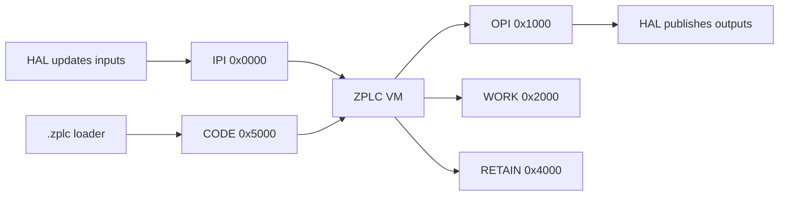

# Runtime ISA

This page describes the contract between the compiler, the loader and the virtual machine: the memory map, the reserved registers, the instruction families and the `.zplc` file. Read it to write a tool that produces or inspects bytecode, or to find out why a program was refused. The single source is `firmware/lib/zplc_core/include/zplc_isa.h`; when the two disagree, the header wins.

## Versions

The header defines `ZPLC_VERSION_MAJOR = 1` and `ZPLC_VERSION_MINOR = 0`. They number the binary contract, not the ZPLC product release. A second number, the draft counter, tracks changes to the contract while it is still moving (see [Draft counter](#draft-counter)).

## Memory map

The VM sees five regions at fixed bases. WORK, RETAIN and CODE take their size from the board configuration; the table gives the defaults of the header.

| Region                     |     Base |                           Size | Canonical source                               |
| -------------------------- | -------: | -----------------------------: | ---------------------------------------------- |
| IPI (Input Process Image)  | `0x0000` |               `0x1000` (4 KiB) | `ZPLC_MEM_IPI_BASE`, `ZPLC_MEM_IPI_SIZE`       |
| OPI (Output Process Image) | `0x1000` |               `0x1000` (4 KiB) | `ZPLC_MEM_OPI_BASE`, `ZPLC_MEM_OPI_SIZE`       |
| WORK                       | `0x2000` | configurable, default `0x2000` | `ZPLC_MEM_WORK_BASE`, `ZPLC_MEM_WORK_SIZE`     |
| RETAIN                     | `0x4000` | configurable, default `0x1000` | `ZPLC_MEM_RETAIN_BASE`, `ZPLC_MEM_RETAIN_SIZE` |
| CODE                       | `0x5000` | configurable, default `0xB000` | `ZPLC_MEM_CODE_BASE`, `ZPLC_MEM_CODE_SIZE`     |

A cycle reads the input image, runs the program and writes the output image. [Memory Model](./memory-model.md) explains how variables are placed in these regions.

## Reserved system registers

The runtime owns the last 16 bytes of the input image, `0x0FF0` to `0x0FFF`. The runtime rewrites them before each cycle, so a program reads them and gains nothing by writing them.

| Register              |  Address | Purpose                                   |
| --------------------- | -------: | ----------------------------------------- |
| `ZPLC_SYS_CYCLE_TIME` | `0x0FF0` | last cycle execution time in microseconds |
| `ZPLC_SYS_UPTIME`     | `0x0FF4` | system uptime in milliseconds             |
| `ZPLC_SYS_TASK_ID`    | `0x0FF8` | current task identifier                   |
| `ZPLC_SYS_FLAGS`      | `0x0FF9` | runtime state flags                       |

The byte at `ZPLC_SYS_FLAGS` combines these bits:

- `ZPLC_SYS_FLAG_FIRST_SCAN` (`0x01`) is set during the first cycle.
- `ZPLC_SYS_FLAG_WDG_WARN` (`0x02`) is reserved. No runtime sets it today.
- `ZPLC_SYS_FLAG_RUNNING` (`0x04`) is set while the program runs.

:::note
`ZPLC_SYS_FLAG_WDG_WARN` is not evidence of a watchdog, a timing monitor or a safe-state mechanism. The instruction budget of the VM is a different thing: a logical bound on one cycle, not a time limit.
:::

## Opcode families

The opcodes of `zplc_opcode_t` fall into the families below. For the exact stack effect of each opcode, use the [Runtime API](../reference/runtime-api.md) table.

| Family            | Examples                                                                                                                                                                         | Role                                                            |
| ----------------- | -------------------------------------------------------------------------------------------------------------------------------------------------------------------------------- | --------------------------------------------------------------- |
| System            | `OP_NOP`, `OP_HALT`, `OP_BREAK`, `OP_GET_TICKS`                                                                                                                                  | basic control and debugging                                     |
| Stack             | `OP_DUP`, `OP_DROP`, `OP_SWAP`, `OP_OVER`, `OP_ROT`                                                                                                                              | stack manipulation                                              |
| Indirect access   | `OP_LOADI8`, `OP_LOADI16`, `OP_LOADI32`, `OP_STOREI8`, `OP_STOREI16`, `OP_STOREI32`                                                                                              | computed addressing                                             |
| Strings           | `OP_STRLEN`, `OP_STRCPY`, `OP_STRCAT`, `OP_STRCMP`, `OP_STRCLR`                                                                                                                  | safe `STRING` operations                                        |
| Arithmetic        | `OP_ADD`, `OP_SUB`, `OP_MUL`, `OP_DIV`, `OP_MOD`                                                                                                                                 | integer and floating-point math                                 |
| 64-bit integer    | `OP_MUL64`, `OP_DIVS64`, `OP_DIVU64`, `OP_MODS64`, `OP_MODU64`, `OP_NEG64`, `OP_ABS64`, `OP_SHL64`, `OP_SHR64`, `OP_SAR64`                                                       | `LINT`, `ULINT` and `LWORD` operations that have no 32-bit form |
| Double precision  | `OP_ADDD`, `OP_SUBD`, `OP_MULD`, `OP_DIVD`, `OP_NEGD`, `OP_ABSD`, `OP_SQRTD`, `OP_RNDD`                                                                                          | `LREAL` arithmetic                                              |
| Logical / bitwise | `OP_AND`, `OP_OR`, `OP_XOR`, `OP_NOT`, `OP_SHL`, `OP_SHR`, `OP_SAR`                                                                                                              | boolean and bit operations                                      |
| Comparison        | `OP_EQ`, `OP_NE`, `OP_LT`, `OP_LE`, `OP_GT`, `OP_GE`, `OP_LTU`, `OP_GTU`                                                                                                         | control decisions                                               |
| Double comparison | `OP_EQD`, `OP_NED`, `OP_LTD`, `OP_LED`, `OP_GTD`, `OP_GED`                                                                                                                       | `LREAL` control decisions                                       |
| Jumps / calls     | `OP_JMP`, `OP_JZ`, `OP_JNZ`, `OP_CALL`, `OP_RET`, `OP_JR`, `OP_JRZ`, `OP_JRNZ`                                                                                                   | execution flow                                                  |
| Conversion        | `OP_I2F`, `OP_F2I`, `OP_I2B`, `OP_EXT8`, `OP_EXT16`, `OP_ZEXT8`, `OP_ZEXT16`, `OP_F2D`, `OP_D2F`, `OP_I2D`, `OP_D2I`, `OP_L2D`, `OP_D2L`, `OP_U2D`, `OP_D2U`, `OP_L2F`, `OP_U2F` | type adaptation, including `LREAL` and the 64-bit integers      |
| Communication     | `OP_COMM_EXEC`, `OP_COMM_STATUS`, `OP_COMM_RESET`                                                                                                                                | communication FB execution                                      |

The top two bits of an opcode fix the size of its operand:

- `0x00-0x3F`: no operand.
- `0x40-0x7F`: an 8-bit operand.
- `0x80-0xBF`: a 16-bit operand.
- `0xC0-0xFF`: a 32-bit operand.

`OP_RET` and the opcodes from `OP_I2F` (`0xA0`) to `OP_GED` (`0xBE`) are the exception: they lie in the 16-bit range but take no operand.

An indirect access (`OP_LOADI*`, `OP_STOREI*`) to an address that no data region contains ends the cycle with `ZPLC_VM_OUT_OF_BOUNDS`, the memory access violation. `0xFFFF` and every address of the CODE region are in that case. The compiler relies on it: a `REF_TO` variable starts as `0xFFFF`, so dereferencing a null reference faults, and a run-time array index outside the bounds reads from the CODE base address and faults the same way. A host test pins this behaviour.

## Two-word values: 64-bit integers and `LREAL`

The evaluation stack holds 32-bit words, so a `LINT`, `ULINT`, `LWORD` or `LREAL` takes two. The low word sits deeper and the high word on top, which is how `OP_LOAD64` leaves them and `OP_STORE64` takes them. An `LREAL` is the IEEE 754 binary64 bit pattern in those two words.

The loader proves the stack depth of every path from the stack effects in the [Runtime API](../reference/runtime-api.md) table, so a program that applies one of these opcodes to too few words is refused with `ZPLC_LOADER_ERR_STACK`. All of them are part of the C core: every runtime has them.

The VM computes each double-precision result in integer arithmetic. The result therefore does not depend on the C library, on hardware floating point or on x87 extended precision, and it is the same bit pattern on the 64-bit host, on a 32-bit build and on every target. The results the VM defines:

| Operation                                        | Operands                  | Result                                                                                       |
| ------------------------------------------------ | ------------------------- | -------------------------------------------------------------------------------------------- |
| `OP_MUL64`                                       | any                       | the low 64 bits of the product (it wraps)                                                    |
| `OP_DIVS64`                                      | divisor `0`               | fault `ZPLC_VM_DIV_BY_ZERO`                                                                  |
|                                                  | `INT64_MIN / -1`          | `INT64_MIN`                                                                                  |
|                                                  | otherwise                 | the quotient truncated toward zero                                                           |
| `OP_MODS64`                                      | divisor `0`               | fault `ZPLC_VM_DIV_BY_ZERO`                                                                  |
|                                                  | divisor `-1`              | `0`                                                                                          |
|                                                  | otherwise                 | the remainder, with the sign of the dividend                                                 |
| `OP_DIVU64`, `OP_MODU64`                         | divisor `0`               | fault `ZPLC_VM_DIV_BY_ZERO`                                                                  |
|                                                  | otherwise                 | the unsigned quotient or remainder                                                           |
| `OP_NEG64`, `OP_ABS64`                           | `INT64_MIN`               | `INT64_MIN`                                                                                  |
| `OP_SHL64`, `OP_SHR64`                           | count of 64 or more       | `0`                                                                                          |
| `OP_SAR64`                                       | count of 64 or more       | `-1` for a negative value, otherwise `0`                                                     |
| `OP_ADDD`, `OP_SUBD`, `OP_MULD`, `OP_DIVD`       | any                       | the IEEE 754 binary64 result, nearest even; overflow is an infinity and underflow is gradual |
| `OP_DIVD`                                        | divisor `0.0` or `-0.0`   | fault `ZPLC_VM_DIV_BY_ZERO`, whatever the dividend (as `OP_DIVF`)                            |
| `OP_NEGD`, `OP_ABSD`                             | any                       | the sign bit flipped or cleared; a NaN keeps its payload                                     |
| `OP_SQRTD`                                       | `0.0`, `-0.0` or below    | `0.0` (the rule of `SQRT` on a `REAL`)                                                       |
|                                                  | `+Inf`                    | `+Inf`                                                                                       |
|                                                  | otherwise                 | the correctly rounded square root                                                            |
| `OP_RNDD`                                        | any                       | the nearest integral value, an exact half to the even one; `-0.4` is `-0.0`                  |
| `OP_EQD`, `OP_LTD`, `OP_LED`, `OP_GTD`, `OP_GED` | a NaN operand             | false; `-0.0` equals `+0.0`                                                                  |
| `OP_NED`                                         | a NaN operand             | true                                                                                         |
| `OP_F2D`, `OP_D2F`                               | any                       | exact widening; narrowing to nearest even, overflow is an infinity                           |
| `OP_D2I`, `OP_D2L`                               | NaN                       | `0`                                                                                          |
|                                                  | out of range, an infinity | the nearest limit of `INT32` or `INT64`                                                      |
|                                                  | otherwise                 | truncated toward zero                                                                        |
| `OP_D2U`                                         | NaN, or below `1.0`       | `0`                                                                                          |
|                                                  | `2^64` or more            | `UINT64_MAX`                                                                                 |
|                                                  | otherwise                 | truncated toward zero                                                                        |
| `OP_I2D`, `OP_L2D`, `OP_U2D`, `OP_L2F`, `OP_U2F` | any                       | one rounding, to nearest even                                                                |

Every NaN that a double-precision operation produces is the quiet NaN `0x7FF8000000000000` (`0x7FC00000` as a `REAL`), so two platforms never differ in the payload.

A shift count is read as one unsigned 32-bit word, so a negative count counts as 64 or more. The language conversions round to the nearest integer (`LREAL_TO_DINT(2.5) = 2`) with `OP_RNDD` followed by a truncating conversion, the same way the `REAL` conversions do.

## Draft counter

Until the contract is frozen, header word 28 of every `.zplc` artifact holds `ZPLC_DRAFT_COUNTER`, and the loader refuses an artifact that carries another value, reporting both numbers. Any change to an opcode, a layout or a size raises the counter.

The counter is **6** today. The history, newest first:

- 6: the declared safe values (the `ZPLC_SEG_SAFE` segment).
- 5: the layout of the strings of the communication blocks.
- 4: the call depth of a task and the build identity.
- 3: the 64-bit and double-precision opcodes.

A program built before a bump is refused and must be rebuilt. To move the artifacts committed to the repository to the current counter, run `tools/contract/restamp_artifacts.py`.

## Shared limits and types

The header publishes the limits that the toolchain and the runtime share:

- `ZPLC_STACK_MAX_DEPTH` for the evaluation stack (256 unless the board configuration changes it).
- `ZPLC_CALL_STACK_MAX` for the call stack (32 unless changed).
- `ZPLC_MAX_BREAKPOINTS` for the debugger (16 unless changed).
- The IEC type identifiers: `ZPLC_TYPE_BOOL`, `ZPLC_TYPE_INT`, `ZPLC_TYPE_DINT`, `ZPLC_TYPE_REAL`, `ZPLC_TYPE_TIME`, `ZPLC_TYPE_STRING` and the others.

A `STRING` has a fixed layout: the current length at offset `0`, the capacity at offset `2` and the character data from offset `4`.

## The `.zplc` file

The file is built from packed structures declared in the same header:

- `zplc_file_header_t`
- `zplc_segment_entry_t`
- `zplc_task_def_t`
- `zplc_iomap_entry_t`
- `zplc_tag_entry_t`
- `zplc_build_info_t`
- `zplc_safe_entry_t`

The segments it can carry:

- `ZPLC_SEG_CODE`
- `ZPLC_SEG_DATA`
- `ZPLC_SEG_BSS`
- `ZPLC_SEG_RETAIN`
- `ZPLC_SEG_IOMAP`
- `ZPLC_SEG_SYMTAB`
- `ZPLC_SEG_DEBUG`
- `ZPLC_SEG_TASK`
- `ZPLC_SEG_TAGS`
- `ZPLC_SEG_BUILD`
- `ZPLC_SEG_SAFE`

## Task depth and build identity

The compiler measures what the loader will verify and records it in the artifact.

- A task definition carries `stack_size`, the most values the task holds on the evaluation stack at once, and `call_depth`, the most call frames it has active at once, its own body included. A task that calls nothing has a call depth of 1; 0 means the artifact does not declare it.
- The loader refuses a task that needs more than it declares, and a task whose call depth exceeds the call stack of the VM plus its own body.
- The compiler fails the build when a task needs a stack deeper than `ZPLC_VERIFY_MAX_DEPTH` (127) or deeper than the target holds, or nests calls deeper than `ZPLC_CALL_STACK_MAX`.
- The `ZPLC_SEG_BUILD` segment holds one 32-bit value, the build identity: the CRC-32 of the CODE segment followed by the TASK segment as written, never 0. The debug map of the same build records it as `buildId`, in 8 hexadecimal digits, so a tool can tell that a map does not belong to the program that is running. An artifact without the segment reads as not identified.

## Declared safe values

While the program does not control an output (STOP, a pause, a latched fault, the boot, a deploy in progress), the output is off unless the project declares another value for it. The declaration travels inside the artifact, in the `ZPLC_SEG_SAFE` segment, so a program and its safe state are one unit: a device that restores the program restores its declaration, and an interrupted deploy cannot leave one build's program with another build's safe values.

- Each entry is a `zplc_safe_entry_t` of `ZPLC_SAFE_ENTRY_SIZE` (4) bytes: the byte `offset` of the output in the output image, the `bit` (0 to 7) and the `value` (0 or 1).
- The loader refuses the artifact with `ZPLC_LOADER_ERR_SAFE` when the segment is not a whole number of entries, an entry names a bit outside the output image or a value other than 0 or 1, an output is declared twice, or there are more than `ZPLC_LOADER_MAX_SAFE` (64) entries. A second `ZPLC_SEG_SAFE` segment is refused as a segment error. An artifact without the segment declares nothing.
- At deploy and at boot restore, the runtime refuses a declaration for an output the board does not have: each entry must name a digital output channel of the board description by its image offset and bit. A program for another board never runs with a safe state that does not exist.
- A declared value replaces the level the board description gives that output in the safe state, in both directions. It is in force from the load that committed the program, before the first cycle.

## Related pages

- [Runtime Overview](./index.md)
- [Memory Model](./memory-model.md)
- [Persistence & Retain Memory](./persistence.md)
- [Runtime API](../reference/runtime-api.md)
- [Native C Runtime](./native-c.md)
