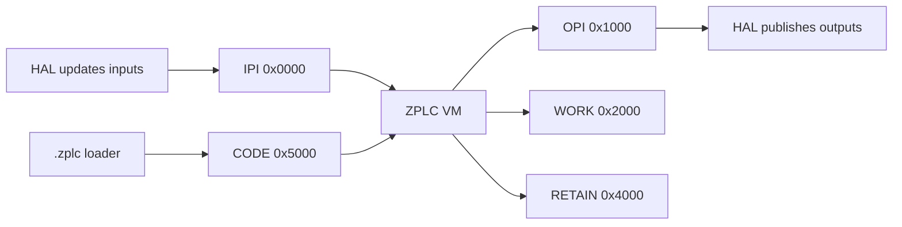

# Runtime ISA

The canonical source for this page is `firmware/lib/zplc_core/include/zplc_isa.h`.

In ZPLC 2.0, that public header defines the binary/ISA contract for:

- the VM memory layout
- reserved system registers
- valid opcode families
- shared type identifiers and limits
- the packed `.zplc` binary format

## What the header versions today

`zplc_isa.h` currently exposes these ISA contract constants:

- `ZPLC_VERSION_MAJOR = 1`
- `ZPLC_VERSION_MINOR = 0`

That is the **binary/ISA contract version**, not the full product marketing version.

## VM memory layout

The ISA reserves five logical regions with public bases and contract-defined sizes:

| Region | Base | Size | Canonical source |
|---|---:|---:|---|
| IPI (Input Process Image) | `0x0000` | `0x1000` (4 KiB) | `ZPLC_MEM_IPI_BASE`, `ZPLC_MEM_IPI_SIZE` |
| OPI (Output Process Image) | `0x1000` | `0x1000` (4 KiB) | `ZPLC_MEM_OPI_BASE`, `ZPLC_MEM_OPI_SIZE` |
| WORK | `0x2000` | configurable, default `0x2000` | `ZPLC_MEM_WORK_BASE`, `ZPLC_MEM_WORK_SIZE` |
| RETAIN | `0x4000` | configurable, default `0x1000` | `ZPLC_MEM_RETAIN_BASE`, `ZPLC_MEM_RETAIN_SIZE` |
| CODE | `0x5000` | configurable, default `0xB000` | `ZPLC_MEM_CODE_BASE`, `ZPLC_MEM_CODE_SIZE` |

## Reserved system registers

The last 16 bytes of IPI (`0x0FF0` through `0x0FFF`) are reserved for scheduler/runtime state.

| Register | Address | Purpose |
|---|---:|---|
| `ZPLC_SYS_CYCLE_TIME` | `0x0FF0` | last cycle execution time in microseconds |
| `ZPLC_SYS_UPTIME` | `0x0FF4` | system uptime in milliseconds |
| `ZPLC_SYS_TASK_ID` | `0x0FF8` | current task identifier |
| `ZPLC_SYS_FLAGS` | `0x0FF9` | runtime state flags |

Public flags defined today:

- `ZPLC_SYS_FLAG_FIRST_SCAN`
- `ZPLC_SYS_FLAG_WDG_WARN` (reserved; current runtimes do not produce it)
- `ZPLC_SYS_FLAG_RUNNING`

`ZPLC_SYS_FLAG_WDG_WARN` is not evidence of a watchdog, timing monitor, or
safe-state mechanism. The runtime's instruction budget is a separate logical
execution bound.

## Opcode families

The public `zplc_opcode_t` enum groups instructions into clear runtime-facing families:

| Family | Examples | Role |
|---|---|---|
| System | `OP_NOP`, `OP_HALT`, `OP_BREAK`, `OP_GET_TICKS` | basic control and debugging |
| Stack | `OP_DUP`, `OP_DROP`, `OP_SWAP`, `OP_OVER`, `OP_ROT` | stack manipulation |
| Indirect access | `OP_LOADI8`, `OP_LOADI16`, `OP_LOADI32`, `OP_STOREI8`, `OP_STOREI16`, `OP_STOREI32` | computed addressing |
| Strings | `OP_STRLEN`, `OP_STRCPY`, `OP_STRCAT`, `OP_STRCMP`, `OP_STRCLR` | safe `STRING` operations |
| Arithmetic | `OP_ADD`, `OP_SUB`, `OP_MUL`, `OP_DIV`, `OP_MOD` | integer and floating-point math |
| 64-bit integer | `OP_MUL64`, `OP_DIVS64`, `OP_DIVU64`, `OP_MODS64`, `OP_MODU64`, `OP_NEG64`, `OP_ABS64`, `OP_SHL64`, `OP_SHR64`, `OP_SAR64` | `LINT`, `ULINT` and `LWORD` operations that have no 32-bit form |
| Double precision | `OP_ADDD`, `OP_SUBD`, `OP_MULD`, `OP_DIVD`, `OP_NEGD`, `OP_ABSD`, `OP_SQRTD`, `OP_RNDD` | `LREAL` arithmetic |
| Logical / bitwise | `OP_AND`, `OP_OR`, `OP_XOR`, `OP_NOT`, `OP_SHL`, `OP_SHR`, `OP_SAR` | boolean and bit operations |
| Comparison | `OP_EQ`, `OP_NE`, `OP_LT`, `OP_LE`, `OP_GT`, `OP_GE`, `OP_LTU`, `OP_GTU` | control decisions |
| Double comparison | `OP_EQD`, `OP_NED`, `OP_LTD`, `OP_LED`, `OP_GTD`, `OP_GED` | `LREAL` control decisions |
| Jumps / calls | `OP_JMP`, `OP_JZ`, `OP_JNZ`, `OP_CALL`, `OP_RET`, `OP_JR`, `OP_JRZ`, `OP_JRNZ` | execution flow |
| Conversion | `OP_I2F`, `OP_F2I`, `OP_I2B`, `OP_EXT8`, `OP_EXT16`, `OP_ZEXT8`, `OP_ZEXT16`, `OP_F2D`, `OP_D2F`, `OP_I2D`, `OP_D2I`, `OP_L2D`, `OP_D2L`, `OP_U2D`, `OP_D2U`, `OP_L2F`, `OP_U2F` | type adaptation, including `LREAL` and the 64-bit integers |
| Communication | `OP_COMM_EXEC`, `OP_COMM_STATUS`, `OP_COMM_RESET` | communication FB execution |

An indirect access (`OP_LOADI*`, `OP_STOREI*`) to an address that no data region
contains, such as `0xFFFF` or any address of the CODE region, ends the scan with
`ZPLC_VM_OUT_OF_BOUNDS` (memory access violation). The compiler relies on that
fault: a `REF_TO` variable starts as `0xFFFF`, so dereferencing a null reference
faults, and a run-time array index outside the bounds loads from the CODE base
address (CMP-023, CMP-024). A host test pins the behaviour.

The ISA also fixes operand width by opcode range:

- `0x00-0x3F`: no operand
- `0x40-0x7F`: 8-bit operand
- `0x80-0xBF`: 16-bit operand
- `0xC0-0xFF`: 32-bit operand

`OP_RET` and the conversion, double-precision and double comparison opcodes from
`OP_I2F` (`0xA0`) to `OP_GED` (`0xBE`) carry no operand although they lie in the
16-bit range.

## Two-word values: 64-bit integers and `LREAL`

The evaluation stack has 32-bit words. A `LINT`, `ULINT`, `LWORD` or `LREAL`
value is two words, the **low word deeper** on the stack and the high word on
top, exactly as `OP_LOAD64` leaves it and `OP_STORE64` takes it. An `LREAL` is
the IEEE 754 binary64 bit pattern in those two words.

The opcodes of the 64-bit and double-precision families are listed, with their
stack effects, in the [Runtime API](../reference/runtime-api.md) table. The loader
proves the stack depth of every path from that table, so a program that uses one
of them with too few words is refused (`ZPLC_LOADER_ERR_STACK`). They are part of
the C core: every runtime has them at once.

The VM computes every double-precision result in integer arithmetic. A result
therefore does not depend on the C library, on hardware floating point or on x87
extended precision, and is the same bit pattern on the 64-bit host, on a 32-bit
build and on every target. The results the VM defines:

| Operation | Operands | Result |
|---|---|---|
| `OP_MUL64` | any | the low 64 bits of the product (it wraps) |
| `OP_DIVS64` | divisor `0` | fault `ZPLC_VM_DIV_BY_ZERO` |
| | `INT64_MIN / -1` | `INT64_MIN` |
| | otherwise | the quotient truncated toward zero |
| `OP_MODS64` | divisor `0` | fault `ZPLC_VM_DIV_BY_ZERO` |
| | divisor `-1` | `0` |
| | otherwise | the remainder, with the sign of the dividend |
| `OP_DIVU64`, `OP_MODU64` | divisor `0` | fault `ZPLC_VM_DIV_BY_ZERO` |
| | otherwise | the unsigned quotient or remainder |
| `OP_NEG64`, `OP_ABS64` | `INT64_MIN` | `INT64_MIN` |
| `OP_SHL64`, `OP_SHR64` | count of 64 or more | `0` |
| `OP_SAR64` | count of 64 or more | `-1` for a negative value, otherwise `0` |
| `OP_ADDD`, `OP_SUBD`, `OP_MULD`, `OP_DIVD` | any | the IEEE 754 binary64 result, nearest even; overflow is an infinity and underflow is gradual |
| `OP_DIVD` | divisor `0.0` or `-0.0` | fault `ZPLC_VM_DIV_BY_ZERO`, whatever the dividend (as `OP_DIVF`) |
| `OP_NEGD`, `OP_ABSD` | any | the sign bit flipped or cleared; a NaN keeps its payload |
| `OP_SQRTD` | `0.0`, `-0.0` or below | `0.0` (the rule of `SQRT` on a `REAL`) |
| | `+Inf` | `+Inf` |
| | otherwise | the correctly rounded square root |
| `OP_RNDD` | any | the nearest integral value, an exact half to the even one; `-0.4` is `-0.0` |
| `OP_EQD`, `OP_LTD`, `OP_LED`, `OP_GTD`, `OP_GED` | a NaN operand | false; `-0.0` equals `+0.0` |
| `OP_NED` | a NaN operand | true |
| `OP_F2D`, `OP_D2F` | any | exact widening; narrowing to nearest even, overflow is an infinity |
| `OP_D2I`, `OP_D2L` | NaN | `0` |
| | out of range, an infinity | the nearest limit of `INT32` or `INT64` |
| | otherwise | truncated toward zero |
| `OP_D2U` | NaN, or below `1.0` | `0` |
| | `2^64` or more | `UINT64_MAX` |
| | otherwise | truncated toward zero |
| `OP_I2D`, `OP_L2D`, `OP_U2D`, `OP_L2F`, `OP_U2F` | any | one rounding, to nearest even |

Every NaN that a double-precision operation produces is the quiet NaN
`0x7FF8000000000000` (`0x7FC00000` as a `REAL`), so two platforms never differ in
the payload.

A count is read as one unsigned 32-bit word, so a negative count is a count of 64
or more. Rounding to the nearest integer for the language conversions
(`LREAL_TO_DINT(2.5) = 2`) is `OP_RNDD` followed by a truncating conversion, as
the `REAL` conversions are.

## Draft counter

Until the contract is frozen (CMP-052), header word 28 of every `.zplc` artifact
holds the draft counter (`ZPLC_DRAFT_COUNTER`) and the loader refuses an artifact
that carries another value, with both numbers. Every change of an opcode, layout
or size increases it. The counter is **6** since the declared safe values (the
`ZPLC_SEG_SAFE` segment): programs built before are refused and must be rebuilt
(it was 5 with the layout of the strings of the communication blocks, 4 with the
call depth of a task and the build identity, and 3 with the 64-bit and
double-precision opcodes). The
`tools/contract/restamp_artifacts.py` tool moves the artifacts committed to the
repository to the current counter.

## Public types and limits

The header also publishes limits that the toolchain and runtime share:

- `ZPLC_STACK_MAX_DEPTH` for the evaluation stack
- `ZPLC_CALL_STACK_MAX` for the call stack
- `ZPLC_MAX_BREAKPOINTS` for debug capacity
- IEC type IDs such as `ZPLC_TYPE_BOOL`, `ZPLC_TYPE_INT`, `ZPLC_TYPE_DINT`, `ZPLC_TYPE_REAL`, `ZPLC_TYPE_TIME`, and `ZPLC_TYPE_STRING`

For `STRING`, the ISA fixes a safe memory layout with:

- current length at offset `0`
- max capacity at offset `2`
- character data at offset `4`

## `.zplc` file contract

The `.zplc` binary format uses packed public structures from the same header:

- `zplc_file_header_t`
- `zplc_segment_entry_t`
- `zplc_task_def_t`
- `zplc_iomap_entry_t`
- `zplc_tag_entry_t`
- `zplc_build_info_t`
- `zplc_safe_entry_t`

Public segment identifiers defined today include:

- `ZPLC_SEG_CODE`
- `ZPLC_SEG_DATA`
- `ZPLC_SEG_BSS`
- `ZPLC_SEG_RETAIN`
- `ZPLC_SEG_IOMAP`
- `ZPLC_SEG_SYMTAB`
- `ZPLC_SEG_DEBUG`
- `ZPLC_SEG_TASK`
- `ZPLC_SEG_TAGS`
- `ZPLC_SEG_BUILD`
- `ZPLC_SEG_SAFE`

## Task depth and build identity

The compiler measures what the loader will prove, and records it in the artifact
(CMP-050, CMP-056):

- `stack_size` of a task definition is the most values the task holds on the
  evaluation stack at once, and `call_depth` the most call frames it has active
  at once, its own body included (1 for a task that calls nothing; 0 means the
  artifact does not declare it). The loader refuses a task that needs more than
  it declares, and a task whose call depth is more than the call stack of the VM
  plus its body. The compiler fails the build when a task needs a stack deeper
  than `ZPLC_VERIFY_MAX_DEPTH` (127) or than the target holds, or calls nested
  deeper than `ZPLC_CALL_STACK_MAX`.
- The `ZPLC_SEG_BUILD` segment holds one 32-bit value, the build identity: the
  CRC-32 of the CODE segment followed by the TASK segment as written, never 0.
  The debug map of the same build records it as `buildId` in 8 hexadecimal
  digits, so that a tool can tell a map that does not belong to the program that
  runs. An artifact without the segment reads as not identified.

## Declared safe values

The state of an output while the program does not control it (STOP, a pause, a
latched fault, the boot, a deploy in progress) is off, unless the project
declares another value for it (RT-023). The declaration travels in the artifact,
in the `ZPLC_SEG_SAFE` segment, so that a program and its safe state are one
unit: a device that restores the program restores its declaration, and an
interrupted deploy cannot leave the program of one build with the safe values of
another.

- Each entry is a `zplc_safe_entry_t` of `ZPLC_SAFE_ENTRY_SIZE` (4) bytes: the
  byte `offset` of the output in the output image, the `bit` (0 to 7) and the
  `value` (0 or 1).
- The loader refuses the artifact with `ZPLC_LOADER_ERR_SAFE` when the segment is
  not whole entries, an entry names a bit outside the output image or a value
  other than 0 or 1, an output is declared twice, or there are more than
  `ZPLC_LOADER_MAX_SAFE` (64) entries; a second `ZPLC_SEG_SAFE` segment is
  refused as a segment error. An artifact without the segment declares nothing.
- The runtime refuses, at deploy and at boot restore, a declaration for an
  output the board does not have (an entry has to name a digital output channel
  of the board description by its image offset and bit). A program of another
  board is not run with a safe state that does not exist.
- A value declared for an output replaces the level the board description gives
  that output in the safe state, in both directions. It is in force from the load
  that committed the program, before the first scan.

## Related pages

- [Runtime Overview](./index.md)
- [Memory Model](./memory-model.md)
- [Persistence & Retain Memory](./persistence.md)
- [Runtime API](../reference/runtime-api.md)
- [Native C Runtime](./native-c.md)
