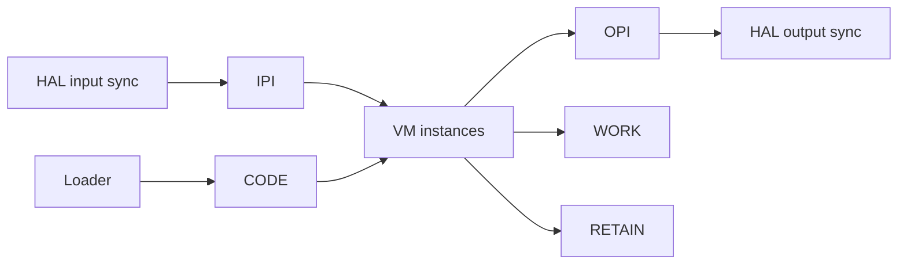

# Memory model

A ZPLC program sees one flat address space split into five regions. This page says what each region is for, what a task shares with the others and what is its own, and where the sizes come from. The public definitions are in `firmware/lib/zplc_core/include/zplc_isa.h` and `firmware/lib/zplc_core/include/zplc_core.h`.

## The five regions

| Region | Base | Role | Size |
| --- | ---: | --- | --- |
| IPI | `0x0000` | Input process image | 4 KB |
| OPI | `0x1000` | Output process image | 4 KB |
| WORK | `0x2000` | Working memory: the variables of the program | 8192 bytes by default |
| RETAIN | `0x4000` | Retentive memory, saved and restored across a restart | 4096 bytes by default |
| CODE | `0x5000` | The loaded bytecode | up to 45056 bytes by default |



The last 16 bytes of IPI are reserved for system data that a program can read: the cycle time (`ZPLC_SYS_CYCLE_TIME`), the uptime, the id of the current task and a flags byte with the first-scan, running and watchdog-warning bits. User data and runtime metadata never share an address.

## What tasks share and what they own

Every task runs in its own VM instance, but the memory is one.

| Shared by all tasks | Private to each VM instance |
| --- | --- |
| IPI and OPI | The program counter, stack pointer and base pointer |
| The WORK and RETAIN address space | The call depth, flags and error state |
| The loaded code | The breakpoint table, the evaluation stack and the call stack |

That split is why several tasks can exchange data through global variables without sharing an execution context. The stack depth (`ZPLC_STACK_MAX_DEPTH`, 256), the call depth (`ZPLC_CALL_STACK_MAX`, 32) and the breakpoint table (`ZPLC_MAX_BREAKPOINTS`, 16) are bounded, so a program cannot grow them.

## Start of a program

A program load is a cold start on every runtime. IPI, OPI, WORK and RETAIN are set to zero and the force table is emptied before the new program is published, so a program never starts on the variables of the one it replaced. A runtime that holds a stored `RETAIN` record restores it afterwards. `zplc_core_cold_start()` is that operation, and `zplc_core_warm_start()` is the same without touching RETAIN, for a restart that keeps the retained values. Neither touches the code region or the tags, which are the program.

## Access from outside the scan {#access-from-outside-the-scan}

While scans run, the scan is the only writer of the process image. A thread outside it, such as the Modbus server and clients, MQTT or the shell debug commands, goes through the exchange (`zplc_exchange.h`):

- **Reads** come from the snapshot of IPI, OPI, WORK and RETAIN that the scan publishes at its commit. A value is whole and from one scan, and a read never waits for a scan.
- **Writes** are queued whole and applied by the scan at the input latch of its next scan, through the force-aware interface of the core: a forced variable keeps its forced value whatever a client writes. While no scan runs (stopped, paused or faulted) there is no latch to wait for, and the write is applied at once.
- **A write that does not fit** the queue (`CONFIG_ZPLC_EXCHANGE_QUEUE_BYTES`, 1024 bytes by default) is refused whole and the caller sees an error. A Modbus TCP client gets exception 6 (server device busy) and may retry.
- **A Modbus tag of two registers** is written one half at a time, so two clients that write the two halves never overwrite each other with a stale value of the other half.

The snapshot is a copy of the four regions, so it costs their total size in RAM: 20 KB with the default sizes.

## How the compiler places variables

The compiler gives the whole project one layout in WORK, and the debug map lists it: each variable with its address and size, under the POU of the file that declares it. The order is the globals, the variables of each function, the variables of the methods, the variables of each program in the order of the tasks, the string literals and the work buffers of the string functions. The last byte of the region of the target profile is the initialization flag.

The memory a program can use is what the target profile has, shared by every program of the project. A project that does not fit is a build error that states the bytes required, the bytes available and the largest consumers. Variables located with `AT %M` sit at `0x2000` plus their offset, and a variable that the compiler would place on top of one is a build error.

## Where the sizes are set

On Zephyr the sizes of the retentive, work and code regions are Kconfig options. These are the defaults from `firmware/zephyr/Kconfig`, and the `prj.conf` of a board can override them:

```kconfig
CONFIG_ZPLC_WORK_MEMORY_SIZE=8192
CONFIG_ZPLC_RETAIN_MEMORY_SIZE=4096
CONFIG_ZPLC_CODE_SIZE_MAX=45056
```

Some boards set smaller values because they have less RAM. The board manifest `firmware/app/boards/boards.json` repeats the numbers, and a build fails when the two differ. See the [Kconfig reference](../reference/kconfig.md) for every symbol with its range, and [persistence](./persistence.md) for how the RETAIN region is saved.
