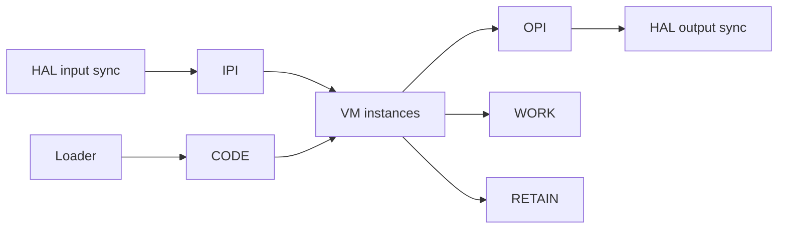

# Memory Model

The public memory contract is defined primarily by:

- `firmware/lib/zplc_core/include/zplc_isa.h`
- `firmware/lib/zplc_core/include/zplc_core.h`

## Logical memory regions

`zplc_isa.h` exposes five logical memory regions:

| Region | Base | Role |
|---|---:|---|
| IPI | `0x0000` | input process image |
| OPI | `0x1000` | output process image |
| WORK | `0x2000` | working memory |
| RETAIN | `0x4000` | retentive memory |
| CODE | `0x5000` | loaded bytecode |



## Shared vs private state

`zplc_core.h` makes a very important split explicit.

### Shared across VM instances

- IPI
- OPI
- work and retain address space
- loaded code segment

### Private per VM instance

- program counter (`pc`)
- stack pointer (`sp`)
- base pointer (`bp`)
- call depth
- flags and error state
- breakpoint table
- evaluation stack
- call stack

That is the architectural reason multitask scheduling can share process data without pretending every task has the same execution context.

## System registers inside IPI

`zplc_isa.h` reserves the last 16 bytes of IPI for system information, including:

- cycle time
- system uptime
- current task id
- runtime flags such as first-scan and scheduler-running state

That means user memory and runtime metadata are not mixed arbitrarily.

## Start of a program

A program load is a cold start on every runtime (RT-016). IPI, OPI, WORK and RETAIN are set to zero and the force
table is emptied before the new program is published, so a program never starts on the variables of the one it
replaced; a runtime that holds a stored `RETAIN` record restores it after that. `zplc_core_cold_start()` is that
operation, and `zplc_core_warm_start()` is the same without touching `RETAIN`, for a restart that keeps the retained
values. The code region and the tags are the program and are not touched by either.

## How the compiler places variables

The compiler gives the whole project one layout in WORK memory, and the debug map lists it: each variable, with its address and size, in the POU of the file that declares it. The order is the globals, the variables of each function, the variables of the methods, the variables of each program in the order of the tasks, the string literals, and the work buffers of the string functions; the last byte of the region of the target profile is the initialization flag. The memory a program can use is what the target profile has, shared by every program of the project, and a project that does not fit is a build error that states the bytes required, the bytes available and the largest consumers. Variables located with `AT %M` are at `0x2000` plus their offset, and a variable that the compiler places on top of one is a build error.

## Bounded memory expectations

The public headers also expose bounded limits such as:

- `ZPLC_STACK_MAX_DEPTH`
- `ZPLC_CALL_STACK_MAX`
- `ZPLC_MAX_BREAKPOINTS`
- configurable work, retain, and code sizes through `CONFIG_*` overrides

On Zephyr the sizes are set with Kconfig options. These are the defaults from `firmware/zephyr/Kconfig`; a board's `prj.conf` can override them:

```kconfig
CONFIG_ZPLC_WORK_MEMORY_SIZE=8192
CONFIG_ZPLC_RETAIN_MEMORY_SIZE=4096
CONFIG_ZPLC_CODE_SIZE_MAX=45056
```
