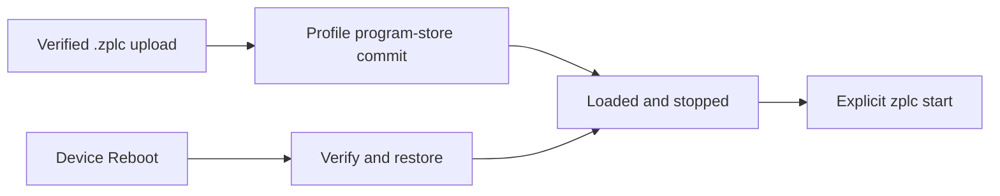

# Persistence & Retain Memory

For profiles with an enabled, operational program-store backend, ZPLC can
commit a verified deployed `.zplc` artifact transactionally. Restore publishes
the artifact as logically stopped/READY. Output behavior before execution is
target-profile-specific and requires recorded evidence. A human must explicitly
issue `zplc start`.

## Platform Backends

The ZPLC runtime core relies on an abstract Hardware Abstraction Layer (HAL) for persistence operations. This allows the system to seamlessly adapt to the storage capabilities of different environments:

| Platform | Storage Backend |
|---|---|
| **Zephyr profile** | Program-store backend when enabled and operational: NVS, or ZMS on a board whose flash sectors are above the 64 KB that NVS accepts (the Nucleo-H743ZI). The `RETAIN` records, the settings keys and the credentials use the same HAL calls. |
| **Native Sim (Desktop)** | Files in the persistence directory (`ZPLC_PERSIST_ROOT`, default `~/.zplc`): the program store and the `RETAIN` records. |
| **WASM simulator** | The records of the retain module (`retain_a0` to `retain_b7`) go through the HAL calls of the module to the host page, which keeps them in the `build/retain` folder of the open project, and in the memory of the page when no project is open. The program store of the session is in memory. See [Browser runtime](./browser-runtime.md). |

## Program Persistence on Hardware

When a profile provides an operational program-store backend, a verified `.zplc`
load can be committed through that backend.



Upon boot, an enabled program store can provide a valid artifact for verification
and logical stopped/READY restore. Output behavior before execution is
target-profile-specific and requires recorded evidence. Deployment is complete
when the verified load completes; it never starts the machine. Start is a
separate, explicit human operation. Target, power-cut, HIL and electrical
evidence remain specific to the exact profile and have not been executed here.

### How the store keeps a program

The store has two slots, A and B, and a small active record that names the slot to run. A slot is the artifact, an
8 byte footer (`ZPE1` and the artifact length) and a 32 byte metadata record; every record carries a CRC-32 and the
format version. The host runtime and the firmware run the same code (`zplc_program_store.c`) over the HAL persistence
calls, so the order of the writes below is the one the host tests exercise.

A deploy writes the slot that is not active, reads it back and verifies it, writes the metadata as prepared and
reads it back, and only then writes the active record: that write is the single point at which the new program
becomes the one to restore. The metadata is then rewritten as committed.

| A power cut ... | What the next restore finds |
|---|---|
| before the active record is written | The previous program. A store that never held one is empty. |
| in the middle of the new payload | The previous program: a slot that is half old and half new fails the CRC-32 of its artifact and is never accepted. |
| after the active record, before the metadata is rewritten | The new program: the slot was read back before the pointer moved. |
| that damages the active record | The newest complete committed slot. |

Records that exist and verify as nothing are never read as an empty store: restore reports them as unverifiable and a
deploy refuses to write over them. A store written by the first firmware (one key, `code_len` and `code`) is
restored as it is and migrated at the next deploy.

A flash key-value store keeps an entry inside one erase sector, so a payload is cut into chunks of
`CONFIG_ZPLC_PROGRAM_STORE_CHUNK_SIZE` bytes (1024 by default), each under its own key. The largest artifact is one
number, `CONFIG_ZPLC_CODE_SIZE_MAX`: it is the code region, the largest artifact the loader accepts, the size of the
staging and restore buffers, the size `zplc sys info` reports (`max_artifact_size`) and the size ZPLC is told for
the board (RT-028). The build fails when two slots of that size, in chunks, do not fit the storage partition. The
Raspberry Pi Pico profile therefore sets 24576 bytes (its 128 KB partition also holds the RETAIN records), the STM32F746G Discovery
profile 16384 and the Arduino Opta WiFi profile 32768 (their RAM), and the ESP32-S3 profile keeps its 8192; the
other profiles keep 45056. The upload staging buffer and the VM each hold one program in RAM, so a profile spends
twice its code size. There is no third, resident copy: the staging buffer keeps the loaded artifact, and `zplc reset`
reloads the program from the store, which holds the same one (an upload in progress is cancelled by a reset).

A deploy has to know, before it writes, that there is a real program to fall back to, which means reading that
program and admitting it, and that needs a buffer of the code size. The store has none of its own: it reads the
rollback into the staging buffer when an upload starts, while that buffer is free (`zplc load`, `zplc sched load`
and the start of a program transfer of the device link), and the commit at the end of the upload goes ahead only
when the active record and the two metadata records are still the ones the answer was read from. The only writer of
those records is a commit, so they are the same unless the upload was overtaken, and then nothing is written. A store
whose records verify as nothing gives no rollback, and the commit refuses as it always did. The payload of the
rollback was admitted when the upload started, not when it ended.

What has been shown: a power cut injected at every operation of a deploy and a torn write at every record, on the
host (`test_program_store`, which also sweeps the deploy the way the firmware makes it, with the rollback found at the
start of the upload), and a power cut at every operation of a deploy of the largest size over the NVS flash
simulator on `native_sim` (`program_store_nvs`), restored into the same buffer the deploy used. What has not: a power cut on a board. The flash driver, the erase time
and the supply behaviour of each profile need the hardware record of that profile (HIL-010).

## Retentive Memory (`RETAIN`)

The compiler accepts `VAR RETAIN` and `VAR_GLOBAL RETAIN`, places those
variables in the retentive region of the process memory (address `0x4000`, 4 KB
by default) and applies their declared initial values only when the region holds
no saved state. The runtime saves that region and restores it when the same
program is loaded again. Everything on this page is host, simulator and
build-level evidence: no board has been measured, and no board has been through
a power cut under test.

### What is saved, and when

| Moment | What happens |
|---|---|
| Program load, and restore at boot | The region is restored from the stored records before the first scan, or initialised to zero when no record matches. The status says which. |
| `STOP` (commanded) | The region is stored with the values of the last complete scan. A stop of a faulted runtime stores nothing. |
| While running | The region is stored at most once per interval, at a scan boundary, and only when it changed since the last stored record. |
| Clean shutdown of the host runtime | Stored like a `STOP`. |
| Reset (`execution.reset`) | A cold restart: the region is initialised and that initialised region is stored, so the old values do not come back. |

On the firmware a periodic save runs on its own work queue, outside the scan, and
holds the memory lock only for the copy of the region, never during the write to
storage. On the host it runs in the main loop between two scans. A power cut
between two saves loses the changes since the last record; that is the reason
for the interval, which the flash budget below bounds from the other side.

### The record

Two records alternate, so a power cut during a save never destroys the last good
one. A save writes the older slot with a sequence number one above the newest.
Every record is cut into chunks of at most `CONFIG_ZPLC_RETAIN_CHUNK_SIZE` bytes
(1024 by default), stored under the keys `retain_a0`, `retain_a1`, ... and
`retain_b0`, ..., because a storage entry can be smaller than the region (NVS on
a 4 KB sector).

| Offset | Size | Field |
|---|---|---|
| 0 | 4 | magic `ZRTN` |
| 4 | 2 | format version, 1 |
| 6 | 2 | reserved, zero |
| 8 | 4 | sequence number, never 0 |
| 12 | 4 | program identity: the CRC32 word of the artifact header |
| 16 | 4 | program identity: the code-size word of the artifact header |
| 20 | 4 | layout hash |
| 24 | 4 | payload length, the size of the `RETAIN` region |
| 28 | n | payload, the region bytes |
| 28+n | 4 | CRC-32 of every byte before it |

The layout hash is a CRC-32 over the region size, the region address, the ISA
version, the contract draft counter and the program identity. A program that
changes by one byte has another identity, so a rebuild discards the retained
values; the runtime has no variable-level layout to carry them across a change.

### What a restart does

The restore takes the valid record with the highest sequence whose identity and
layout match. If a record fails its checksum, the other one is tried. If none
matches, the region is set to zero and the status says why:

| `reason` | Meaning |
|---|---|
| `restored` | A valid record of this program and layout was restored. |
| `none` | No record in either slot: first start, erased storage, or no storage backend. |
| `identity_mismatch` | Valid records exist, written by another program. |
| `layout_mismatch` | The same program, but another region size, address or runtime layout. |
| `corrupt` | Records exist and none passes the format and checksum checks. |
| `io_error` | The storage backend failed on both slots. Saves are refused until a restore reads the backend again. |
| `reset` | A reset command initialised the region. |
| `not_restored` | No program is loaded. |

The status of the native runtime carries this next to the existing fields:

```json
"retain": {"reason": "restored", "restored": true, "sequence": 12, "saves": 3, "save_errors": 0, "saved_at_ms": 94000}
```

`saved_at_ms` is the runtime uptime of the last record written in this session,
or `null` when none was. On the firmware the same values are in
`zplc sched status` and `zplc sched status --json`.

### Host and WASM runtimes

The POSIX host applies the same module and the same rules. Its periodic save
interval is 30 seconds by default and can be set with the environment variable
`ZPLC_RETAIN_SAVE_INTERVAL_MS`: `0` turns periodic saves off (a `STOP` and a
shutdown still store), a value from 100 to 86400000 sets the interval, and any
other value is ignored with a message on standard error. Programs running on the
host simulator therefore keep their `RETAIN` values from one session to the
next, as a controller does; use `execution.reset`, or another persistence
directory, to start from the declared values.

The WASM runtime applies the same module and the same rules: the module is the
one the firmware and the host run, linked into the WebAssembly build, and the
session saves on `STOP`, on `execution.reset` and at shutdown, and restores when
a program loads. What differs is the storage and the interval. The page keeps
the records in the `build/retain` folder of the open project (the files
`retain_a0.bin` to `retain_b7.bin`), and in the memory of the page when no
project is open. The periodic interval is 30 seconds, because a module has no
environment variable to change it. The write to the folder follows the call that
saves, so a page closed between the two can lose that one record, and the
previous one stays valid because two records alternate. [Browser
runtime](./browser-runtime.md) lists the scenarios that hold it to the host's.

### Enabling it on a firmware board

`CONFIG_ZPLC_RETAIN_PERSIST` is off by default. The write path is covered by the `retain_persist` suite
on `native_sim` (both word sizes) and the build-time wear assertion, and no board has been measured: a
flash write can stall instruction fetch on parts that execute from the same flash. Set `CONFIG_ZPLC_RETAIN_PERSIST=y` in the board
file, with the endurance numbers of the next section, once that board has passed its hardware record
(HIL-010). Until then the `RETAIN` region is initialised at every start on firmware and the status has no
`retain` field. The HIL image that record is made on (`-DCONFIG_ZPLC_HIL_IMAGE=y`) turns it on, so that
its power cycle step can measure it; it never ships.

### Flash wear budget per board

Every save of a changed region costs flash erases. The worst case is a region
that changes in every interval. For a board:

- one save writes the record plus the entry overhead of each chunk (about 64
  bytes each, an estimate that covers a 32-byte write block);
- the storage partition takes in the wear bytes of the table per erase of every
  sector: the sectors minus the one NVS keeps free, minus the live data that
  garbage collection copies at every rotation (the two program slots and the
  RETAIN record not being written; on the Pico about 59,000 bytes);
- the flash is rated for a number of erase cycles per sector.

Saves the flash takes = erase cycles x wear bytes / bytes per save. Life =
saves x interval. The build fails when the interval makes that life shorter than
`CONFIG_ZPLC_RETAIN_LIFE_YEARS` (10 by default), so a board cannot ship an
interval its own numbers do not support.

Every number below is an engineering estimate from the datasheet class of the
part and from the partition layout of the board file. No board was measured.

| Board | Storage partition | RETAIN | Rated cycles | Wear bytes | Interval | Estimated worst-case life |
|---|---|---|---|---|---|---|
| Raspberry Pi Pico (RP2040) | 128 KB of the on-board QSPI NOR, 32 sectors of 4 KB | 4 KB | 100,000 | 67,000 | 300 s | 14.3 years |
| Arduino GIGA R1 (STM32H747 M7) | `zplc_nvs_partition`: 7 MB of the external QSPI NOR, 4 KB sectors assumed | 4 KB | 100,000 | 7,300,000 | 60 s | more than 100 years |
| Arduino Opta WiFi (STM32H747 M7) | `zplc_nvs_partition`: 7 MB of the external QSPI NOR, 4 KB sectors assumed | 4 KB | 100,000 | 7,300,000 | 60 s | more than 100 years |
| STM32F746G Discovery | `zplc_nvs_partition`: 15 MB of the external QSPI NOR, 4 KB sub-sectors assumed | 4 KB | 100,000 | 15,700,000 | 60 s | more than 100 years |
| ESP32-S3-DevKitC-1 (N8R8) | `zplc_nvs_partition`: 192 KB of the module SPI NOR at 4 MB, 48 sectors of 4 KB | 1 KB | 100,000 | 184,000 | 60 s | 29.5 years |
| STM32 Nucleo-H743ZI | `zplc_nvs_partition`: 384 KB of the internal flash, 3 sectors of 128 KB, kept by ZMS | 4 KB | 10,000 | 253,000 | 600 s | 10.8 years |
| A board with no numbers | any | any | 10,000 | 40,000 | 3600 s | 10.3 years for 4 KB |

The Pico row is the one to read twice: at 30 seconds, the host default, the same
board would wear its storage out in about 1.4 years. The interval is a minimum:
a region that does not change is never written, so a program whose retained
values change rarely wears the flash far less than this table says.

A `STOP` of a changed region is one more save and is not part of the budget: it
is a person's command. A script that stops and starts the controller every few
seconds, with retained values that change in every run, spends the budget of a
year in days.

### Which store takes which partition

A firmware board has up to two stores in flash: the records of the HAL (the program slots, `RETAIN`, the settings keys
`cfg_00` to `cfg_99` and the credentials) and, on the network boards, the settings file system (LittleFS: the settings
file, the certificate files and, where the Wi-Fi credentials go through the settings, those). Two stores on one
partition overwrite each other, so each one has its own (IO-008). The HAL takes `zplc_nvs_partition` when the board's
devicetree defines it, and `storage_partition` otherwise; the settings file system mounts `storage_partition`. The
build stops when a board that builds the file system has no `zplc_nvs_partition`, or when the two partitions overlap.
A certificate or key setting (`mqtt_ca_cert_path`, `mqtt_client_cert_path`, `mqtt_client_key_path`,
`aws_claim_cert_path`, `aws_claim_key_path`) names a file of the file system or one of the two credential records,
`persist://aws_cert_pem` and `persist://aws_key_pem`. Any other `persist://` name is refused by `zplc config set`, is
not applied when a stored value holds it, and is never read: no setting can hand the program or a key of the device
link to the TLS stack.

| Board | Records of the HAL | Settings file system | Image slot |
|---|---|---|---|
| Raspberry Pi Pico (RP2040) | NVS, `storage_partition`, 128 KB at 0x1e0000 of the on-board QSPI NOR | not built in | `code_partition`, 0x100 to 0x1e0000 |
| Waveshare RP2040-Zero | NVS, `storage_partition`, 128 KB at 0x1e0000 of the on-board QSPI NOR | not built in | `code_partition`, 0x100 to 0x1e0000 |
| ESP32-S3-DevKitC-1 (N8R8) | NVS, `zplc_nvs_partition`, 192 KB at 0x400000 of the module SPI NOR | `storage_partition`, 192 KB at 0x3b0000 | 0 to 0x101c00, the flash budget of the board |
| Arduino GIGA R1 (STM32H747 M7) | NVS, `zplc_nvs_partition`, 7 MB at 0x700000 of the external QSPI NOR | `storage_partition`, 1 MB at 0x600000 of the QSPI NOR | `slot0_partition`, 0x40000 to 0x100000 of the internal flash |
| Arduino Opta WiFi (STM32H747 M7) | NVS, `zplc_nvs_partition`, 7 MB at 0x700000 of the external QSPI NOR | `storage_partition`, 1 MB at 0x600000 of the QSPI NOR | `slot0_partition`, 0x40000 to 0x100000 of the internal flash |
| STM32F746G Discovery | NVS, `zplc_nvs_partition`, 15 MB at 0xa0000 of the external QSPI NOR | `storage_partition`, 640 KB at 0 of the QSPI NOR | 0 to 1 MB, the internal flash |
| STM32 Nucleo-H743ZI | ZMS, `zplc_nvs_partition`, 384 KB at 0x1a0000 of the internal flash (3 sectors of 128 KB) | `storage_partition`, 1152 KB at 0x80000 of the internal flash | `slot0_partition`, 0 to 512 KB |

The addresses are those of the devicetree of each build. `tools/hil/check_storage_partitions.py` reads them from the
`zephyr.dts` and `.config` that `run.sh size` keeps for every board, and fails when two stores share or overlap a
partition, when a store holds fewer than two erase blocks or blocks its backend cannot mount (NVS refuses a sector
above 64 KB), or when a store lies inside the image slot, the flash range the linker may fill with the image. The two
RP2040 boards end their `code_partition` before the records, so the linker refuses an image that would grow into
them. The ESP32-S3 linker does not bound the image (it ignores the load size of Zephyr and runs to the end of the
flash), so its slot is the flash budget of the board, which the size check of the same run fails an image above. All
seven boards pass, and `tools/hil/storage-partitions-open.json`, the list of boards with a known failure, is empty.
CI runs the same check on each cross-build; that step is authored and has not been run here. For the learner boards, a test of the board description also fails when two
stores share a partition (it reads the Kconfig and overlay files of the board). All of this is build-level evidence:
how the flash of each board behaves is the bench of HIL-010, and no board was measured.

Until this release the settings file system never mounted on any board: the mount named the flash device where Zephyr
expects a flash area, failed with `-ENODEV`, and the firmware went on with the defaults. The settings file, the
certificate files and the Wi-Fi credentials kept through the settings were therefore never stored; the settings keys
of the HAL were. At the first start after the update the file system formats `storage_partition`. On the GIGA R1, the
Opta and the STM32F746G the records of the HAL keep the area they had, so a board keeps its stored program, `RETAIN`
values and settings keys; the file system takes the provisioning area of the Arduino IoT Cloud library (`kvs`) on the
two Arduino boards and the second MCUboot image slot on the STM32F746G, neither of which this firmware uses. An
ESP32-S3 that ran an earlier image kept its records in `storage_partition`: after the update the stored program, the
`RETAIN` values and the settings keys of that image are not carried over. A Nucleo-H743ZI never stored any. Deploy the
program again and enter the settings again on those two boards.

### Limits

- Not measured: the endurance numbers above come from the datasheet class of the
  parts, not from a measurement, and the partition layouts of the GIGA, Opta and
  F746G are read from the board description, not from a board.
- Not proven: that a save survives a power cut on any board. The record format
  and the order of the writes are tested with failures injected at every step on
  the host and on `native_sim`, and that is all.
- Not measured: how long a flash write stalls the processor. On parts that run
  code from the same flash a write can hold instruction fetch for the length of
  an erase; the periodic save runs on its own work queue, but whether a scan is
  delayed depends on the flash driver and has not been measured on any board.
- Not proven on a board: that the two stores of a board keep each other's data
  on its flash. Their partitions are separate in every build (a check of the
  build's devicetree, see the table above), and on `native_sim` the settings
  file system and the records are written beside each other and both read back
  (`hal_persist_keys`); the flash of each board is the bench of HIL-010.
- The Nucleo-H743ZI keeps its records in ZMS, which `hal_persist_keys` runs on
  `native_sim` (its ZMS scenario); no board has run it. Its profile saves the
  `RETAIN` region at most every 600 s, because its flash is rated for 10,000
  erase cycles.
- A rebuild of the program, even one that only moves code, changes its identity
  and discards the retained values.
- The single-task firmware mode (scheduler disabled) does not persist `RETAIN`.
- Do not rely on `RETAIN` for recovery-critical state until the hardware records
  of the exact profile exist: a power cut at the wrong time loses the values
  since the last save.
