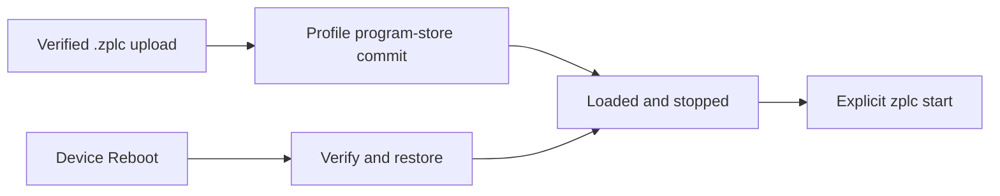

# Persistence & Retain Memory

For profiles with an enabled, operational program-store backend, ZPLC can
commit a verified deployed `.zplc` artifact transactionally. Restore publishes
the artifact as logically stopped/READY. Output behavior before execution is
target-profile-specific and requires recorded evidence. A human must explicitly
issue `zplc start`.

## Platform Backends

The ZPLC runtime core relies on an abstract Hardware Abstraction Layer (HAL) for persistence operations. This allows the system to seamlessly adapt to the storage capabilities of different environments:

| Platform | Storage Backend |
|---|---|
| **Zephyr profile** | Program-store backend when enabled and operational; NVS is one implementation, not a universal board guarantee. The `RETAIN` records use the same HAL calls. |
| **Native Sim (Desktop)** | Files in the persistence directory (`ZPLC_PERSIST_ROOT`, default `~/.zplc`): the program store and the `RETAIN` records. |
| **WASM simulator** | `localStorage` of the browser, through the same HAL calls. The simulator does not use it for `RETAIN` yet. |

## Program Persistence on Hardware

When a profile provides an operational program-store backend, a verified `.zplc`
load can be committed through that backend.



Upon boot, an enabled program store can provide a valid artifact for verification
and logical stopped/READY restore. Output behavior before execution is
target-profile-specific and requires recorded evidence. Deployment is complete
when the verified load completes; it never starts the machine. Start is a
separate, explicit human operation. Target, power-cut, HIL and electrical
evidence remain specific to the exact profile and have not been executed here.

### How the store keeps a program

The store has two slots, A and B, and a small active record that names the slot to run. A slot is the artifact, an
8 byte footer (`ZPE1` and the artifact length) and a 32 byte metadata record; every record carries a CRC-32 and the
format version. The host runtime and the firmware run the same code (`zplc_program_store.c`) over the HAL persistence
calls, so the order of the writes below is the one the host tests exercise.

A deploy writes the slot that is not active, reads it back and verifies it, writes the metadata as prepared and
reads it back, and only then writes the active record: that write is the single point at which the new program
becomes the one to restore. The metadata is then rewritten as committed.

| A power cut ... | What the next restore finds |
|---|---|
| before the active record is written | The previous program. A store that never held one is empty. |
| in the middle of the new payload | The previous program: a slot that is half old and half new fails the CRC-32 of its artifact and is never accepted. |
| after the active record, before the metadata is rewritten | The new program: the slot was read back before the pointer moved. |
| that damages the active record | The newest complete committed slot. |

Records that exist and verify as nothing are never read as an empty store: restore reports them as unverifiable and a
deploy refuses to write over them. A store written by the first firmware (one key, `code_len` and `code`) is
restored as it is and migrated at the next deploy.

A flash key-value store keeps an entry inside one erase sector, so a payload is cut into chunks of
`CONFIG_ZPLC_PROGRAM_STORE_CHUNK_SIZE` bytes (1024 by default), each under its own key. The largest artifact is one
number, `CONFIG_ZPLC_CODE_SIZE_MAX`: it is the code region, the largest artifact the loader accepts, the size of the
staging and restore buffers, the size `zplc sys info` reports (`max_artifact_size`) and the size the IDE is told for
the board (RT-028). The build fails when two slots of that size, in chunks, do not fit the storage partition. The
Raspberry Pi Pico profile therefore sets 24576 bytes (its 64 KB partition), the STM32F746G Discovery
profile 16384 and the Arduino Opta WiFi profile 32768 (their RAM), and the ESP32-S3 profile keeps its 8192; the
other profiles keep 45056. The program store, the upload staging, the resident copy and the VM each hold one
program in RAM, so a profile spends four times its code size.

What has been shown: a power cut injected at every operation of a deploy and a torn write at every record, on the
host and on `native_sim` over the NVS flash simulator, with an artifact of the largest size
(`test_program_store`, `program_store_nvs`). What has not: a power cut on a board. The flash driver, the erase time
and the supply behaviour of each profile need the hardware record of that profile (HIL-010).

## Retentive Memory (`RETAIN`)

The compiler accepts `VAR RETAIN` and `VAR_GLOBAL RETAIN`, places those
variables in the retentive region of the process memory (address `0x4000`, 4 KB
by default) and applies their declared initial values only when the region holds
no saved state. The runtime saves that region and restores it when the same
program is loaded again. Everything on this page is host, simulator and
build-level evidence: no board has been measured, and no board has been through
a power cut under test.

### What is saved, and when

| Moment | What happens |
|---|---|
| Program load, and restore at boot | The region is restored from the stored records before the first scan, or initialised to zero when no record matches. The status says which. |
| `STOP` (commanded) | The region is stored with the values of the last complete scan. A stop of a faulted runtime stores nothing. |
| While running | The region is stored at most once per interval, at a scan boundary, and only when it changed since the last stored record. |
| Clean shutdown of the host runtime | Stored like a `STOP`. |
| Reset (`execution.reset`) | A cold restart: the region is initialised and that initialised region is stored, so the old values do not come back. |

On the firmware a periodic save runs on its own work queue, outside the scan, and
holds the memory lock only for the copy of the region, never during the write to
storage. On the host it runs in the main loop between two scans. A power cut
between two saves loses the changes since the last record; that is the reason
for the interval, which the flash budget below bounds from the other side.

### The record

Two records alternate, so a power cut during a save never destroys the last good
one. A save writes the older slot with a sequence number one above the newest.
Every record is cut into chunks of at most `CONFIG_ZPLC_RETAIN_CHUNK_SIZE` bytes
(1024 by default), stored under the keys `retain_a0`, `retain_a1`, ... and
`retain_b0`, ..., because a storage entry can be smaller than the region (NVS on
a 4 KB sector).

| Offset | Size | Field |
|---|---|---|
| 0 | 4 | magic `ZRTN` |
| 4 | 2 | format version, 1 |
| 6 | 2 | reserved, zero |
| 8 | 4 | sequence number, never 0 |
| 12 | 4 | program identity: the CRC32 word of the artifact header |
| 16 | 4 | program identity: the code-size word of the artifact header |
| 20 | 4 | layout hash |
| 24 | 4 | payload length, the size of the `RETAIN` region |
| 28 | n | payload, the region bytes |
| 28+n | 4 | CRC-32 of every byte before it |

The layout hash is a CRC-32 over the region size, the region address, the ISA
version, the contract draft counter and the program identity. A program that
changes by one byte has another identity, so a rebuild discards the retained
values; the runtime has no variable-level layout to carry them across a change.

### What a restart does

The restore takes the valid record with the highest sequence whose identity and
layout match. If a record fails its checksum, the other one is tried. If none
matches, the region is set to zero and the status says why:

| `reason` | Meaning |
|---|---|
| `restored` | A valid record of this program and layout was restored. |
| `none` | No record in either slot: first start, erased storage, or no storage backend. |
| `identity_mismatch` | Valid records exist, written by another program. |
| `layout_mismatch` | The same program, but another region size, address or runtime layout. |
| `corrupt` | Records exist and none passes the format and checksum checks. |
| `io_error` | The storage backend failed on both slots. Saves are refused until a restore reads the backend again. |
| `reset` | A reset command initialised the region. |
| `not_restored` | No program is loaded. |

The status of the native runtime carries this next to the existing fields:

```json
"retain": {"reason": "restored", "restored": true, "sequence": 12, "saves": 3, "save_errors": 0, "saved_at_ms": 94000}
```

`saved_at_ms` is the runtime uptime of the last record written in this session,
or `null` when none was. On the firmware the same values are in
`zplc sched status` and `zplc sched status --json`.

### Host and WASM runtimes

The POSIX host applies the same module and the same rules. Its periodic save
interval is 30 seconds by default and can be set with the environment variable
`ZPLC_RETAIN_SAVE_INTERVAL_MS`: `0` turns periodic saves off (a `STOP` and a
shutdown still store), a value from 100 to 86400000 sets the interval, and any
other value is ignored with a message on standard error. Programs running on the
host simulator therefore keep their `RETAIN` values from one session to the
next, as a controller does; use `execution.reset`, or another persistence
directory, to start from the declared values.

The WASM simulator does not apply these rules yet. Its storage is `localStorage`
and the portable module needs only the HAL calls, but the module is not linked
into the WASM build and its adapter does not call a save on stop or a restore on
load. Until that is wired, a program on the WASM simulator starts from the
declared values at every load.

### Enabling it on a firmware board

`CONFIG_ZPLC_RETAIN_PERSIST` is off by default. The write path is covered by the `retain_persist` suite
on `native_sim` (both word sizes) and the build-time wear assertion, and no board has been measured: a
flash write can stall instruction fetch on parts that execute from the same flash, and on several boards
the storage partition is also used by another file system. Set `CONFIG_ZPLC_RETAIN_PERSIST=y` in the board
file, with the endurance numbers of the next section, once that board has passed its hardware record
(HIL-010). Until then the `RETAIN` region is initialised at every start on firmware and the status has no
`retain` field.

### Flash wear budget per board

Every save of a changed region costs flash erases. The worst case is a region
that changes in every interval. For a board:

- one save writes the record plus the entry overhead of each chunk (about 64
  bytes each, an estimate that covers a 32-byte write block);
- the storage partition takes in the wear bytes of the table per erase of every
  sector: the sectors minus the one NVS keeps free, minus about 8300 bytes of the
  two program slots that garbage collection copies at every rotation;
- the flash is rated for a number of erase cycles per sector.

Saves the flash takes = erase cycles x wear bytes / bytes per save. Life =
saves x interval. The build fails when the interval makes that life shorter than
`CONFIG_ZPLC_RETAIN_LIFE_YEARS` (10 by default), so a board cannot ship an
interval its own numbers do not support.

Every number below is an engineering estimate from the datasheet class of the
part and from the partition layout of the board file. No board was measured.

| Board | Storage partition | RETAIN | Rated cycles | Wear bytes | Interval | Estimated worst-case life |
|---|---|---|---|---|---|---|
| Raspberry Pi Pico (RP2040) | 64 KB of the on-board QSPI NOR, 16 sectors of 4 KB | 4 KB | 100,000 | 53,000 | 300 s | 11.3 years |
| Arduino GIGA R1 (STM32H747 M7) | 7 MB of the external QSPI NOR, 4 KB sectors assumed | 4 KB | 100,000 | 7,300,000 | 60 s | more than 100 years |
| Arduino Opta WiFi (STM32H747 M7) | 7 MB of the external QSPI NOR, 4 KB sectors assumed | 4 KB | 100,000 | 7,300,000 | 60 s | more than 100 years |
| STM32F746G Discovery | 15 MB of the external QSPI NOR, 4 KB sub-sectors assumed | 4 KB | 100,000 | 15,700,000 | 60 s | more than 100 years |
| ESP32-S3 DevKitC | 192 KB of the module SPI NOR, 48 sectors of 4 KB | 1 KB | 100,000 | 184,000 | 60 s | 29.5 years |
| STM32 Nucleo-H743ZI | 128 KB, one sector of the internal flash: NVS cannot mount | 4 KB | none | none | none | not persisted |
| A board with no numbers | any | any | 10,000 | 40,000 | 3600 s | 10.3 years for 4 KB |

The Pico row is the one to read twice: at 30 seconds, the host default, the same
board would wear its storage out in about 1.1 years. The interval is a minimum:
a region that does not change is never written, so a program whose retained
values change rarely wears the flash far less than this table says.

A `STOP` of a changed region is one more save and is not part of the budget: it
is a person's command. A script that stops and starts the controller every few
seconds, with retained values that change in every run, spends the budget of a
year in days.

### Limits

- Not measured: the endurance numbers above come from the datasheet class of the
  parts, not from a measurement, and the partition layouts of the GIGA, Opta and
  F746G are read from the board description, not from a board.
- Not proven: that a save survives a power cut on any board. The record format
  and the order of the writes are tested with failures injected at every step on
  the host and on `native_sim`, and that is all.
- Not measured: how long a flash write stalls the processor. On parts that run
  code from the same flash a write can hold instruction fetch for the length of
  an erase; the periodic save runs on its own work queue, but whether a scan is
  delayed depends on the flash driver and has not been measured on any board.
- The Nucleo-H743ZI cannot mount its storage backend (one 128 KB sector, above
  the 64 KB limit of NVS), so its `RETAIN` region is initialised at every start
  and its status says `io_error`. The settings file system of the STM32F746G,
  GIGA and Opta boards uses the same partition as the NVS records: that both
  coexist is not established.
- A rebuild of the program, even one that only moves code, changes its identity
  and discards the retained values.
- The single-task firmware mode (scheduler disabled) does not persist `RETAIN`.
- Do not rely on `RETAIN` for recovery-critical state until the hardware records
  of the exact profile exist: a power cut at the wrong time loses the values
  since the last save.
