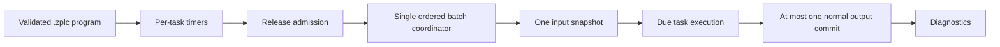

# Multitask Scheduler

ZPLC schedules configured PLC tasks through runtime-specific adapters. The current Zephyr path admits timer releases into one batch coordinator; the POSIX path supports repeatable host-side workflows. These are logical runtime contracts, not evidence of timing or physical-I/O behavior on a board.

## Task model

Tasks are declared in the project and compiled into the `.zplc` program.

| Property | Current meaning |
|---|---|
| **Type** | The current Zephyr scheduler admits `CYCLIC` tasks. It rejects `EVENT` tasks before loading. |
| **Interval** | Requested cyclic interval in milliseconds, not a measured cycle-time guarantee. |
| **Priority** | For Zephyr releases with the same release time, a lower numeric priority runs first. Task ID breaks a remaining tie. |
| **Entry point** | Program or function location in the compiled program. |

## Lifecycle

The scheduler loads task declarations, prepares its runtime queues, and reports state transitions such as `READY`, `RUNNING`, `PAUSED`, and `ERROR`. A program is admitted and validated before it is allowed to run. Logical execution budgets and runtime diagnostics are used to identify bounded-scan failures and overruns.

## Shared state

For each Zephyr due-set, timer callbacks only admit releases; they do not run PLC code. The coordinator orders admitted tasks by release time, priority, and task ID, then takes one input process-image snapshot. Due tasks run against shared runtime memory in that order. If no fault or control-plane closure occurs, the batch performs at most one normal output-process-image commit.

`STOP`, external pause, unregister, and scheduler faults close admission and drain in-flight coordinator work before returning. These guarantees describe the scheduler implementation and its host/native-sim tests. They do not establish WCET, jitter, electrical state, or board qualification.

## Pause, resume, step and stop

The runtime keeps two things apart: the **physical outputs** (the pins) and the **logical state of the program** (the output process image, the force table and each task's program counter and stacks). A pause makes the first one safe and keeps the second one, so that a resume or a step continues the program from where it stopped (requirement RT-017). `STOP` ends the run and discards both.

| Operation | Physical outputs | Output image | Force table | Task scans |
|---|---|---|---|---|
| Pause (`zplc dbg pause`) | Safe (off) before the call returns | Kept | Kept | Pauses between scans: the batch in flight finishes first |
| Breakpoint | Safe (off); the batch commits once, then the pins are driven safe | Kept, partial scan included | Kept | The scan stops at the breakpoint with its program counter and stacks |
| Step (`zplc dbg step`) | The scan is committed, then the pins are driven safe | Kept, shows the stepped scan | Kept | Finishes the scan stopped at a breakpoint, or runs one whole scan; stops at the next cycle boundary or at the next breakpoint |
| Resume (`zplc dbg resume`) | Not driven by the resume itself | Kept | Kept | A scan stopped at a breakpoint continues from there at the next release; a pause between scans starts a new scan |
| `STOP` | Safe (off) | Zeroed | Cleared | Every task is back at its entry point; a scan a breakpoint interrupted, or a resume armed, is discarded |
| Fault | Safe (off) | Zeroed | Cleared | Latched; the faulted task keeps its program counter and error until a program is loaded |

Notes on the table:

- Safe means off for every output channel today. The pins are driven from that policy, never from the image, so a paused image that has a bit set does not energize it. A project-declared safe value per output is a separate requirement (RT-023).
- The first normal commit after a resume copies the output image, with the force table applied, to the pins. A resume does not energize anything by itself. A forced output that is on stays off while paused and comes on at that commit.
- A scan that continues after a resume or a step keeps what the first part of it saw: the instructions already executed, the evaluation stack, the first-scan flag and its own task id. Inputs are latched again at the start of the batch that continues it, so the remainder reads the inputs of that moment.
- The batch that stops at a breakpoint, and a step, commit the image to the pins once and then drive them safe. The time between the two writes is the driver's and is not measured here.
- Evidence for this behaviour is the Zephyr test suites on `native_sim` and QEMU (`scheduler_run_control`, `scheduler_admission`). The physical level is observed through the GPIO emulator of `native_sim`; no board has been measured.

## Diagnostics and evidence

Runtime diagnostics expose cycle counts, logical budget faults, process-image latch/commit counts, and timing-related observations. Their resolution, collection method, and meaning depend on the runtime and target profile. Native-sim evidence checks logical ordering and state transitions only. Measure WCET, jitter, deadline behavior, and physical outputs on the exact target/revision before relying on them operationally.
