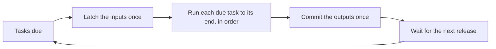

# Scan cycle and tasks

A PLC does not run a program once. It repeats a scan: read the inputs, run the tasks, write the outputs. This page explains how ZPLC does that, in what order tasks run, what happens when one is late, and what the outputs do whenever the program is not in control. Read it before you rely on a timing, a task priority or the behaviour of a stopped program.

## One scan, step by step



1. One or more tasks become due. Tasks released together form a **batch**.
2. The runtime takes the input image once, and every task of the batch reads that same image.
3. The tasks run one after the other, each to its end. Nothing preempts a task.
4. The output image is committed once, after the last task, and the pins are written from it.

The logic you write sees a consistent set of inputs for the whole scan, and the outputs change together at its end. That is why the order of the rungs or statements matters inside a task and why a value set late in a scan is not seen by the pins until the commit.

## Task model

Tasks are declared in `zplc.json` and compiled into the `.zplc` program. This release has one kind of task, the cyclic task. The model is the same in simulation and on a target; the differences are in [What is not identical in simulation](#what-is-not-identical-in-simulation).

| Property | Meaning |
| --- | --- |
| **Type** | Cyclic only. `trigger: "cyclic"` is a cyclic task. `trigger: "freewheeling"` is built as a cyclic task of the interval it declares and never runs faster than that. Event and interrupt tasks do not exist in this release: the build fails at the task definition and names the task, its `trigger` field and the supported triggers, and both runtimes refuse an artifact that holds an event task. |
| **Interval** | Whole milliseconds, from 1 to 3 600 000. Each task has its own interval. A program holds at most 16 tasks, and a firmware build registers as many as `CONFIG_ZPLC_MAX_TASKS` allows (8 by default). The interval is the release period and the deadline of the scan, not a measured cycle time. |
| **Priority** | A lower number runs first. Priority only orders tasks released together; it never interrupts a running task and gives no task more time. |
| **Entry point** | The program or function location in the compiled program. |

Five rules follow:

1. **Release.** A start or a resume begins the schedule of every task at the same instant, and after that a task is released once per interval. A release that arrives while the task still runs is not queued, and a host that dispatches late runs the task once, not once per missed release.
2. **Order.** A batch runs by earlier release first, then by priority (the lower number first), then by task ID (the lower first).
3. **No preemption.** The tasks of a batch run one after the other, each to the end of its scan. Only a breakpoint stops a scan before its end; see [Pause, resume, step and stop](#pause-resume-step-and-stop).
4. **One latch and one commit per batch.** A task that is not released in a batch does not run, and the process image keeps what it wrote.
5. **Deadline.** The deadline of a scan is its task's interval after the release of its batch. A task that ends later misses it; see [Deadlines](#deadlines).

## One scheduler core

Every decision above is made in one place, `zplc_sched_core` (`firmware/lib/zplc_core/src/core/zplc_sched_core.c`), and each runtime supplies only what depends on its platform:

| In the core, the same everywhere | In the adapter |
| --- | --- |
| Which tasks are due and in what order | The clock, the timers and the threads that call the core |
| The deadline check, the miss count and the fault latch | The locks of the process image and of the output I/O |
| The input latch, the output commit and the safe state | The pins and the hardware watchdog |
| The fault reason: the first one is kept, and a VM fault wins over a deadline miss in the same scan | The debug protocol and the shell |

Three adapters use the core: the POSIX session of the host runtime (`native_runtime_session.c`), the Zephyr scheduler (`zplc_scheduler_zephyr.c`) and the single-task configuration (`zplc_single_task.c`). The host test `test_sched_equivalence` and the Zephyr suite `scheduler_equivalence` run the same scenarios, a three-task program and a one-task program, and compare the decisions with one golden trace, so a change of the rule in one runtime fails the other. The comparison is of decisions, not of time. The WebAssembly runtime of the ZPLC application runs the same core and the same trace test; see [the software runtime](./browser-runtime.md).

**Single-task firmware.** A build with `CONFIG_ZPLC_SCHEDULER=n` runs one task of one interval on the same core, with the same latch, deadline check (`CONFIG_ZPLC_DEADLINE_MISS_LIMIT`), fault latch and safe state. Two things differ: its loop holds the runtime lock for the whole scan, so a shell command waits for the scan to end, and it has no snapshot exchange, so another thread reads and writes the process image under that lock.

### The locks around a scan

On a target a batch is three steps. The inputs are read from the HAL with no lock held. Then, under the process-image lock, the writes other threads queued are applied, the samples go to the input image, the tasks run and the image is published as a snapshot. Last, with the image lock released and under a separate lock for the output I/O, the pins are written and the hardware watchdog is fed. The image lock is never held while a pin is written, a line is printed or any call that can block runs.

A thread outside the scan reads the snapshot of the last commit and queues its writes for the next input latch; see [Access from outside the scan](./memory-model.md#access-from-outside-the-scan). A lock that cannot be created or taken is an error the caller sees: a control call returns `ZPLC_SCHED_ERR_LOCK` and changes nothing, and a scan that cannot take the image lock drives the pins to their safe state and latches the fault.

### Priorities and start-up order

The scan coordinator runs at a lower priority number than every communication thread (`CONFIG_ZPLC_COMM_THREAD_PRIORITY`, 8 by default) and than the shell and log threads, and the build fails otherwise. Boards with a network stack set `CONFIG_NET_TC_THREAD_PREEMPTIVE=y`, because Zephyr's network threads are cooperative by default and would outrank the scan.

The firmware starts the runtime before any service: the hardware layer, the core, the scheduler with the program store and the restore of the stored program. The network, the time service, the fieldbus servers and MQTT or cloud provisioning start after them, and each may fail without stopping the runtime that is already up. The boot log names each step in the order it ran.

## Deadlines

A scan misses its deadline when its task ends more than one interval after the release of its batch, because the task was released again before it was done or the tasks ahead of it used its interval. A miss has these effects, in order:

1. The **warning** flag is raised.
2. The miss is **counted**, for the task and in total.
3. The **overrun**, how far past the deadline the task ended, is recorded.
4. When the same task has missed `N` times in a row, the fault is **latched**: the outputs go to their safe state, the session is in `error`, and the status gives the reason and the task. A reset or a new program clears it.

A scan that ends in time ends the run of that task and clears its part of the warning; the count stays until a program is loaded or reset. A debugger step and a scan that stopped at a breakpoint are not checked.

`N` is **3** by default on every runtime, so one late activation, which a communication burst or a flash write can cause, is warned and counted, and a task that keeps missing stops the program. It is a design default; earlier releases latched on the first miss. In simulation `N` is the environment variable `ZPLC_DEADLINE_MISS_LIMIT`, an integer from 1 to 1 000 000 read when the session starts (a value outside the range is ignored with a message on standard error). On a target it is `CONFIG_ZPLC_DEADLINE_MISS_LIMIT`, in the same range, fixed when the firmware is built.

Simulation reports a miss in the `status.get` result and in every `status.changed` event, and a latched fault also as a `runtime.error` event with the code `DEADLINE_MISS`. A target reports the same fields in `zplc sched status --json`, as the objects `deadline` and `fault`.

| Field | Meaning |
| --- | --- |
| `stats.overruns` | Deadline misses of all tasks since the program was loaded or reset. |
| `tasks[].overruns` | Deadline misses of that task. |
| `deadline.warning` | `true` while any task has a run of misses that no scan in time has ended. |
| `deadline.misses` | The same count as `stats.overruns`. |
| `deadline.consecutive_misses` | The longest run of misses that is still going on. |
| `deadline.miss_limit` | `N`. |
| `deadline.last_overrun_us` | How far past its deadline the last late task ended, in microseconds. The host clock counts milliseconds, so there it is a multiple of 1000. |
| `fault.reason` | `none`, `deadline_miss`, `vm_fault` or `runtime_failure`. |
| `fault.task_id` | The task that latched the fault, or `null` when there is none. |

The separate `host_cadence` object reports how late the host dispatched a batch after its tasks were due, and the releases it skipped. In simulation that lateness is not a deadline miss.

## What is not identical in simulation

The five rules are the same in simulation and on a target. These points are not, and none of them has been measured on a board:

| Subject | Simulation | Target (Zephyr scheduler) |
| --- | --- | --- |
| Time source | The host monotonic clock in whole milliseconds, so a deadline and an overrun are multiples of 1 ms. | The cycle counter, read in microseconds. |
| Instant of a release | The instant the host dispatches the batch. The wait between the due time and the dispatch is reported in `host_cadence` and is not a miss. | The timer stamps the release when it expires, so a coordinator that starts the batch late spends the deadline of its tasks. |
| Next release | Tasks of different intervals keep a fixed grid from the common start. Tasks of one interval are released an interval after the previous dispatch, so a late dispatch moves the releases that follow it. | A periodic timer on a fixed grid: a late batch does not move the next release. |
| First release | Every task is released at the start itself. | Each task is first released one interval after the start or the resume. |
| Two tasks of one tick | Released at the same instant, so ordered by priority, then task ID. | The comparison is the same, but each timer stamps its own release; the order of two timers of one tick on a board is not stated. |
| A write to the input image while the program runs | Queued (32 writes at most) and applied at the start of the next scan, in order and through the force-aware write, so no scan sees the image change. When a breakpoint holds a scan that has not ended, the queue waits for the end of that scan. A write over bytes that an earlier queued write covers waits one scan more, so a press and a release written between two scans are each seen by a whole scan. A full queue refuses the write with `RUNTIME_FAILURE`; a stop, a reset or a load drops the queue. While the program is stopped or paused, the write is applied at once. | The write queue of the exchange applies every queued write, in order, at the input latch of the next scan. |
| Speed and jitter | The VM runs on a host processor under a general-purpose operating system. | The VM runs on the board's processor. A program that is in time in simulation can miss on a target, and the reverse. |

## Pause, resume, step and stop

The runtime keeps two things apart: the **physical outputs** (the pins) and the **logical state of the program** (the output image, the force table and each task's program counter and stacks). A pause makes the pins safe and keeps the logical state, so a resume or a step continues from where the program stopped. `STOP` ends the run and discards both.

| Operation | Physical outputs | Output image | Force table | Task scans |
| --- | --- | --- | --- | --- |
| Pause (`zplc dbg pause`) | Safe (off) before the call returns | Kept | Kept | Pauses between scans: the batch in flight finishes first |
| Breakpoint | Safe (off); the batch commits once, then the pins are driven safe | Kept, partial scan included | Kept | The scan stops at the breakpoint with its program counter and stacks |
| Step (`zplc dbg step`) | The scan is committed, then the pins are driven safe | Kept, shows the stepped scan | Kept | Finishes the scan stopped at a breakpoint, or runs one whole scan, and stops at the next cycle boundary or breakpoint |
| Resume (`zplc dbg resume`) | Not driven by the resume itself | Kept | Kept | A scan stopped at a breakpoint continues there at the next release; a pause between scans starts a new scan |
| `STOP` | Safe (off) | Zeroed | Cleared | Every task is back at its entry point; an interrupted scan is discarded |
| Fault | Safe (off) | Zeroed | Cleared | Latched; the faulted task keeps its program counter and error until a program is loaded |

- Safe means off unless the project declares another value ([Safe state of an output](#safe-state-of-an-output)). The pins are driven from that policy, never from the image, so a paused image with a bit set does not energize it.
- The first normal commit after a resume copies the output image, with the force table applied, to the pins. A resume energizes nothing by itself, and a forced output that is on stays off while paused and comes on at that commit.
- A scan that continues after a resume or a step keeps what its first part saw: the instructions already executed, the evaluation stack, the first-scan flag and its task id. Inputs are latched again at the start of the batch that continues it.
- Evidence level: emulated target. The Zephyr suites `scheduler_run_control` and `scheduler_admission` run on `native_sim` and QEMU, and the pin level is observed through the GPIO emulator of `native_sim`. No board has been measured, and the time between the commit and the safe write is the driver's.

## Safe state of an output

An output is **off** whenever the program does not control it: in STOP, while paused or at a breakpoint, in a latched fault, from boot until the first scan and while a deploy is in progress. One function, `zplc_io_drive_safe`, decides the level:

1. The value the **loaded program declares** for that output, when it declares one.
2. Otherwise **off**, unless the board description (`firmware/app/boards/boards.json`) gives that channel another safe level, as an active-low relay needs.

A project declares the value in `zplc.json`, on a row of `io.outputs`:

```json
{
  "io": {
    "outputs": [
      { "name": "Brake", "address": "%QX0.0", "type": "BOOL", "safe": true },
      { "name": "Valve", "address": "%QX0.1", "type": "BOOL" }
    ]
  }
}
```

Here `Brake` is energized whenever the program is not running it, and `Valve` is off. The declaration travels inside the artifact, in its `SAFE` segment, so a program and its safe state are one unit: a device that restores the program restores the declaration, and an interrupted deploy cannot leave the program of one build with the safe values of another (see [Declared safe values](./isa.md#declared-safe-values)). The deploy confirmation shows each declared output with the value it takes, or says that every output is off, before the program is written.

| Where | What is refused |
| --- | --- |
| The build (the ZPLC application, the command line, MCP) | A `safe` that is not `true` or `false`; one on a row that is not a digital output bit (`%QW0`, `%QB0`), on an input or on a `virtual` row; two rows for one output; an output the selected board has no digital channel for. The message names the output, the address and the board, and there is no artifact to deploy. |
| The loader | A segment that is not whole entries, an entry outside the output image, a value other than 0 or 1, an output twice, or more than 64 entries. |
| The firmware, at deploy and at boot restore | A declaration for an output that is not a digital output channel of the board's I/O table, which means a project for another board. The program is not stored and is not run. |

The declared values are in force from the load that commits the program, before the first scan: a restored program waits in STOP with its declared outputs on. The output image is the logical state of the program and is zeroed in STOP whatever the pin shows. The time between power-on and the instant the firmware drives the pins is the part's reset state; a board that must have a pin on there needs hardware that does it (see [Boards](../reference/boards.md)).

## Faults, reset cause and the watchdog

The decisions that do not depend on a platform are in `zplc_failsafe` and are tested on the host; what a platform does (the reset-cause register, a RAM record a reset does not clear, the reboot, the watchdog) is `zplc_failsafe_zephyr.c`.

**A processor fault.** A processor fault, a stack overflow, an assertion or a kernel panic does not leave the outputs where the last scan left them. The fatal-error handler (`CONFIG_ZPLC_FATAL_HANDLER`, on by default) takes no lock and allocates nothing: it drives every digital output to its safe level, keeps the reason in a 24-byte RAM record that a reset does not clear and reboots. The next boot reports the record and consumes it, so the following reset is not called a fault. A record that is not whole, or not ours, is ignored.

**Why the runtime was reset.** `zplc sys reset` (with `--json`) reports the cause of the last reset: `power_on`, `brown_out`, `pin`, `software`, `watchdog`, `fault` or `unknown`, with the raw register, the fault record of the previous run and the start policy. When a processor reports several bits the order is fixed: a fault record first, then watchdog, power-on, brown-out, lock-up, software and, last, the pin, because almost every reset sets it. The cause is also the `reset_cause` key of `zplc sched status --json`.

**After a reset the runtime waits in STOP.** Whatever the cause, the stored program is restored into STOP with the outputs at their safe values, and **RUN is a person's command**: the function `zplc_reset_may_run` is 0 for every cause. The retained variables are restored only when `CONFIG_ZPLC_RETAIN_PERSIST` is on, which it is in the profile of every shipped board. A deploy stops the running program before it transfers a byte.

**The hardware watchdog.** The `watchdog` entry of each board in `boards.json` says whether it is enabled, the timeout its reset timing was recorded at, the longest timeout the part accepts and what it does in STOP, while paused and in a latched fault. **No board has it enabled**, and the options stay off until an exact board and revision has a hardware record of its reset timing and pins. When it is enabled:

- It is fed from the completion of a scan, never from a timer, an interrupt, the shell or the idle thread, so a stalled scan stops the feed and the board resets.
- Its timeout is the profile's, made longer when the task set needs it (more than two intervals of the slowest task, up to the longest the part accepts); a task set that does not fit is refused at start.
- The default policy is disarmed in STOP, fed from the control path while paused so that a long breakpoint does not reset the board, and left to expire in a latched fault, so the board resets into STOP with the cause recorded.

## Evidence and limits

The decisions are tested on the host (`test_failsafe`, `test_sched_core`) and the behaviours on the Zephyr emulator and QEMU: `failsafe`, `failsafe_reboot` (a real undefined-instruction fault and a real reboot on `qemu_cortex_m3`, where the record survives the reset and the cause is `fault`), `scheduler_watchdog`, `program_boot_restore` and `scheduler_admission`. Evidence level: host and emulated target.

Not shown, and in need of a hardware record: scan time and jitter on any board, the time a real part takes to reset, the pin level while it resets, whether the RAM of a given part survives its watchdog reset, and the watchdog of any board. Native simulation checks logical order and state transitions only, so measure the worst-case execution time, jitter, deadlines and physical outputs on the exact board and revision before you rely on them.
