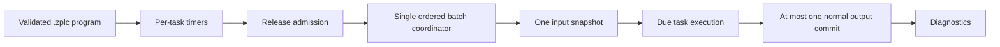

# Multitask Scheduler

ZPLC schedules configured PLC tasks through runtime-specific adapters around one portable scheduler core. The current Zephyr path admits timer releases into one batch coordinator; the POSIX path runs the same task model for repeatable host-side workflows; the single-task firmware configuration runs one task on the same core. These are logical runtime contracts, not evidence of timing or physical-I/O behavior on a board.

## One scheduler core

The decisions of the scheduler are made in one place, `zplc_sched_core` (`firmware/lib/zplc_core/src/core/zplc_sched_core.c`), and the runtimes only provide what depends on the platform (RT-008, RT-018):

| In the core, the same everywhere                                                                                          | In the adapter                                           |
| ------------------------------------------------------------------------------------------------------------------------- | -------------------------------------------------------- |
| Which tasks are due and in what order: earlier release first, then priority, then task ID                                 | The clock, the timers and the threads that call the core |
| The deadline check: a miss is warned, counted and its overrun recorded; a run of `N` misses of one task latches the fault | The locks of the process image and of the output I/O     |
| The fault latch and its reason; the first reason is kept and a VM fault wins over a deadline miss in the same scan        | The pins and the hardware watchdog                       |
| The input latch, the commit of the outputs and the safe state of STOP, a pause and a fault                                | The debug protocol and the shell                         |

Three adapters use it: the POSIX session of the host runtime (`native_runtime_session.c`), the Zephyr scheduler (`zplc_scheduler_zephyr.c`) and the single-task configuration (`zplc_single_task.c`, see [Single-task configuration](#single-task-configuration)). A scenario is a list of tasks and of the instants a batch is due, started and ended; its output is the list of decisions the core took, one line for each. The host test `test_sched_equivalence` and the Zephyr suite `scheduler_equivalence` run the same scenarios and compare the decisions with one golden trace, so a change of the rule in one runtime fails the other. The scenarios are a three-task program (100 and 200 ms tasks, `N` of 3, latching at the fourth batch) and a one-task program. The comparison is of decisions, not of time: the host counts whole milliseconds and the target reads a cycle counter in microseconds.

### Single-task configuration

A firmware built with `CONFIG_ZPLC_SCHEDULER=n` runs one task of one interval. It is the one-task configuration of the core, not another loop: its scan has the same input latch, deadline check and limit (`CONFIG_ZPLC_DEADLINE_MISS_LIMIT`), fault latch and safe state as the multitask scheduler, and its status reports the same fields. Two things differ and are not hidden: the loop holds the runtime lock for the whole scan, so a shell command waits for the scan to end, and it has no snapshot exchange, so a thread outside the scan reads and writes the process image under that lock instead of through the queue.

## Task model

Tasks are declared in `zplc.json` and compiled into the `.zplc` program. This release has one kind of task, the cyclic task. The model below is the same in simulation and on a target; the differences that remain are listed in [What is not identical in simulation](#what-is-not-identical-in-simulation).

| Property        | Meaning                                                                                                                                                                                                                                                                                                                                                                                                                                           |
| --------------- | ------------------------------------------------------------------------------------------------------------------------------------------------------------------------------------------------------------------------------------------------------------------------------------------------------------------------------------------------------------------------------------------------------------------------------------------------- |
| **Type**        | Cyclic only. `trigger: "cyclic"` is a cyclic task. `trigger: "freewheeling"` is built as a cyclic task of the interval it declares and does not run faster than that interval. Event-triggered and interrupt-triggered tasks do not exist in this release: the build fails at the task definition, naming the task, its `trigger` field in `zplc.json` and the supported triggers, and both runtimes refuse an artifact that holds an event task. |
| **Interval**    | Whole milliseconds, from 1 to 3 600 000. Every task has its own interval, and tasks of different intervals run in one program (at most 16 tasks). The interval is the period of the release and the deadline of the scan, not a measured cycle-time guarantee.                                                                                                                                                                                    |
| **Priority**    | A lower number runs first. Priority only orders tasks that are released together. It does not interrupt a task that is running and it does not give a task more time.                                                                                                                                                                                                                                                                             |
| **Entry point** | Program or function location in the compiled program.                                                                                                                                                                                                                                                                                                                                                                                             |

Rules:

1. **Release.** The tasks of a program start together: a start or a resume begins the schedule of every task at the same instant. After that a task is released once per interval. A release that arrives while the task is still running is not queued, and a host that dispatches late runs the task once, not once per missed release.
2. **Order.** Tasks released together are one batch. A batch runs its tasks by earlier release first, then by priority (the lower number first), then by task ID (the lower first).
3. **No preemption.** The tasks of a batch run one after the other, each to the end of its scan. Nothing suspends a task for another task or for a release. A breakpoint is the only thing that stops a scan before its end; see [Pause, resume, step and stop](#pause-resume-step-and-stop).
4. **One latch and one commit per batch.** A batch takes the input image once, before its first task, and every task of the batch reads that image. The output image is committed once, after its last task. A task that is not released in a batch does not run, and the process image keeps what it wrote.
5. **Deadline.** The deadline of a scan is its task's interval after the release of its batch. A task that ends later misses its deadline; see [Deadlines](#deadlines).

## Lifecycle

The scheduler loads task declarations, prepares its runtime queues, and reports state transitions such as `READY`, `RUNNING`, `PAUSED`, and `ERROR`. A program is admitted and validated before it is allowed to run. Logical execution budgets and runtime diagnostics are used to identify bounded-scan failures and overruns.



## Shared state

For each Zephyr due-set, timer callbacks only admit releases; they do not run PLC code. The coordinator orders admitted tasks by release time, priority, and task ID, then takes one input process-image snapshot. Due tasks run against shared runtime memory in that order. If no fault or control-plane closure occurs, the batch performs at most one normal output-process-image commit.

In simulation one thread serves the control requests and runs the batches, one after the other. The input image therefore cannot change while a batch runs, which is the single latch of rule 4, and the output image is the process image itself.

`STOP`, external pause, unregister, and scheduler faults close admission and drain in-flight coordinator work before returning. These guarantees describe the scheduler implementation and its host/native-sim tests. They do not establish WCET, jitter, electrical state, or board qualification.

### The locks around a scan (RT-010, RT-012)

On the target a batch is three steps. The inputs are read from the HAL with no lock held. Then, under the
process-image lock, the writes that other threads queued are applied, the samples are written to IPI, the tasks run
and the image is published as a snapshot. Last, with the image lock released and under a separate lock for the
output I/O, the physical outputs are written and the hardware watchdog is fed. The image lock is never held while a
pin is written, a line is printed or any call that can block runs: the log lines of a scan are printed after the lock
is released.

A thread outside the scan reads the snapshot of the last commit and queues its writes for the next input latch (see
[Access from outside the scan](memory-model.md#access-from-outside-the-scan-rt-010-rt-011)). A stop, a pause or a
fault that arrives between the commit of the image and the write of the pins takes the output lock after or before
it, and the pins end in the state the later of the two decided.

A lock that cannot be created or taken is an error the caller sees (RT-030). A control call returns
`ZPLC_SCHED_ERR_LOCK` and changes nothing. A scan that cannot take the image lock drives the pins to their safe state
and latches the fault, so the state is `ERROR`; a replacement program is the way out, as for any fault.

### Priorities and start-up order (RT-013, RT-024)

The scan coordinator, the high-priority work queue or the normal one when there is none, has a lower priority number
than every communication thread of the application, which all run at `CONFIG_ZPLC_COMM_THREAD_PRIORITY` (8 by
default), and than the shell and log threads. The build checks it and fails otherwise. Boards with a network stack
set `CONFIG_NET_TC_THREAD_PREEMPTIVE=y`, because Zephyr's network threads are cooperative by default and would
outrank the scan.

The firmware starts the runtime before any service. The hardware layer, the core, the scheduler with the program
store and the restore of the stored program come first, and the shell, which is the control link, is started by
Zephyr before `main()`. The network, the time service, the fieldbus servers and MQTT or cloud provisioning start
after them, and each is allowed to fail: a service that does not come up is logged and counted, and the runtime that
is already up keeps running. The boot log names every step in the order it ran.

## Deadlines

A scan misses its deadline when its task ends more than one interval after the release of the batch it ran in: the task was released again before it was done, or the tasks ahead of it in the batch used its interval. A miss has these effects, in this order:

1. The **warning** flag is raised.
2. The miss is **counted**, for the task and in total.
3. The **overrun**, how far past the deadline the task ended, is recorded.
4. When the same task has missed `N` times in a row, the fault is **latched**: the outputs go to their safe state, the session is in `error`, and the status gives the reason and the task. A reset or a new program clears it.

A scan that ends in time ends the run of that task and clears its part of the warning. The count stays until a program is loaded or reset. A debugger step and a scan that stopped at a breakpoint are not checked.

`N`, the consecutive misses that latch the fault, is configurable and is **3** by default on every runtime: one late activation, which a communication burst or a flash write can cause, is warned and counted, and a task that keeps missing stops the program. The value 3 is a design default (RT-D05b) that the project owner has not confirmed; 1 is the behaviour of earlier releases. In simulation `N` is the environment variable `ZPLC_DEADLINE_MISS_LIMIT`, an integer from 1 to 1 000 000, read when the session starts; a value outside that range is ignored and a message is written to standard error. On a target it is `CONFIG_ZPLC_DEADLINE_MISS_LIMIT`, in the same range, fixed when the firmware is built.

The simulation reports a miss in the `status.get` result and in every `status.changed` event; a latched fault is also sent as a `runtime.error` event with the code `DEADLINE_MISS`. A target reports the same fields in `zplc sched status --json`, as the objects `deadline` and `fault` (the microsecond overrun is exact there). Fields that were already there keep their meaning.

| Field                         | Meaning                                                                                                                                      |
| ----------------------------- | -------------------------------------------------------------------------------------------------------------------------------------------- |
| `stats.overruns`              | Deadline misses of all tasks since the program was loaded or reset.                                                                          |
| `tasks[].overruns`            | Deadline misses of that task.                                                                                                                |
| `deadline.warning`            | `true` while any task has a run of misses that no scan in time has ended.                                                                    |
| `deadline.misses`             | The same count as `stats.overruns`.                                                                                                          |
| `deadline.consecutive_misses` | The longest run of misses that is still going on.                                                                                            |
| `deadline.miss_limit`         | `N`.                                                                                                                                         |
| `deadline.last_overrun_us`    | How far past its deadline the last late task ended, in microseconds. The host clock counts milliseconds, so the value is a multiple of 1000. |
| `fault.reason`                | `none`, `deadline_miss`, `vm_fault` or `runtime_failure`.                                                                                    |
| `fault.task_id`               | The task that latched the fault, or `null` when there is none.                                                                               |

The `host_cadence` object is separate. It reports how late the host dispatched a batch after its tasks were due, and the releases that it skipped. That lateness is not a deadline miss in simulation.

## What is not identical in simulation

The five rules above are the same in simulation and on a target. These are not, and no measurement of any of them exists:

| Subject                      | Simulation                                                                                                                                                                                                                                                                                                                                                                                                                                                                                                                                                                                                                                                                                                                                                                                                                       | Target (Zephyr scheduler today)                                                                                                                                                                                        |
| ---------------------------- | -------------------------------------------------------------------------------------------------------------------------------------------------------------------------------------------------------------------------------------------------------------------------------------------------------------------------------------------------------------------------------------------------------------------------------------------------------------------------------------------------------------------------------------------------------------------------------------------------------------------------------------------------------------------------------------------------------------------------------------------------------------------------------------------------------------------------------- | ---------------------------------------------------------------------------------------------------------------------------------------------------------------------------------------------------------------------- |
| Time source                  | The host monotonic clock in whole milliseconds. A deadline and an overrun are multiples of 1 ms.                                                                                                                                                                                                                                                                                                                                                                                                                                                                                                                                                                                                                                                                                                                                 | The cycle counter, read in microseconds.                                                                                                                                                                               |
| Instant of a release         | The instant the host dispatches the batch. The wait between the instant a task was due and the dispatch is reported in `host_cadence` and is not a miss.                                                                                                                                                                                                                                                                                                                                                                                                                                                                                                                                                                                                                                                                         | The timer stamps the release when it expires, so a coordinator that starts the batch late spends the deadline of the tasks in it.                                                                                      |
| Position of the next release | Tasks of different intervals keep a fixed grid from the common start: a late dispatch does not move the next release, and tasks that coincide are released together, as on the target. Tasks of one interval are released an interval after the previous dispatch, as earlier versions did, so a late dispatch moves the releases that follow it.                                                                                                                                                                                                                                                                                                                                                                                                                                                                                | A periodic timer on a fixed grid: a late batch does not move the next release.                                                                                                                                         |
| First release                | The first scan after a start or a resume is a release of every task: the schedule begins at the start itself.                                                                                                                                                                                                                                                                                                                                                                                                                                                                                                                                                                                                                                                                                                                    | The first release of each task comes one interval after the start or the resume.                                                                                                                                       |
| Two tasks of the same tick   | Released at the same instant, so ordered by priority, then task ID.                                                                                                                                                                                                                                                                                                                                                                                                                                                                                                                                                                                                                                                                                                                                                              | The comparison is the same, but the release is stamped in each timer callback from the cycle counter. What order two timers of one tick get on a board is not stated here.                                             |
| A write to the input image   | A `memory.write` inside the input image while the program runs is queued (32 writes at most) and applied at the start of the next scan, in order, through the force-aware write, so no scan sees the image change (LRN-017); when a breakpoint resumed a scan that has not ended, the queue waits for the end of that scan. A write over bytes that an earlier queued write covers waits one scan more, so that a press and a release written between two scans are each seen by a whole scan. A full queue refuses the write with `RUNTIME_FAILURE`. A stop, a reset or a load drops the queue. While the program is stopped or paused the write is applied at once, as a debugger's write always was: a write to a program held at a breakpoint is seen by the rest of that scan (RT-010 moves the debug link onto the latch). | The write queue of the exchange applies every queued write, in order, at the input latch of the next scan (RT-010).                                                                                                    |
| Speed and jitter             | The VM runs on a host processor under a general-purpose operating system.                                                                                                                                                                                                                                                                                                                                                                                                                                                                                                                                                                                                                                                                                                                                                        | The VM runs on the board's processor. A program that is in time in simulation can miss on a target, and the reverse.                                                                                                   |
| Reporting of a miss          | The warning flag, the count, the last overrun, the configurable limit and the fault reason of the table above.                                                                                                                                                                                                                                                                                                                                                                                                                                                                                                                                                                                                                                                                                                                   | The same fields, from the same core (`deadline` and `fault` of `zplc sched status --json`), with the count of each task, the total and the state `error` once latched. The limit is `CONFIG_ZPLC_DEADLINE_MISS_LIMIT`. |

The WebAssembly runtime of the ZPLC application runs the same scheduler core and the same session as the native simulation, and a test holds its decisions to the shared trace of the core (admission, order, input latch, deadline misses, fault latch and commit, for three tasks and for one). Its clock is the clock of the page, in whole milliseconds, so the rows above that name the host clock apply to the clock of the app window, and a hidden window can run late. See [Software runtime](./browser-runtime.md).

## Pause, resume, step and stop

The runtime keeps two things apart: the **physical outputs** (the pins) and the **logical state of the program** (the output process image, the force table and each task's program counter and stacks). A pause makes the first one safe and keeps the second one, so that a resume or a step continues the program from where it stopped (requirement RT-017). `STOP` ends the run and discards both.

| Operation                  | Physical outputs                                                  | Output image                 | Force table | Task scans                                                                                                                    |
| -------------------------- | ----------------------------------------------------------------- | ---------------------------- | ----------- | ----------------------------------------------------------------------------------------------------------------------------- |
| Pause (`zplc dbg pause`)   | Safe (off) before the call returns                                | Kept                         | Kept        | Pauses between scans: the batch in flight finishes first                                                                      |
| Breakpoint                 | Safe (off); the batch commits once, then the pins are driven safe | Kept, partial scan included  | Kept        | The scan stops at the breakpoint with its program counter and stacks                                                          |
| Step (`zplc dbg step`)     | The scan is committed, then the pins are driven safe              | Kept, shows the stepped scan | Kept        | Finishes the scan stopped at a breakpoint, or runs one whole scan; stops at the next cycle boundary or at the next breakpoint |
| Resume (`zplc dbg resume`) | Not driven by the resume itself                                   | Kept                         | Kept        | A scan stopped at a breakpoint continues from there at the next release; a pause between scans starts a new scan              |
| `STOP`                     | Safe (off)                                                        | Zeroed                       | Cleared     | Every task is back at its entry point; a scan a breakpoint interrupted, or a resume armed, is discarded                       |
| Fault                      | Safe (off)                                                        | Zeroed                       | Cleared     | Latched; the faulted task keeps its program counter and error until a program is loaded                                       |

Notes on the table:

- Safe means off for an output unless the project declares another value for it ([Safe state of an output](#safe-state-of-an-output)). The pins are driven from that policy, never from the image, so a paused image that has a bit set does not energize it.
- The first normal commit after a resume copies the output image, with the force table applied, to the pins. A resume does not energize anything by itself. A forced output that is on stays off while paused and comes on at that commit.
- A scan that continues after a resume or a step keeps what the first part of it saw: the instructions already executed, the evaluation stack, the first-scan flag and its own task id. Inputs are latched again at the start of the batch that continues it, so the remainder reads the inputs of that moment.
- The batch that stops at a breakpoint, and a step, commit the image to the pins once and then drive them safe. The time between the two writes is the driver's and is not measured here.
- Evidence for this behaviour is the Zephyr test suites on `native_sim` and QEMU (`scheduler_run_control`, `scheduler_admission`). The physical level is observed through the GPIO emulator of `native_sim`; no board has been measured.

## Safe state of an output

An output is **off** whenever the program does not control it: in STOP, while paused or at a breakpoint, in a latched fault, from the boot until the first scan, and while a deploy is in progress. The level is decided in one function, `zplc_io_drive_safe`, and nowhere else (RT-023):

1. The value the **loaded program declares** for that output, when it declares one.
2. Otherwise **off**, unless the board description (`firmware/app/boards/boards.json`) gives that channel another safe level, which an active-low relay can.

A project declares the value in `zplc.json`, on a row of `io.outputs`:

```json
{
  "io": {
    "outputs": [
      { "name": "Brake", "address": "%QX0.0", "type": "BOOL", "safe": true },
      { "name": "Valve", "address": "%QX0.1", "type": "BOOL" }
    ]
  }
}
```

Here `Brake` is energized whenever the program is not running it, and `Valve` is off. The declaration travels **inside the artifact**, in its `SAFE` segment, so that a program and its safe state are one unit: a device that restores the program restores its declaration, a replaced program replaces it, and an interrupted deploy cannot leave the program of one build with the safe values of another (see [Declared safe values](isa.md#declared-safe-values)).

The confirmation of a deploy to a board shows what the artifact carries: each declared output by its address with the value it takes, or the sentence that every output is off, so that a person sees the safe state before the program is written.

What is checked, and where:

| Where                                                   | What is refused                                                                                                                                                                                                                                                                                                               |
| ------------------------------------------------------- | ----------------------------------------------------------------------------------------------------------------------------------------------------------------------------------------------------------------------------------------------------------------------------------------------------------------------------- |
| The build (the ZPLC application, the command line, MCP) | A `safe` that is not `true` or `false`; one on a row that is not a digital output bit (`%QW0`, `%QB0`); one on an input or on a `virtual` row; two rows for one output; an output the selected board has no digital channel for. The message names the output, the address and the board, and there is no artifact to deploy. |
| The loader                                              | A segment that is not whole entries, an entry outside the output image, a value other than 0 or 1, an output twice, or more than 64 entries.                                                                                                                                                                                  |
| The firmware, at deploy and at boot restore             | A declaration for an output that is not a digital output channel of the board's I/O table (a project for another board). The program is not stored and is not run.                                                                                                                                                            |

The declared values are in force from the load that commits the program, before the first scan, and the load drives them to the pins: a restored program waits in STOP with its declared outputs on. Replacing it with a program that declares nothing returns the pins to the board's level at that load. The output process image is the logical state of the program and is zeroed in STOP whatever the pin shows.

What this does not state: the time between a power-on and the instant the firmware drives the pins is the part's reset state, and a board that must have a pin on there needs hardware that does it (see [Boards](../reference/boards.md)); the deploy confirmation that shows a person the declared values before they are written to a device is a screen of the ZPLC application and is not part of this page.

## Fail-safe runtime: faults, reset cause and watchdog

These are the requirements RT-019 to RT-022. The decisions that do not depend on a platform are in `zplc_failsafe` and are tested on the host; what the platform does (the reset-cause register, a record in RAM that a reset does not clear, the reboot, the watchdog) is `zplc_failsafe_zephyr.c`.

### A fault of the processor (RT-019)

A processor fault, a stack overflow, an assertion or a kernel panic does not leave the outputs where the last scan left them. The fatal-error handler of the firmware (`CONFIG_ZPLC_FATAL_HANDLER`, on by default) takes no lock and allocates nothing: it drives every digital output to its safe level, keeps the reason in a 24-byte record in RAM that a reset does not clear (a magic, a version, the kind, the kernel's reason, the task, the program counter, a sequence number and a CRC-32) and reboots. The next boot finds the record, reports it and consumes it, so that the following reset is not called a fault. A record that is not whole or is not ours is nothing.

### Why the runtime was reset (RT-021)

`zplc sys reset` (and `--json`) reports the cause of the last reset: `power_on`, `brown_out`, `pin`, `software`, `watchdog`, `fault` or `unknown` (a part that does not report one), the raw register, the previous run's fault record and the start policy. When a processor reports several bits the order is fixed: a fault record of the previous run, then watchdog, power-on, brown-out, lock-up, software and, last, the pin, because almost every reset sets it. The watchdog comes before power-on because the RP2040 keeps its power-on flag across a later reset. Zephyr's hardware information reports a watchdog reset on the RP2350 only, so on the RP2040 the firmware reads the WATCHDOG REASON register itself; that register is read-only, so after a watchdog reset a `zplc sys reboot` still reads as `watchdog` until the next power-on or RUN-pin reset. `zplc sys info --json` keeps exactly its keys; the cause is also the `reset_cause` key of `zplc sched status --json`.

### After a reset the runtime waits in STOP (RT-022)

Whatever the cause, the stored program is restored into STOP with the outputs at their safe values, and **RUN is a person's command**. The runtime never enters RUN on its own because of a reset (the function `zplc_reset_may_run` is 0 for every cause; running again after a clean power-on of a device a person enabled beforehand is a decision of the project owner, D-13, and is not made here). The retained variables are restored only when `CONFIG_ZPLC_RETAIN_PERSIST` is on, which it is in the profile of every shipped board. A deploy stops the running program before it transfers a byte, so that a transfer never runs beside a program that was in RUN.

### The hardware watchdog (RT-020)

Each board's profile (`watchdog` in `boards.json`) says whether its hardware watchdog is enabled, the timeout its reset timing was recorded at, the longest timeout the part accepts and what the watchdog does in STOP, while paused and in a latched fault. **No board has it enabled**: the options are off until an exact board and revision has a hardware record of the reset timing and of the pins while it resets (HIL-010). When it is enabled:

- It is fed from the completion of a scan, never from a timer, an interrupt, the shell or the idle thread. A scan that stalls stops the feed and the watchdog resets the board.
- Its timeout is the profile's, made longer when the task set needs it: more than two intervals of the slowest task, up to the longest the part accepts. A task set that does not fit is refused when it is started.
- The default policy is **disarmed in STOP**, **fed from the control path while paused** (so a long breakpoint does not reset the board; feeding the watchdog does not hold the outputs, which are driven to their safe state while paused, and only the output image keeps the state of the paused scan) and **left to expire in a latched fault**: the board resets into STOP with the cause recorded, and the record of the fault survives the reset. A part whose watchdog cannot be stopped is profiled to feed in STOP.

### Evidence and what is not shown

The decisions are tested on the host (`test_failsafe`, `test_sched_core`) and the behaviours on the Zephyr emulator and QEMU: `failsafe` (the handler, the record, the intercepted reboot), `failsafe_reboot` (a real undefined-instruction fault and a real reboot on `qemu_cortex_m3`: the record survives the reset with the kernel's reason in it, and the cause is `fault`), `scheduler_watchdog` (the feed, the timeout, the policy and a modelled expiry), `program_boot_restore` and `scheduler_admission`. Not shown, and recorded as needing a hardware record: the time a real part takes to reset, the level of a pin while it resets, that the RAM of a given part survives its watchdog reset, and the watchdog of any board. Nothing here is a board qualification.

## Diagnostics and evidence

Runtime diagnostics expose cycle counts, deadline misses, logical budget faults, process-image latch/commit counts, and timing-related observations. Their resolution, collection method, and meaning depend on the runtime and target profile. Native-sim evidence checks logical ordering and state transitions only. Measure WCET, jitter, deadline behavior, and physical outputs on the exact target/revision before relying on them operationally.
