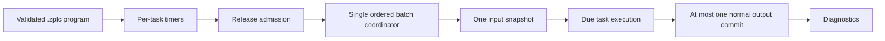

# Multitask Scheduler

ZPLC schedules configured PLC tasks through runtime-specific adapters. The current Zephyr path admits timer releases into one batch coordinator; the POSIX path runs the same task model for repeatable host-side workflows. These are logical runtime contracts, not evidence of timing or physical-I/O behavior on a board.

## Task model

Tasks are declared in `zplc.json` and compiled into the `.zplc` program. This release has one kind of task, the cyclic task. The model below is the same in simulation and on a target; the differences that remain are listed in [What is not identical in simulation](#what-is-not-identical-in-simulation).

| Property | Meaning |
|---|---|
| **Type** | Cyclic only. `trigger: "cyclic"` is a cyclic task. `trigger: "freewheeling"` is built as a cyclic task of the interval it declares and does not run faster than that interval. Event-triggered and interrupt-triggered tasks do not exist in this release: the build fails at the task definition, naming the task, its `trigger` field in `zplc.json` and the supported triggers, and both runtimes refuse an artifact that holds an event task. |
| **Interval** | Whole milliseconds, from 1 to 3 600 000. Every task has its own interval, and tasks of different intervals run in one program (at most 16 tasks). The interval is the period of the release and the deadline of the scan, not a measured cycle-time guarantee. |
| **Priority** | A lower number runs first. Priority only orders tasks that are released together. It does not interrupt a task that is running and it does not give a task more time. |
| **Entry point** | Program or function location in the compiled program. |

Rules:

1. **Release.** The tasks of a program start together: a start or a resume begins the schedule of every task at the same instant. After that a task is released once per interval. A release that arrives while the task is still running is not queued, and a host that dispatches late runs the task once, not once per missed release.
2. **Order.** Tasks released together are one batch. A batch runs its tasks by earlier release first, then by priority (the lower number first), then by task ID (the lower first).
3. **No preemption.** The tasks of a batch run one after the other, each to the end of its scan. Nothing suspends a task for another task or for a release. A breakpoint is the only thing that stops a scan before its end; see [Pause, resume, step and stop](#pause-resume-step-and-stop).
4. **One latch and one commit per batch.** A batch takes the input image once, before its first task, and every task of the batch reads that image. The output image is committed once, after its last task. A task that is not released in a batch does not run, and the process image keeps what it wrote.
5. **Deadline.** The deadline of a scan is its task's interval after the release of its batch. A task that ends later misses its deadline; see [Deadlines](#deadlines).

## Lifecycle

The scheduler loads task declarations, prepares its runtime queues, and reports state transitions such as `READY`, `RUNNING`, `PAUSED`, and `ERROR`. A program is admitted and validated before it is allowed to run. Logical execution budgets and runtime diagnostics are used to identify bounded-scan failures and overruns.

## Shared state

For each Zephyr due-set, timer callbacks only admit releases; they do not run PLC code. The coordinator orders admitted tasks by release time, priority, and task ID, then takes one input process-image snapshot. Due tasks run against shared runtime memory in that order. If no fault or control-plane closure occurs, the batch performs at most one normal output-process-image commit.

In simulation one thread serves the control requests and runs the batches, one after the other. The input image therefore cannot change while a batch runs, which is the single latch of rule 4, and the output image is the process image itself.

`STOP`, external pause, unregister, and scheduler faults close admission and drain in-flight coordinator work before returning. These guarantees describe the scheduler implementation and its host/native-sim tests. They do not establish WCET, jitter, electrical state, or board qualification.

### Priorities and start-up order (RT-013, RT-024)

The scan coordinator, the high-priority work queue or the normal one when there is none, has a lower priority number
than every communication thread of the application, which all run at `CONFIG_ZPLC_COMM_THREAD_PRIORITY` (8 by
default), and than the shell and log threads. The build checks it and fails otherwise. Boards with a network stack
set `CONFIG_NET_TC_THREAD_PREEMPTIVE=y`, because Zephyr's network threads are cooperative by default and would
outrank the scan.

The firmware starts the runtime before any service. The hardware layer, the core, the scheduler with the program
store and the restore of the stored program come first, and the shell, which is the control link, is started by
Zephyr before `main()`. The network, the time service, the fieldbus servers and MQTT or cloud provisioning start
after them, and each is allowed to fail: a service that does not come up is logged and counted, and the runtime that
is already up keeps running. The boot log names every step in the order it ran.

## Deadlines

A scan misses its deadline when its task ends more than one interval after the release of the batch it ran in: the task was released again before it was done, or the tasks ahead of it in the batch used its interval. A miss has these effects, in this order:

1. The **warning** flag is raised.
2. The miss is **counted**, for the task and in total.
3. The **overrun**, how far past the deadline the task ended, is recorded.
4. When the same task has missed `N` times in a row, the fault is **latched**: the outputs go to their safe state, the session is in `error`, and the status gives the reason and the task. A reset or a new program clears it.

A scan that ends in time ends the run of that task and clears its part of the warning. The count stays until a program is loaded or reset. A debugger step and a scan that stopped at a breakpoint are not checked.

`N`, the consecutive misses that latch the fault, is configurable. In simulation it is the environment variable `ZPLC_DEADLINE_MISS_LIMIT`, an integer from 1 to 1 000 000, read when the session starts; a value outside that range is ignored and a message is written to standard error. The default is 1: the first miss latches the fault, which is what the target scheduler does today.

The simulation reports a miss in the `status.get` result and in every `status.changed` event; a latched fault is also sent as a `runtime.error` event with the code `DEADLINE_MISS`. Fields that were already there keep their meaning.

| Field | Meaning |
|---|---|
| `stats.overruns` | Deadline misses of all tasks since the program was loaded or reset. |
| `tasks[].overruns` | Deadline misses of that task. |
| `deadline.warning` | `true` while any task has a run of misses that no scan in time has ended. |
| `deadline.misses` | The same count as `stats.overruns`. |
| `deadline.consecutive_misses` | The longest run of misses that is still going on. |
| `deadline.miss_limit` | `N`. |
| `deadline.last_overrun_us` | How far past its deadline the last late task ended, in microseconds. The host clock counts milliseconds, so the value is a multiple of 1000. |
| `fault.reason` | `none`, `deadline_miss`, `vm_fault` or `runtime_failure`. |
| `fault.task_id` | The task that latched the fault, or `null` when there is none. |

The `host_cadence` object is separate. It reports how late the host dispatched a batch after its tasks were due, and the releases that it skipped. That lateness is not a deadline miss in simulation.

## What is not identical in simulation

The five rules above are the same in simulation and on a target. These are not, and no measurement of any of them exists:

| Subject | Simulation | Target (Zephyr scheduler today) |
|---|---|---|
| Time source | The host monotonic clock in whole milliseconds. A deadline and an overrun are multiples of 1 ms. | The cycle counter, read in microseconds. |
| Instant of a release | The instant the host dispatches the batch. The wait between the instant a task was due and the dispatch is reported in `host_cadence` and is not a miss. | The timer stamps the release when it expires, so a coordinator that starts the batch late spends the deadline of the tasks in it. |
| Position of the next release | Tasks of different intervals keep a fixed grid from the common start: a late dispatch does not move the next release, and tasks that coincide are released together, as on the target. Tasks of one interval are released an interval after the previous dispatch, as earlier versions did, so a late dispatch moves the releases that follow it. | A periodic timer on a fixed grid: a late batch does not move the next release. |
| First release | The first scan after a start or a resume is a release of every task: the schedule begins at the start itself. | The first release of each task comes one interval after the start or the resume. |
| Two tasks of the same tick | Released at the same instant, so ordered by priority, then task ID. | The comparison is the same, but the release is stamped in each timer callback from the cycle counter. What order two timers of one tick get on a board is not stated here. |
| Speed and jitter | The VM runs on a host processor under a general-purpose operating system. | The VM runs on the board's processor. A program that is in time in simulation can miss on a target, and the reverse. |
| Reporting of a miss | The warning flag, the count, the last overrun, the configurable limit and the fault reason of the table above. | The count of each task and the total, and the state `error` once latched. The limit is fixed at one miss. The warning flag, the last overrun and the reason are not reported; they move to the target with the shared scheduler core (RT-008, RT-014). |

## Pause, resume, step and stop

The runtime keeps two things apart: the **physical outputs** (the pins) and the **logical state of the program** (the output process image, the force table and each task's program counter and stacks). A pause makes the first one safe and keeps the second one, so that a resume or a step continues the program from where it stopped (requirement RT-017). `STOP` ends the run and discards both.

| Operation | Physical outputs | Output image | Force table | Task scans |
|---|---|---|---|---|
| Pause (`zplc dbg pause`) | Safe (off) before the call returns | Kept | Kept | Pauses between scans: the batch in flight finishes first |
| Breakpoint | Safe (off); the batch commits once, then the pins are driven safe | Kept, partial scan included | Kept | The scan stops at the breakpoint with its program counter and stacks |
| Step (`zplc dbg step`) | The scan is committed, then the pins are driven safe | Kept, shows the stepped scan | Kept | Finishes the scan stopped at a breakpoint, or runs one whole scan; stops at the next cycle boundary or at the next breakpoint |
| Resume (`zplc dbg resume`) | Not driven by the resume itself | Kept | Kept | A scan stopped at a breakpoint continues from there at the next release; a pause between scans starts a new scan |
| `STOP` | Safe (off) | Zeroed | Cleared | Every task is back at its entry point; a scan a breakpoint interrupted, or a resume armed, is discarded |
| Fault | Safe (off) | Zeroed | Cleared | Latched; the faulted task keeps its program counter and error until a program is loaded |

Notes on the table:

- Safe means off for every output channel today. The pins are driven from that policy, never from the image, so a paused image that has a bit set does not energize it. A project-declared safe value per output is a separate requirement (RT-023).
- The first normal commit after a resume copies the output image, with the force table applied, to the pins. A resume does not energize anything by itself. A forced output that is on stays off while paused and comes on at that commit.
- A scan that continues after a resume or a step keeps what the first part of it saw: the instructions already executed, the evaluation stack, the first-scan flag and its own task id. Inputs are latched again at the start of the batch that continues it, so the remainder reads the inputs of that moment.
- The batch that stops at a breakpoint, and a step, commit the image to the pins once and then drive them safe. The time between the two writes is the driver's and is not measured here.
- Evidence for this behaviour is the Zephyr test suites on `native_sim` and QEMU (`scheduler_run_control`, `scheduler_admission`). The physical level is observed through the GPIO emulator of `native_sim`; no board has been measured.

## Diagnostics and evidence

Runtime diagnostics expose cycle counts, deadline misses, logical budget faults, process-image latch/commit counts, and timing-related observations. Their resolution, collection method, and meaning depend on the runtime and target profile. Native-sim evidence checks logical ordering and state transitions only. Measure WCET, jitter, deadline behavior, and physical outputs on the exact target/revision before relying on them operationally.
