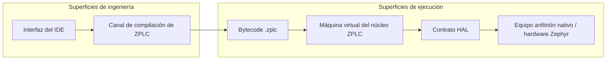

# Arquitectura del sistema

ZPLC se divide a propósito en superficies de ingeniería y superficies de ejecución.

Esta separación protege el comportamiento determinista del runtime en el hardware de control, y aun así ofrece los flujos modernos de IDE, compilador y simulación.

## La arquitectura de un vistazo

## Los límites principales del sistema

ZPLC se entiende mejor como cuatro límites y no como una sola aplicación monolítica:

1. **Límite de autoría.** Las personas trabajan en el IDE con archivos `.st`, `.ld` o modelos visuales.
2. **Límite de compilación.** La autoría en cada lenguaje converge en una transpilación canónica a ST, que genera el bytecode `.zplc` compartido.
3. **Límite de ejecución.** El núcleo de ejecución en C99 interpreta el bytecode de forma determinista en el hardware de destino.
4. **Límite de plataforma.** El hardware, la persistencia, los temporizadores, los sockets y los servicios del sistema operativo quedan detrás de la capa de abstracción de hardware (HAL).

## Los componentes principales

### 1. El IDE

El IDE es la superficie de ingeniería para quien opera y para quien desarrolla. Gestiona la edición de texto de Structured Text e Instruction List, la edición visual de Ladder, FBD y SFC, y la orquestación del proyecto (compilar, cargar, depurar).

### 2. El compilador

El compilador lleva todos los lenguajes IEC al mismo contrato de bytecode y runtime. Como la salida `.zplc` es única, ZPLC ofrece "un solo núcleo de ejecución y muchas vías de autoría" sin diferencias de comportamiento en el runtime.

### 3. El núcleo del runtime

El runtime (`libzplc_core`) es el límite de ejecución, escrito en C99 estricto. Se apoya en estos modelos operativos:
- **Regiones de memoria compartida** definidas de forma global para entradas (IPI), salidas (OPI), trabajo, retención y código.
- **Instancias de la máquina virtual** que guardan el estado de ejecución privado (punteros de pila y registros) de cada tarea.
- **API del planificador** que registra las tareas, las consulta y gestiona la temporización cíclica.

### 4. El contrato HAL

La capa de abstracción de hardware (HAL) es el puente entre el núcleo determinista y los microcontroladores físicos.
Para portar ZPLC a una arquitectura nueva basta con implementar `zplc_hal.h`:
- Temporización (`zplc_hal_tick`, `zplc_hal_sleep`)
- Manejo de E/S digitales y analógicas
- Persistencia en NVS
- Red y sockets
- Inicialización del registro de mensajes

Como todo pasa por la HAL, ZPLC garantiza una portabilidad profunda.

## Principios de trabajo

1. **El código de plataforma queda fuera del núcleo.** El núcleo nunca debe hablar directamente con los registros del microcontrolador ni con los controladores de Zephyr. Toda petición de hardware pasa por la HAL genérica.
2. **Ejecución acotada.** La memoria se asigna de forma estática en la compilación, y el runtime analiza y ejecuta el bytecode dentro de límites de memoria fijos. La temporización es otro asunto: no se ha medido ningún tiempo de ciclo en una placa.
3. **Ejecución de varias tareas.** El sistema aísla el contexto de ejecución de cada programa y expone de forma segura los bloques de datos globales compartidos (como las etiquetas de Modbus o las entradas físicas).

## Siguientes pasos

- [Visión general de la plataforma](../platform-overview/index.md)
- [Visión general del runtime](../runtime/index.md)
- [Integración y carga](../integration/index.md)
