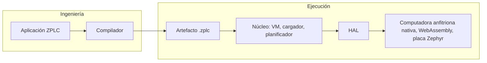

# Arquitectura del sistema

ZPLC mantiene separado lo que usted escribe de lo que mueve la máquina. Esta página muestra dónde están las divisiones, qué hay a cada lado y qué reglas las sostienen. Léala antes de portar ZPLC, de agregar una ruta de lenguaje o de interpretar qué dice un resultado de un lugar sobre otro.

## Las partes y cómo se conectan

| Límite | Qué hay a cada lado | Qué lo cruza |
| --- | --- | --- |
| Edición | Usted, la aplicación ZPLC y la línea de comandos, trabajando en ST, IL, LD, FBD o SFC | Archivos de proyecto: código fuente, `zplc.json`, escenarios |
| Compilación | El compilador (`packages/zplc-compiler`) y los transpiladores de lenguaje de la aplicación | Un artefacto `.zplc` y su mapa de depuración |
| Runtime | El núcleo en C99 de `firmware/lib/zplc_core/src/core`: la VM, el cargador con su verificador y el núcleo del planificador | Llamadas a las funciones `zplc_hal_*` |
| Plataforma | Un puerto del HAL: Zephyr, POSIX, WebAssembly o FreeRTOS | El reloj, los pines, el almacenamiento y la red del dispositivo |

## Quién posee qué

**La aplicación ZPLC** es donde trabaja una persona: edita los cinco lenguajes, compila, simula, observa, fuerza, carga y ejecuta lecciones. Los pasos de compilación y de prueba también están en la línea de comandos, de modo que un proyecto se puede compilar y comprobar sin ventana. Véanse [las guías de lenguaje](../languages/index.md).

**El compilador** convierte cada lenguaje en un único artefacto. La lista de instrucciones, el diagrama de escalera, el diagrama de bloques de función y el diagrama funcional secuencial se transpilan a texto estructurado con los transpiladores de `packages/zplc-ide/src/compiler/transpilers`, y el compilador lo convierte en bytecode. Como el formato del artefacto es uno solo, un programa se comporta igual sin importar el lenguaje en que se escribió. El artefacto se vuelve a comprobar al cargarlo; no se confía en él por haberlo generado el compilador.

**El núcleo** es `libzplc_core`, escrito en C99. Define qué significa un programa: el conjunto de instrucciones, las cinco regiones de memoria, el cargador que verifica un artefacto antes de ejecutar nada y el núcleo del planificador que decide qué tarea corre y cuándo. Nunca toca registros, controladores ni sockets. Véanse la [descripción del runtime](../runtime/index.md), el [modelo de memoria](../runtime/memory-model.md) y el [planificador](../runtime/scheduler.md).

**El HAL** es el único encabezado, `firmware/lib/zplc_core/include/zplc_hal.h`, por el que el núcleo pide a una plataforma el tiempo, la E/S, el almacenamiento, los cerrojos y una línea de registro. Lo implementan cuatro puertos. Véase el [contrato del HAL](../runtime/hal-contract.md).

## Dónde puede ejecutarse un programa

| Runtime | Se compila a partir de | Evidencia que aporta |
| --- | --- | --- |
| Simulación nativa (`zplc_runtime`) | El núcleo y el puerto POSIX | Host: el resultado de cada ciclo, en un procesador y un reloj de la computadora anfitriona |
| Runtime de software (WebAssembly) | El mismo código de sesión y el mismo núcleo del planificador, compilados con el puerto WebAssembly | Host, degradada: sin bloques de red, sin puerto serie, sin pines. Véase [el runtime de software](../runtime/browser-runtime.md) |
| Firmware Zephyr | El núcleo y el puerto Zephyr, una imagen por placa | Destino emulado o `cross-build` por ahora; véase [compatibilidad de hardware](../reference/capabilities-evidence.md) |

Los tres cargan los mismos artefactos `.zplc` y responden las mismas solicitudes de sesión, de modo que un escenario que pasa en simulación ejercita la lógica que usted cargará. No ejercita los tiempos ni el comportamiento eléctrico de una placa.

## Reglas que respeta el diseño

1. **Sin código de plataforma en el núcleo.** Los archivos de `src/core` no incluyen ningún encabezado de plataforma, y un destino de compilación los compila solos para demostrarlo. Todo lo que pertenece a un pin, un reloj, un archivo o un socket pasa por `zplc_hal_*`.
2. **Un artefacto, un verificador.** Todo runtime carga un programa con el mismo cargador, que rechaza el código que no puede demostrar bien formado.
3. **Memoria estática.** Las regiones tienen tamaños fijos definidos al compilar, y el núcleo no reserva memoria mientras corre un programa.
4. **Semántica de ciclo compartida.** Un solo núcleo del planificador decide la admisión, el orden, los plazos y la retención de la falla en todos los runtimes, y las pruebas comparan las decisiones del host y del destino con una traza de referencia.
5. **La evidencia conserva su nivel.** Un resultado de host no es un resultado de placa. Toda página que dice qué funciona dice también si la evidencia es de host, QEMU, compilación para el destino, banco de pruebas o manual.

## Siguientes pasos

- [Descripción de la plataforma](../platform-overview/index.md) explica qué es ZPLC y qué no es.
- [Descripción del runtime](../runtime/index.md) entra en el núcleo.
- [Integración y carga](../integration/index.md) conecta un dispositivo con otros sistemas.
