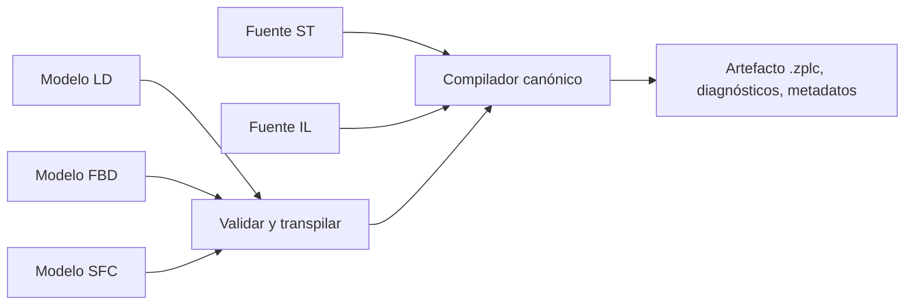

# Flujo del compilador

ZPLC usa un compilador canónico para el código fuente y para los modelos
visuales admitidos.

## Camino rápido

1. Compile el proyecto guardado en una carpeta.
2. Lea los diagnósticos y la identidad del artefacto producido.
3. Ejecute pruebas temporales y la simulación POSIX nativa con ese artefacto.
4. Solo después considere el flujo de hardware, que inicia una persona por separado.

## Canalización

## Qué acepta el compilador

Todos los lenguajes comparten un solo backend, pero cada uno acepta únicamente
las construcciones que admiten su editor, su transpilador y el compilador. Los
lenguajes no tienen las mismas funciones ni el mismo comportamiento al depurar.
Revise la salida del compilador y el resultado de un escenario en su propio
proyecto.

## Límite del artefacto

El artefacto se verifica antes de que el runtime lo cargue. Una compilación
correcta en el equipo anfitrión no demuestra que una placa pueda grabarse,
restaurarse, cumplir sus tiempos o activar una salida. Eso requiere una
ejecución en esa placa; consulte [despliegue](./deployment.md).
