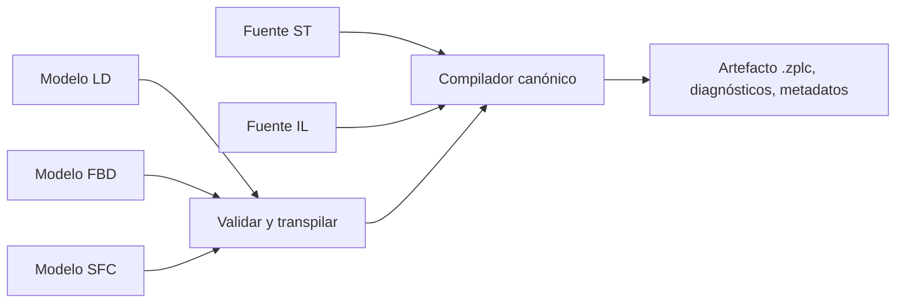

# Flujo del compilador

ZPLC usa un compilador canónico para el código fuente y para los modelos
visuales admitidos.

## Camino rápido

1. Compile el proyecto guardado en una carpeta.
2. Lea los diagnósticos y la identidad del artefacto producido.
3. Ejecute pruebas temporales y la simulación POSIX nativa con ese artefacto.
4. Solo después considere el flujo de hardware, que inicia una persona por separado.

## Canalización



## Qué acepta el compilador

Todos los lenguajes comparten un solo backend, pero cada uno acepta únicamente
las construcciones que admiten su editor, su transpilador y el compilador. Los
lenguajes no tienen las mismas funciones ni el mismo comportamiento al depurar.
Revise la salida del compilador y el resultado de un escenario en su propio
proyecto.

## Mapa de depuración

El compilador escribe un mapa de depuración junto al artefacto. Dos
compilaciones del mismo proyecto dan el mismo bytecode y el mismo mapa, byte por
byte: el mapa no lleva la hora de la compilación y `compilerVersion` es la
versión del paquete del compilador. Cada sentencia tiene el rango de todas las
instrucciones que genera, con su línea y su columna, de modo que cualquier
contador de programa dentro de una sentencia se resuelve a esa sentencia. El
final de una función y las rutinas auxiliares que siguen al ciclo no pertenecen
a ninguna sentencia.

## Advertencias

Una compilación que termina bien puede aun así avisar al autor de lo que merece
una revisión. Cada advertencia tiene un código estable, una posición y, en un
proyecto, el archivo al que pertenece; Studio, la CLI (`Warning:`) y la API de
herramientas muestran las mismas advertencias para el mismo proyecto.

| Código | Se informa cuando | Nivel |
|---|---|---|
| `NON_IEC_HEX_LITERAL` | se escribe `0xFF`; IEC 61131-3 escribe `16#FF` | `default` |
| `NON_IEC_REAL_LITERAL` | un literal real tiene exponente y no tiene parte fraccionaria, `1e3`; IEC escribe `1.0E3` | `default` |
| `IMPLICIT_NARROWING` | un valor se guarda en un tipo más estrecho y conserva sus bits bajos (es un error con `compiler.strictTypes`) | `default` |
| `UNREACHABLE_STATEMENT` | una sentencia sigue a `RETURN`, `EXIT` o `CONTINUE`, o a un `IF` o `CASE` con `ELSE` en el que toda rama sale, en la misma lista: una advertencia por el resto de la lista | `default` |
| `UNUSED_VARIABLE` | una variable `VAR` o `VAR_TEMP` nunca se lee ni se escribe | `default` |
| `WRITE_ONLY_VARIABLE` | una variable `VAR` o `VAR_TEMP` se escribe y nunca se lee | `all` |
| `OPTION_IGNORED` | una opción de `zplc.json` tiene un valor que no cambia nada | `default` |
| `SOURCE_NOT_COMPILED` | un archivo Structured Text de la carpeta del proyecto no está en `src` ni en una biblioteca declarada | `default` |
| `WATCHDOG_RESET_NO_EFFECT` | se llama a `WATCHDOG_RESET()`: no hace nada, el runtime alimenta el watchdog de hardware por sí mismo después de cada ciclo completado | `default` |

Una rama que una condición constante desactiva (`IF FALSE THEN`) no es código
inalcanzable: IEC 61131-3 no define una regla para ello y el compilador no
evalúa condiciones. Las variables que no se comprueban son las entradas,
salidas y variables de entrada y salida de una unidad, las globales, las que
tienen una dirección directa (`AT %Q0.0`) y las que tienen una etiqueta de
comunicación; un miembro de un bloque de función que otra unidad lee como
`instancia.miembro` cuenta como usado.

## Opciones del proyecto

| Opción | Valores | Por defecto | Efecto |
|---|---|---|---|
| `compiler.warnings` | `none`, `default`, `all` | `default` | Qué advertencias informa la compilación. `none` no informa ninguna y `all` agrega `WRITE_ONLY_VARIABLE`. |
| `compiler.strictTypes` | `true`, `false` | `false` | Un estrechamiento implícito es un error en el valor, que nombra ambos tipos, en lugar de la advertencia `IMPLICIT_NARROWING`. |
| `compiler.debug` | `true`, `false` | `true` | El mapa de depuración lleva los rangos de sentencias y las correspondencias de línea que necesitan los puntos de interrupción y la línea actual. Con `false` solo lista las variables y la memoria; el código es el mismo. |
| `compiler.optimization` | `none`, `size`, `speed` | `none` | El compilador tiene un solo generador de código: el código es el mismo con cualquier valor. `size` y `speed` se aceptan para que los proyectos antiguos compilen, y la compilación avisa con `OPTION_IGNORED`. |
| `build.generateDebugInfo` | `true`, `false` | `false` | `zplc-cli compile <espacio> --output <archivo>` escribe además el mapa de depuración junto al artefacto, como `<archivo>.map.json`. |
| `libraries` | lista de carpetas | ninguna | Carpetas de archivos fuente que se compilan con el proyecto, véase abajo. |

Un valor que no está en la tabla es un error de proyecto que nombra la opción.

## Bibliotecas

`libraries` en `zplc.json` lista carpetas, relativas al proyecto, cuyos
archivos fuente se compilan con el proyecto: las funciones, bloques de función,
tipos y globales que declaran los ve todo programa, igual que los de `src`, y
una declaración hecha en una biblioteca y en `src` es un error que nombra los
dos archivos.

```json
{ "libraries": ["lib/motors", "lib/valves"] }
```

Una carpeta se lee como `src`: sus archivos directamente, sin bajar más, y sin
seguir enlaces. Una tarea ejecuta programas de `src`; los archivos de una
biblioteca declaran bloques y tipos y solo se ejecutan donde un programa los
usa. `src` sigue funcionando como antes, y una carpeta que no está en la lista
no se compila: la compilación avisa con `SOURCE_NOT_COMPILED` y nombra cada
archivo Structured Text que deja fuera. El mapa de depuración nombra el archivo
de cada bloque de biblioteca en su `sourceRef`.

## Listado de ensamblador

El compilador convierte Structured Text en texto ensamblador y el ensamblador lo
convierte en bytecode. El texto sigue disponible para inspección: Studio lo muestra
en el diálogo de código generado, y la CLI lo entrega con `--emit asm`, impreso o
escrito en `--output`:

```bash
zplc-cli compile <espacio|archivo-fuente> --emit asm --output build/main.asm
```

Para un espacio de trabajo el listado contiene el código de cada programa, en el
orden del bytecode, cada uno bajo un comentario que lo nombra. Es una vista de la
compilación y no un fuente: ensamblarlo da el bytecode del artefacto, y nada se
demuestra leyéndolo.

## Operandos y directivas del ensamblador

El generador de código escribe texto en ensamblador y el ensamblador lo convierte
en el bytecode del artefacto. Un operando debe caber en su campo. Un valor que
no cabe es un error que nombra la línea y el campo; el ensamblador nunca lo
trunca.

| Campo | Opcodes | Valores aceptados |
|---|---|---|
| Inmediato de 8, 16 o 32 bits | `PUSH8`, `PICK`, `PUSH16`, `PUSH32` | de -2^(n-1) a 2^n - 1: con o sin signo, la VM lo extiende con signo |
| Dirección de memoria de 16 bits | `LOAD8` a `STORE64` | 0 a 65535 |
| Dirección de código de 16 bits | `JMP`, `JZ`, `JNZ`, `CALL` | una instrucción del código, 0 a 65535 |
| Desplazamiento de 8 bits con signo | `JR`, `JRZ`, `JRNZ` | -128 a 127 desde la instrucción siguiente |
| Tipo de 32 bits | `COMM_EXEC`, `COMM_STATUS`, `COMM_RESET` | 0 a 4294967295 |

Es un error un salto a una etiqueta posterior a la última instrucción, a un
destino numérico fuera del código, o a una etiqueta a más de 127 bytes con un
salto relativo. También lo es un punto de entrada, un campo de etiqueta o una
dirección reubicada que no cabe en su campo: `relocateBytecode` deja el bytecode
sin cambios cuando una dirección pasaría de 65535.

El generador de código escribe solamente instrucciones de la tabla de opcodes
generada: el tipo de las líneas que emite se construye a partir de esa tabla y
cada línea se comprueba al escribirla. Una línea que no está en la tabla es un
error interno del compilador que la nombra; nunca llega al ensamblador.

| Directiva | Efecto en la salida |
|---|---|
| `.ORG addr` | El siguiente byte queda en `addr`; el hueco se rellena con bytes `NOP`. Retroceder es un error. |
| `.ENTRY etiqueta` o `.ENTRY addr` | Fija el punto de entrada del archivo; debe ser una instrucción del código. |
| `.DB v, v, ...` y `.BYTE` | Emite cada valor, de -128 a 255, como un byte en ese lugar. Una etiqueta posterior queda después de los bytes. El cargador verifica el segmento de código como instrucciones, así que los bytes deben decodificarse como tales. |
| `.TAG addr tipo id valor` | Agrega una etiqueta de variable al segmento TAGS; los cuatro números deben caber en 16, 8, 8 y 32 bits. |

## Identidad de compilación

Un artefacto lleva una identidad de compilación, y el mapa de depuración de la misma
compilación la registra como `buildId`: los mismos 8 dígitos hexadecimales. Studio y la CLI
la usan cuando un mapa se asocia a un programa: se rechaza un mapa cuya identidad no es la del
programa, mostrando ambas identidades, y un programa o un mapa sin identidad se dice que no
la tiene en lugar de darlos por coincidentes. La identidad es una función del código y de la
tabla de tareas, así que dos compilaciones del mismo proyecto tienen la misma. La tabla de
tareas registra además la profundidad de la pila de evaluación y la de llamadas de cada
tarea, que la compilación comprueba contra el destino; véase el
[conjunto de instrucciones](../runtime/isa.md#profundidad-de-las-tareas-e-identidad-de-compilación).

## Límite del artefacto

El artefacto se verifica antes de que el runtime lo cargue. Una compilación
correcta en el equipo anfitrión no demuestra que una placa pueda grabarse,
restaurarse, cumplir sus tiempos o activar una salida. Eso requiere una
ejecución en esa placa; consulte [despliegue](./deployment.md).
