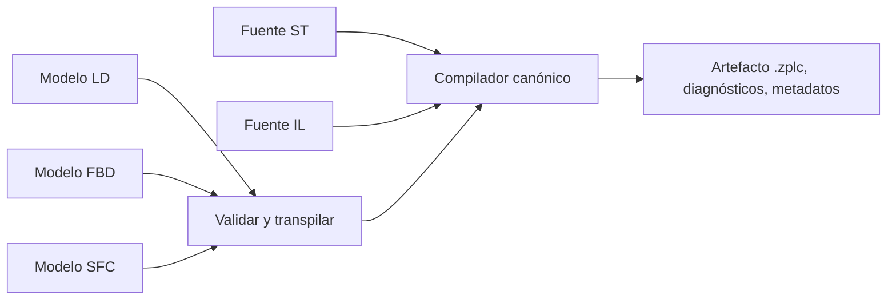

# Flujo del compilador

Esta página explica qué ocurre cuando usted compila un proyecto de ZPLC: la canalización, cómo se informan los errores y las advertencias, las opciones del proyecto que cambian una compilación y cómo inspeccionar el resultado. La compilación es la misma en la aplicación, en la línea de comandos y en la API de herramientas.

## Camino rápido

1. Compile el proyecto (`Ctrl+B`, o `zplc-cli compile <workspace> --output <file>` desde una terminal).
2. Lea los diagnósticos y la identidad del artefacto que produjo.
3. Ejecute las pruebas de escenario y la simulación nativa con ese artefacto.
4. Solo después considere el flujo de hardware, que inicia una persona por separado ([Cargar un programa](./deployment.md)).

## Canalización

El texto estructurado y la lista de instrucciones llegan al compilador como texto. Los lenguajes gráficos se validan y se traducen primero a texto estructurado. Todos terminan en un solo artefacto con sus diagnósticos y sus metadatos.



Todos los lenguajes comparten un solo backend, pero cada uno acepta únicamente las construcciones que su editor, su traductor y el compilador admiten, y no tienen funciones ni depuración idénticas. Compile su propio proyecto y ejecute un escenario para ver qué hace.

## Errores

Un error detiene la compilación y no produce ningún artefacto. Una compilación informa de cada error independiente de los archivos que leyó, cada uno con un **código**, un mensaje y una posición: el archivo, y la línea y la columna donde empieza y donde termina. El código nombra el tipo de problema (`UNKNOWN_IDENTIFIER`, `TYPE_MISMATCH`, `WORK_MEMORY_EXCEEDED`) y no cambia cuando se reformula el mensaje, de modo que puede buscarlo. Los [códigos de diagnóstico](../reference/diagnostic-codes.md) listan cada código con un programa que lo provoca.

La línea de comandos imprime el código al final de la línea, entre corchetes:

```text
src/Motor.st:12:5: Unknown identifier 'Speed' [UNKNOWN_IDENTIFIER]
```

Un programa que no cabe en la memoria del destino dice cuánto necesita, cuánto tiene el destino y qué ocupa más. Esto vale para la memoria de trabajo, la memoria retentiva y el código:

```text
CODE exceeds the target memory profile: 46012 bytes required, 45056 bytes available (the code memory of the target profile). Largest consumers: Program Main (41000 bytes), Function Scale (3100 bytes), Helper: byte copy (900 bytes)
```

## Advertencias

Una compilación que termina bien aún puede señalar algo que merece una revisión. Cada advertencia tiene un código estable, una posición y, en un proyecto, el archivo al que pertenece. La aplicación, la línea de comandos (`Warning:`) y la API de herramientas muestran las mismas advertencias para el mismo proyecto.

| Código                     | Se informa cuando                                                                                                                                                            | Nivel     |
| -------------------------- | ---------------------------------------------------------------------------------------------------------------------------------------------------------------------------- | --------- |
| `NON_IEC_HEX_LITERAL`      | se escribe `0xFF`; IEC 61131-3 escribe `16#FF`                                                                                                                               | `default` |
| `NON_IEC_REAL_LITERAL`     | un literal real tiene exponente y no tiene fracción, `1e3`; IEC escribe `1.0E3`                                                                                              | `default` |
| `IMPLICIT_NARROWING`       | un valor se almacena en un tipo más estrecho y conserva sus bits bajos (es un error con `compiler.strictTypes`)                                                              | `default` |
| `UNREACHABLE_STATEMENT`    | una instrucción sigue a `RETURN`, `EXIT` o `CONTINUE`, o a un `IF` o `CASE` con `ELSE` cuyas ramas salen todas, en la misma lista: una advertencia para el resto de la lista | `default` |
| `UNUSED_VARIABLE`          | una variable `VAR` o `VAR_TEMP` no se lee ni se escribe nunca                                                                                                                | `default` |
| `WRITE_ONLY_VARIABLE`      | una variable `VAR` o `VAR_TEMP` se escribe y no se lee nunca                                                                                                                 | `all`     |
| `OPTION_IGNORED`           | una opción de `zplc.json` tiene un valor que no cambia nada                                                                                                                  | `default` |
| `SOURCE_NOT_COMPILED`      | un archivo de texto estructurado de la carpeta del proyecto no está en `src` ni en una biblioteca listada                                                                    | `default` |
| `WATCHDOG_RESET_NO_EFFECT` | se llama a `WATCHDOG_RESET()`: no hace nada, porque el runtime alimenta por sí mismo el watchdog de hardware después de cada ciclo completado                                | `default` |

Una rama que una condición constante deshabilita (`IF FALSE THEN`) no es código inalcanzable: IEC 61131-3 no define ninguna regla para ella y el compilador no evalúa ninguna condición. Las variables que no se comprueban son las entradas, salidas y variables de entrada/salida de una unidad, las globales, las variables con dirección directa (`AT %Q0.0`) y las que tienen una etiqueta de comunicación; un miembro de bloque de función que otra unidad lee como `instance.member` cuenta como usado.

## Opciones del proyecto

| Opción                    | Valores                  | Por defecto | Efecto                                                                                                                                                                                                                    |
| ------------------------- | ------------------------ | ----------- | ------------------------------------------------------------------------------------------------------------------------------------------------------------------------------------------------------------------------- |
| `compiler.warnings`       | `none`, `default`, `all` | `default`   | Qué advertencias informa la compilación. `none` no informa ninguna, `all` agrega `WRITE_ONLY_VARIABLE`.                                                                                                                   |
| `compiler.strictTypes`    | `true`, `false`          | `false`     | Un estrechamiento implícito es un error en el valor, con el nombre de ambos tipos, en lugar de la advertencia `IMPLICIT_NARROWING`.                                                                                       |
| `compiler.debug`          | `true`, `false`          | `true`      | El mapa de depuración lleva los rangos de instrucciones y las asociaciones de líneas que necesitan los puntos de parada y la línea actual. Con `false` lista solo las variables y la memoria; el código es el mismo.      |
| `compiler.optimization`   | `none`, `size`, `speed`  | `none`      | El compilador tiene un solo generador de código, así que el código es el mismo con cualquier valor. `size` y `speed` se aceptan para que los proyectos antiguos se compilen, y la compilación avisa con `OPTION_IGNORED`. |
| `build.generateDebugInfo` | `true`, `false`          | `false`     | `zplc-cli compile <workspace> --output <file>` escribe además el mapa de depuración junto al artefacto, como `<file>.map.json`.                                                                                           |
| `libraries`               | lista de carpetas        | ninguna     | Carpetas de archivos fuente que se compilan con el proyecto, vea abajo.                                                                                                                                                   |

Un valor que no figura en la tabla es un error de proyecto que nombra la opción.

## Bibliotecas

`libraries` en `zplc.json` lista carpetas, relativas al proyecto, cuyos archivos fuente se compilan con el proyecto. Las funciones, los bloques de función, los tipos y las globales que declaran los ven todos los programas, igual que los de `src`, y una declaración hecha en una biblioteca y en `src` es un error que nombra ambos archivos.

```json
{ "libraries": ["lib/motors", "lib/valves"] }
```

Una carpeta se lee como se lee `src`: sus archivos directamente, no más abajo, y no se sigue ningún enlace. Una tarea ejecuta programas de `src`; los archivos de una biblioteca declaran bloques y tipos, y se ejecutan solo donde un programa los usa. Una carpeta que no está listada no se compila: la compilación avisa con `SOURCE_NOT_COMPILED` y nombra cada archivo de texto estructurado que deja fuera. El mapa de depuración nombra el archivo de cada bloque de biblioteca en su `sourceRef`.

## Mapa de depuración

El compilador escribe un mapa de depuración junto al artefacto. Dos compilaciones del mismo proyecto dan el mismo bytecode y el mismo mapa, byte a byte: el mapa no lleva la hora de la compilación, y `compilerVersion` es la versión del paquete del compilador. Cada instrucción tiene el rango de todas las instrucciones de máquina que genera, con su línea y su columna, de modo que cualquier contador de programa dentro de una instrucción se resuelve a esa instrucción. El final de una función y las rutinas auxiliares posteriores al ciclo no pertenecen a ninguna instrucción.

## Identidad de compilación

Un artefacto lleva una identidad de compilación, y el mapa de depuración de la misma compilación la registra como `buildId`: los mismos 8 dígitos hexadecimales. Cuando se asocia un mapa a un programa, la aplicación y la CLI rechazan un mapa cuya identidad no es la del programa y dicen ambas identidades; un programa o un mapa sin identidad se informa como que no la tiene, en lugar de hacerlos coincidir. La identidad es función del código y de la tabla de tareas, así que dos compilaciones del mismo proyecto tienen la misma. La tabla de tareas también registra la profundidad de la pila de evaluación y la profundidad de llamadas de cada tarea, que la compilación comprueba contra el destino; vea el [conjunto de instrucciones](../runtime/isa.md#profundidad-de-las-tareas-e-identidad-de-compilación).

## Listado de ensamblador

El compilador convierte el texto estructurado en texto ensamblador, y el ensamblador lo convierte en bytecode. El texto sigue disponible para su inspección: la aplicación lo muestra en el diálogo de código generado, y la CLI lo entrega con `--emit asm`, impreso o escrito en `--output`:

```bash
zplc-cli compile <workspace|source-file> --emit asm --output build/main.asm
```

Para un proyecto, el listado contiene el código de todos los programas, en el orden del bytecode, cada uno bajo un comentario que lo nombra. Es una vista de la compilación, no un código fuente: ensamblarlo da el bytecode del artefacto, y leerlo no prueba nada por sí solo.

## Operandos y directivas del ensamblador

Un operando tiene que caber en su campo. Un valor que no cabe es un error que nombra la línea y el campo; el ensamblador nunca lo trunca.

| Campo                              | Códigos de operación                     | Valores aceptados                                                              |
| ---------------------------------- | ---------------------------------------- | ------------------------------------------------------------------------------ |
| Inmediato de 8, 16 o 32 bits       | `PUSH8`, `PICK`, `PUSH16`, `PUSH32`      | de -2^(n-1) a 2^n - 1: escrito con o sin signo, la VM lo extiende con el signo |
| Dirección de memoria de 16 bits    | `LOAD8` a `STORE64`                      | 0 a 65535                                                                      |
| Dirección de código de 16 bits     | `JMP`, `JZ`, `JNZ`, `CALL`               | una instrucción del código, 0 a 65535                                          |
| Desplazamiento de 8 bits con signo | `JR`, `JRZ`, `JRNZ`                      | -128 a 127 desde la instrucción siguiente                                      |
| Tipo de 32 bits                    | `COMM_EXEC`, `COMM_STATUS`, `COMM_RESET` | 0 a 4294967295                                                                 |

Es un error un salto a una etiqueta posterior a la última instrucción, a un destino numérico fuera del código, o a una etiqueta a más de 127 bytes con un salto relativo. También lo es un punto de entrada, un campo de etiqueta o una dirección reubicada que no cabe en su campo: `relocateBytecode` deja el bytecode sin cambios cuando una dirección pasaría de 65535.

El generador de código escribe solo instrucciones de la tabla de códigos de operación generada, y cada línea se comprueba al escribirse. Una línea que no está en la tabla es un error interno del compilador que la nombra; nunca llega al ensamblador.

| Directiva                      | Efecto en la salida                                                                                                                                                                                                                   |
| ------------------------------ | ------------------------------------------------------------------------------------------------------------------------------------------------------------------------------------------------------------------------------------- |
| `.ORG addr`                    | El byte siguiente está en `addr`; el hueco se rellena con bytes `NOP`. Retroceder es un error.                                                                                                                                        |
| `.ENTRY label` o `.ENTRY addr` | Fija el punto de entrada del archivo; tiene que ser una instrucción del código.                                                                                                                                                       |
| `.DB v, v, ...` y `.BYTE`      | Emite cada valor, de -128 a 255, como un byte en este lugar. Una etiqueta posterior queda después de los bytes. El cargador verifica el segmento de código como instrucciones, así que los bytes tienen que decodificarse como tales. |
| `.TAG addr type id value`      | Agrega una etiqueta de variable al segmento TAGS; los cuatro números tienen que caber en 16, 8, 8 y 32 bits.                                                                                                                          |

## Lo que demuestra el artefacto

El artefacto se verifica antes de que el runtime lo cargue. Una compilación correcta en el host no demuestra que una placa pueda recibir el firmware, que se restaure el estado, que se cumpla el tiempo ni que se maneje una salida. Eso necesita una ejecución en esa placa; vea [Cargar un programa](./deployment.md).
