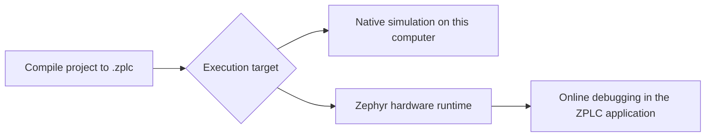

# Integración y despliegue

Esta página traza el camino de un programa compilado a un destino en marcha y dice qué debe hacer cuando su hardware no es una de las placas que ZPLC ya compila.

## A dónde va un programa

El compilador convierte un proyecto en un archivo `.zplc`. Usted elige dónde se ejecuta:

La simulación no necesita placa. Para hardware, grabe el runtime una vez ([Grabar el firmware](../guides/flash-firmware.md)) y despliegue después los programas desde la aplicación ([Despliegue](../ide/deployment.md)). Son dos operaciones distintas, y usted inicia ambas.

## Use una placa que ZPLC ya compila

Hay siete placas en el manifiesto, todas en el nivel `cross-build`: el firmware compila y cabe en su presupuesto en integración continua, y ninguna placa tiene un registro de hardware. La lista, con el comando de compilación de cada una, está en [Placas](../reference/boards.md). Para agregar una, siga [Portar ZPLC a una placa nueva](../guides/port-to-a-board.md).

## Incorpore el runtime en firmware propio

Si fabrica su propio hardware, o no quiere la imagen de la aplicación de ZPLC, incorpore el núcleo usted mismo:

1. **Enlace el núcleo.** Agregue la biblioteca ANSI C99 `firmware/lib/zplc_core` a su compilación con CMake.
2. **Implemente la HAL.** Provea las funciones C del [contrato de la HAL](../runtime/hal-contract.md) para sus pines y controladores, como `zplc_hal_tick`, `zplc_hal_gpio_read` y `zplc_hal_gpio_write`.
3. **Inicie el planificador.** Desde su hilo `main()`, llame a `zplc_sched_init()`, cargue un programa con `zplc_sched_load()` e inícielo con `zplc_sched_start()`. Las llamadas están en la [API del runtime](../reference/runtime-api.md).

El núcleo solo toca el hardware a través de la HAL, así que el port es la HAL. La compilación cruzada de un port propio demuestra que compila. No demuestra su temporización ni su E/S.

## Compruebe el hardware para los protocolos que necesita

Un protocolo necesita la capa inferior en la placa:

| Protocolo  | La placa necesita                                                    |
| ---------- | -------------------------------------------------------------------- |
| MQTT       | Una interfaz Wi-Fi o Ethernet en la configuración de Zephyr          |
| Modbus TCP | Una interfaz Ethernet o Wi-Fi y sus sockets                          |
| Modbus RTU | Un UART con un transceptor RS-485 en la placa                        |

La clase de red de cada placa está en [Placas](../reference/boards.md). Qué se ejercitó de cada protocolo, y con qué nivel de evidencia, está en [Conectividad](../runtime/connectivity.md).
