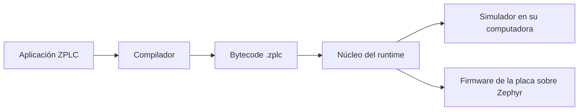

# Panorama de plataforma

Esta página es el mapa de ZPLC. Nombra las cuatro partes, muestra el camino que sigue un programa y dice qué tipo de
evidencia respalda cada parte, para que sepa en qué confiar antes de leer las páginas detalladas.

## Las partes

| Parte                                     | Qué es                                                                                                                                              | Dónde está                                             |
| ----------------------------------------- | --------------------------------------------------------------------------------------------------------------------------------------------------- | ------------------------------------------------------ |
| **Aplicación ZPLC**                       | El programa de escritorio en el que escribe, compila, prueba y simula. También contiene el curso Aprender.                                          | `packages/zplc-ide/`                                   |
| **Compilador**                            | Convierte texto estructurado, lista de instrucciones, escalera, diagrama de bloques de función y diagrama funcional secuencial en bytecode `.zplc`. | `packages/zplc-ide/src/compiler/` y los transpiladores |
| **Núcleo del runtime**                    | Un intérprete de bytecode en C99 con validación de programas, estado del runtime y un planificador portátil. El mismo código corre en todas partes. | `firmware/lib/zplc_core/`                              |
| **Capa de abstracción de hardware (HAL)** | La interfaz pequeña que el núcleo usa para relojes, almacenamiento, E/S y transportes. Un puerto la implementa para cada plataforma.                | `firmware/lib/zplc_core/` y los puertos de las placas  |

## Cómo viaja un programa

1. Usted escribe el programa en la aplicación, en cualquiera de los cinco lenguajes.
2. El compilador lo comprueba y escribe un único archivo `.zplc`, con las tareas y los valores seguros declarados de las
   salidas.
3. El **simulador** carga ese archivo en su computadora. Es el mismo núcleo del runtime, construido para el host.
4. Para una placa, usted compila el firmware, lo graba, se conecta, carga el archivo `.zplc` y lo ejecuta. Una persona
   inicia cada uno de estos pasos, y las herramientas de IA y MCP no pueden iniciar ninguno.

El cargador del runtime rechaza un programa compilado para otra versión del contrato, así que usted vuelve a compilar un
programa cuando actualiza ZPLC.

## En qué confiar y por qué

ZPLC indica el nivel de evidencia de cada afirmación. Un resultado en un nivel nunca demuestra uno superior.

| Nivel                  | Qué demuestra                                                                                  |
| ---------------------- | ---------------------------------------------------------------------------------------------- |
| Host                   | La lógica es correcta en su computadora, con el reloj virtual del simulador.                   |
| QEMU y `native_sim`    | El runtime y el planificador corren en un procesador emulado. Sin placa.                       |
| Compilación de destino | El firmware de una placa compila y cabe en su presupuesto de flash y RAM (`cross-build`).      |
| Banco y manual         | Una persona lo ejecutó en una placa física y lo registró. Hoy ninguna placa tiene un registro. |

[Compatibilidad de hardware](../reference/capabilities-evidence.md) enumera el nivel de cada placa, y
[Seguridad y limitaciones](../safety-and-limitations.md) dice qué no es ZPLC: no es un PLC de seguridad, no garantiza
tiempos y no debe controlar maquinaria.

## Reglas de diseño

- **Memoria acotada.** El núcleo usa regiones de memoria fijas y declaradas, y cada perfil de placa fija sus propios tamaños.
- **El HAL es la única puerta al hardware.** El núcleo nunca toca un dispositivo, así que una plataforma puede probarse aparte de la lógica.
- **Las salidas fallan en modo seguro.** Cada salida tiene un valor seguro, normalmente apagado. Una parada, una falla o un programa inválido nunca se reanudan solos.
- **Un único núcleo de planificación.** El simulador y el firmware toman las mismas decisiones de planificación con el mismo código.

## Continúe con

- [Primeros pasos](../getting-started/index.md): instale ZPLC y ejecute un programa.
- [Arquitectura del sistema](../architecture/index.md): los límites en detalle.
- [Runtime](../runtime/index.md) y el [planificador](../runtime/scheduler.md): cómo se ejecuta un programa.
