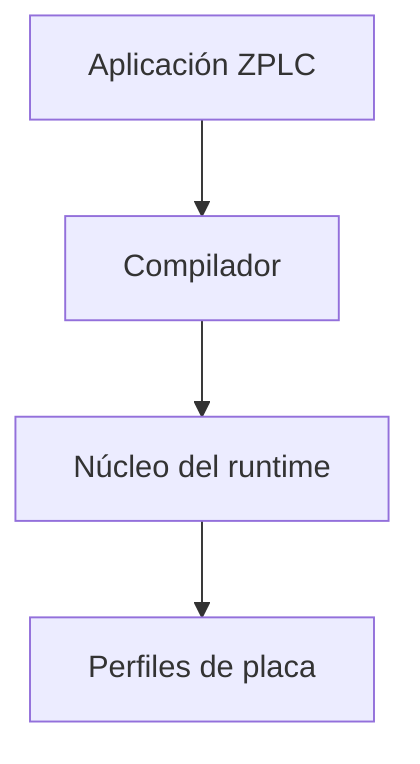

# Panorama de plataforma

ZPLC (Zephyr PLC) combina un núcleo de ejecución portable en ANSI C99 con herramientas de ingeniería en TypeScript. Sus capacidades dependen de la evidencia: la simulación en el host, las compilaciones para un destino y los resultados HIL responden preguntas distintas.

## El ecosistema ZPLC

## Principios centrales

- **Memoria acotada en el runtime**: el núcleo en C99 usa límites de memoria definidos; la validación sigue siendo parte de cada perfil de destino.
- **Separación mediante la HAL**: el núcleo y los adaptadores de hardware están separados para que cada comportamiento de la plataforma pueda inspeccionarse y probarse por su lado.
- **Evidencia antes que afirmaciones**: los tiempos del planificador, la E/S, la persistencia, los protocolos y el soporte de placas solo se afirman para el perfil y la revisión que tienen la evidencia correspondiente. [Soporte de hardware](../reference/capabilities-evidence.md) enumera los niveles, y [Seguridad y limitaciones](../safety-and-limitations.md) dice qué no es ZPLC.

## Componentes del producto

1. **Máquina virtual del núcleo (`libzplc_core`)**: intérprete de bytecode en C99, validación de programas, estado del runtime e interfaces del planificador.
2. **Capa de abstracción de hardware (HAL)**: adaptadores para los servicios de la plataforma, como relojes, almacenamiento, E/S y transportes configurados.
3. **Compilador**: transforma los flujos de proyecto admitidos, centrados en Structured Text, en bytecode `.zplc`.
4. **IDE**: entorno de ingeniería de escritorio para escribir programas, ver diagnósticos y usar los flujos del runtime según sus capacidades.

## Flujo típico

1. Elija un destino para el proyecto e inspeccione el perfil de la placa y sus capacidades.
2. Escriba la lógica en un lenguaje admitido y compílela a `.zplc`.
3. Use la simulación POSIX nativa para comprobaciones lógicas repetibles en el host, dentro de las capacidades declaradas.
4. Compile el firmware, grábelo, cargue el programa PLC y opérelo como acciones humanas separadas.
5. Use evidencia en el destino o HIL de la placa y la revisión exactas antes de depender de los tiempos o del comportamiento físico.

## Continúe con

- [Primeros pasos](../getting-started/index.md)
- [Ejemplos de lenguajes](../languages/examples/v1-5-language-suite.md)
- [Arquitectura del sistema](../architecture/index.md)
