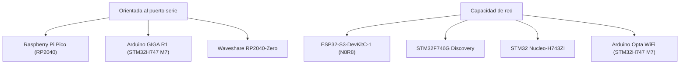

# Placas

:::note
Esta página se genera desde `firmware/app/boards/boards.json`, el único manifiesto de placas. Actualice el JSON o vuelva a ejecutar `python3 tools/docs/generate_board_reference.py` en lugar de editar este archivo manualmente.
:::

Nivel de compatibilidad de las placas, derivado de sus registros de evidencia ([Compatibilidad de hardware](./capabilities-evidence.md#los-niveles)): `cross-build` (7 / 7).

## Topología

## La descripción de E/S

Cada entrada de placa del manifiesto tiene un objeto `io` que lista los canales de la placa. Un canal tiene un `id`, una `direction` (`input` u `output`), un `kind` (`digital` o `analog`), la `address` IEC de su lugar en la imagen de proceso (`%QX0.0`, `%IW4`), el `pin` o borne impreso en la placa, sus notas `electrical`, el valor `safe` de una salida y un objeto `dt` con el alias de devicetree, el controlador GPIO y el pin (o el conversor y el canal) que la compilación verifica.

`pin_status` dice de dónde sale el pin: `devicetree` es un pin que el devicetree de la placa o el overlay del perfil define y la compilación comprueba; `profile` es un pin del conector que este perfil eligió y que necesita el banco con lazo de retorno (loopback) de HIL-010 para confirmarse.

Los textos que lee una persona (`pin`, `location`, `electrical`, `scaling`, y el `terminal` y la `reason` de un borne sin mapear) están en inglés, el texto que usan el firmware y sus registros. Una placa del estudiante del curso (`"learner": true`) da además cada uno en español, con la misma clave terminada en `_es`, y las páginas en español muestran ese texto; el validador rechaza una placa del estudiante sin él.

Para agregar un canal a una placa, agregue el alias a su overlay y la entrada a su descripción. La tabla de E/S del firmware se genera desde la descripción al compilar, así que no cambia ningún código fuente en C, y la compilación falla cuando la descripción y el devicetree no coinciden. Una palabra de la imagen de proceso que ningún pin maneja no es un canal: un proyecto la lista en `io.virtual`.

La aplicación ZPLC lee el mismo archivo. El editor de mapeo de E/S de la configuración del proyecto lista los canales de la placa seleccionada con sus nombres de pin y marca una fila en una dirección que la placa no tiene; una compilación falla con un error que nombra la placa y la variable cuando una variable está ubicada donde la placa no tiene canal; y una carga a hardware se rechaza, con un mensaje que nombra la placa, cuando el firmware informa otra descripción o el programa toca una dirección sin canal.

## Matriz de placas

| Nombre visible | Board ID | ZPLC ID | Destino de Zephyr | Red | Nivel de compatibilidad | Registros de evidencia |
| --- | --- | --- | --- | --- | --- | --- |
| Raspberry Pi Pico (RP2040) | `rpi-pico-rp2040` | `rpi_pico` | `rpi_pico/rp2040` | Orientada al puerto serie | cross-build | 0 |
| Arduino GIGA R1 (STM32H747 M7) | `arduino-giga-r1-m7` | `arduino_giga_r1` | `arduino_giga_r1/stm32h747xx/m7` | Orientada al puerto serie | cross-build | 0 |
| ESP32-S3-DevKitC-1 (N8R8) | `esp32-s3-devkitc` | `esp32s3_devkitc` | `esp32s3_devkitc/esp32s3/procpu` | Capacidad de red (Wi-Fi) | cross-build | 0 |
| STM32F746G Discovery | `stm32f746g-disco` | `stm32f746g_disco` | `stm32f746g_disco/stm32f746xx` | Capacidad de red (Ethernet) | cross-build | 0 |
| STM32 Nucleo-H743ZI | `nucleo-h743zi` | `nucleo_h743zi` | `nucleo_h743zi/stm32h743xx` | Capacidad de red (Ethernet) | cross-build | 0 |
| Arduino Opta WiFi (STM32H747 M7) | `arduino-opta-wifi-m7` | `arduino_opta_wifi` | `arduino_opta/stm32h747xx/m7` | Capacidad de red (Wi-Fi) | cross-build | 0 |
| Waveshare RP2040-Zero | `waveshare-rp2040-zero` | `waveshare_rp2040_zero` | `rp2040_zero/rp2040` | Orientada al puerto serie | cross-build | 0 |

## Huella de memoria

Flash y RAM de `firmware/app` por placa, de la tabla de memoria del enlazador en el informe de tamaño de CI (`tools/firmware-test/size-budget.json`). Son mediciones de una compilación en el host, no evidencia de hardware. Las últimas tres columnas son las regiones de memoria que el runtime configura para la placa (trabajo, retentiva, código).

| Board ID | Flash (KiB) | Flash budget (KiB) | RAM (KiB) | RAM budget (KiB) | Work (KiB) | RETAIN (KiB) | Code (KiB) |
| --- | ---: | ---: | ---: | ---: | ---: | ---: | ---: |
| `rpi-pico-rp2040` | 173.7 | 182.5 | 169.4 | 178.0 | 8.0 | 4.0 | 24.0 |
| `arduino-giga-r1-m7` | 212.8 | 223.5 | 229.9 | 241.5 | 8.0 | 4.0 | 44.0 |
| `esp32-s3-devkitc` | 987.0 | 1031.0 | 2381.1 | 2493.0 | 2.0 | 1.0 | 8.0 |
| `stm32f746g-disco` | 297.7 | 312.8 | 209.7 | 220.2 | 8.0 | 4.0 | 16.0 |
| `nucleo-h743zi` | 353.3 | 371.2 | 397.1 | 417.0 | 8.0 | 4.0 | 44.0 |
| `arduino-opta-wifi-m7` | 372.5 | 391.2 | 392.4 | 412.2 | 8.0 | 4.0 | 32.0 |
| `waveshare-rp2040-zero` | 168.5 | 177.0 | 174.5 | 183.2 | 8.0 | 4.0 | 24.0 |

## Detalle por placa

### Raspberry Pi Pico (RP2040)

- **Board ID:** `rpi-pico-rp2040`
- **ZPLC ID:** `rpi_pico`
- **Zephyr target:** `rpi_pico/rp2040`
- **Variant:** `rp2040`
- **Network:** Orientada al puerto serie
- **Nivel de compatibilidad:** cross-build (sin registro de hardware)
- **Watchdog de hardware:** apagado: sin registro de hardware (HIL-010), el perfil lo mantiene apagado hasta que el tiempo de reinicio y las salidas seguras se registren en esta placa con él encendido
- **Comando de compilación:** `west build -b rpi_pico/rp2040 firmware/app --pristine`
- **Ancla de referencia:** `docs/docs/reference/capabilities-evidence.md`
- **Imagen de proceso usada (entrada, salida):** 18 B, 1 B
- **Hash de la descripción de E/S:** `d27196be`
- **Archivos de soporte:**
  - `firmware/app/boards/rpi_pico_rp2040.conf`
  - `firmware/app/boards/rpi_pico_rp2040.overlay`

#### Canales de E/S

| Canal | Dirección | Tipo | Dirección IEC | Pin | Ubicación | Estado del pin | Seguro | Eléctrico |
| --- | --- | --- | --- | --- | --- | --- | --- | --- |
| DO0 | salida | digital | `%QX0.0` | GP0 | pin 1 del conector | devicetree | 0 | Lógica de 3.3 V. No tolera 5 V. El RP2040 entrega 4 mA por defecto (hasta 12 mA, valor no calificado aquí): mantenga cada salida por debajo de 10 mA, como lo hace un LED con 330 Ω en serie (unos 4 mA), y el total de todos los pines por debajo de 50 mA. |
| DO1 | salida | digital | `%QX0.1` | GP1 | pin 2 del conector | devicetree | 0 | Lógica de 3.3 V. No tolera 5 V. El RP2040 entrega 4 mA por defecto (hasta 12 mA, valor no calificado aquí): mantenga cada salida por debajo de 10 mA, como lo hace un LED con 330 Ω en serie (unos 4 mA), y el total de todos los pines por debajo de 50 mA. |
| DO2 | salida | digital | `%QX0.2` | GP2 | pin 4 del conector | devicetree | 0 | Lógica de 3.3 V. No tolera 5 V. El RP2040 entrega 4 mA por defecto (hasta 12 mA, valor no calificado aquí): mantenga cada salida por debajo de 10 mA, como lo hace un LED con 330 Ω en serie (unos 4 mA), y el total de todos los pines por debajo de 50 mA. |
| DO3 | salida | digital | `%QX0.3` | GP3 | pin 5 del conector | devicetree | 0 | Lógica de 3.3 V. No tolera 5 V. El RP2040 entrega 4 mA por defecto (hasta 12 mA, valor no calificado aquí): mantenga cada salida por debajo de 10 mA, como lo hace un LED con 330 Ω en serie (unos 4 mA), y el total de todos los pines por debajo de 50 mA. |
| DO4 | salida | digital | `%QX0.4` | GP25 | LED integrado en la placa | devicetree | 0 | LED verde integrado en la placa, con su resistencia en serie; no es una salida de campo. Esta imagen es para la Raspberry Pi Pico (RP2040): la Pico W tiene el LED en su chip inalámbrico, y la Pico 2 (RP2350) necesita otra imagen. |
| DI0 | entrada | digital | `%IX0.0` | GP15 | pin 20 del conector | devicetree |  | Entrada de lógica de 3.3 V con la resistencia de pull-up interna del RP2040 activada por el perfil; conecte un interruptor a GND. No tolera 5 V. |
| DI1 | entrada | digital | `%IX0.1` | GP14 | pin 19 del conector | profile |  | Entrada de lógica de 3.3 V con la resistencia de pull-up interna del RP2040 activada por el perfil; conecte un interruptor a GND. No tolera 5 V. |
| DI2 | entrada | digital | `%IX0.2` | GP13 | pin 17 del conector | profile |  | Entrada de lógica de 3.3 V con la resistencia de pull-up interna del RP2040 activada por el perfil; conecte un interruptor a GND. No tolera 5 V. |
| DI3 | entrada | digital | `%IX0.3` | GP12 | pin 16 del conector | profile |  | Entrada de lógica de 3.3 V con la resistencia de pull-up interna del RP2040 activada por el perfil; conecte un interruptor a GND. No tolera 5 V. |
| AI0 | entrada | analógico | `%IW4` | GP26 (ADC0) | pin 31 del conector | devicetree |  | De 0 V a 3.3 V en la entrada del ADC; no supere 3.3 V. Conecte un potenciómetro de 10 kΩ entre 3V3(OUT) (pin 36 del conector) y AGND (pin 33 del conector), con su cursor en este pin. 0..4095 -> 0.0 a 3.3 V. |
| AI1 | entrada | analógico | `%IW5` | GP27 (ADC1) | pin 32 del conector | devicetree |  | De 0 V a 3.3 V en la entrada del ADC; no supere 3.3 V. 0..4095 -> 0.0 a 3.3 V. |
| AI2 | entrada | analógico | `%IW6` | GP28 (ADC2) | pin 34 del conector | devicetree |  | De 0 V a 3.3 V en la entrada del ADC; no supere 3.3 V. 0..4095 -> 0.0 a 3.3 V. |
| AI3 | entrada | analógico | `%IW7` | VSYS/3 (ADC3) | interno | devicetree |  | Interno: la tensión de alimentación dividida por 3, sin conexión externa. 0..4095 -> 0.0 a 3.3 V. VSYS = 3 x la tensión de entrada. |
| AI4 | entrada | analógico | `%IW8` | Sensor de temperatura (ADC4) | interno | devicetree |  | Sensor de temperatura interno del chip, sin conexión externa. 0..4095 -> 0.0 a 3.3 V. Hoja de datos del RP2040: T [°C] = 27 - (V - 0.706) / 0.001721 con V = raw * 3.3 / 4095. |

#### Puertos de bus de campo

| Puerto | Protocolo | UART | TX | RX | Ubicación | Eléctrico |
| --- | --- | --- | --- | --- | --- | --- |
| RTU0 | modbus-rtu | `uart1` | GP4 | GP5 | pines 6 (TX) y 7 (RX) del conector, GND en el pin 8 del conector | UART de lógica de 3.3 V, no RS-485 ni RS-232: para un bus, conecte un transceptor RS-485 de 3.3 V (un módulo de la clase MAX3485); para una computadora, un adaptador USB-serie de 3.3 V. Nunca conecte 5 V ni niveles RS-232 a estos pines. |

### Arduino GIGA R1 (STM32H747 M7)

- **Board ID:** `arduino-giga-r1-m7`
- **ZPLC ID:** `arduino_giga_r1`
- **Zephyr target:** `arduino_giga_r1/stm32h747xx/m7`
- **Variant:** `stm32h747xx/m7`
- **Network:** Orientada al puerto serie
- **Nivel de compatibilidad:** cross-build (sin registro de hardware)
- **Watchdog de hardware:** apagado: sin registro de hardware (HIL-010), el perfil lo mantiene apagado hasta que el tiempo de reinicio y las salidas seguras se registren en esta placa con él encendido
- **Comando de compilación:** `west build -b arduino_giga_r1/stm32h747xx/m7 firmware/app --pristine`
- **Ancla de referencia:** `docs/docs/reference/capabilities-evidence.md`
- **Imagen de proceso usada (entrada, salida):** 1 B, 1 B
- **Hash de la descripción de E/S:** `77271dae`
- **Archivos de soporte:**
  - `firmware/app/boards/arduino_giga_r1_stm32h747xx_m7.conf`
  - `firmware/app/boards/arduino_giga_r1_stm32h747xx_m7.overlay`

#### Canales de E/S

| Canal | Dirección | Tipo | Dirección IEC | Pin | Ubicación | Estado del pin | Seguro | Eléctrico |
| --- | --- | --- | --- | --- | --- | --- | --- | --- |
| DO0 | salida | digital | `%QX0.0` | PI12 (red LED) |  | devicetree | 0 | On-board LED, active low in the board devicetree; not a field output. |
| DO1 | salida | digital | `%QX0.1` | PJ13 (green LED) |  | devicetree | 0 | On-board LED, active low in the board devicetree; not a field output. |
| DI0 | entrada | digital | `%IX0.0` | PC13 (user button) |  | devicetree |  | On-board user button. |

### ESP32-S3-DevKitC-1 (N8R8)

- **Board ID:** `esp32-s3-devkitc`
- **ZPLC ID:** `esp32s3_devkitc`
- **Zephyr target:** `esp32s3_devkitc/esp32s3/procpu`
- **Variant:** `esp32s3/procpu`
- **Network:** Capacidad de red (Wi-Fi)
- **Nivel de compatibilidad:** cross-build (sin registro de hardware)
- **Módulo:** ESP32-S3-WROOM-1-N8R8, 8 MB flash, 8 MB PSRAM (variante por confirmar en el módulo)
- **Watchdog de hardware:** apagado: sin registro de hardware (HIL-010), el perfil lo mantiene apagado hasta que el tiempo de reinicio y las salidas seguras se registren en esta placa con él encendido
- **Comando de compilación:** `west build -b esp32s3_devkitc/esp32s3/procpu firmware/app --pristine`
- **Ancla de referencia:** `docs/docs/reference/capabilities-evidence.md`
- **Imagen de proceso usada (entrada, salida):** 10 B, 1 B
- **Hash de la descripción de E/S:** `93e038ba`
- **Archivos de soporte:**
  - `firmware/app/boards/esp32s3_devkitc_esp32s3_procpu.conf`
  - `firmware/app/boards/esp32s3_devkitc_esp32s3_procpu.overlay`

#### Canales de E/S

| Canal | Dirección | Tipo | Dirección IEC | Pin | Ubicación | Estado del pin | Seguro | Eléctrico |
| --- | --- | --- | --- | --- | --- | --- | --- | --- |
| DO0 | salida | digital | `%QX0.0` | GPIO15 | pin 8 del conector J1 | profile | 0 | Lógica de 3.3 V. No tolera 5 V. Mantenga la carga por debajo de 10 mA: un LED con 330 Ω en serie consume unos 4 mA. |
| DO1 | salida | digital | `%QX0.1` | GPIO16 | pin 9 del conector J1 | profile | 0 | Lógica de 3.3 V. No tolera 5 V. Mantenga la carga por debajo de 10 mA: un LED con 330 Ω en serie consume unos 4 mA. |
| DO2 | salida | digital | `%QX0.2` | GPIO17 | pin 10 del conector J1 | profile | 0 | Lógica de 3.3 V. No tolera 5 V. Mantenga la carga por debajo de 10 mA: un LED con 330 Ω en serie consume unos 4 mA. |
| DO3 | salida | digital | `%QX0.3` | GPIO18 | pin 11 del conector J1 | profile | 0 | Lógica de 3.3 V. No tolera 5 V. Mantenga la carga por debajo de 10 mA: un LED con 330 Ω en serie consume unos 4 mA. |
| DI0 | entrada | digital | `%IX0.0` | GPIO5 | pin 5 del conector J1 | profile |  | Entrada de lógica de 3.3 V con la resistencia de pull-up interna activada por el perfil, activa en bajo: conecte un pulsador a GND. No tolera 5 V. |
| DI1 | entrada | digital | `%IX0.1` | GPIO6 | pin 6 del conector J1 | profile |  | Entrada de lógica de 3.3 V con la resistencia de pull-up interna activada por el perfil, activa en bajo: conecte un pulsador a GND. No tolera 5 V. |
| DI2 | entrada | digital | `%IX0.2` | GPIO7 | pin 7 del conector J1 | profile |  | Entrada de lógica de 3.3 V con la resistencia de pull-up interna activada por el perfil, activa en bajo: conecte un pulsador a GND. No tolera 5 V. |
| DI3 | entrada | digital | `%IX0.3` | GPIO8 | pin 12 del conector J1 | profile |  | Entrada de lógica de 3.3 V con la resistencia de pull-up interna activada por el perfil, activa en bajo: conecte un pulsador a GND. No tolera 5 V. |
| DI4 | entrada | digital | `%IX0.4` | GPIO0 (botón BOOT) | botón BOOT de la placa | devicetree |  | Botón BOOT de la placa, activo en bajo con la resistencia de pull-up interna: una entrada adicional que no necesita cableado y no es una de las cuatro entradas del estudiante. Es un pin de configuración de arranque (strapping): no lo mantenga presionado mientras la placa se reinicia, o la placa arranca en modo de descarga. |
| AI0 | entrada | analógico | `%IW4` | GPIO4 (ADC1_CH3) | pin 4 del conector J1 | profile |  | De 0 V a unos 3.1 V con atenuación de 12 dB (algunos chips llegan solo a unos 2.9 V); nunca aplique más de 3.3 V. Conecte un potenciómetro de 10 kΩ entre 3V3 (pin 1 del conector J1) y GND (pin 22 del conector J1), con su cursor en este pin. 0..2885 -> 0.0 a 3.1 V. El driver ESP32 de Zephyr aplica la calibración de eFuse y devuelve la entrada en milivoltios dividida por 4 (ganancia 1/4) como cuentas de 4095 sobre su referencia de 1100 mV: V = raw x 4.4 / 4095, así que 3.1 V se lee como unas 2885 cuentas. ZPLC no lo calibra; el conversor no es lineal cerca de ambos extremos.. |

#### Sin mapear

- `GPIO38 (LED RGB en la v1.1) o GPIO48 (LED RGB en la v1.0)`: el LED de la placa es un componente RGB direccionable que necesita el driver de tiras de LED

### STM32F746G Discovery

- **Board ID:** `stm32f746g-disco`
- **ZPLC ID:** `stm32f746g_disco`
- **Zephyr target:** `stm32f746g_disco/stm32f746xx`
- **Variant:** `stm32f746xx`
- **Network:** Capacidad de red (Ethernet)
- **Nivel de compatibilidad:** cross-build (sin registro de hardware)
- **Watchdog de hardware:** apagado: sin registro de hardware (HIL-010), el perfil lo mantiene apagado hasta que el tiempo de reinicio y las salidas seguras se registren en esta placa con él encendido
- **Comando de compilación:** `west build -b stm32f746g_disco/stm32f746xx firmware/app --pristine`
- **Ancla de referencia:** `docs/docs/reference/capabilities-evidence.md`
- **Imagen de proceso usada (entrada, salida):** 1 B, 1 B
- **Hash de la descripción de E/S:** `80927f2e`
- **Archivos de soporte:**
  - `firmware/app/boards/stm32f746g_disco.conf`
  - `firmware/app/boards/stm32f746g_disco.overlay`

#### Canales de E/S

| Canal | Dirección | Tipo | Dirección IEC | Pin | Ubicación | Estado del pin | Seguro | Eléctrico |
| --- | --- | --- | --- | --- | --- | --- | --- | --- |
| DO0 | salida | digital | `%QX0.0` | PI1 (LD1 green) |  | devicetree | 0 | On-board LED; not a field output. |
| DI0 | entrada | digital | `%IX0.0` | PI11 (user button) |  | devicetree |  | On-board user button. |

### STM32 Nucleo-H743ZI

- **Board ID:** `nucleo-h743zi`
- **ZPLC ID:** `nucleo_h743zi`
- **Zephyr target:** `nucleo_h743zi/stm32h743xx`
- **Variant:** `stm32h743xx`
- **Network:** Capacidad de red (Ethernet)
- **Nivel de compatibilidad:** cross-build (sin registro de hardware)
- **Watchdog de hardware:** apagado: sin registro de hardware (HIL-010), el perfil lo mantiene apagado hasta que el tiempo de reinicio y las salidas seguras se registren en esta placa con él encendido
- **Comando de compilación:** `west build -b nucleo_h743zi/stm32h743xx firmware/app --pristine`
- **Ancla de referencia:** `docs/docs/reference/capabilities-evidence.md`
- **Imagen de proceso usada (entrada, salida):** 1 B, 1 B
- **Hash de la descripción de E/S:** `4193575e`
- **Archivos de soporte:**
  - `firmware/app/boards/nucleo_h743zi.conf`
  - `firmware/app/boards/nucleo_h743zi.overlay`

#### Canales de E/S

| Canal | Dirección | Tipo | Dirección IEC | Pin | Ubicación | Estado del pin | Seguro | Eléctrico |
| --- | --- | --- | --- | --- | --- | --- | --- | --- |
| DO0 | salida | digital | `%QX0.0` | PB0 (LD1 green) |  | devicetree | 0 | On-board LED; not a field output. |
| DO1 | salida | digital | `%QX0.1` | PE1 (LD2 yellow) |  | devicetree | 0 | On-board LED; not a field output. |
| DI0 | entrada | digital | `%IX0.0` | PC13 (user button) |  | devicetree |  | On-board user button. |

### Arduino Opta WiFi (STM32H747 M7)

- **Board ID:** `arduino-opta-wifi-m7`
- **ZPLC ID:** `arduino_opta_wifi`
- **Zephyr target:** `arduino_opta/stm32h747xx/m7`
- **Variant:** `stm32h747xx/m7`
- **Network:** Capacidad de red (Wi-Fi)
- **Nivel de compatibilidad:** cross-build (sin registro de hardware)
- **Watchdog de hardware:** apagado: sin registro de hardware (HIL-010), el perfil lo mantiene apagado hasta que el tiempo de reinicio y las salidas seguras se registren en esta placa con él encendido
- **Comando de compilación:** `west build -b arduino_opta/stm32h747xx/m7 firmware/app --pristine`
- **Ancla de referencia:** `docs/docs/reference/capabilities-evidence.md`
- **Imagen de proceso usada (entrada, salida):** 1 B, 1 B
- **Hash de la descripción de E/S:** `6ce9cc7a`
- **Archivos de soporte:**
  - `firmware/app/boards/arduino_opta_stm32h747xx_m7.conf`
  - `firmware/app/boards/arduino_opta_stm32h747xx_m7.overlay`

#### Canales de E/S

| Canal | Dirección | Tipo | Dirección IEC | Pin | Ubicación | Estado del pin | Seguro | Eléctrico |
| --- | --- | --- | --- | --- | --- | --- | --- | --- |
| DO0 | salida | digital | `%QX0.0` | PI0 (status LED D0) |  | devicetree | 0 | On-board status LED; not a field output. |
| DO1 | salida | digital | `%QX0.1` | PI1 (status LED D1) |  | devicetree | 0 | On-board status LED; not a field output. |
| DO2 | salida | digital | `%QX0.2` | PI3 (status LED D2) |  | devicetree | 0 | On-board status LED; not a field output. |
| DO3 | salida | digital | `%QX0.3` | PH15 (status LED D3) |  | devicetree | 0 | On-board status LED; not a field output. |
| DO4 | salida | digital | `%QX0.4` | PI6 (relay output 1) | relay output terminal 1 | devicetree | 0 | Relay contact: it can switch a field circuit. Observe the contact rating in the Arduino Opta documentation; not qualified here. |
| DO5 | salida | digital | `%QX0.5` | PI5 (relay output 2) | relay output terminal 2 | devicetree | 0 | Relay contact: it can switch a field circuit. Observe the contact rating in the Arduino Opta documentation; not qualified here. |
| DO6 | salida | digital | `%QX0.6` | PI7 (relay output 3) | relay output terminal 3 | devicetree | 0 | Relay contact: it can switch a field circuit. Observe the contact rating in the Arduino Opta documentation; not qualified here. |
| DO7 | salida | digital | `%QX0.7` | PI4 (relay output 4) | relay output terminal 4 | devicetree | 0 | Relay contact: it can switch a field circuit. Observe the contact rating in the Arduino Opta documentation; not qualified here. |
| DI0 | entrada | digital | `%IX0.0` | PE4 (user button) |  | devicetree |  | On-board user button. |

#### Sin mapear

- `I1 to I8 (field inputs)`: the pin documentation of the Arduino Opta field inputs is not established (OA-13); the board devicetree defines no digital input alias for them

### Waveshare RP2040-Zero

- **Board ID:** `waveshare-rp2040-zero`
- **ZPLC ID:** `waveshare_rp2040_zero`
- **Zephyr target:** `rp2040_zero/rp2040`
- **Variant:** `rp2040`
- **Network:** Orientada al puerto serie
- **Nivel de compatibilidad:** cross-build (sin registro de hardware)
- **Watchdog de hardware:** apagado: sin registro de hardware (HIL-010), el perfil lo mantiene apagado hasta que el tiempo de reinicio y las salidas seguras se registren en esta placa con él encendido
- **Comando de compilación:** `west build -b rp2040_zero/rp2040 firmware/app --pristine`
- **Ancla de referencia:** `docs/docs/reference/capabilities-evidence.md`
- **Imagen de proceso usada (entrada, salida):** 1 B, 1 B
- **Hash de la descripción de E/S:** `0d5edb3c`
- **Archivos de soporte:**
  - `firmware/app/boards/rp2040_zero_rp2040.conf`
  - `firmware/app/boards/rp2040_zero_rp2040.overlay`

#### Canales de E/S

| Canal | Dirección | Tipo | Dirección IEC | Pin | Ubicación | Estado del pin | Seguro | Eléctrico |
| --- | --- | --- | --- | --- | --- | --- | --- | --- |
| DO0 | salida | digital | `%QX0.0` | GP2 | castellated edge pad GP2 | devicetree | 0 | 3.3 V logic. Not 5 V tolerant. RP2040 drive strength is configurable up to 12 mA per pin (datasheet, not qualified here). |
| DI0 | entrada | digital | `%IX0.0` | GP3 | castellated edge pad GP3 | devicetree |  | 3.3 V logic input with the RP2040 internal pull-up enabled by the profile; connect a switch to GND. Not 5 V tolerant. |

#### Sin mapear

- `WS2812 RGB LED (GP16)`: an addressable LED needs the LED-strip driver; it is not a simple output
