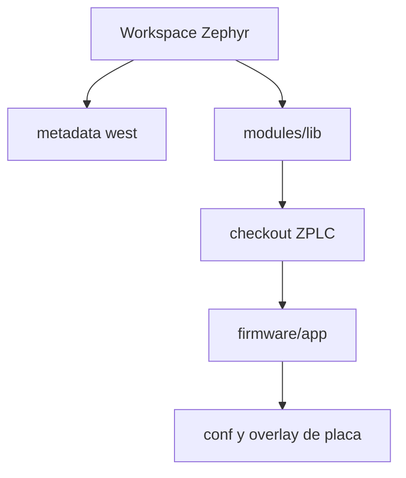

# Configuración del Workspace Zephyr

Compile el runtime embebido desde los inputs del workspace Zephyr fijado por el
repositorio. Un cross-build exitoso solo prueba que el profile compila; no prueba
flash, boot, I/O, timing, persistencia ni HIL.

## Camino rápido

1. Instale SDK/toolchain Zephyr y deje `west` disponible.
2. Active el entorno Zephyr para que exista `ZEPHYR_BASE`.
3. Ubique ZPLC en el workspace como checkout de módulo o clon.
4. Ejecute el comando exacto de la página generada de [Profiles de placa](./boards.md).

## Anclas del repositorio

- `west.yml`
- `firmware/app/CMakeLists.txt`
- `firmware/app/README.md`
- `firmware/app/boards/boards.json`
- [Fuentes de verdad](./source-of-truth.md)

## Forma del workspace



## Build

Después de activar el entorno, invoque el comando del profile generado desde la
raíz del repositorio. Por ejemplo:

```bash
west build -b rpi_pico/rp2040 firmware/app --pristine
```

La página generada de placas es la matriz vigente: contiene cada profile del
manifiesto, su target exacto, comandos de build, niveles de evidencia y cantidad de
referencias HIL. Cada entrada actual es `cross-build` con cero referencias HIL.

## Límite de flash y recovery

Build, flash, deploy de programa y RUN/debug son operaciones distintas. Use el
procedimiento exacto de board/runner antes de flashear. No deduzcas que
cross-build hace seguro `west flash`, recovery o persistencia de programa en
un dispositivo no probado. Consulte [Límites de recuperación](../operations/recovery.md).

## Páginas relacionadas

- [Profiles de placa](./boards.md)
- [Soporte de hardware](./capabilities-evidence.md)
