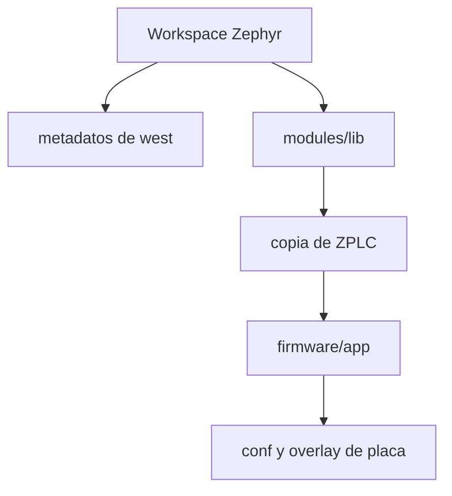

# Configuración del Workspace Zephyr

Compile el runtime embebido desde las entradas fijadas del workspace Zephyr del
repositorio. Una compilación cruzada correcta solo prueba que el perfil compila; no
prueba la grabación, el arranque, la E/S, la temporización, la persistencia ni el HIL.

## Camino rápido

1. Instale SDK/toolchain Zephyr y deje `west` disponible.
2. Active el entorno Zephyr para que exista `ZEPHYR_BASE`.
3. Ubique ZPLC en el workspace como una copia del módulo o como un clon.
4. Ejecute el comando exacto de la página generada de [Perfiles de placa](./boards.md).

## Anclas del repositorio

- `west.yml`
- `firmware/app/CMakeLists.txt`
- `firmware/app/README.md`
- `firmware/app/boards/boards.json`
- [Fuentes de verdad](./source-of-truth.md)

## Forma del workspace



## Compilación

Después de activar el entorno, ejecute el comando del perfil generado desde la
raíz del repositorio. Por ejemplo:

```bash
west build -b rpi_pico/rp2040 firmware/app --pristine
```

La página generada de placas es la matriz vigente: contiene cada perfil del
manifiesto, su destino exacto, los comandos de compilación, los niveles de evidencia y la
cantidad de referencias HIL. Cada entrada actual es `cross-build` con cero referencias HIL.

## Límite de grabación y recuperación

Compilar, grabar, cargar un programa y RUN/depuración son operaciones distintas. Use el
procedimiento exacto de la placa y del runner antes de grabar. No suponga que
una compilación cruzada hace seguros `west flash`, la recuperación ni la persistencia del programa en
un dispositivo no probado. Consulte [Límites de recuperación](../operations/recovery.md).

## Páginas relacionadas

- [Perfiles de placa](./boards.md)
- [Soporte de hardware](./capabilities-evidence.md)
