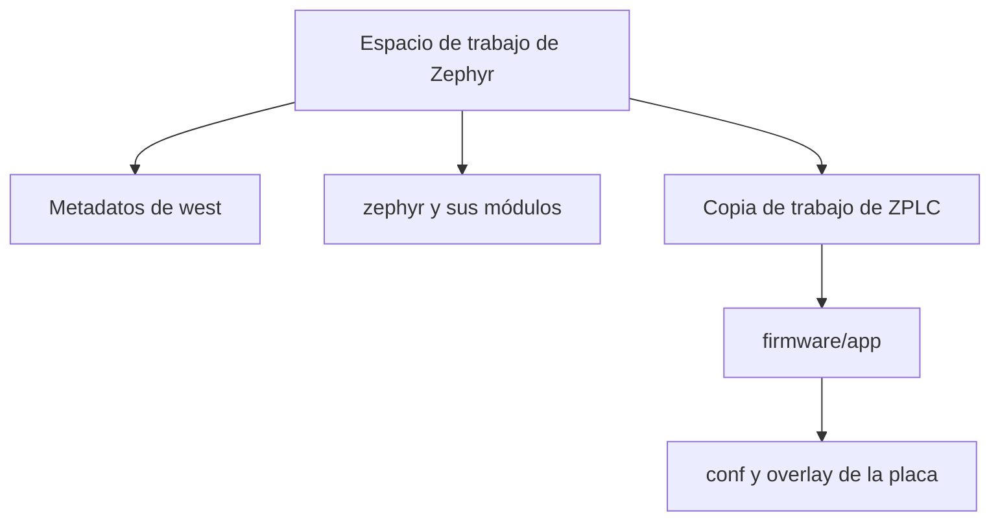

# Configuración del espacio de trabajo de Zephyr

Esta página lleva de una máquina nueva a la primera compilación del firmware. ZPLC compila sobre el árbol de Zephyr que fija `west.yml`, de modo que hace falta ese árbol y una cadena de herramientas antes de compilar cualquier placa.

:::note Qué demuestra una compilación
Una compilación terminada demuestra que el perfil compila y cabe en su presupuesto de flash y RAM. No demuestra que la imagen se grabe, arranque, maneje un pin, mantenga el tiempo ni conserve un programa tras un corte de energía. Hoy todas las placas están en el nivel `cross-build` ([Compatibilidad de hardware](./capabilities-evidence.md)).
:::

## Qué está fijado

`west.yml` nombra un solo proyecto, Zephyr, en un commit fijo, e importa los módulos que Zephyr necesita. ZPLC es la entrada `self` de ese manifiesto, así que la copia de trabajo es el repositorio de manifiesto del espacio de trabajo.

| Entrada                           | Qué fija                                                     |
| --------------------------------- | ------------------------------------------------------------ |
| `west.yml`                        | La revisión de Zephyr y los módulos que importa              |
| `firmware/app/CMakeLists.txt`     | La aplicación que se compila para cada placa                 |
| `firmware/app/boards/boards.json` | El manifiesto de placas: destinos, memoria, E/S, presupuesto |
| `tools/firmware-test/setup.sh`    | El script que crea y verifica el espacio de trabajo          |

## Cree el espacio de trabajo

El script construye el espacio de trabajo fuera del repositorio, en `~/zplc-zephyr-ws` (defina `ZPLC_FW_WS` para usar otra carpeta). Crea un entorno virtual de Python con `west`, enlaza su copia de trabajo como repositorio de manifiesto y descarga el árbol de Zephyr fijado. No instala nada en el SDK de Zephyr ni en el repositorio, y cada paso se puede repetir sin riesgo.

```bash
tools/firmware-test/setup.sh
```

El SDK de Zephyr lo instala usted. Los requisitos, el espacio en disco y lo que imprime el script están en [Pruebas de firmware](../development/firmware-testing.md#preparación-única).



## Compile una placa

La página de placas lista el comando exacto de cada perfil. Para la Raspberry Pi Pico es:

```bash
west build -b rpi_pico/rp2040 firmware/app --pristine
```

[Compile el firmware desde el código fuente](../guides/build-firmware.md) muestra el script del repositorio que compila una placa y comprueba su presupuesto en un solo paso.

## Grabación y recuperación

Compilar, grabar, cargar un programa y ejecutar son cuatro operaciones distintas, y usted inicia cada una. Una compilación no dice si `west flash` o un procedimiento de recuperación es seguro en su dispositivo. Lea antes el procedimiento de la placa: [Grabe el firmware](../guides/flash-firmware.md) y [Límites de recuperación](../operations/recovery.md).

## Páginas relacionadas

- [Placas](./boards.md): la lista generada de perfiles.
- [Compatibilidad de hardware](./capabilities-evidence.md): qué significa cada nivel.
