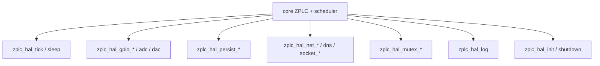

# Contrato HAL

`firmware/lib/zplc_core/include/zplc_hal.h` es el contrato público entre el core de ZPLC y cualquier plataforma concreta.

Eso incluye los destinos Zephyr, los runtimes host/POSIX, un port para navegador con WebAssembly (está en el árbol de código fuente, pero no se distribuye en esta versión) y los futuros ports de placa.

## Regla central

El core portable no debe llamar directamente a las APIs de la plataforma.

Si algo pertenece a GPIO, timing, persistencia, networking, sockets o sincronización, el core debe usarlo mediante `zplc_hal_*`.

El core portable define la semántica de ejecución. La HAL se encarga de la integración con la plataforma.

## Superficie HAL por responsabilidad

## Timing

- `zplc_hal_tick()` provee el reloj del scheduler en milisegundos
- `zplc_hal_sleep()` ofrece espera bloqueante fuera de la lógica PLC

## E/S digital y analógica

La superficie pública actual trabaja por canales lógicos:

- `zplc_hal_gpio_read()`
- `zplc_hal_gpio_write()`
- `zplc_hal_adc_read()`
- `zplc_hal_dac_write()`

El core direcciona la E/S por **canal lógico**, no por pin de la placa. El mapa de E/S del programa `.zplc` asocia los canales con la imagen de proceso, y el port de la plataforma asocia los canales con el hardware.

## Persistencia

La HAL es dueña de:

- `zplc_hal_persist_save()`
- `zplc_hal_persist_load()`
- `zplc_hal_persist_delete()`

Estas primitivas permiten que el core portable use un program store
independiente del backend. No proporcionan asignación, restore ni retención
end-to-end calificada de `RETAIN` a nivel de fuente; esas declaraciones no están
soportadas hoy.

## Red y sockets

La superficie pública de red incluye:

- `zplc_hal_net_init()`
- `zplc_hal_net_get_ip()`
- `zplc_hal_dns_resolve()`
- `zplc_hal_socket_connect()`
- `zplc_hal_socket_send()`
- `zplc_hal_socket_recv()`
- `zplc_hal_socket_close()`

Los ports de Zephyr, POSIX y WebAssembly implementan estas funciones.

## Sincronización

El contrato también incluye mutexes:

- `zplc_hal_mutex_create()`
- `zplc_hal_mutex_lock()`
- `zplc_hal_mutex_unlock()`
- `zplc_hal_mutex_destroy()`

## Logging y ciclo de vida

- `zplc_hal_init()`
- `zplc_hal_shutdown()`
- `zplc_hal_log()`

## Páginas relacionadas

- [Visión general del runtime](./index.md)
- [Modelo de memoria](./memory-model.md)
- [Conectividad](./connectivity.md)
