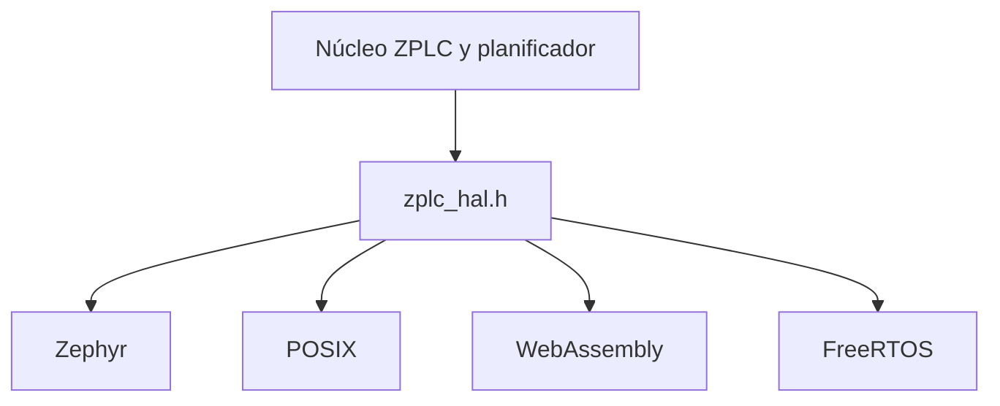

# Contrato del HAL y sus puertos

La capa de abstracción de hardware (HAL) es la frontera entre el núcleo portable y la plataforma que tiene debajo. Esta página explica qué pide el núcleo, qué hace con ello cada uno de los cuatro puertos del árbol de fuentes y qué hay que hacer para agregar uno. El contrato es un único encabezado, `firmware/lib/zplc_core/include/zplc_hal.h`. Las firmas exactas y la suite de conformidad que pasa cada puerto están en la página generada [Interfaz de puerto y suite de conformidad](./port-interface.md).

## La regla

El núcleo portable no debe llamar a la API de una plataforma. Si un comportamiento pertenece a un pin, un reloj, el almacenamiento, la red o un cerrojo, el núcleo lo usa mediante `zplc_hal_*`. El núcleo define qué significa un programa; el HAL define cómo la plataforma aporta el tiempo, la E/S y el almacenamiento.



## Qué pide el núcleo

| Responsabilidad | Funciones | Notas |
| --- | --- | --- |
| Tiempo | `zplc_hal_tick()`, `zplc_hal_sleep()` | El tick es el reloj del planificador en milisegundos. La espera bloquea fuera de la lógica del programa. |
| E/S digital y analógica | `zplc_hal_gpio_read()`, `zplc_hal_gpio_write()`, `zplc_hal_adc_read()`, `zplc_hal_dac_write()` | Por canal lógico, nunca por pin de la placa. |
| Persistencia | `zplc_hal_persist_save()`, `zplc_hal_persist_load()`, `zplc_hal_persist_delete()` | Un almacén de claves independiente del backend bajo el almacén de programas y los registros RETAIN. Véase [persistencia](./persistence.md). |
| Red | `zplc_hal_net_init()`, `zplc_hal_net_get_ip()` | La resolución de nombres y los sockets no forman parte del puerto: la aplicación abre sus propios sockets mediante el resolvedor de Zephyr y SNTP. |
| Sincronización | `zplc_hal_mutex_create()`, `zplc_hal_mutex_lock()`, `zplc_hal_mutex_unlock()`, `zplc_hal_mutex_destroy()` | Cerrojos de la plataforma para la imagen de proceso compartida. |
| Ciclo de vida y registro | `zplc_hal_init()`, `zplc_hal_shutdown()`, `zplc_hal_log()` | |

El encabezado declara 18 funciones, y cada una tiene un llamador: se quitaron una función de DNS y cuatro de socket que nadie llamaba.

Una operación que una plataforma no puede realizar devuelve `ZPLC_HAL_NOT_IMPL`, el resultado definido para "no admitido". El planificador lo omite si viene de un canal opcional, lo trata como error si viene de un canal obligatorio y nunca acepta una función que un puerto deje sin definir: eso es una falla de compilación o de prueba, no un sustituto silencioso.

## Cómo describe una placa su E/S

El núcleo direcciona la E/S por canal lógico. Qué canales tiene una placa, dónde está cada uno en la imagen de proceso y cuál es su pin son datos de `firmware/app/boards/boards.json` (véase [Placas](../reference/boards.md)).

La compilación de Zephyr convierte la entrada de la placa en una tabla constante, `zplc_io_table()`, con `firmware/zephyr/scripts/gen_io_table.py`. Cada fila lleva el identificador del canal, el nombre del pin, el byte y el bit de la imagen de proceso, el tipo, la dirección, el número de canal del HAL, el valor seguro y si el canal es obligatorio. El planificador sincroniza la imagen a través de la tabla (`zplc_io_channel_at()`, `zplc_io_read_channel()`, `zplc_io_write_channel()`), de modo que agregar un canal a una placa es editar el JSON y el overlay del devicetree, y no cambia ningún archivo fuente de C.

- **La descripción y el devicetree deben coincidir.** El archivo generado afirma, para cada canal, que el devicetree tiene el alias, que el alias está en el pin descrito y que el pin pertenece al controlador descrito. Un desacuerdo detiene la compilación con un mensaje que nombra el canal.
- **Los periféricos se configuran al iniciar.** `zplc_hal_init()` configura cada GPIO y cada entrada analógica de la descripción antes de que el runtime pueda entrar en RUN, no en el primer ciclo. Un canal obligatorio que no se puede configurar hace fallar la inicialización.
- **Numeración.** Las salidas digitales se numeran primero y luego las entradas digitales. Las entradas analógicas tienen su propia numeración, en el orden de la imagen.
- **Una placa que no está en el manifiesto** (`native_sim`, una placa propia) usa el perfil de alias por defecto de `firmware/zephyr/io-default.json`: `led0` a `led3` son las salidas, `sw0` a `sw3` las entradas y el conversor con la etiqueta `adc` canales 0 a 4 las entradas analógicas, cada una enlazada cuando el devicetree la tiene.
- **Ningún puerto maneja una salida analógica**, así que ninguna descripción lista una, y `zplc_hal_dac_write()` responde `ZPLC_HAL_NOT_IMPL`.
- **Los tamaños de imagen** son los que necesitan los canales, y `CONFIG_ZPLC_IO_INPUT_IMAGE_BYTES` y `CONFIG_ZPLC_IO_OUTPUT_IMAGE_BYTES` reservan más. La memoria detrás de las imágenes sigue siendo los 4 KB del conjunto de instrucciones.

El firmware informa la identidad de su descripción con `sys io --json` (id de placa, hash, cantidad de canales y bytes de imagen). La aplicación ZPLC se niega a cargar un programa que usa E/S en un firmware cuya descripción no es la que ella tiene, o en una placa que no tiene canal para lo que el programa toca.

## Los cuatro puertos

Los puertos son los directorios bajo `firmware/lib/zplc_core/src/hal/`, junto a un directorio `common` de código compartido.

| | Zephyr | POSIX | WebAssembly | FreeRTOS |
| --- | --- | --- | --- | --- |
| Fuente | `zephyr/zplc_hal_zephyr.c` | `posix/zplc_hal_posix.c` | `wasm/zplc_hal_wasm.c` | `freertos/zplc_hal_freertos.c` y `freertos/zplc_persist_freertos.c` |
| Lo usa | El firmware de cada placa | El simulador nativo, `zplc_runtime`, en el que la aplicación ZPLC y la línea de comandos ejecutan programas y escenarios | El runtime de software de la aplicación ZPLC (`tools/wasm-core` lo compila con `clang` y `wasm-ld`), donde el runtime nativo no puede arrancar. Véase [el runtime de software](./browser-runtime.md) | El puerto FreeRTOS, compilado con `ZPLC_PORT=freertos` contra el simulador POSIX/GCC de FreeRTOS y mostrado solo allí. Ninguna placa FreeRTOS está calificada |
| Tiempo | `k_uptime_get()`, y `k_msleep()` para esperar | `CLOCK_MONOTONIC`; un escenario puede reemplazarlo por un reloj lógico (`zplc_hal_posix_set_tick_override`) | El reloj de la página, mediante la importación `zplc_host.clock_ms`; aquí también está el reloj de escenario del puerto POSIX | El tick del kernel, 1 kHz, y `vTaskDelay()` para esperar. El simulador no es de tiempo real: bajo carga su tick corre más lento que el reloj de pared |
| E/S digital y analógica | Controladores GPIO y ADC, para los canales de la descripción de la placa. Las salidas analógicas responden `ZPLC_HAL_NOT_IMPL` | Ninguna: las funciones responden `ZPLC_HAL_NOT_IMPL`, porque el runtime de host intercambia la imagen de proceso con la aplicación ZPLC | Ninguna, como en POSIX; la tabla de E/S está vacía | Una placa simulada, `freertos-sim`: ocho salidas digitales, ocho entradas digitales y una palabra analógica en cada sentido, detrás de pines que una prueba escribe y lee |
| Persistencia | NVS en la `storage_partition` de la placa cuando `CONFIG_NVS` está activado, y `ZPLC_HAL_NOT_IMPL` si no | Un archivo `<key>.bin` por clave, en `$ZPLC_PERSIST_ROOT` si está definida y en `~/.zplc` si no | Las importaciones `persist_save`, `persist_load` y `persist_delete` de la página, que guarda los registros RETAIN en la carpeta `build/retain` del proyecto abierto | Un archivo `<key>.bin` por clave, escrito con un nombre temporal, vaciado y renombrado, en `$ZPLC_PERSIST_ROOT` o `~/.zplc`: el modelo de flash del simulador |
| Red | La pila de red de Zephyr cuando `CONFIG_NETWORKING` está activado, y `ZPLC_HAL_NOT_IMPL` si no | `ZPLC_HAL_NOT_IMPL` | `ZPLC_HAL_NOT_IMPL` | `ZPLC_HAL_NOT_IMPL` |

El ciclo omite un canal cuya operación responde `ZPLC_HAL_NOT_IMPL`, de modo que un conversor ausente no detiene el controlador, y no lo oculta. El runtime cuenta los canales de entrada y de salida que no pudo atender (cada canal una vez) y los informa: `zplc status` los lista en `warnings` como `io_unsupported` con los conteos, el enlace de dispositivo envía una advertencia en sus eventos de registro cada vez que el conteo cambia y la aplicación ZPLC muestra la línea en la consola del dispositivo conectado. Nivel de evidencia: host, con pruebas en C y una prueba de la aplicación. Lo que hace una placa concreta con un conversor ausente no se ha verificado en hardware.

## Qué fija una placa Zephyr

Los tamaños del almacén de programas y de las memorias son símbolos de Kconfig del módulo. Una placa con menos memoria que los valores por defecto los fija en su `firmware/app/boards/<board>.conf`, y el manifiesto repite los mismos números, de modo que la compilación falla cuando los dos difieren:

```ini
# default 8192
CONFIG_ZPLC_WORK_MEMORY_SIZE=8192
# default 4096
CONFIG_ZPLC_RETAIN_MEMORY_SIZE=4096
# default 45056
CONFIG_ZPLC_CODE_SIZE_MAX=24576

# Persistencia: NVS necesita el controlador de flash, el mapa de particiones y una storage_partition
CONFIG_FLASH=y
CONFIG_FLASH_PAGE_LAYOUT=y
CONFIG_FLASH_MAP=y
CONFIG_NVS=y
```

El overlay de la placa define `storage_partition` salvo que la placa original ya lo haga. La [referencia de Kconfig](../reference/kconfig.md) lista cada símbolo con su valor por defecto y su rango.

## Agregar un puerto

1. Agregue `src/hal/<platform>/zplc_hal_<platform>.c` junto a los demás puertos y defina todas las funciones que declara `zplc_hal.h`. Responda `ZPLC_HAL_NOT_IMPL` para lo que la plataforma no pueda hacer.
2. Compílelo con el núcleo. Las fuentes portables son `src/core/*.c`, que no deben incluir un encabezado de plataforma (un destino de CMake las compila solas y se detiene ante una inclusión de plataforma), y el puerto se lista en el CMake de `firmware/lib/zplc_core` como se hace con el puerto POSIX.
3. Agregue el puerto a `PORTS` en `tools/ci/check_hal_contract.py` y ejecútelo:

   ```bash
   python3 tools/ci/check_hal_contract.py
   ```

   Falla cuando una función declarada no tiene definición en un puerto, no tiene llamador fuera de los puertos y de las pruebas, o tiene una entrada obsoleta en `tools/ci/hal-contract.json`.
4. Ejecute las pruebas del núcleo (`bun run test:core`), que compilan el núcleo con los saneadores de direcciones y de comportamiento indefinido. Un puerto que no es la compilación de host ejecuta la suite de conformidad en su propia compilación, como hace el puerto FreeRTOS con `bash tools/freertos/test.sh`.

Para portar ZPLC a una placa y no a una plataforma, véase [Portar ZPLC a una placa nueva](../guides/port-to-a-board.md).

## Qué se verifica

| Parte | Verificado | Nivel |
| --- | --- | --- |
| Cada puerto define todas las funciones del contrato, y cada función tiene un llamador o una entrada en el registro | `tools/ci/check_hal_contract.py` en CI. Es una verificación de texto: prueba que existen una definición y un sitio de llamada, no que el código detrás sea correcto | Host |
| Las afirmaciones de la tabla de puertos | Leídas de las cuatro fuentes de los puertos; no tienen una prueba propia | Ninguno |
| El puerto FreeRTOS pasa la suite de conformidad de puertos | `bash tools/freertos/test.sh` en el simulador POSIX de FreeRTOS; el trabajo `freertos-port` de CI ejecuta los mismos comandos, y el flujo de trabajo todavía no se ha ejecutado en GitHub | Host (simulador) |
| Una placa FreeRTOS, o un puerto distinto de estos cuatro, se comporta como dice el contrato | No aplica: no existe tal puerto | Ninguno |

## Páginas relacionadas

- [Descripción del runtime](./index.md)
- [Modelo de memoria](./memory-model.md)
- [Conectividad](./connectivity.md)
