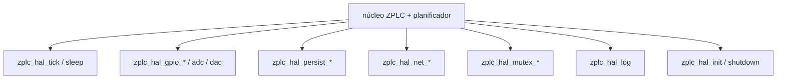
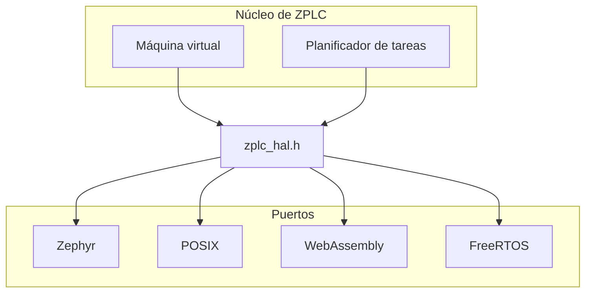

# Contrato HAL

`firmware/lib/zplc_core/include/zplc_hal.h` es el contrato público entre el núcleo de ZPLC y cualquier plataforma concreta.

Eso incluye los destinos Zephyr, los runtimes host/POSIX, un puerto para navegador con WebAssembly (el runtime de la simulación en el navegador, compilado con ZPLC) y los futuros puertos de placa.

Las funciones de abajo, el puerto del planificador y la suite de conformidad que pasa cada puerto están en una página generada: [Interfaz de puerto y suite de conformidad](./port-interface.md).

## Regla central

El núcleo portable no debe llamar directamente a las APIs de la plataforma.

Si algo pertenece a GPIO, tiempos, persistencia, red, sockets o sincronización, el núcleo debe usarlo mediante `zplc_hal_*`.

El núcleo portable define la semántica de ejecución. La HAL se encarga de la integración con la plataforma.

## Superficie HAL por responsabilidad



## Tiempos

- `zplc_hal_tick()` proporciona el reloj del planificador en milisegundos
- `zplc_hal_sleep()` ofrece espera bloqueante fuera de la lógica PLC

## E/S digital y analógica

La superficie pública de E/S es por canal:

- `zplc_hal_gpio_read()`
- `zplc_hal_gpio_write()`
- `zplc_hal_adc_read()`
- `zplc_hal_dac_write()`

El núcleo direcciona la E/S por **canal lógico**, no por pin de la placa. Qué canales tiene una placa, dónde está cada
uno en la imagen de proceso y cuál es su pin es un dato: la descripción de E/S de la placa en
`firmware/app/boards/boards.json` (véase [Placas](../reference/boards.md)).

### La tabla de E/S

La compilación de Zephyr convierte la entrada de la placa en una tabla constante, `zplc_io_table()`, con
`firmware/zephyr/scripts/gen_io_table.py`. Cada fila lleva el identificador del canal, el nombre del pin, el byte y el bit de la
imagen de proceso, el tipo, la dirección, el número de canal de la HAL, el valor seguro y si el canal es obligatorio.
El planificador sincroniza la imagen a través de la tabla (`zplc_io_channel_at()`, `zplc_io_read_channel()`,
`zplc_io_write_channel()`), de modo que agregar un canal a una placa es editar el JSON y el overlay de devicetree y no
cambia ningún archivo fuente de C.

- La descripción y el devicetree deben coincidir. El archivo generado afirma, para cada canal, que el devicetree tiene
  el alias, que el alias está en el pin descrito y que el pin pertenece al controlador descrito; un desacuerdo detiene
  la compilación con un mensaje que nombra el canal.
- Los periféricos se configuran en `zplc_hal_init()`, antes de que el runtime pueda entrar en RUN: cada GPIO y cada
  entrada analógica de la descripción, no en el primer ciclo. Un canal obligatorio que no se puede configurar hace
  fallar la inicialización.
- Las salidas digitales se numeran primero y luego las entradas digitales; las entradas analógicas tienen su propia
  numeración, en el orden de la imagen.
- Una placa que no está en el manifiesto (`native_sim`, una placa propia) usa el perfil de alias por defecto de
  `firmware/zephyr/io-default.json`: `led0` a `led3` son las salidas, `sw0` a `sw3` las entradas y el conversor con
  la etiqueta `adc` canales 0 a 4 las entradas analógicas, cada una enlazada cuando el devicetree la tiene.
- Los puertos POSIX y WebAssembly no listan ningún canal: el runtime host intercambia la imagen de proceso con la aplicación ZPLC.
- Ningún puerto maneja una salida analógica, así que ninguna descripción lista una (`zplc_hal_dac_write()` responde
  `ZPLC_HAL_NOT_IMPL`).
- Los tamaños de imagen son los que necesitan los canales, con `CONFIG_ZPLC_IO_INPUT_IMAGE_BYTES` y
  `CONFIG_ZPLC_IO_OUTPUT_IMAGE_BYTES` para reservar más. La memoria detrás de las imágenes sigue siendo los 4 KB del
  conjunto de instrucciones: reducirla cambia el contrato binario y es un paso aparte.

El firmware informa la identidad de su descripción con `sys io --json` (id de placa, hash, cantidad de canales
y bytes de imagen; un comando aparte, para que las claves de `sys info --json` no cambien), y la aplicación ZPLC se niega a cargar un programa que usa E/S en un firmware cuya descripción no es la
que él tiene, o en una placa que no tiene canal para lo que el programa toca.

### No soportado

Una operación que una placa no puede realizar devuelve `ZPLC_HAL_NOT_IMPL`; ese es el resultado definido de "no
soportado". El planificador lo omite si viene de un canal opcional, es un error si viene de un canal obligatorio, y una
función que un puerto no implementa es una falla de compilación o de prueba, no un sustituto silencioso.

## Persistencia

La HAL es dueña de:

- `zplc_hal_persist_save()`
- `zplc_hal_persist_load()`
- `zplc_hal_persist_delete()`

Estas primitivas permiten que el núcleo portable use un almacén de programas
independiente del backend. No proporcionan asignación, restauración ni retención
de extremo a extremo calificada de `RETAIN` a nivel de fuente; esas afirmaciones no tienen
respaldo hoy.

## Red y sockets

La superficie pública de red incluye:

- `zplc_hal_net_init()`
- `zplc_hal_net_get_ip()`

Los puertos de Zephyr, POSIX, WebAssembly y FreeRTOS implementan estas funciones. La resolución de nombres y los sockets no forman
parte de la interfaz de puerto: la aplicación abre sus propios sockets con tiempos de espera por socket mediante el resolvedor de
Zephyr y SNTP. La HAL declaraba una función de DNS y cuatro de socket que nadie llamaba; se quitaron para que toda
función declarada tenga un llamador (IO-007).

## Sincronización

El contrato también incluye exclusiones mutuas (mutex):

- `zplc_hal_mutex_create()`
- `zplc_hal_mutex_lock()`
- `zplc_hal_mutex_unlock()`
- `zplc_hal_mutex_destroy()`

## Registro y ciclo de vida

- `zplc_hal_init()`
- `zplc_hal_shutdown()`
- `zplc_hal_log()`

## Se verifica en cada cambio

`python3 tools/ci/check_hal_contract.py` lee `zplc_hal.h`, las fuentes de los cuatro puertos y los llamadores. Falla
cuando una función declarada no tiene implementación en un puerto, o no tiene llamador ni entrada en el registro, y
cuando una entrada del registro quedó vieja. Es una verificación de texto: prueba que existen una definición y un
sitio de llamada, no que el código detrás sea correcto.

## Páginas relacionadas

- [Visión general del runtime](./index.md)
- [Modelo de memoria](./memory-model.md)
- [Conectividad](./connectivity.md)

## Los puertos HAL

El [contrato HAL](./hal-contract.md) dice qué le pide el núcleo portable a una plataforma.
Esta página dice qué hace con él cada puerto del árbol de código fuente y qué exige agregar
uno. El contrato es `firmware/lib/zplc_core/include/zplc_hal.h`; los puertos son los cuatro
directorios que están bajo `firmware/lib/zplc_core/src/hal/`.



### Los cuatro puertos

|                         | Zephyr                                                                                                                                                                                                  | POSIX                                                                                                                                    | WebAssembly                                                                                                                                                                                       | FreeRTOS                                                                                                                                                                                                                        |
| ----------------------- | ------------------------------------------------------------------------------------------------------------------------------------------------------------------------------------------------------- | ---------------------------------------------------------------------------------------------------------------------------------------- | ------------------------------------------------------------------------------------------------------------------------------------------------------------------------------------------------- | ------------------------------------------------------------------------------------------------------------------------------------------------------------------------------------------------------------------------------- |
| Fuente                  | `zephyr/zplc_hal_zephyr.c`                                                                                                                                                                              | `posix/zplc_hal_posix.c`                                                                                                                 | `wasm/zplc_hal_wasm.c`                                                                                                                                                                            | `freertos/zplc_hal_freertos.c` y `freertos/zplc_persist_freertos.c`                                                                                                                                                             |
| Lo usa                  | El firmware de cada placa                                                                                                                                                                               | El simulador nativo, `zplc_runtime`, en el que la aplicación ZPLC y la línea de comandos ejecutan programas y escenarios                 | El runtime de software de la aplicación ZPLC (`tools/wasm-core` lo compila con `clang` y `wasm-ld`), donde el runtime nativo no puede arrancar. Véase [Runtime de software](./browser-runtime.md) | El puerto FreeRTOS, compilado con `ZPLC_PORT=freertos` contra el simulador POSIX/GCC de FreeRTOS y demostrado solo allí: el segundo puerto embebido que no es de Zephyr (decisión D-06). Ninguna placa FreeRTOS está calificada |
| Tiempo                  | `k_uptime_get()`, y `k_msleep()` para dormir                                                                                                                                                            | `CLOCK_MONOTONIC`; un escenario puede reemplazarlo por un reloj lógico (`zplc_hal_posix_set_tick_override`)                              | El reloj de la página, mediante la importación `zplc_host.clock_ms` (`performance.now()` en ZPLC); aquí también está el reloj de escenario del puerto POSIX                                       | El tick del kernel, a 1 kHz, y `vTaskDelay()` para dormir; aquí también está el reloj de escenario del puerto POSIX. El simulador no es de tiempo real: con carga su tick corre más lento que el reloj de pared                 |
| E/S digital y analógica | Controladores de GPIO y ADC, para los canales de la descripción de la placa en `boards.json`: primero se numeran las salidas y luego las entradas. Las salidas analógicas responden `ZPLC_HAL_NOT_IMPL` | Ninguna: las funciones responden `ZPLC_HAL_NOT_IMPL`, porque el runtime del host intercambia la imagen de proceso con la aplicación ZPLC | Ninguna: las funciones responden `ZPLC_HAL_NOT_IMPL` y la tabla de E/S está vacía, como en el puerto POSIX                                                                                        | Una placa simulada, `freertos-sim`: ocho salidas digitales, ocho entradas digitales y una palabra analógica en cada sentido, detrás de pines que una prueba escribe y lee. Un canal fuera de esos responde `ZPLC_HAL_NOT_IMPL`  |
| Persistencia            | NVS en la `storage_partition` de la placa cuando `CONFIG_NVS` está activo, y `ZPLC_HAL_NOT_IMPL` cuando no lo está                                                                                      | Un archivo `<clave>.bin` por clave, en `$ZPLC_PERSIST_ROOT` cuando esa variable está definida, y en `~/.zplc` en caso contrario          | Las importaciones `persist_save`, `persist_load` y `persist_delete` de la página, que guarda los registros `RETAIN` en la carpeta `build/retain` del proyecto abierto                             | Un archivo `<clave>.bin` por clave, escrito con un nombre temporal, vaciado y renombrado, en `$ZPLC_PERSIST_ROOT` o en `~/.zplc`: el modelo de flash del simulador, que una placa reemplaza por su controlador de flash         |
| Red y sockets           | La pila de red de Zephyr cuando `CONFIG_NETWORKING` está activo, y `ZPLC_HAL_NOT_IMPL` cuando no lo está                                                                                                | `ZPLC_HAL_NOT_IMPL`                                                                                                                      | `ZPLC_HAL_NOT_IMPL`                                                                                                                                                                               | `ZPLC_HAL_NOT_IMPL`                                                                                                                                                                                                             |

Una función que una plataforma no puede realizar devuelve `ZPLC_HAL_NOT_IMPL`, que es el
resultado definido de «no soportado»; nunca se deja sin definir. Las páginas del
[contrato](./hal-contract.md#es-digital-y-analógica) y de las
[placas compatibles](../reference/boards.md) dicen qué canales tiene una placa y cómo
se genera la tabla de E/S.

El ciclo omite un canal cuya operación responde `ZPLC_HAL_NOT_IMPL`, para que un convertidor ausente no detenga el controlador, y no lo oculta: el runtime cuenta los canales de entrada y de salida que no pudo atender (cada canal una vez) y los informa. El comando `zplc status` los lista en `warnings` (`io_unsupported`) con las cuentas, imprime una advertencia en su forma de texto, y el enlace con el dispositivo envía una advertencia en sus eventos de registro cada vez que cambia la cuenta (y a un cliente que se suscribe después). La aplicación ZPLC muestra la línea en la consola del dispositivo conectado. Esto se verifica con pruebas en C en el host y con una prueba de la aplicación; lo que hace una placa concreta con un convertidor ausente no se verifica en hardware.

### Qué fija una placa Zephyr

Los tamaños del almacén de programa y de las memorias son símbolos Kconfig del módulo.
Una placa con menos memoria que los valores por defecto los fija en su
`firmware/app/boards/<placa>.conf`, y el manifiesto repite los mismos números (una
compilación falla cuando los dos difieren):

```ini
# por defecto 8192
CONFIG_ZPLC_WORK_MEMORY_SIZE=8192
# por defecto 4096
CONFIG_ZPLC_RETAIN_MEMORY_SIZE=4096
# por defecto 45056
CONFIG_ZPLC_CODE_SIZE_MAX=24576

# Persistencia: NVS necesita el controlador de flash, el mapa de particiones y una storage_partition
CONFIG_FLASH=y
CONFIG_FLASH_PAGE_LAYOUT=y
CONFIG_FLASH_MAP=y
CONFIG_NVS=y
```

El overlay de la placa define `storage_partition`, salvo que la placa de Zephyr ya la
defina. La [referencia de Kconfig](../reference/kconfig.md) lista cada símbolo con su
valor por defecto y su rango.

### Agregar un puerto

1. Agregue `src/hal/<plataforma>/zplc_hal_<plataforma>.c` junto a los demás puertos y
   defina cada función que declara `zplc_hal.h`. Responda `ZPLC_HAL_NOT_IMPL` para lo
   que la plataforma no puede hacer.
2. Compílelo con el núcleo: las fuentes portables son `src/core/*.c`, que no deben incluir
   ningún encabezado de plataforma (un objetivo de ese CMake las compila solas y se detiene
   ante una inclusión de plataforma), y el puerto se lista en el CMake de
   `firmware/lib/zplc_core` como se lista el puerto POSIX.
3. Agregue el puerto a `PORTS` en `tools/ci/check_hal_contract.py` y ejecútelo. Falla cuando
   una función declarada no tiene definición en un puerto, no tiene ningún llamador fuera de
   los puertos y de las pruebas, o tiene una entrada obsoleta en `tools/ci/hal-contract.json`:

   ```bash
   python3 tools/ci/check_hal_contract.py
   ```

4. Ejecute las pruebas del núcleo (`bun run test:core`), que compilan el núcleo con los
   sanitizadores de direcciones y de comportamiento indefinido. Un puerto que no es la
   compilación del host ejecuta la suite de conformidad en su propia compilación, como hace
   el puerto FreeRTOS con `bash tools/freertos/test.sh`.

Para una placa, y no una plataforma, vea [Portar ZPLC a una placa nueva](../guides/port-to-a-board.md).

### Qué está verificado y qué no

| Parte                                                                                                            | Verificado                                                                                                                                                                                              | Nivel            |
| ---------------------------------------------------------------------------------------------------------------- | ------------------------------------------------------------------------------------------------------------------------------------------------------------------------------------------------------- | ---------------- |
| Cada puerto define todas las funciones del contrato, y cada función tiene un llamador o una entrada del registro | `tools/ci/check_hal_contract.py` en CI                                                                                                                                                                  | Host             |
| Las afirmaciones de la tabla de arriba                                                                           | Leídas de las fuentes de los cuatro puertos en la fecha de esta página; no tienen una prueba propia                                                                                                     | Ninguno          |
| El puerto FreeRTOS pasa la suite de conformidad de puertos                                                       | `bash tools/freertos/test.sh` en el simulador POSIX de FreeRTOS; el trabajo `freertos-port` de CI ejecuta los mismos comandos (el flujo de trabajo está escrito y todavía no se ha ejecutado en GitHub) | Host (simulador) |
| Una placa FreeRTOS se comporta como dice el contrato                                                             | No aplica: no existe un puerto FreeRTOS para una placa                                                                                                                                                  | Ninguno          |
| Un puerto distinto de los cuatro se comporta como dice el contrato                                               | No aplica: no existe otro puerto                                                                                                                                                                        | Ninguno          |
