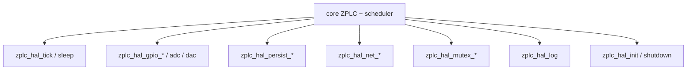

# Contrato HAL

`firmware/lib/zplc_core/include/zplc_hal.h` es el contrato público entre el core de ZPLC y cualquier plataforma concreta.

Eso incluye los destinos Zephyr, los runtimes host/POSIX, un port para navegador con WebAssembly (el runtime de la simulación en el navegador, compilado con el IDE) y los futuros ports de placa.

Las funciones de abajo, el puerto del planificador y la suite de conformidad que pasa cada puerto están en una página generada: [Interfaz de puerto y suite de conformidad](./port-interface.md).

## Regla central

El core portable no debe llamar directamente a las APIs de la plataforma.

Si algo pertenece a GPIO, timing, persistencia, networking, sockets o sincronización, el core debe usarlo mediante `zplc_hal_*`.

El core portable define la semántica de ejecución. La HAL se encarga de la integración con la plataforma.

## Superficie HAL por responsabilidad

## Timing

- `zplc_hal_tick()` provee el reloj del scheduler en milisegundos
- `zplc_hal_sleep()` ofrece espera bloqueante fuera de la lógica PLC

## E/S digital y analógica

La superficie pública de E/S es por canal:

- `zplc_hal_gpio_read()`
- `zplc_hal_gpio_write()`
- `zplc_hal_adc_read()`
- `zplc_hal_dac_write()`

El core direcciona la E/S por **canal lógico**, no por pin de la placa. Qué canales tiene una placa, dónde está cada
uno en la imagen de proceso y cuál es su pin es un dato: la descripción de E/S de la placa en
`firmware/app/boards/boards.json` (ver [Placas Soportadas](../reference/boards.md)).

### La tabla de E/S

El build de Zephyr convierte la entrada de la placa en una tabla constante, `zplc_io_table()`, con
`firmware/zephyr/scripts/gen_io_table.py`. Cada fila lleva el id del canal, el nombre del pin, el byte y el bit de la
imagen de proceso, el tipo, la dirección, el número de canal de la HAL, el valor seguro y si el canal es obligatorio.
El scheduler sincroniza la imagen a través de la tabla (`zplc_io_channel_at()`, `zplc_io_read_channel()`,
`zplc_io_write_channel()`), de modo que agregar un canal a una placa es editar el JSON y el overlay de devicetree y no
cambia ningún fuente C.

- La descripción y el devicetree deben coincidir. El archivo generado afirma, para cada canal, que el devicetree tiene
  el alias, que el alias está en el pin descrito y que el pin pertenece al controlador descrito; un desacuerdo detiene
  el build con un mensaje que nombra el canal.
- Los periféricos se configuran en `zplc_hal_init()`, antes de que el runtime pueda entrar en RUN: cada GPIO y cada
  entrada analógica de la descripción, no en el primer scan. Un canal obligatorio que no se puede configurar hace
  fallar la inicialización.
- Las salidas digitales se numeran primero y luego las entradas digitales; las entradas analógicas tienen su propia
  numeración, en el orden de la imagen.
- Una placa que no está en el manifiesto (`native_sim`, una placa propia) usa el perfil de alias por defecto de
  `firmware/zephyr/io-default.json`: `led0` a `led3` son las salidas, `sw0` a `sw3` las entradas y el conversor con
  la etiqueta `adc` canales 0 a 4 las entradas analógicas, cada una enlazada cuando el devicetree la tiene.
- Los ports POSIX y WebAssembly no listan ningún canal: el runtime host intercambia la imagen de proceso con Studio.
- Ningún port maneja una salida analógica, así que ninguna descripción lista una (`zplc_hal_dac_write()` responde
  `ZPLC_HAL_NOT_IMPL`).
- Los tamaños de imagen son los que necesitan los canales, con `CONFIG_ZPLC_IO_INPUT_IMAGE_BYTES` y
  `CONFIG_ZPLC_IO_OUTPUT_IMAGE_BYTES` para reservar más. La memoria detrás de las imágenes sigue siendo los 4 KB del
  conjunto de instrucciones: reducirla cambia el contrato binario y es un paso aparte.

El firmware informa la identidad de su descripción con `sys io --json` (id de placa, hash, cantidad de canales
y bytes de imagen; un comando aparte, para que las claves de `sys info --json` no cambien), y Studio se niega a cargar un programa que usa E/S en un firmware cuya descripción no es la
que él tiene, o en una placa que no tiene canal para lo que el programa toca.

### No soportado

Una operación que una placa no puede realizar devuelve `ZPLC_HAL_NOT_IMPL`; ese es el resultado definido de "no
soportado". El scheduler lo omite si viene de un canal opcional, es un error si viene de un canal obligatorio, y una
función que un port no implementa es un fallo de build o de test, no un stub silencioso.

## Persistencia

La HAL es dueña de:

- `zplc_hal_persist_save()`
- `zplc_hal_persist_load()`
- `zplc_hal_persist_delete()`

Estas primitivas permiten que el core portable use un program store
independiente del backend. No proporcionan asignación, restore ni retención
end-to-end calificada de `RETAIN` a nivel de fuente; esas declaraciones no están
soportadas hoy.

## Red y sockets

La superficie pública de red incluye:

- `zplc_hal_net_init()`
- `zplc_hal_net_get_ip()`
Los ports de Zephyr, POSIX y WebAssembly implementan estas funciones. La resolución de nombres y los sockets no forman
parte de la interfaz de port: la aplicación abre sus propios sockets con timeouts por socket mediante el resolvedor de
Zephyr y SNTP. La HAL declaraba una función de DNS y cuatro de socket que nadie llamaba; se quitaron para que toda
función declarada tenga un llamador (IO-007).

## Sincronización

El contrato también incluye mutexes:

- `zplc_hal_mutex_create()`
- `zplc_hal_mutex_lock()`
- `zplc_hal_mutex_unlock()`
- `zplc_hal_mutex_destroy()`

## Logging y ciclo de vida

- `zplc_hal_init()`
- `zplc_hal_shutdown()`
- `zplc_hal_log()`

## Se verifica en cada cambio

`python3 tools/ci/check_hal_contract.py` lee `zplc_hal.h`, las fuentes de los tres ports y los llamadores. Falla
cuando una función declarada no tiene implementación en un port, o no tiene llamador ni entrada en el registro, y
cuando una entrada del registro quedó vieja. Es una verificación de texto: prueba que existen una definición y un
sitio de llamada, no que el código detrás sea correcto.

## Páginas relacionadas

- [Visión general del runtime](./index.md)
- [Modelo de memoria](./memory-model.md)
- [Conectividad](./connectivity.md)
