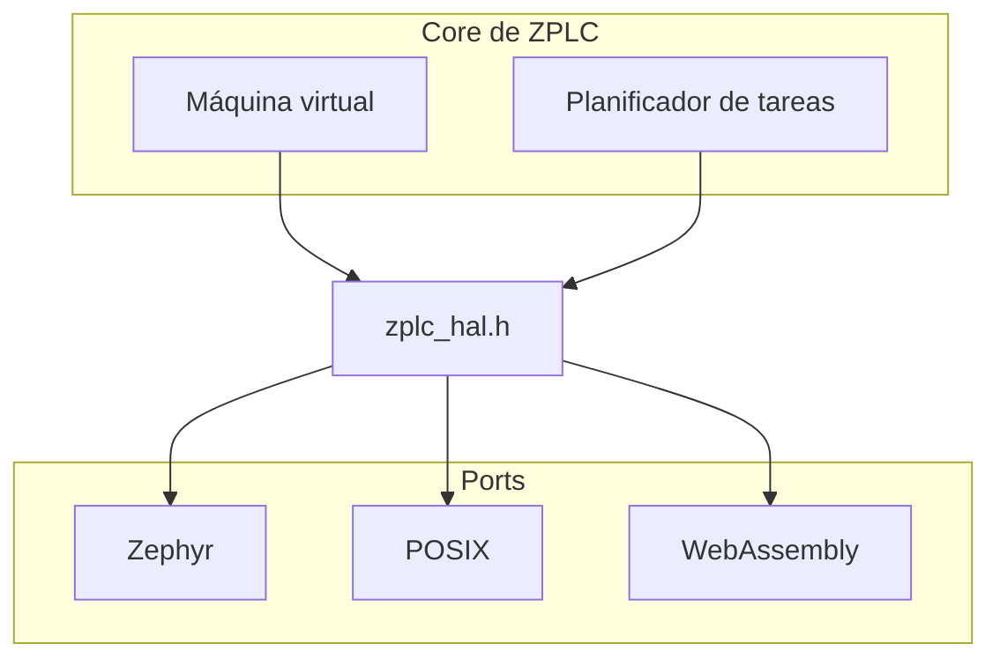

# Capa de abstracción de hardware (HAL): los ports

El [contrato HAL](./hal-contract.md) dice qué le pide el core portable a una plataforma.
Esta página dice qué hace con él cada port del árbol de código fuente y qué exige agregar
uno. El contrato es `firmware/lib/zplc_core/include/zplc_hal.h`; los ports son los tres
archivos que están bajo `firmware/lib/zplc_core/src/hal/`.



## Los tres ports

| | Zephyr | POSIX | WebAssembly |
| --- | --- | --- | --- |
| Fuente | `zephyr/zplc_hal_zephyr.c` | `posix/zplc_hal_posix.c` | `wasm/zplc_hal_wasm.c` |
| Lo usa | El firmware de cada placa | El simulador nativo, `zplc_runtime`, en el que Studio y la línea de comandos ejecutan programas y escenarios | Una compilación para navegador; está en el árbol de código fuente y no se distribuye en esta versión |
| Tiempo | `k_uptime_get()`, y `k_msleep()` para dormir | `CLOCK_MONOTONIC`; un escenario puede reemplazarlo por un reloj lógico (`zplc_hal_posix_set_tick_override`) | `performance.now()` a través de JavaScript |
| E/S digital y analógica | Controladores de GPIO y ADC, para los canales de la descripción de la placa en `boards.json`: primero se numeran las salidas y luego las entradas. Las salidas analógicas responden `ZPLC_HAL_NOT_IMPL` | Ninguna: las funciones responden `ZPLC_HAL_NOT_IMPL`, porque el runtime del host intercambia la imagen de proceso con Studio | Cuatro salidas y cuatro entradas, conectadas a funciones de retorno de JavaScript |
| Persistencia | NVS en la `storage_partition` de la placa cuando `CONFIG_NVS` está activo, y `ZPLC_HAL_NOT_IMPL` cuando no lo está | Un archivo `<clave>.bin` por clave, en `$ZPLC_PERSIST_ROOT` cuando esa variable está definida, y en `~/.zplc` en caso contrario | El `localStorage` del navegador, bajo la clave `zplc_<clave>` |
| Red y sockets | La pila de red de Zephyr cuando `CONFIG_NETWORKING` está activo, y `ZPLC_HAL_NOT_IMPL` cuando no lo está | `ZPLC_HAL_NOT_IMPL` | `ZPLC_HAL_NOT_IMPL` |

Una función que una plataforma no puede realizar devuelve `ZPLC_HAL_NOT_IMPL`, que es el
resultado definido de «no soportado»; nunca se deja sin definir. Las páginas del
[contrato](./hal-contract.md#es-digital-y-analógica) y de las
[placas compatibles](../reference/boards.md) dicen qué canales tiene una placa y cómo
se genera la tabla de E/S.

## Qué fija una placa Zephyr

Los tamaños del almacén de programa y de las memorias son símbolos Kconfig del módulo.
Una placa con menos memoria que los valores por defecto los fija en su
`firmware/app/boards/<placa>.conf`, y el manifiesto repite los mismos números (una
compilación falla cuando los dos difieren):

```ini
# por defecto 8192
CONFIG_ZPLC_WORK_MEMORY_SIZE=8192
# por defecto 4096
CONFIG_ZPLC_RETAIN_MEMORY_SIZE=4096
# por defecto 45056
CONFIG_ZPLC_CODE_SIZE_MAX=24576

# Persistencia: NVS necesita el controlador de flash, el mapa de particiones y una storage_partition
CONFIG_FLASH=y
CONFIG_FLASH_PAGE_LAYOUT=y
CONFIG_FLASH_MAP=y
CONFIG_NVS=y
```

El overlay de la placa define `storage_partition`, salvo que la placa de Zephyr ya la
defina. La [referencia de Kconfig](../reference/kconfig.md) lista cada símbolo con su
valor por defecto y su rango.

## Agregar un port

1. Agregue `src/hal/<plataforma>/zplc_hal_<plataforma>.c` junto a los tres ports y
   defina cada función que declara `zplc_hal.h`. Responda `ZPLC_HAL_NOT_IMPL` para lo
   que la plataforma no puede hacer.
2. Compílelo con el core: las fuentes portables son `src/core/*.c`, que no deben incluir
   ninguna cabecera de plataforma (un objetivo de ese CMake las compila solas y se detiene
   ante una inclusión de plataforma), y el port se lista en el CMake de
   `firmware/lib/zplc_core` como se lista el port POSIX.
3. Agregue el port a `PORTS` en `tools/ci/check_hal_contract.py` y ejecútelo. Falla cuando
   una función declarada no tiene definición en un port, no tiene ningún llamador fuera de
   los ports y de las pruebas, o tiene una entrada obsoleta en `tools/ci/hal-contract.json`:

   ```bash
   python3 tools/ci/check_hal_contract.py
   ```

4. Ejecute las pruebas del core (`bun run test:core`), que compilan el core con los
   sanitizadores de direcciones y de comportamiento indefinido.

Para una placa, y no una plataforma, vea [Portar ZPLC a una placa nueva](../guides/port-to-a-board.md).

## Qué está verificado y qué no

| Parte | Verificado | Nivel |
| --- | --- | --- |
| Cada port define todas las funciones del contrato, y cada función tiene un llamador o una entrada del registro | `tools/ci/check_hal_contract.py` en CI | Host |
| Las afirmaciones de la tabla de arriba | Leídas de las fuentes de los tres ports en la fecha de esta página; no tienen una prueba propia | Ninguno |
| Un port distinto de los tres se comporta como dice el contrato | No aplica: no existe otro port | Ninguno |
