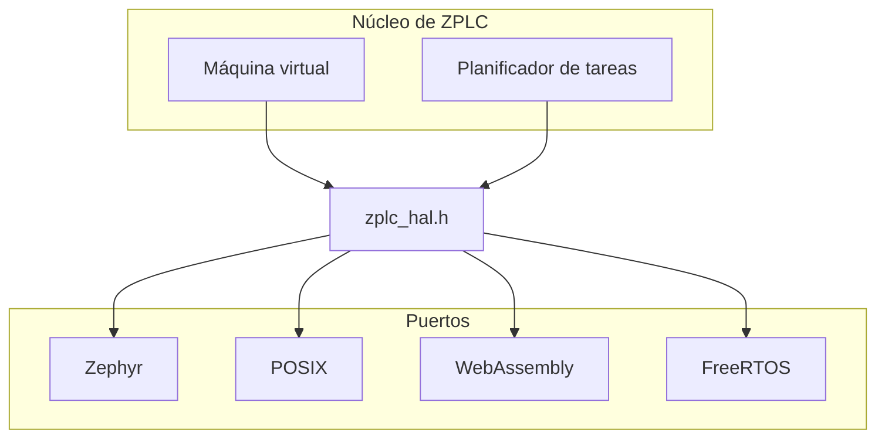

# Capa de abstracción de hardware (HAL): los puertos

El [contrato HAL](./hal-contract.md) dice qué le pide el núcleo portable a una plataforma.
Esta página dice qué hace con él cada puerto del árbol de código fuente y qué exige agregar
uno. El contrato es `firmware/lib/zplc_core/include/zplc_hal.h`; los puertos son los cuatro
directorios que están bajo `firmware/lib/zplc_core/src/hal/`.



## Los cuatro puertos

|                         | Zephyr                                                                                                                                                                                                  | POSIX                                                                                                                                    | WebAssembly                                                                                                                                                                                       | FreeRTOS                                                                                                                                                                                                                        |
| ----------------------- | ------------------------------------------------------------------------------------------------------------------------------------------------------------------------------------------------------- | ---------------------------------------------------------------------------------------------------------------------------------------- | ------------------------------------------------------------------------------------------------------------------------------------------------------------------------------------------------- | ------------------------------------------------------------------------------------------------------------------------------------------------------------------------------------------------------------------------------- |
| Fuente                  | `zephyr/zplc_hal_zephyr.c`                                                                                                                                                                              | `posix/zplc_hal_posix.c`                                                                                                                 | `wasm/zplc_hal_wasm.c`                                                                                                                                                                            | `freertos/zplc_hal_freertos.c` y `freertos/zplc_persist_freertos.c`                                                                                                                                                             |
| Lo usa                  | El firmware de cada placa                                                                                                                                                                               | El simulador nativo, `zplc_runtime`, en el que la aplicación ZPLC y la línea de comandos ejecutan programas y escenarios                 | El runtime de software de la aplicación ZPLC (`tools/wasm-core` lo compila con `clang` y `wasm-ld`), donde el runtime nativo no puede arrancar. Véase [Runtime de software](./browser-runtime.md) | El puerto FreeRTOS, compilado con `ZPLC_PORT=freertos` contra el simulador POSIX/GCC de FreeRTOS y demostrado solo allí: el segundo puerto embebido que no es de Zephyr (decisión D-06). Ninguna placa FreeRTOS está calificada |
| Tiempo                  | `k_uptime_get()`, y `k_msleep()` para dormir                                                                                                                                                            | `CLOCK_MONOTONIC`; un escenario puede reemplazarlo por un reloj lógico (`zplc_hal_posix_set_tick_override`)                              | El reloj de la página, mediante la importación `zplc_host.clock_ms` (`performance.now()` en ZPLC); aquí también está el reloj de escenario del puerto POSIX                                       | El tick del kernel, a 1 kHz, y `vTaskDelay()` para dormir; aquí también está el reloj de escenario del puerto POSIX. El simulador no es de tiempo real: con carga su tick corre más lento que el reloj de pared                 |
| E/S digital y analógica | Controladores de GPIO y ADC, para los canales de la descripción de la placa en `boards.json`: primero se numeran las salidas y luego las entradas. Las salidas analógicas responden `ZPLC_HAL_NOT_IMPL` | Ninguna: las funciones responden `ZPLC_HAL_NOT_IMPL`, porque el runtime del host intercambia la imagen de proceso con la aplicación ZPLC | Ninguna: las funciones responden `ZPLC_HAL_NOT_IMPL` y la tabla de E/S está vacía, como en el puerto POSIX                                                                                        | Una placa simulada, `freertos-sim`: ocho salidas digitales, ocho entradas digitales y una palabra analógica en cada sentido, detrás de pines que una prueba escribe y lee. Un canal fuera de esos responde `ZPLC_HAL_NOT_IMPL`  |
| Persistencia            | NVS en la `storage_partition` de la placa cuando `CONFIG_NVS` está activo, y `ZPLC_HAL_NOT_IMPL` cuando no lo está                                                                                      | Un archivo `<clave>.bin` por clave, en `$ZPLC_PERSIST_ROOT` cuando esa variable está definida, y en `~/.zplc` en caso contrario          | Las importaciones `persist_save`, `persist_load` y `persist_delete` de la página, que guarda los registros `RETAIN` en la carpeta `build/retain` del proyecto abierto                             | Un archivo `<clave>.bin` por clave, escrito con un nombre temporal, vaciado y renombrado, en `$ZPLC_PERSIST_ROOT` o en `~/.zplc`: el modelo de flash del simulador, que una placa reemplaza por su controlador de flash         |
| Red y sockets           | La pila de red de Zephyr cuando `CONFIG_NETWORKING` está activo, y `ZPLC_HAL_NOT_IMPL` cuando no lo está                                                                                                | `ZPLC_HAL_NOT_IMPL`                                                                                                                      | `ZPLC_HAL_NOT_IMPL`                                                                                                                                                                               | `ZPLC_HAL_NOT_IMPL`                                                                                                                                                                                                             |

Una función que una plataforma no puede realizar devuelve `ZPLC_HAL_NOT_IMPL`, que es el
resultado definido de «no soportado»; nunca se deja sin definir. Las páginas del
[contrato](./hal-contract.md#es-digital-y-analógica) y de las
[placas compatibles](../reference/boards.md) dicen qué canales tiene una placa y cómo
se genera la tabla de E/S.

El ciclo omite un canal cuya operación responde `ZPLC_HAL_NOT_IMPL`, para que un convertidor ausente no detenga el controlador, y no lo oculta: el runtime cuenta los canales de entrada y de salida que no pudo atender (cada canal una vez) y los informa. El comando `zplc status` los lista en `warnings` (`io_unsupported`) con las cuentas, imprime una advertencia en su forma de texto, y el enlace con el dispositivo envía una advertencia en sus eventos de registro cada vez que cambia la cuenta (y a un cliente que se suscribe después). La aplicación ZPLC muestra la línea en la consola del dispositivo conectado. Esto se verifica con pruebas en C en el host y con una prueba de la aplicación; lo que hace una placa concreta con un convertidor ausente no se verifica en hardware.

## Qué fija una placa Zephyr

Los tamaños del almacén de programa y de las memorias son símbolos Kconfig del módulo.
Una placa con menos memoria que los valores por defecto los fija en su
`firmware/app/boards/<placa>.conf`, y el manifiesto repite los mismos números (una
compilación falla cuando los dos difieren):

```ini
# por defecto 8192
CONFIG_ZPLC_WORK_MEMORY_SIZE=8192
# por defecto 4096
CONFIG_ZPLC_RETAIN_MEMORY_SIZE=4096
# por defecto 45056
CONFIG_ZPLC_CODE_SIZE_MAX=24576

# Persistencia: NVS necesita el controlador de flash, el mapa de particiones y una storage_partition
CONFIG_FLASH=y
CONFIG_FLASH_PAGE_LAYOUT=y
CONFIG_FLASH_MAP=y
CONFIG_NVS=y
```

El overlay de la placa define `storage_partition`, salvo que la placa de Zephyr ya la
defina. La [referencia de Kconfig](../reference/kconfig.md) lista cada símbolo con su
valor por defecto y su rango.

## Agregar un puerto

1. Agregue `src/hal/<plataforma>/zplc_hal_<plataforma>.c` junto a los demás puertos y
   defina cada función que declara `zplc_hal.h`. Responda `ZPLC_HAL_NOT_IMPL` para lo
   que la plataforma no puede hacer.
2. Compílelo con el núcleo: las fuentes portables son `src/core/*.c`, que no deben incluir
   ningún encabezado de plataforma (un objetivo de ese CMake las compila solas y se detiene
   ante una inclusión de plataforma), y el puerto se lista en el CMake de
   `firmware/lib/zplc_core` como se lista el puerto POSIX.
3. Agregue el puerto a `PORTS` en `tools/ci/check_hal_contract.py` y ejecútelo. Falla cuando
   una función declarada no tiene definición en un puerto, no tiene ningún llamador fuera de
   los puertos y de las pruebas, o tiene una entrada obsoleta en `tools/ci/hal-contract.json`:

   ```bash
   python3 tools/ci/check_hal_contract.py
   ```

4. Ejecute las pruebas del núcleo (`bun run test:core`), que compilan el núcleo con los
   sanitizadores de direcciones y de comportamiento indefinido. Un puerto que no es la
   compilación del host ejecuta la suite de conformidad en su propia compilación, como hace
   el puerto FreeRTOS con `bash tools/freertos/test.sh`.

Para una placa, y no una plataforma, vea [Portar ZPLC a una placa nueva](../guides/port-to-a-board.md).

## Qué está verificado y qué no

| Parte                                                                                                            | Verificado                                                                                                                                                                                              | Nivel            |
| ---------------------------------------------------------------------------------------------------------------- | ------------------------------------------------------------------------------------------------------------------------------------------------------------------------------------------------------- | ---------------- |
| Cada puerto define todas las funciones del contrato, y cada función tiene un llamador o una entrada del registro | `tools/ci/check_hal_contract.py` en CI                                                                                                                                                                  | Host             |
| Las afirmaciones de la tabla de arriba                                                                           | Leídas de las fuentes de los cuatro puertos en la fecha de esta página; no tienen una prueba propia                                                                                                     | Ninguno          |
| El puerto FreeRTOS pasa la suite de conformidad de puertos                                                       | `bash tools/freertos/test.sh` en el simulador POSIX de FreeRTOS; el trabajo `freertos-port` de CI ejecuta los mismos comandos (el flujo de trabajo está escrito y todavía no se ha ejecutado en GitHub) | Host (simulador) |
| Una placa FreeRTOS se comporta como dice el contrato                                                             | No aplica: no existe un puerto FreeRTOS para una placa                                                                                                                                                  | Ninguno          |
| Un puerto distinto de los cuatro se comporta como dice el contrato                                               | No aplica: no existe otro puerto                                                                                                                                                                        | Ninguno          |
