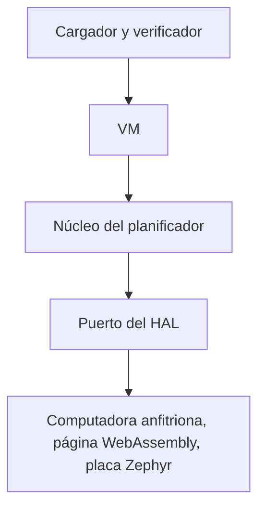

# Descripción del runtime

El runtime es la parte de ZPLC que ejecuta su programa: verifica un artefacto `.zplc` compilado, le da memoria, planifica sus tareas en cada ciclo y se comunica con el exterior a través del HAL. Esta página es el mapa; cada parte tiene su propia página.

ZPLC es un runtime portable en C99 detrás de una capa de abstracción de hardware (HAL). No es un PLC de seguridad certificado, y nada en estas páginas dice que lo sea.

## Qué hace el runtime

- **Carga y verifica** un artefacto `.zplc`. El cargador lo comprueba antes de ejecutar cualquier instrucción y rechaza el código que no puede demostrar bien formado.
- **Le da memoria**: dos imágenes de proceso para entradas y salidas, una región de trabajo, una región retentiva y el código. Véase el [modelo de memoria](./memory-model.md).
- **Ejecuta sus tareas**: tareas cíclicas, cada una con un intervalo y una prioridad, ordenadas por un único núcleo del planificador. Véase el [planificador](./scheduler.md).
- **Conserva lo que debe sobrevivir a un reinicio**: el programa almacenado y la región `RETAIN`. Véase [persistencia](./persistence.md).
- **Pide a la plataforma** el tiempo, los pines, el almacenamiento, los cerrojos y la red a través del [HAL](./hal-contract.md), y nada más.

## Dónde se ejecuta

| Runtime                            | Función                                                                                 | Qué establecen sus resultados                                                                 |
| ---------------------------------- | --------------------------------------------------------------------------------------- | --------------------------------------------------------------------------------------------- |
| Simulación nativa (`zplc_runtime`) | Runtime de host sin ventana para compilar, probar, trazar y reproducir                  | Evidencia de host: la lógica, no los tiempos ni la E/S de una placa                           |
| Runtime de software (WebAssembly)  | Simulación de respaldo de la aplicación ZPLC cuando el runtime nativo no puede arrancar | Evidencia de host, degradada; véase [el runtime de software](./browser-runtime.md)            |
| Firmware Zephyr                    | Una imagen por perfil de placa, con los adaptadores del HAL de esa placa                | Depende del perfil; véase [compatibilidad de hardware](../reference/capabilities-evidence.md) |
| Puerto FreeRTOS                    | Un segundo puerto embebido, compilado contra el simulador POSIX de FreeRTOS             | Host (simulador); ninguna placa FreeRTOS está calificada                                      |

## De la compilación a la máquina en marcha

1. **Compile** el proyecto en un artefacto `.zplc`.
2. **Cargue** el artefacto. El cargador lo verifica, y una carga correcta deja el runtime detenido y listo. Cargar nunca arranca la máquina.
3. **Inspeccione** el destino y luego **arránquelo** con una orden humana explícita, `zplc start` en un dispositivo. Nada inicia un programa por un reinicio ni por una carga.

Compilar el firmware, grabarlo, cargar un programa y ejecutarlo o depurarlo son cuatro operaciones distintas, y una carga nunca inicia el programa. Véase [Seguridad y limitaciones](../safety-and-limitations.md).

## Las páginas de esta sección

| Página                                         | Léala para saber                                                                                                                       |
| ---------------------------------------------- | -------------------------------------------------------------------------------------------------------------------------------------- |
| [Planificador](./scheduler.md)                 | Cómo funciona un ciclo, cómo se ordenan las tareas, qué hace un plazo incumplido y qué hacen las salidas cuando el programa se detiene |
| [Modelo de memoria](./memory-model.md)         | Las cinco regiones, qué comparte una tarea y qué le pertenece, cómo llega a los datos un hilo ajeno al ciclo                           |
| [Persistencia](./persistence.md)               | Qué se almacena, qué restaura un reinicio y el presupuesto de desgaste de la flash de cada placa                                       |
| [Contrato del HAL](./hal-contract.md)          | Qué pide el núcleo a una plataforma y qué hace con ello cada uno de los cuatro puertos                                                 |
| [Runtime de software](./browser-runtime.md)    | Qué comparte la simulación WebAssembly con el firmware y qué le falta                                                                  |
| [Biblioteca estándar](./stdlib.md)             | Qué son las funciones y los bloques de función integrados y dónde están las reglas de cada uno                                         |
| [API del runtime](../reference/runtime-api.md) | La superficie pública en C, generada a partir de los encabezados                                                                       |

## Qué cubre la evidencia

Las pruebas de host, el simulador nativo, las suites de Zephyr en `native_sim` y en QEMU y las compilaciones cruzadas del firmware son evidencia real, y cada página nombra la que usa. Los tiempos del destino, el comportamiento eléctrico de las salidas, la recuperación tras un corte de energía y los resultados con hardware en el bucle requieren una ejecución registrada en la placa exacta, y todavía no existe ninguna. Use la [referencia de placas](../reference/boards.md) y el procedimiento de recuperación del perfil elegido antes de poner en servicio algo o de realizar una operación física.
