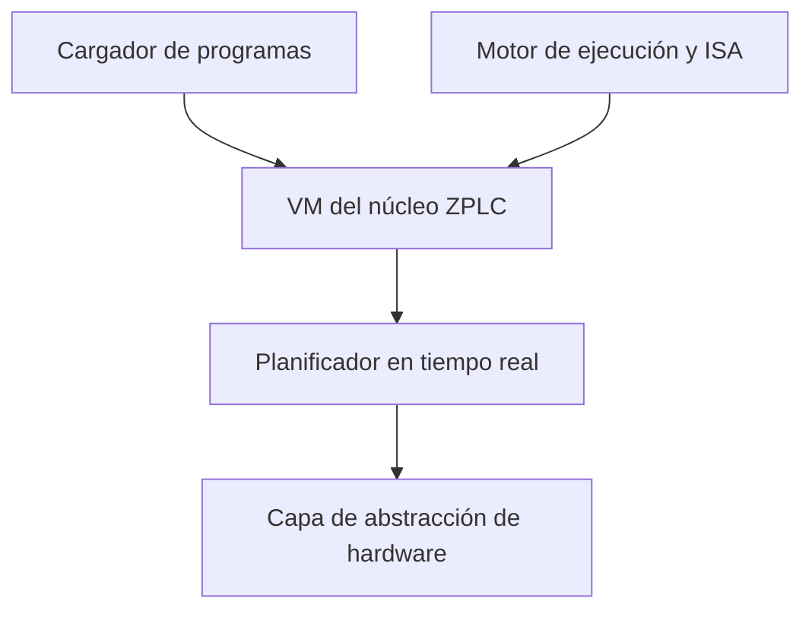

# Motor de ejecución de ZPLC

El runtime interno de ZPLC es el núcleo de ejecución de la plataforma. Está diseñado para ofrecer un rendimiento determinista en sistemas embebidos: ejecuta con seguridad el bytecode `.zplc`, gestiona la memoria, planifica las tareas de automatización y se integra con el hardware de cada plataforma.

## Responsabilidades principales

El runtime de ZPLC ofrece un entorno virtual completo para ejecutar las tareas de IEC 61131-3. Sus responsabilidades son:
- Cargar los programas compilados `.zplc` y sus metadatos.
- Crear máquinas virtuales (VM) con contextos de ejecución aislados.
- Hacer cumplir los límites de memoria (imágenes de proceso, memoria de trabajo interna y datos retenidos).
- Planificar y coordinar las tareas de PLC cíclicas.
- Delegar las operaciones físicas de E/S, de red y de almacenamiento en la capa de abstracción de hardware (HAL).

## Arquitectura de los subsistemas

## Modelo de memoria compartida

Para garantizar seguridad y rendimiento en circuitos integrados con pocos recursos, el contrato de memoria del runtime de ZPLC define límites estrictos para sus elementos:
- **IPI** (imagen de proceso de entradas): búfer aislado y asignado en memoria para leer las entradas físicas con seguridad.
- **OPI** (imagen de proceso de salidas): búfer que traslada los resultados lógicos a las salidas de hardware.
- **Memoria de trabajo:** pila de ejecución volátil y dinámica que se asigna mientras el runtime ejecuta.
- **Memoria retenida:** región de direcciones retain reservada y primitivas de persistencia de la HAL; las declaraciones `RETAIN` a nivel de código fuente no están soportadas por ahora.

## Portabilidad a otros destinos

Como el runtime delega los asuntos de bajo nivel en una HAL estrictamente definida, ZPLC se ejecuta con facilidad en varias arquitecturas:
- **Zephyr RTOS:** la plataforma de ejecución principal para los controladores de hardware en el borde. Ejecuta la aplicación de firmware de forma nativa sobre el hardware.
- **Simulación nativa en el equipo anfitrión:** ofrece una simulación de SoftPLC de escritorio, al adaptar las primitivas de la HAL a los sistemas de archivos y procesos de Windows, macOS o Linux.
