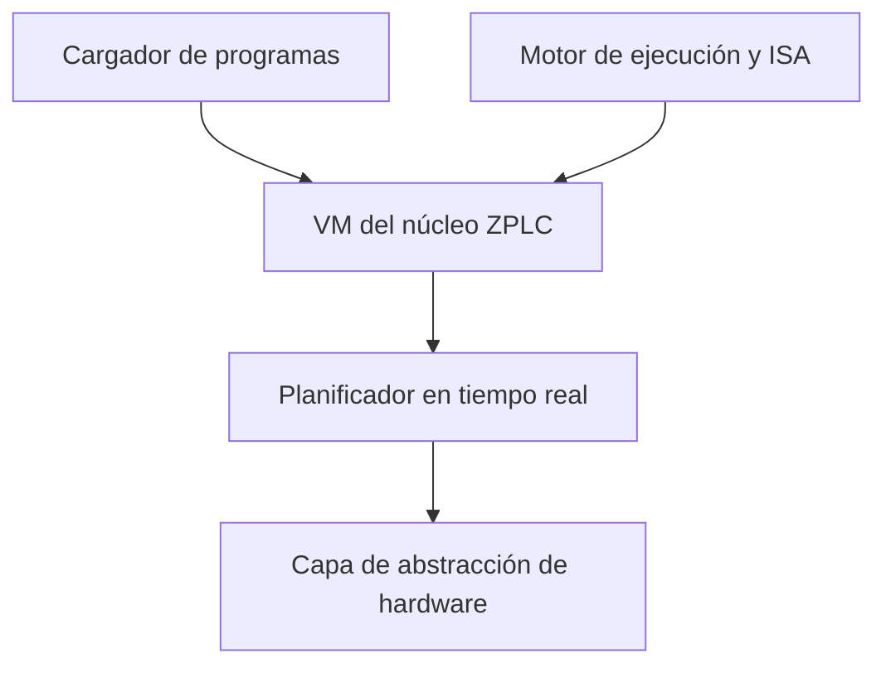

# Motor de ejecución de ZPLC

El runtime interno de ZPLC es el núcleo de ejecución de la plataforma. Está diseñado para ofrecer un rendimiento determinista en sistemas embebidos: ejecuta con seguridad el bytecode `.zplc`, gestiona la memoria, planifica las tareas de automatización y se integra con el hardware de cada plataforma.

## Responsabilidades principales

El runtime de ZPLC ofrece un entorno virtual completo para ejecutar las tareas de IEC 61131-3. Sus responsabilidades son:

- Cargar los programas compilados `.zplc` y sus metadatos.
- Crear máquinas virtuales (VM) con contextos de ejecución aislados.
- Hacer cumplir los límites de memoria (imágenes de proceso, memoria de trabajo interna y datos retenidos).
- Planificar y coordinar las tareas de PLC cíclicas.
- Delegar las operaciones físicas de E/S, de red y de almacenamiento en la capa de abstracción de hardware (HAL).

## Arquitectura de los subsistemas

## Modelo de memoria compartida

Para garantizar seguridad y rendimiento en circuitos integrados con pocos recursos, el contrato de memoria del runtime de ZPLC define límites estrictos para sus elementos:

- **IPI** (imagen de proceso de entradas): búfer aislado y asignado en memoria para leer las entradas físicas con seguridad.
- **OPI** (imagen de proceso de salidas): búfer que traslada los resultados lógicos a las salidas de hardware.
- **Memoria de trabajo:** pila de ejecución volátil y dinámica que se asigna mientras el runtime ejecuta.
- **Memoria retenida:** región de direcciones retain reservada y primitivas de persistencia de la HAL; las declaraciones `RETAIN` a nivel de código fuente no están soportadas por ahora.

## Portabilidad a otros destinos

Como el runtime delega los asuntos de bajo nivel en una HAL estrictamente definida, ZPLC se ejecuta con facilidad en varias arquitecturas:

- **Zephyr RTOS:** la plataforma de ejecución principal para los controladores de hardware en el borde. Ejecuta la aplicación de firmware de forma nativa sobre el hardware.
- **Simulación nativa en el equipo anfitrión:** ofrece una simulación de SoftPLC de escritorio, al adaptar las primitivas de la HAL a los sistemas de archivos y procesos de Windows, macOS o Linux.

## Introducción

ZPLC es un runtime PLC portable en C99 detrás de una capa de abstracción de
hardware (HAL). La aplicación ZPLC, el runtime nativo del host y los perfiles de Zephyr usan
artefactos `.zplc` verificados y los mismos contratos del runtime. No es un PLC de
seguridad certificado.

### Camino rápido

1. Compile el proyecto en un artefacto `.zplc`.
2. Verifique y cargue ese artefacto. Una carga correcta lo deja lógicamente
   detenido y listo (READY).
3. Inspeccione el destino y ejecute explícitamente el comando humano `zplc start`
   para ponerlo en marcha.

La compilación del firmware, la grabación del firmware, la carga del programa PLC y
RUN/depuración son operaciones separadas. Cargar un programa nunca implica que
arranque.

### Superficies del runtime

| Superficie              | Función                                                                               | Límite de la evidencia                                                                                                                                                                                                                                    |
| ----------------------- | ------------------------------------------------------------------------------------- | --------------------------------------------------------------------------------------------------------------------------------------------------------------------------------------------------------------------------------------------------------- |
| Núcleo y cargador       | Máquina virtual en C99, ISA, modelo de memoria y verificación de `.zplc`              | La evidencia de host y de pruebas unitarias no califica el comportamiento físico.                                                                                                                                                                         |
| Simulación nativa POSIX | Runtime local sin interfaz para los flujos de compilación, prueba, traza y repetición | Comportamiento del host; no es evidencia de tiempos en el destino ni HIL.                                                                                                                                                                                 |
| Perfiles de Zephyr      | Firmware del runtime y adaptadores de la HAL para revisiones de placa con nombre      | Las capacidades y la calificación varían según el perfil.                                                                                                                                                                                                 |
| WASM                    | Alternativa degradada para la simulación cuando el runtime nativo no puede arrancar   | Evidencia de host; la sesión, el núcleo del planificador y las reglas de retención del runtime nativo, sin bloques de red, sin puerto serie, sin pines y con los tiempos de la ventana de la aplicación. Vea [Runtime de software](./browser-runtime.md). |

### Contratos y referencias

- La [API del runtime](../reference/runtime-api.md) define la superficie pública del runtime.
- [Persistencia](./persistence.md) explica el almacén de programas verificado y sus
  límites por perfil.
- [Planificador](./scheduler.md) describe la semántica de planificación y los
  límites actuales de la evidencia.
- [Fuente de verdad](../reference/source-of-truth.md) identifica las versiones y los
  contratos canónicos de la publicación.
- La [referencia de placas](../reference/boards.md) lista los perfiles, sus
  capacidades y su nivel de evidencia.

### Límites de seguridad y de evidencia

- Los tiempos en el destino, el comportamiento eléctrico de las salidas, la
  recuperación ante cortes de energía y los resultados HIL requieren evidencia para
  el perfil de placa exacto.
- La región `RETAIN` y las primitivas de la HAL existen, pero hoy se rechazan las
  declaraciones RETAIN a nivel de código fuente y la retención en el destino no está
  calificada.
- La restauración publica el artefacto como lógicamente detenido y listo (READY).
  El comportamiento de las salidas antes de ejecutar es específico del perfil del
  destino y requiere evidencia registrada.
- El runtime no declara certificación como PLC de seguridad.

Use la referencia de placas y el procedimiento de recuperación del perfil elegido
antes de la puesta en marcha o de una operación física.
