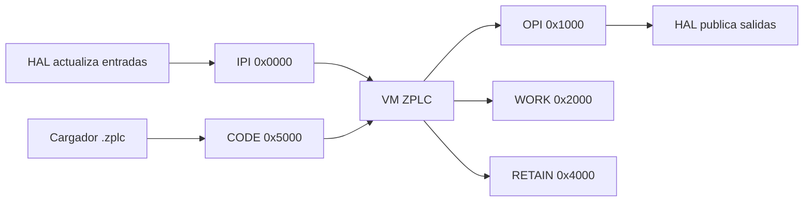

# ISA del runtime

Esta página describe el contrato entre el compilador, el cargador y la máquina virtual: el mapa de memoria, los registros reservados, las familias de instrucciones y el archivo `.zplc`. Sirve para escribir una herramienta que genere o inspeccione bytecode, o para averiguar por qué se rechazó un programa. La fuente única es `firmware/lib/zplc_core/include/zplc_isa.h`; si ambos difieren, manda el encabezado.

## Versiones

El encabezado define `ZPLC_VERSION_MAJOR = 1` y `ZPLC_VERSION_MINOR = 0`. Numeran el contrato binario, no la versión del producto ZPLC. Un segundo número, el contador de borrador, sigue los cambios del contrato mientras este aún se mueve (véase [Contador de borrador](#contador-de-borrador)).

## Mapa de memoria

La VM ve cinco regiones con bases fijas. WORK, RETAIN y CODE toman su tamaño de la configuración de la placa; la tabla indica los valores por defecto del encabezado.

| Región                     |     Base |                             Tamaño | Fuente canónica                                |
| -------------------------- | -------: | ---------------------------------: | ---------------------------------------------- |
| IPI (Input Process Image)  | `0x0000` |                   `0x1000` (4 KiB) | `ZPLC_MEM_IPI_BASE`, `ZPLC_MEM_IPI_SIZE`       |
| OPI (Output Process Image) | `0x1000` |                   `0x1000` (4 KiB) | `ZPLC_MEM_OPI_BASE`, `ZPLC_MEM_OPI_SIZE`       |
| WORK                       | `0x2000` | configurable, por defecto `0x2000` | `ZPLC_MEM_WORK_BASE`, `ZPLC_MEM_WORK_SIZE`     |
| RETAIN                     | `0x4000` | configurable, por defecto `0x1000` | `ZPLC_MEM_RETAIN_BASE`, `ZPLC_MEM_RETAIN_SIZE` |
| CODE                       | `0x5000` | configurable, por defecto `0xB000` | `ZPLC_MEM_CODE_BASE`, `ZPLC_MEM_CODE_SIZE`     |

Un ciclo lee la imagen de entrada, ejecuta el programa y escribe la imagen de salida. El [modelo de memoria](./memory-model.md) explica cómo se ubican las variables en estas regiones.

## Registros de sistema reservados

El runtime es dueño de los últimos 16 bytes de la imagen de entrada, de `0x0FF0` a `0x0FFF`. Los reescribe antes de cada ciclo, de modo que el programa los lee y no gana nada escribiéndolos.

| Registro              | Dirección | Propósito                                       |
| --------------------- | --------: | ----------------------------------------------- |
| `ZPLC_SYS_CYCLE_TIME` |  `0x0FF0` | tiempo del último ciclo en microsegundos        |
| `ZPLC_SYS_UPTIME`     |  `0x0FF4` | tiempo de actividad del sistema en milisegundos |
| `ZPLC_SYS_TASK_ID`    |  `0x0FF8` | identificador de la tarea actual                |
| `ZPLC_SYS_FLAGS`      |  `0x0FF9` | indicadores de estado del runtime               |

El byte de `ZPLC_SYS_FLAGS` combina estos bits:

- `ZPLC_SYS_FLAG_FIRST_SCAN` (`0x01`) se activa durante el primer ciclo.
- `ZPLC_SYS_FLAG_WDG_WARN` (`0x02`) está reservado. Hoy ningún runtime lo activa.
- `ZPLC_SYS_FLAG_RUNNING` (`0x04`) se activa mientras el programa se ejecuta.

:::note
`ZPLC_SYS_FLAG_WDG_WARN` no es evidencia de un watchdog, de un monitor de tiempos ni de un mecanismo de estado seguro. El presupuesto de instrucciones de la VM es otra cosa: un límite lógico para un ciclo, no un límite de tiempo.
:::

## Familias de opcodes

Los opcodes de `zplc_opcode_t` se agrupan en las familias siguientes. Para el efecto exacto de cada opcode sobre la pila, use la tabla de la [API del runtime](../reference/runtime-api.md).

| Familia                        | Ejemplos                                                                                                                                                                         | Rol                                                                     |
| ------------------------------ | -------------------------------------------------------------------------------------------------------------------------------------------------------------------------------- | ----------------------------------------------------------------------- |
| Sistema                        | `OP_NOP`, `OP_HALT`, `OP_BREAK`, `OP_GET_TICKS`                                                                                                                                  | control básico y depuración                                             |
| Pila                           | `OP_DUP`, `OP_DROP`, `OP_SWAP`, `OP_OVER`, `OP_ROT`                                                                                                                              | manipulación de la pila                                                 |
| Acceso indirecto               | `OP_LOADI8`, `OP_LOADI16`, `OP_LOADI32`, `OP_STOREI8`, `OP_STOREI16`, `OP_STOREI32`                                                                                              | direccionamiento calculado                                              |
| Cadenas                        | `OP_STRLEN`, `OP_STRCPY`, `OP_STRCAT`, `OP_STRCMP`, `OP_STRCLR`                                                                                                                  | operaciones seguras sobre `STRING`                                      |
| Aritmética                     | `OP_ADD`, `OP_SUB`, `OP_MUL`, `OP_DIV`, `OP_MOD`                                                                                                                                 | entero y punto flotante                                                 |
| Entero de 64 bits              | `OP_MUL64`, `OP_DIVS64`, `OP_DIVU64`, `OP_MODS64`, `OP_MODU64`, `OP_NEG64`, `OP_ABS64`, `OP_SHL64`, `OP_SHR64`, `OP_SAR64`                                                       | operaciones de `LINT`, `ULINT` y `LWORD` que no tienen forma de 32 bits |
| Doble precisión                | `OP_ADDD`, `OP_SUBD`, `OP_MULD`, `OP_DIVD`, `OP_NEGD`, `OP_ABSD`, `OP_SQRTD`, `OP_RNDD`                                                                                          | aritmética de `LREAL`                                                   |
| Lógico y bit a bit             | `OP_AND`, `OP_OR`, `OP_XOR`, `OP_NOT`, `OP_SHL`, `OP_SHR`, `OP_SAR`                                                                                                              | booleanos y bits                                                        |
| Comparación                    | `OP_EQ`, `OP_NE`, `OP_LT`, `OP_LE`, `OP_GT`, `OP_GE`, `OP_LTU`, `OP_GTU`                                                                                                         | decisiones de control                                                   |
| Comparación de doble precisión | `OP_EQD`, `OP_NED`, `OP_LTD`, `OP_LED`, `OP_GTD`, `OP_GED`                                                                                                                       | decisiones de control sobre `LREAL`                                     |
| Saltos y llamadas              | `OP_JMP`, `OP_JZ`, `OP_JNZ`, `OP_CALL`, `OP_RET`, `OP_JR`, `OP_JRZ`, `OP_JRNZ`                                                                                                   | flujo de ejecución                                                      |
| Conversión                     | `OP_I2F`, `OP_F2I`, `OP_I2B`, `OP_EXT8`, `OP_EXT16`, `OP_ZEXT8`, `OP_ZEXT16`, `OP_F2D`, `OP_D2F`, `OP_I2D`, `OP_D2I`, `OP_L2D`, `OP_D2L`, `OP_U2D`, `OP_D2U`, `OP_L2F`, `OP_U2F` | adaptación de tipos, incluidos `LREAL` y los enteros de 64 bits         |
| Comunicación                   | `OP_COMM_EXEC`, `OP_COMM_STATUS`, `OP_COMM_RESET`                                                                                                                                | ejecución de bloques de función de comunicación                         |

Los dos bits superiores de un opcode fijan el tamaño de su operando:

- `0x00-0x3F`: sin operando.
- `0x40-0x7F`: operando de 8 bits.
- `0x80-0xBF`: operando de 16 bits.
- `0xC0-0xFF`: operando de 32 bits.

`OP_RET` y los opcodes de `OP_I2F` (`0xA0`) a `OP_GED` (`0xBE`) son la excepción: están en el rango de 16 bits pero no llevan operando.

Un acceso indirecto (`OP_LOADI*`, `OP_STOREI*`) a una dirección que ninguna región de datos contiene termina el ciclo con `ZPLC_VM_OUT_OF_BOUNDS`, la violación de acceso a memoria. Es el caso de `0xFFFF` y de toda dirección de la región CODE. El compilador se apoya en ello: una variable `REF_TO` arranca en `0xFFFF`, así que desreferenciar una referencia nula provoca la falla, y un índice de arreglo fuera de los límites en tiempo de ejecución lee desde la dirección base de CODE y falla igual. Una prueba en el host fija este comportamiento.

## Valores de dos palabras: enteros de 64 bits y `LREAL`

La pila de evaluación guarda palabras de 32 bits, de modo que un `LINT`, `ULINT`, `LWORD` o `LREAL` ocupa dos. La palabra baja queda más al fondo y la alta arriba, tal como las deja `OP_LOAD64` y las toma `OP_STORE64`. Un `LREAL` es el patrón de bits IEEE 754 binary64 en esas dos palabras.

El cargador demuestra la profundidad de pila de cada camino a partir de los efectos de la tabla de la [API del runtime](../reference/runtime-api.md), así que un programa que aplica uno de estos opcodes a muy pocas palabras se rechaza con `ZPLC_LOADER_ERR_STACK`. Todos forman parte del núcleo en C: todo runtime los tiene.

La VM calcula cada resultado de doble precisión con aritmética entera. Por eso el resultado no depende de la biblioteca de C, del punto flotante del hardware ni de la precisión extendida x87, y es el mismo patrón de bits en el host de 64 bits, en una compilación de 32 bits y en todo destino. Los resultados que la VM define:

| Operación                                        | Operandos                   | Resultado                                                                                                              |
| ------------------------------------------------ | --------------------------- | ---------------------------------------------------------------------------------------------------------------------- |
| `OP_MUL64`                                       | cualquiera                  | los 64 bits bajos del producto (da la vuelta)                                                                          |
| `OP_DIVS64`                                      | divisor `0`                 | falla `ZPLC_VM_DIV_BY_ZERO`                                                                                            |
|                                                  | `INT64_MIN / -1`            | `INT64_MIN`                                                                                                            |
|                                                  | en otro caso                | el cociente truncado hacia cero                                                                                        |
| `OP_MODS64`                                      | divisor `0`                 | falla `ZPLC_VM_DIV_BY_ZERO`                                                                                            |
|                                                  | divisor `-1`                | `0`                                                                                                                    |
|                                                  | en otro caso                | el resto, con el signo del dividendo                                                                                   |
| `OP_DIVU64`, `OP_MODU64`                         | divisor `0`                 | falla `ZPLC_VM_DIV_BY_ZERO`                                                                                            |
|                                                  | en otro caso                | el cociente o el resto sin signo                                                                                       |
| `OP_NEG64`, `OP_ABS64`                           | `INT64_MIN`                 | `INT64_MIN`                                                                                                            |
| `OP_SHL64`, `OP_SHR64`                           | cuenta de 64 o más          | `0`                                                                                                                    |
| `OP_SAR64`                                       | cuenta de 64 o más          | `-1` para un valor negativo, `0` en otro caso                                                                          |
| `OP_ADDD`, `OP_SUBD`, `OP_MULD`, `OP_DIVD`       | cualquiera                  | el resultado IEEE 754 binary64, al par más cercano; el desbordamiento es un infinito y el subdesbordamiento es gradual |
| `OP_DIVD`                                        | divisor `0.0` o `-0.0`      | falla `ZPLC_VM_DIV_BY_ZERO`, sea cual sea el dividendo (como `OP_DIVF`)                                                |
| `OP_NEGD`, `OP_ABSD`                             | cualquiera                  | el bit de signo invertido o borrado; un NaN conserva su contenido                                                      |
| `OP_SQRTD`                                       | `0.0`, `-0.0` o menor       | `0.0` (la regla de `SQRT` sobre un `REAL`)                                                                             |
|                                                  | `+Inf`                      | `+Inf`                                                                                                                 |
|                                                  | en otro caso                | la raíz cuadrada correctamente redondeada                                                                              |
| `OP_RNDD`                                        | cualquiera                  | el valor entero más cercano, una mitad exacta al par; `-0.4` es `-0.0`                                                 |
| `OP_EQD`, `OP_LTD`, `OP_LED`, `OP_GTD`, `OP_GED` | un operando NaN             | falso; `-0.0` es igual a `+0.0`                                                                                        |
| `OP_NED`                                         | un operando NaN             | verdadero                                                                                                              |
| `OP_F2D`, `OP_D2F`                               | cualquiera                  | ensanchamiento exacto; estrechamiento al par más cercano, el desbordamiento es un infinito                             |
| `OP_D2I`, `OP_D2L`                               | NaN                         | `0`                                                                                                                    |
|                                                  | fuera de rango, un infinito | el límite más cercano de `INT32` o `INT64`                                                                             |
|                                                  | en otro caso                | truncado hacia cero                                                                                                    |
| `OP_D2U`                                         | NaN, o menor que `1.0`      | `0`                                                                                                                    |
|                                                  | `2^64` o más                | `UINT64_MAX`                                                                                                           |
|                                                  | en otro caso                | truncado hacia cero                                                                                                    |
| `OP_I2D`, `OP_L2D`, `OP_U2D`, `OP_L2F`, `OP_U2F` | cualquiera                  | un solo redondeo, al par más cercano                                                                                   |

Todo NaN que produce una operación de doble precisión es el NaN silencioso `0x7FF8000000000000` (`0x7FC00000` como `REAL`), de modo que dos plataformas nunca difieren en la carga útil.

Una cuenta de desplazamiento se lee como una palabra de 32 bits sin signo, así que una cuenta negativa vale como 64 o más. Las conversiones del lenguaje redondean al entero más cercano (`LREAL_TO_DINT(2.5) = 2`) con `OP_RNDD` seguido de una conversión por truncamiento, igual que las conversiones de `REAL`.

## Contador de borrador

Mientras el contrato no esté congelado, la palabra 28 del encabezado de todo artefacto `.zplc` guarda `ZPLC_DRAFT_COUNTER`, y el cargador rechaza un artefacto con otro valor, informando ambos números. Todo cambio de un opcode, de una disposición o de un tamaño aumenta el contador.

Hoy el contador vale **6**. El historial, del más reciente al más antiguo:

- 6: los valores seguros declarados (el segmento `ZPLC_SEG_SAFE`).
- 5: la disposición de las cadenas de los bloques de comunicación.
- 4: la profundidad de llamadas de una tarea y la identidad de compilación.
- 3: los opcodes de 64 bits y de doble precisión.

Un programa compilado antes de un aumento se rechaza y debe recompilarse. Para llevar al contador actual los artefactos versionados en el repositorio, ejecute `tools/contract/restamp_artifacts.py`.

## Tipos y límites compartidos

El encabezado publica los límites que comparten la cadena de herramientas y el runtime:

- `ZPLC_STACK_MAX_DEPTH` para la pila de evaluación (256, salvo que la configuración de la placa lo cambie).
- `ZPLC_CALL_STACK_MAX` para la pila de llamadas (32, salvo cambio).
- `ZPLC_MAX_BREAKPOINTS` para el depurador (16, salvo cambio).
- Los identificadores de tipos IEC: `ZPLC_TYPE_BOOL`, `ZPLC_TYPE_INT`, `ZPLC_TYPE_DINT`, `ZPLC_TYPE_REAL`, `ZPLC_TYPE_TIME`, `ZPLC_TYPE_STRING` y los demás.

Un `STRING` tiene una disposición fija: la longitud actual en el desplazamiento `0`, la capacidad en el `2` y los caracteres desde el `4`.

## El archivo `.zplc`

El archivo se construye con estructuras empaquetadas declaradas en el mismo encabezado:

- `zplc_file_header_t`
- `zplc_segment_entry_t`
- `zplc_task_def_t`
- `zplc_iomap_entry_t`
- `zplc_tag_entry_t`
- `zplc_build_info_t`
- `zplc_safe_entry_t`

Los segmentos que puede llevar:

- `ZPLC_SEG_CODE`
- `ZPLC_SEG_DATA`
- `ZPLC_SEG_BSS`
- `ZPLC_SEG_RETAIN`
- `ZPLC_SEG_IOMAP`
- `ZPLC_SEG_SYMTAB`
- `ZPLC_SEG_DEBUG`
- `ZPLC_SEG_TASK`
- `ZPLC_SEG_TAGS`
- `ZPLC_SEG_BUILD`
- `ZPLC_SEG_SAFE`

## Profundidad de las tareas e identidad de compilación

El compilador mide lo que el cargador va a verificar y lo registra en el artefacto.

- La definición de una tarea lleva `stack_size`, la mayor cantidad de valores que la tarea tiene a la vez en la pila de evaluación, y `call_depth`, la mayor cantidad de marcos de llamada activos a la vez, contando su propio cuerpo. Una tarea que no llama a nada tiene profundidad de llamadas 1; 0 significa que el artefacto no la declara.
- El cargador rechaza una tarea que necesita más de lo que declara, y una tarea cuya profundidad de llamadas supera la pila de llamadas de la VM más su propio cuerpo.
- El compilador falla la compilación cuando una tarea necesita una pila más profunda que `ZPLC_VERIFY_MAX_DEPTH` (127) o que la que ofrece el destino, o anida llamadas más allá de `ZPLC_CALL_STACK_MAX`.
- El segmento `ZPLC_SEG_BUILD` guarda un valor de 32 bits, la identidad de compilación: el CRC-32 del segmento CODE seguido del segmento TASK tal como se escriben, nunca 0. El mapa de depuración de la misma compilación la registra como `buildId`, en 8 dígitos hexadecimales, para que una herramienta detecte que un mapa no pertenece al programa en ejecución. Un artefacto sin el segmento se lee como no identificado.

## Valores seguros declarados

Mientras el programa no controla una salida (STOP, una pausa, una falla enclavada, el arranque, una carga en curso), la salida está apagada, salvo que el proyecto declare otro valor para ella. La declaración viaja dentro del artefacto, en el segmento `ZPLC_SEG_SAFE`, de modo que un programa y su estado seguro forman una unidad: un dispositivo que restaura el programa restaura su declaración, y una carga interrumpida no puede dejar el programa de una compilación con los valores seguros de otra.

- Cada entrada es un `zplc_safe_entry_t` de `ZPLC_SAFE_ENTRY_SIZE` (4) bytes: el `offset` en bytes de la salida dentro de la imagen de salida, el `bit` (0 a 7) y el `value` (0 o 1).
- El cargador rechaza el artefacto con `ZPLC_LOADER_ERR_SAFE` cuando el segmento no es un número entero de entradas, una entrada nombra un bit fuera de la imagen de salida o un valor distinto de 0 y 1, una salida se declara dos veces, o hay más de `ZPLC_LOADER_MAX_SAFE` (64) entradas. Un segundo segmento `ZPLC_SEG_SAFE` se rechaza como error de segmento. Un artefacto sin el segmento no declara nada.
- Al cargar y al restaurar en el arranque, el runtime rechaza una declaración para una salida que la placa no tiene: cada entrada debe nombrar un canal de salida digital de la descripción de la placa por su desplazamiento de imagen y su bit. Un programa de otra placa nunca se ejecuta con un estado seguro que no existe.
- Un valor declarado reemplaza el nivel que la descripción de la placa da a esa salida en el estado seguro, en ambos sentidos. Rige desde la carga que confirmó el programa, antes del primer ciclo.

## Páginas relacionadas

- [Resumen del runtime](./index.md)
- [Modelo de memoria](./memory-model.md)
- [Persistencia y memoria retentiva](./persistence.md)
- [API del runtime](../reference/runtime-api.md)
- [Runtime nativo en C](./native-c.md)
