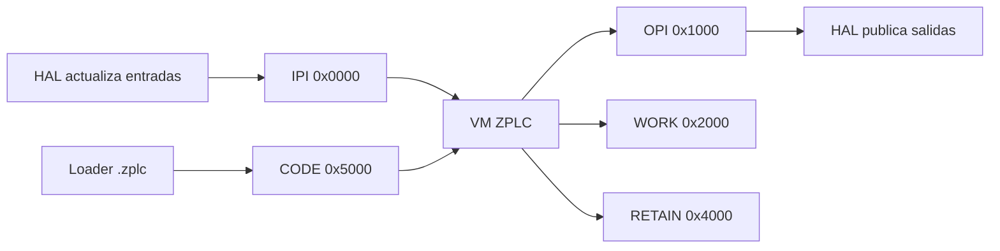

# ISA del Runtime

La fuente canónica para esta página es `firmware/lib/zplc_core/include/zplc_isa.h`.

En ZPLC 2.0, ese header público define el contrato binario/ISA para:

- el layout de memoria de la VM
- los registros reservados del sistema
- la familia de opcodes válidos
- los IDs de tipos compartidos y sus límites
- el formato binario `.zplc`

## Qué fija el header hoy

`zplc_isa.h` expone actualmente estas constantes de versión del contrato ISA:

- `ZPLC_VERSION_MAJOR = 1`
- `ZPLC_VERSION_MINOR = 0`

Eso describe la **versión del contrato binario/ISA**, no la versión comercial completa del release.

## Layout de memoria de la VM

La ISA reserva cinco regiones lógicas con bases públicas y tamaños definidos por contrato:

| Región | Base | Tamaño | Fuente canónica |
|---|---:|---:|---|
| IPI (Input Process Image) | `0x0000` | `0x1000` (4 KiB) | `ZPLC_MEM_IPI_BASE`, `ZPLC_MEM_IPI_SIZE` |
| OPI (Output Process Image) | `0x1000` | `0x1000` (4 KiB) | `ZPLC_MEM_OPI_BASE`, `ZPLC_MEM_OPI_SIZE` |
| WORK | `0x2000` | configurable, default `0x2000` | `ZPLC_MEM_WORK_BASE`, `ZPLC_MEM_WORK_SIZE` |
| RETAIN | `0x4000` | configurable, default `0x1000` | `ZPLC_MEM_RETAIN_BASE`, `ZPLC_MEM_RETAIN_SIZE` |
| CODE | `0x5000` | configurable, default `0xB000` | `ZPLC_MEM_CODE_BASE`, `ZPLC_MEM_CODE_SIZE` |

## Registros de sistema reservados

Los últimos 16 bytes de la IPI (`0x0FF0` a `0x0FFF`) están reservados para información del scheduler/runtime:

| Registro | Dirección | Propósito |
|---|---:|---|
| `ZPLC_SYS_CYCLE_TIME` | `0x0FF0` | tiempo del último ciclo en microsegundos |
| `ZPLC_SYS_UPTIME` | `0x0FF4` | uptime del sistema en milisegundos |
| `ZPLC_SYS_TASK_ID` | `0x0FF8` | identificador de la tarea actual |
| `ZPLC_SYS_FLAGS` | `0x0FF9` | flags de estado del runtime |

Flags públicos definidos hoy:

- `ZPLC_SYS_FLAG_FIRST_SCAN`
- `ZPLC_SYS_FLAG_WDG_WARN` (reservado; los runtimes actuales no lo producen)
- `ZPLC_SYS_FLAG_RUNNING`

`ZPLC_SYS_FLAG_WDG_WARN` no es evidencia de un watchdog, monitor de timing ni
mecanismo de estado seguro. El presupuesto de instrucciones del runtime es un
límite lógico de ejecución separado.

## Familias de opcodes

La enumeración `zplc_opcode_t` agrupa las instrucciones públicas en familias claras:

| Familia | Ejemplos | Rol |
|---|---|---|
| Sistema | `OP_NOP`, `OP_HALT`, `OP_BREAK`, `OP_GET_TICKS` | control básico y depuración |
| Pila | `OP_DUP`, `OP_DROP`, `OP_SWAP`, `OP_OVER`, `OP_ROT` | manipulación del stack |
| Acceso indirecto | `OP_LOADI8`, `OP_LOADI16`, `OP_LOADI32`, `OP_STOREI8`, `OP_STOREI16`, `OP_STOREI32` | direccionamiento calculado |
| Strings | `OP_STRLEN`, `OP_STRCPY`, `OP_STRCAT`, `OP_STRCMP`, `OP_STRCLR` | operaciones seguras sobre `STRING` |
| Aritmética | `OP_ADD`, `OP_SUB`, `OP_MUL`, `OP_DIV`, `OP_MOD` | entero y punto flotante |
| Entero de 64 bits | `OP_MUL64`, `OP_DIVS64`, `OP_DIVU64`, `OP_MODS64`, `OP_MODU64`, `OP_NEG64`, `OP_ABS64`, `OP_SHL64`, `OP_SHR64`, `OP_SAR64` | operaciones de `LINT`, `ULINT` y `LWORD` que no tienen forma de 32 bits |
| Doble precisión | `OP_ADDD`, `OP_SUBD`, `OP_MULD`, `OP_DIVD`, `OP_NEGD`, `OP_ABSD`, `OP_SQRTD`, `OP_RNDD` | aritmética de `LREAL` |
| Lógico/bitwise | `OP_AND`, `OP_OR`, `OP_XOR`, `OP_NOT`, `OP_SHL`, `OP_SHR`, `OP_SAR` | booleanos y bits |
| Comparación | `OP_EQ`, `OP_NE`, `OP_LT`, `OP_LE`, `OP_GT`, `OP_GE`, `OP_LTU`, `OP_GTU` | decisiones de control |
| Comparación de doble precisión | `OP_EQD`, `OP_NED`, `OP_LTD`, `OP_LED`, `OP_GTD`, `OP_GED` | decisiones de control sobre `LREAL` |
| Saltos y llamadas | `OP_JMP`, `OP_JZ`, `OP_JNZ`, `OP_CALL`, `OP_RET`, `OP_JR`, `OP_JRZ`, `OP_JRNZ` | flujo de ejecución |
| Conversión | `OP_I2F`, `OP_F2I`, `OP_I2B`, `OP_EXT8`, `OP_EXT16`, `OP_ZEXT8`, `OP_ZEXT16`, `OP_F2D`, `OP_D2F`, `OP_I2D`, `OP_D2I`, `OP_L2D`, `OP_D2L`, `OP_U2D`, `OP_D2U`, `OP_L2F`, `OP_U2F` | adaptación de tipos, incluidos `LREAL` y los enteros de 64 bits |
| Comunicación | `OP_COMM_EXEC`, `OP_COMM_STATUS`, `OP_COMM_RESET` | ejecución de FBs de comunicación |

Un acceso indirecto (`OP_LOADI*`, `OP_STOREI*`) a una dirección que ninguna región de datos
contiene, como `0xFFFF` o cualquier dirección de la región CODE, termina el scan con
`ZPLC_VM_OUT_OF_BOUNDS` (violación de acceso a memoria). El compilador se apoya en esa falla:
una variable `REF_TO` empieza en `0xFFFF`, así que desreferenciar una referencia nula falla, y
un índice de arreglo fuera de los límites en ejecución lee desde la dirección base de CODE
(CMP-023, CMP-024). Una prueba de host fija el comportamiento.

La ISA también fija el tamaño del operando por rango de opcode:

- `0x00-0x3F`: sin operando
- `0x40-0x7F`: operando de 8 bits
- `0x80-0xBF`: operando de 16 bits
- `0xC0-0xFF`: operando de 32 bits

`OP_RET` y los opcodes de conversión, de doble precisión y de comparación de doble
precisión, de `OP_I2F` (`0xA0`) a `OP_GED` (`0xBE`), no llevan operando aunque estén en el
rango de 16 bits.

## Valores de dos palabras: enteros de 64 bits y `LREAL`

El stack de evaluación tiene palabras de 32 bits. Un valor `LINT`, `ULINT`, `LWORD` o `LREAL`
ocupa dos palabras: la **palabra baja queda más abajo** en el stack y la alta arriba, tal como
la deja `OP_LOAD64` y la toma `OP_STORE64`. Un `LREAL` es el patrón de bits IEEE 754 binary64
en esas dos palabras.

Los opcodes de las familias de 64 bits y de doble precisión están en la tabla de la
[Runtime API](../reference/runtime-api.md), con sus efectos sobre el stack. El loader demuestra
la profundidad del stack de cada camino a partir de esa tabla, así que un programa que usa
uno de ellos con muy pocas palabras se rechaza (`ZPLC_LOADER_ERR_STACK`). Son parte del
núcleo en C: todos los runtimes los tienen a la vez.

La VM calcula cada resultado de doble precisión con aritmética entera. Por eso un resultado no
depende de la biblioteca de C, del punto flotante de hardware ni de la precisión extendida de
x87, y es el mismo patrón de bits en el host de 64 bits, en una compilación de 32 bits y en
todos los destinos. Los resultados que define la VM:

| Operación | Operandos | Resultado |
|---|---|---|
| `OP_MUL64` | cualquiera | los 64 bits bajos del producto (da la vuelta) |
| `OP_DIVS64` | divisor `0` | falla `ZPLC_VM_DIV_BY_ZERO` |
| | `INT64_MIN / -1` | `INT64_MIN` |
| | en otro caso | el cociente truncado hacia cero |
| `OP_MODS64` | divisor `0` | falla `ZPLC_VM_DIV_BY_ZERO` |
| | divisor `-1` | `0` |
| | en otro caso | el resto, con el signo del dividendo |
| `OP_DIVU64`, `OP_MODU64` | divisor `0` | falla `ZPLC_VM_DIV_BY_ZERO` |
| | en otro caso | el cociente o el resto sin signo |
| `OP_NEG64`, `OP_ABS64` | `INT64_MIN` | `INT64_MIN` |
| `OP_SHL64`, `OP_SHR64` | cuenta de 64 o más | `0` |
| `OP_SAR64` | cuenta de 64 o más | `-1` para un valor negativo, `0` en otro caso |
| `OP_ADDD`, `OP_SUBD`, `OP_MULD`, `OP_DIVD` | cualquiera | el resultado IEEE 754 binary64, al más cercano par; el desbordamiento es un infinito y el subdesbordamiento es gradual |
| `OP_DIVD` | divisor `0.0` o `-0.0` | falla `ZPLC_VM_DIV_BY_ZERO`, sea cual sea el dividendo (como `OP_DIVF`) |
| `OP_NEGD`, `OP_ABSD` | cualquiera | el bit de signo invertido o borrado; un NaN conserva su carga |
| `OP_SQRTD` | `0.0`, `-0.0` o menor | `0.0` (la regla de `SQRT` sobre un `REAL`) |
| | `+Inf` | `+Inf` |
| | en otro caso | la raíz cuadrada correctamente redondeada |
| `OP_RNDD` | cualquiera | el valor entero más cercano, una mitad exacta al par; `-0.4` es `-0.0` |
| `OP_EQD`, `OP_LTD`, `OP_LED`, `OP_GTD`, `OP_GED` | un operando NaN | falso; `-0.0` es igual a `+0.0` |
| `OP_NED` | un operando NaN | verdadero |
| `OP_F2D`, `OP_D2F` | cualquiera | ensanchamiento exacto; estrechamiento al más cercano par, el desbordamiento es un infinito |
| `OP_D2I`, `OP_D2L` | NaN | `0` |
| | fuera de rango, un infinito | el límite más cercano de `INT32` o `INT64` |
| | en otro caso | truncado hacia cero |
| `OP_D2U` | NaN, o menor que `1.0` | `0` |
| | `2^64` o más | `UINT64_MAX` |
| | en otro caso | truncado hacia cero |
| `OP_I2D`, `OP_L2D`, `OP_U2D`, `OP_L2F`, `OP_U2F` | cualquiera | un solo redondeo, al más cercano par |

Todo NaN que produce una operación de doble precisión es el NaN silencioso
`0x7FF8000000000000` (`0x7FC00000` como `REAL`), así que dos plataformas nunca difieren en la
carga.

Una cuenta se lee como una palabra de 32 bits sin signo, así que una cuenta negativa es una
cuenta de 64 o más. El redondeo al entero más cercano de las conversiones del lenguaje
(`LREAL_TO_DINT(2.5) = 2`) es `OP_RNDD` seguido de una conversión que trunca, como en las
conversiones de `REAL`.

## Contador de borrador

Hasta que el contrato se congele (CMP-052), la palabra 28 del encabezado de cada artefacto
`.zplc` guarda el contador de borrador (`ZPLC_DRAFT_COUNTER`) y el loader rechaza un artefacto
con otro valor, mostrando ambos números. Cada cambio de un opcode, de un layout o de un tamaño
lo incrementa. El contador es **3** desde los opcodes de 64 bits y de doble precisión: los
programas compilados antes se rechazan y hay que recompilarlos. La herramienta
`tools/contract/restamp_artifacts.py` lleva los artefactos versionados en el repositorio al
contador actual.

## Tipos y límites públicos

El header también publica límites que la toolchain y el runtime comparten:

- `ZPLC_STACK_MAX_DEPTH` para el stack de evaluación
- `ZPLC_CALL_STACK_MAX` para el stack de llamadas
- `ZPLC_MAX_BREAKPOINTS` para la capacidad de depuración
- IDs de tipos IEC como `ZPLC_TYPE_BOOL`, `ZPLC_TYPE_INT`, `ZPLC_TYPE_DINT`, `ZPLC_TYPE_REAL`, `ZPLC_TYPE_TIME` y `ZPLC_TYPE_STRING`

Para `STRING`, la ISA fija un layout seguro con:

- longitud actual en offset `0`
- capacidad máxima en offset `2`
- datos en offset `4`

## Contrato del archivo `.zplc`

El binario `.zplc` usa estructuras públicas empaquetadas en el mismo header:

- `zplc_file_header_t`
- `zplc_segment_entry_t`
- `zplc_task_def_t`
- `zplc_iomap_entry_t`
- `zplc_tag_entry_t`

Segmentos públicos definidos hoy:

- `ZPLC_SEG_CODE`
- `ZPLC_SEG_DATA`
- `ZPLC_SEG_BSS`
- `ZPLC_SEG_RETAIN`
- `ZPLC_SEG_IOMAP`
- `ZPLC_SEG_SYMTAB`
- `ZPLC_SEG_DEBUG`
- `ZPLC_SEG_TASK`
- `ZPLC_SEG_TAGS`

## Páginas relacionadas

- [Visión general del runtime](./index.md)
- [Modelo de Memoria](./memory-model.md)
- [Runtime API](../reference/runtime-api.md)
- [Persistencia](./persistence.md)
- [Runtime nativo en C](./native-c.md)
