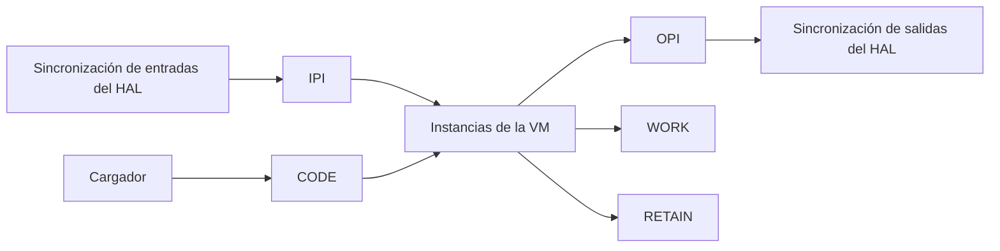

# Modelo de memoria

Un programa ZPLC ve un único espacio de direcciones plano dividido en cinco regiones. Esta página explica para qué sirve cada región, qué comparte una tarea con las demás y qué es propio de ella, y de dónde salen los tamaños. Las definiciones públicas están en `firmware/lib/zplc_core/include/zplc_isa.h` y en `firmware/lib/zplc_core/include/zplc_core.h`.

## Las cinco regiones

| Región | Base | Función | Tamaño |
| --- | ---: | --- | --- |
| IPI | `0x0000` | Imagen de proceso de entradas | 4 KB |
| OPI | `0x1000` | Imagen de proceso de salidas | 4 KB |
| WORK | `0x2000` | Memoria de trabajo: las variables del programa | 8192 bytes por defecto |
| RETAIN | `0x4000` | Memoria retentiva, guardada y restaurada entre reinicios | 4096 bytes por defecto |
| CODE | `0x5000` | El bytecode cargado | hasta 45056 bytes por defecto |



Los últimos 16 bytes de IPI están reservados para datos de sistema que un programa puede leer: el tiempo de ciclo (`ZPLC_SYS_CYCLE_TIME`), el tiempo de actividad, el identificador de la tarea actual y un byte de indicadores con los bits de primer ciclo, de ejecución y de advertencia del watchdog. Los datos del usuario y los metadatos del runtime nunca comparten una dirección.

## Qué comparten las tareas y qué les pertenece

Cada tarea corre en su propia instancia de la VM, pero la memoria es una sola.

| Compartido por todas las tareas | Privado de cada instancia de la VM |
| --- | --- |
| IPI y OPI | El contador de programa, el puntero de pila y el puntero base |
| El espacio de direcciones WORK y RETAIN | La profundidad de llamadas, los indicadores y el estado de error |
| El código cargado | La tabla de puntos de parada, la pila de evaluación y la pila de llamadas |

Esa separación permite que varias tareas intercambien datos mediante variables globales sin compartir un contexto de ejecución. La profundidad de pila (`ZPLC_STACK_MAX_DEPTH`, 256), la profundidad de llamadas (`ZPLC_CALL_STACK_MAX`, 32) y la tabla de puntos de parada (`ZPLC_MAX_BREAKPOINTS`, 16) están acotadas, de modo que un programa no puede ampliarlas.

## Inicio de un programa

Cargar un programa es un arranque en frío en todos los runtimes (RT-016). IPI, OPI, WORK y RETAIN se ponen a cero y la tabla de forzados se vacía antes de publicar el programa nuevo, de modo que un programa nunca arranca sobre las variables del que reemplazó. Un runtime que tiene un registro `RETAIN` almacenado lo restaura después. `zplc_core_cold_start()` es esa operación, y `zplc_core_warm_start()` es lo mismo sin tocar RETAIN, para un reinicio que conserva los valores retentivos. Ninguna de las dos toca la región de código ni las etiquetas, que son el programa.

## Acceso desde fuera del ciclo (RT-010, RT-011)

Mientras los ciclos corren, solo el ciclo escribe la imagen de proceso. Un hilo ajeno, como el servidor y los clientes Modbus, MQTT o los comandos de depuración del shell, pasa por el intercambio (`zplc_exchange.h`):

- **Las lecturas** salen de la instantánea de IPI, OPI, WORK y RETAIN que el ciclo publica en su confirmación. Un valor es íntegro y de un solo ciclo, y una lectura nunca espera a un ciclo.
- **Las escrituras** se encolan completas y el ciclo las aplica en la captura de entradas de su siguiente ciclo, por la interfaz del núcleo que respeta los forzados: una variable forzada conserva su valor forzado escriba lo que escriba un cliente. Mientras no corre ningún ciclo (detenido, en pausa o con falla) no hay captura que esperar, y la escritura se aplica de inmediato.
- **Una escritura que no cabe** en la cola (`CONFIG_ZPLC_EXCHANGE_QUEUE_BYTES`, 1024 bytes por defecto) se rechaza completa y quien llama recibe un error. Un cliente Modbus TCP recibe la excepción 6 (dispositivo servidor ocupado) y puede reintentar.
- **Una etiqueta Modbus de dos registros** se escribe una mitad cada vez, de modo que dos clientes que escriben las dos mitades nunca se pisan con un valor obsoleto de la otra mitad.

La instantánea es una copia de las cuatro regiones, así que cuesta en RAM su tamaño total: 20 KB con los tamaños por defecto.

## Cómo coloca el compilador las variables

El compilador da a todo el proyecto una sola disposición en WORK, y el mapa de depuración la lista: cada variable con su dirección y su tamaño, bajo el POU del archivo que la declara. El orden es: las globales, las variables de cada función, las variables de los métodos, las variables de cada programa en el orden de las tareas, los literales de cadena y los búferes de trabajo de las funciones de cadena. El último byte de la región del perfil del destino es el indicador de inicialización.

La memoria que puede usar un programa es la que tiene el perfil del destino, compartida por todos los programas del proyecto. Un proyecto que no cabe es un error de compilación que indica los bytes requeridos, los bytes disponibles y los mayores consumidores. Las variables ubicadas con `AT %M` están en `0x2000` más su desplazamiento, y una variable que el compilador colocaría encima de una es un error de compilación.

## Dónde se fijan los tamaños

En Zephyr los tamaños de las regiones retentiva, de trabajo y de código son opciones de Kconfig. Estos son los valores por defecto de `firmware/zephyr/Kconfig`, y el `prj.conf` de una placa puede reemplazarlos:

```kconfig
CONFIG_ZPLC_WORK_MEMORY_SIZE=8192
CONFIG_ZPLC_RETAIN_MEMORY_SIZE=4096
CONFIG_ZPLC_CODE_SIZE_MAX=45056
```

Algunas placas fijan valores menores porque tienen menos RAM. El manifiesto de placas `firmware/app/boards/boards.json` repite los números, y la compilación falla cuando los dos difieren. Véanse la [referencia de Kconfig](../reference/kconfig.md) para cada símbolo con su rango, y [persistencia](./persistence.md) para saber cómo se guarda la región RETAIN.
