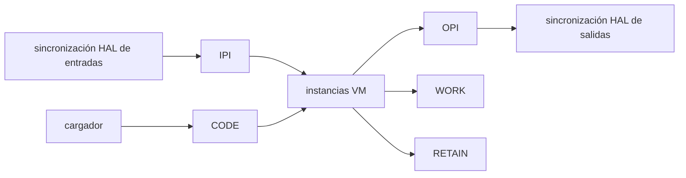

# Modelo de Memoria

El contrato público de memoria está definido sobre todo por:

- `firmware/lib/zplc_core/include/zplc_isa.h`
- `firmware/lib/zplc_core/include/zplc_core.h`

## Regiones lógicas de memoria

`zplc_isa.h` expone cinco regiones lógicas:

| Región | Base | Rol |
|---|---:|---|
| IPI | `0x0000` | imagen de proceso de entradas |
| OPI | `0x1000` | imagen de proceso de salidas |
| WORK | `0x2000` | memoria de trabajo |
| RETAIN | `0x4000` | memoria retentiva |
| CODE | `0x5000` | bytecode cargado |



## Estado compartido y estado privado

`zplc_core.h` marca una separación muy importante.

### Compartido entre instancias VM

- IPI
- OPI
- espacio de direcciones work y retain
- segmento de código cargado

### Privado por instancia VM

- `pc`
- `sp`
- `bp`
- profundidad de llamadas
- banderas y error
- puntos de parada
- pila de evaluación
- pila de llamadas

## Registros de sistema dentro de IPI

`zplc_isa.h` reserva los últimos 16 bytes de IPI para datos de sistema como:

- tiempo de ciclo
- uptime
- identificador de la tarea actual
- banderas del runtime

## Inicio de un programa

Cargar un programa es un arranque en frío en todos los runtimes (RT-016). IPI, OPI, WORK y RETAIN se ponen a cero y
la tabla de forzados se vacía antes de publicar el programa nuevo, de modo que un programa nunca arranca sobre las
variables del que reemplazó; un runtime que tiene un registro `RETAIN` almacenado lo restaura después.
`zplc_core_cold_start()` es esa operación, y `zplc_core_warm_start()` es lo mismo sin tocar `RETAIN`, para un
reinicio que conserva los valores retentivos. La región de código y las etiquetas son el programa y ninguna de las
dos las toca.

## Acceso desde fuera del scan (RT-010, RT-011)

Mientras los ciclos corren, solo el ciclo escribe la imagen de proceso. Un hilo ajeno (el servidor y los
clientes Modbus, MQTT, los comandos de depuración del shell) pasa por el exchange (`zplc_exchange.h`):

- una lectura sale del snapshot de IPI, OPI, WORK y RETAIN que el ciclo publica en su commit. Un valor es íntegro y de
  un solo ciclo, y una lectura nunca espera a un ciclo;
- una escritura se encola completa y el ciclo la aplica en el latch de entradas de su siguiente ciclo, por la interfaz
  del core que respeta los forzados: una variable forzada conserva su valor forzado escriba lo que escriba un cliente.
  Mientras no corre ningún ciclo (detenido, en pausa o con falla) no hay latch que esperar y la escritura se aplica
  de inmediato;
- una escritura que no cabe en la cola (`CONFIG_ZPLC_EXCHANGE_QUEUE_BYTES`, 1024 bytes por defecto) se rechaza
  completa y quien llama recibe un error; un cliente Modbus TCP recibe la excepción 6 (dispositivo servidor
  ocupado) y puede reintentar;
- la escritura de una etiqueta Modbus de dos registros fija la mitad que es el registro, de modo que dos clientes que
  escriben las dos mitades nunca se pisan con un valor viejo de la otra mitad.

El snapshot es una copia de las cuatro regiones, así que cuesta en RAM su tamaño total (20 KB con los tamaños por
defecto).

## Cómo coloca el compilador las variables

El compilador da a todo el proyecto una sola disposición en la memoria WORK, y el mapa de depuración la lista: cada variable, con su dirección y su tamaño, en el POU del archivo que la declara. El orden es: las globales, las variables de cada función, las variables de los métodos, las variables de cada programa en el orden de las tareas, los literales de cadena y los búferes de trabajo de las funciones de cadena; el último byte de la región del perfil del destino es la bandera de inicialización. La memoria que puede usar un programa es la que tiene el perfil del destino, compartida por todos los programas del proyecto, y un proyecto que no cabe es un error de compilación que indica los bytes requeridos, los bytes disponibles y los mayores consumidores. Las variables ubicadas con `AT %M` están en `0x2000` más su desplazamiento, y una variable que el compilador coloque encima de una es un error de compilación.

## Límites acotados

Los encabezados públicos también exponen límites como:

- `ZPLC_STACK_MAX_DEPTH`
- `ZPLC_CALL_STACK_MAX`
- `ZPLC_MAX_BREAKPOINTS`
- tamaños configurables para work, retain y code

En Zephyr los tamaños se fijan con opciones de Kconfig. Estos son los valores por defecto de `firmware/zephyr/Kconfig`; el `prj.conf` de una placa puede reemplazarlos:

```kconfig
CONFIG_ZPLC_WORK_MEMORY_SIZE=8192
CONFIG_ZPLC_RETAIN_MEMORY_SIZE=4096
CONFIG_ZPLC_CODE_SIZE_MAX=45056
```
