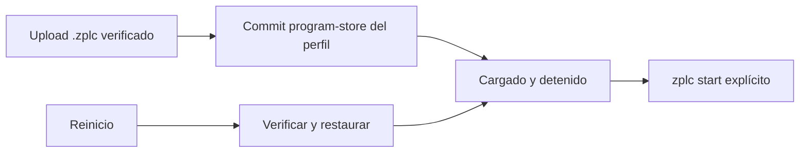

# Persistencia y memoria retenida

Para perfiles con un backend de almacén de programas habilitado y operativo, ZPLC puede
confirmar transaccionalmente un artefacto `.zplc` desplegado y verificado. La
restauración publica el artefacto como lógicamente detenido/READY. El comportamiento
de las salidas antes de ejecutar es específico del perfil de destino y requiere
evidencia registrada. Una persona debe ejecutar explícitamente `zplc start`.

## Backends de la plataforma

El núcleo del runtime ZPLC depende de una Capa de Abstracción de Hardware (HAL) abstracta para las operaciones de persistencia. Esto permite que el sistema se adapte sin problemas a las capacidades de almacenamiento de distintos entornos:

| Plataforma                 | Backend de Almacenamiento                                                                                                                                                                                                                                                                                                                                      |
| -------------------------- | -------------------------------------------------------------------------------------------------------------------------------------------------------------------------------------------------------------------------------------------------------------------------------------------------------------------------------------------------------------- |
| **Perfil Zephyr**          | Backend de almacén de programas cuando está habilitado y operativo: NVS, o ZMS en una placa cuyos sectores de flash superan los 64 KB que NVS acepta (la Nucleo-H743ZI). Los registros `RETAIN`, las claves de configuración y las credenciales usan las mismas llamadas HAL.                                                                                  |
| **Simulación Nativa (PC)** | Archivos en el directorio de persistencia (`ZPLC_PERSIST_ROOT`, por defecto `~/.zplc`): el almacén de programas y los registros `RETAIN`.                                                                                                                                                                                                                      |
| **Simulador WASM**         | Los registros del módulo de retención (`retain_a0` a `retain_b7`) pasan por las llamadas HAL del módulo a la página anfitriona, que los guarda en la carpeta `build/retain` del proyecto abierto y, sin proyecto abierto, en la memoria de la página. El almacén de programas de la sesión está en memoria. Ver [Runtime del navegador](./browser-runtime.md). |

## Persistencia del programa en hardware

Cuando un perfil dispone de un backend de almacén de programas operativo, una carga
`.zplc` verificada puede confirmarse mediante ese backend.



Al iniciar, un almacén de programas habilitado puede proporcionar un artefacto válido
para verificación y restore lógicamente detenido/READY. El comportamiento de
las salidas antes de ejecutar es específico del perfil de destino y requiere
evidencia registrada. La carga termina al completar la carga verificada; nunca
arranca la máquina. El arranque es una operación humana separada y explícita.
La evidencia destino, power-cut, HIL y eléctrica sigue siendo específica del
perfil exacto y no se ejecutó aquí.

### Cómo guarda el almacén un programa

El almacén tiene dos ranuras, A y B, y un registro activo pequeño que nombra la ranura que debe ejecutarse. Una ranura es el
artefacto, un pie de 8 bytes (`ZPE1` y la longitud del artefacto) y un registro de metadatos de 32 bytes; todos los
registros llevan un CRC-32 y la versión de formato. El runtime host y el firmware ejecutan el mismo código
(`zplc_program_store.c`) sobre las llamadas de persistencia de la HAL, de modo que el orden de las escrituras que
sigue es el que ejercitan las pruebas del host.

Una carga escribe la ranura que no está activa, la relee y la verifica, escribe los metadatos como preparados y los
relee, y solo entonces escribe el registro activo: esa escritura es el único punto en que el programa nuevo pasa a
ser el que se restaura. Después los metadatos se reescriben como confirmados.

| Un corte de energía ...                                         | Qué encuentra la siguiente restauración                                                                               |
| --------------------------------------------------------------- | --------------------------------------------------------------------------------------------------------------------- |
| antes de escribir el registro activo                            | El programa anterior. Un almacén que nunca tuvo uno está vacío.                                                       |
| a mitad del contenido nuevo                                     | El programa anterior: una ranura a medias vieja y a medias nueva no pasa el CRC-32 de su artefacto y nunca se acepta. |
| después del registro activo y antes de reescribir los metadatos | El programa nuevo: la ranura se releyó antes de mover el puntero.                                                     |
| que daña el registro activo                                     | La última ranura confirmada y completa.                                                                               |

Los registros que existen y no verifican nunca se toman por un almacén vacío: la restauración los informa como no
verificables y una carga se niega a escribir encima. Un almacén escrito por el primer firmware (una clave, `code_len`
y `code`) se restaura tal cual y se migra en la siguiente carga.

Un almacén clave-valor en flash guarda una entrada dentro de un sector de borrado, así que el contenido se corta en
trozos de `CONFIG_ZPLC_PROGRAM_STORE_CHUNK_SIZE` bytes (1024 por defecto), cada uno bajo su propia clave. El mayor
artefacto es un único número, `CONFIG_ZPLC_CODE_SIZE_MAX`: es la región de código, el mayor artefacto que acepta el
cargador, el tamaño de los búferes de recepción y de restore, el tamaño que informa `zplc sys info`
(`max_artifact_size`) y el tamaño que se comunica a la aplicación ZPLC para la placa (RT-028). La compilación falla si dos ranuras
de ese tamaño, en trozos, no caben en la partición de almacenamiento. Por eso el perfil Raspberry Pi Pico fija 24576
bytes (su partición de 128 KB también guarda los registros de RETAIN), el perfil STM32F746G Discovery 16384 y el perfil Arduino Opta WiFi 32768 (su RAM), y
el perfil ESP32-S3 mantiene sus 8192; los demás perfiles mantienen 45056. El búfer de staging de carga y la VM
guardan cada uno un programa en RAM, así que un perfil gasta dos veces su tamaño de código. No hay una tercera copia
residente: el búfer de staging conserva el artefacto cargado, y `zplc reset` recarga el programa desde el almacén, que
guarda el mismo (un reset cancela una carga en curso).

Una carga tiene que saber, antes de escribir, que existe un programa real al que volver, y eso significa leer ese
programa y admitirlo, lo que necesita un búfer del tamaño de código. El almacén no tiene uno propio: lee la reversión
en el búfer de staging cuando empieza una carga, mientras ese búfer está libre (`zplc load`, `zplc sched load` y el
inicio de una transferencia de programa del enlace de dispositivo), y la confirmación al final de la carga sigue adelante
solo si el registro activo y los dos registros de metadatos son todavía los de los que se leyó la respuesta. El
único que escribe esos registros es una confirmación, así que son los mismos salvo que la carga haya sido adelantada, y
entonces no se escribe nada. Un almacén cuyos registros no verifican nada no da rollback, y la confirmación se niega como
siempre. El contenido de la reversión se admitió cuando empezó la carga, no cuando terminó.

Lo que se ha demostrado: un corte de energía inyectado en cada operación de una carga y una escritura truncada en
cada registro, en el host (`test_program_store`, que también barre la carga como lo hace el firmware, con la reversión
encontrado al inicio de la carga), y un corte de energía en cada operación de una carga del tamaño
máximo sobre el simulador de flash de NVS en `native_sim` (`program_store_nvs`), restaurado en el mismo búfer que
usó la carga. Lo que no: un corte de energía en una placa. El controlador de flash, el
tiempo de borrado y el comportamiento de la alimentación de cada perfil necesitan el registro de hardware de ese
perfil (HIL-010).

## Memoria retentiva (`RETAIN`)

El compilador acepta `VAR RETAIN` y `VAR_GLOBAL RETAIN`, coloca esas variables
en la región retentiva de la memoria de proceso (dirección `0x4000`, 4 KB por
defecto) y aplica sus valores iniciales declarados solo cuando la región no
contiene estado guardado. El runtime guarda esa región y la restaura cuando se
vuelve a cargar el mismo programa. Todo lo de esta página es evidencia de host,
de simulador y de compilación: ninguna placa se ha medido y ninguna placa ha
pasado por un corte de energía bajo prueba.

### Qué se guarda y cuándo

| Momento                                 | Qué ocurre                                                                                                                                                |
| --------------------------------------- | --------------------------------------------------------------------------------------------------------------------------------------------------------- |
| Carga de programa y restore al arrancar | La región se restaura desde los registros guardados antes del primer ciclo, o se inicializa en cero cuando ningún registro coincide. El estado dice cuál. |
| `STOP` (comandado)                      | La región se guarda con los valores del último ciclo completo. Un stop de un runtime en falla no guarda nada.                                             |
| Mientras corre                          | La región se guarda como máximo una vez por intervalo, en un límite de ciclo, y solo si cambió desde el último registro guardado.                         |
| Apagado limpio del runtime host         | Se guarda como un `STOP`.                                                                                                                                 |
| Reset (`execution.reset`)               | Un reinicio en frío: la región se inicializa y esa región inicializada se guarda, de modo que los valores anteriores no vuelven.                          |

En el firmware un guardado periódico corre en su propia cola de trabajo, fuera
del ciclo, y mantiene el bloqueo de memoria solo durante la copia de la región,
nunca durante la escritura al almacenamiento. En el host corre en el bucle
principal entre dos ciclos. Un corte de energía entre dos guardados pierde los
cambios desde el último registro; esa es la razón del intervalo, que el
presupuesto de flash de abajo acota desde el otro lado.

### El registro

Dos registros se alternan, de modo que un corte de energía durante un guardado
nunca destruye el último bueno. Un guardado escribe la ranura más antigua con un
número de secuencia uno por encima del más nuevo. Cada registro se corta en
fragmentos de como máximo `CONFIG_ZPLC_RETAIN_CHUNK_SIZE` bytes (1024 por
defecto), guardados bajo las claves `retain_a0`, `retain_a1`, ... y
`retain_b0`, ..., porque una entrada del almacenamiento puede ser menor que la
región (NVS en un sector de 4 KB).

| Desplazamiento | Tamaño | Campo                                                                               |
| -------------- | ------ | ----------------------------------------------------------------------------------- |
| 0              | 4      | número mágico `ZRTN`                                                                |
| 4              | 2      | versión de formato, 1                                                               |
| 6              | 2      | reservado, cero                                                                     |
| 8              | 4      | número de secuencia, nunca 0                                                        |
| 12             | 4      | identidad del programa: la palabra CRC32 de la cabecera del artefacto               |
| 16             | 4      | identidad del programa: la palabra de tamaño de código de la cabecera del artefacto |
| 20             | 4      | hash de disposición                                                                 |
| 24             | 4      | longitud del contenido, el tamaño de la región `RETAIN`                             |
| 28             | n      | contenido, los bytes de la región                                                   |
| 28+n           | 4      | CRC-32 de todos los bytes anteriores                                                |

El hash de disposición es un CRC-32 sobre el tamaño de la región, la dirección de la
región, la versión de la ISA, el contador de draft del contrato y la identidad
del programa. Un programa que cambia en un byte tiene otra identidad, de modo
que una recompilación descarta los valores retenidos; el runtime no tiene una
disposición a nivel de variable para llevarlos a través de un cambio.

### Qué hace un reinicio

La restauración toma el registro válido con la secuencia más alta cuya identidad y
disposición coinciden. Si un registro falla su suma de verificación, se prueba el otro. Si
ninguno coincide, la región se pone en cero y el estado dice por qué:

| `reason`            | Significado                                                                                                                        |
| ------------------- | ---------------------------------------------------------------------------------------------------------------------------------- |
| `restored`          | Se restauró un registro válido de este programa y disposición.                                                                     |
| `none`              | Ningún registro en ninguno de las dos ranuras: primer arranque, almacenamiento borrado, o sin backend de almacenamiento.           |
| `identity_mismatch` | Existen registros válidos, escritos por otro programa.                                                                             |
| `layout_mismatch`   | El mismo programa, pero otro tamaño de región, dirección o disposición del runtime.                                                |
| `corrupt`           | Existen registros y ninguno pasa las comprobaciones de formato y checksum.                                                         |
| `io_error`          | El backend de almacenamiento falló en ambas ranuras. Los guardados se rechazan hasta que una restauración lea de nuevo el backend. |
| `reset`             | Un comando de reset inicializó la región.                                                                                          |
| `not_restored`      | No hay programa cargado.                                                                                                           |

El estado del runtime nativo lleva esto junto a los campos existentes:

```json
"retain": {"reason": "restored", "restored": true, "sequence": 12, "saves": 3, "save_errors": 0, "saved_at_ms": 94000}
```

`saved_at_ms` es el uptime del runtime del último registro escrito en esta
sesión, o `null` cuando no hubo ninguno. En el firmware los mismos valores están
en `zplc sched status` y `zplc sched status --json`.

### Runtimes host y WASM

El host POSIX aplica el mismo módulo y las mismas reglas. Su intervalo de
guardado periódico es de 30 segundos por defecto y se puede fijar con la
variable de entorno `ZPLC_RETAIN_SAVE_INTERVAL_MS`: `0` desactiva los guardados
periódicos (un `STOP` y un apagado siguen guardando), un valor de 100 a
86400000 fija el intervalo, y cualquier otro valor se ignora con un mensaje en
la salida de error estándar. Los programas que corren en el simulador host
conservan por eso sus valores `RETAIN` de una sesión a la siguiente, como lo
hace un controlador; usa `execution.reset`, u otro directorio de persistencia,
para partir de los valores declarados.

El runtime WASM aplica el mismo módulo y las mismas reglas: el módulo es el que
ejecutan el firmware y el host, enlazado en la compilación WebAssembly, y la
sesión guarda en `STOP`, en `execution.reset` y al cerrar, y restaura cuando se
carga un programa. Lo que cambia es el almacenamiento y el intervalo. La página
guarda los registros en la carpeta `build/retain` del proyecto abierto (los
archivos `retain_a0.bin` a `retain_b7.bin`) y, sin proyecto abierto, en la
memoria de la página. El intervalo periódico es de 30 segundos, porque un módulo
no tiene una variable de entorno para cambiarlo. La escritura en la carpeta
sigue a la llamada que guarda, así que una página que se cierra entre ambas
puede perder ese registro, y el anterior sigue siendo válido porque se alternan
dos registros. [Runtime del navegador](./browser-runtime.md) lista los
escenarios que lo comparan con el del host.

### Activarlo en una placa de firmware

`CONFIG_ZPLC_RETAIN_PERSIST` está activado en el perfil de cada placa distribuida (RT-025: `RETAIN` sobrevive a un ciclo
de energía), con los números de resistencia de la sección siguiente; la opción en sí es falsa por defecto, de modo que
un archivo de placa propio debe establecer `CONFIG_ZPLC_RETAIN_PERSIST=y`. La ruta de escritura está cubierta por la
suite `retain_persist` en `native_sim` (ambos anchos de palabra) y por la aserción de desgaste en tiempo de
compilación; ninguna placa fue medida: una escritura en flash puede detener la búsqueda de instrucciones en partes que
ejecutan desde la misma flash. La compilación falla cuando el intervalo de guardado de un perfil desgastaría su flash
antes de `CONFIG_ZPLC_RETAIN_LIFE_YEARS`, así que la tabla siguiente se comprueba en cada compilación. Estar activado
no es un registro de hardware: que un valor sobreviva a un ciclo de energía en una placa es lo que mide el paso de
ciclo de energía de HIL-010, con la imagen HIL (`-DCONFIG_ZPLC_HIL_IMAGE=y`, que nunca se distribuye). La imagen
cuesta unos 8,5 KB más de RAM en los perfiles RP2040, porque los dos registros de la región se mantienen en RAM
mientras se escriben.

### Presupuesto de desgaste de flash por placa

Cada guardado de una región modificada cuesta borrados de flash. El peor caso es
una región que cambia en cada intervalo. Para una placa:

- un guardado escribe el registro más la sobrecarga de entrada de cada
  fragmento (unos 64 bytes cada uno, una estimación que cubre un bloque de
  escritura de 32 bytes);
- la partición de almacenamiento absorbe los bytes de desgaste de la tabla por
  cada borrado de todos los sectores: los sectores menos el que NVS mantiene
  libre, menos los datos vivos que la recolección de basura copia en cada rotación
  (las dos ranuras de programa y el registro de RETAIN que no se está escribiendo;
  en la Pico, unos 59.000 bytes);
- la flash está especificada para un número de ciclos de borrado por sector.

Guardados que aguanta la flash = ciclos de borrado x bytes de desgaste / bytes
por guardado. Vida = guardados x intervalo. La compilación falla cuando el
intervalo hace esa vida más corta que `CONFIG_ZPLC_RETAIN_LIFE_YEARS` (10 por
defecto), de modo que una placa no puede salir con un intervalo que sus propios
números no sostienen.

Todos los números de abajo son estimaciones de ingeniería a partir de la clase
de datasheet de la pieza y de la disposición de las particiones del archivo de la placa.
Ninguna placa se midió.

| Placa                            | Partición de almacenamiento                                                                 | RETAIN     | Ciclos nominales | Bytes de desgaste | Intervalo | Vida estimada en el peor caso |
| -------------------------------- | ------------------------------------------------------------------------------------------- | ---------- | ---------------- | ----------------- | --------- | ----------------------------- |
| Raspberry Pi Pico (RP2040)       | 128 KB de la NOR QSPI de la placa, 32 sectores de 4 KB                                      | 4 KB       | 100.000          | 67.000            | 300 s     | 14,3 años                     |
| Arduino GIGA R1 (STM32H747 M7)   | `zplc_nvs_partition`: 7 MB de la NOR QSPI externa, sectores de 4 KB supuestos               | 4 KB       | 100.000          | 7.300.000         | 60 s      | más de 100 años               |
| Arduino Opta WiFi (STM32H747 M7) | `zplc_nvs_partition`: 7 MB de la NOR QSPI externa, sectores de 4 KB supuestos               | 4 KB       | 100.000          | 7.300.000         | 60 s      | más de 100 años               |
| STM32F746G Discovery             | `zplc_nvs_partition`: 15 MB de la NOR QSPI externa, subsectores de 4 KB supuestos           | 4 KB       | 100.000          | 15.700.000        | 60 s      | más de 100 años               |
| ESP32-S3-DevKitC-1 (N8R8)        | `zplc_nvs_partition`: 192 KB de la NOR SPI del módulo a partir de 4 MB, 48 sectores de 4 KB | 1 KB       | 100.000          | 184.000           | 60 s      | 29,5 años                     |
| STM32 Nucleo-H743ZI              | `zplc_nvs_partition`: 384 KB de la flash interna, 3 sectores de 128 KB, en ZMS              | 4 KB       | 10.000           | 253.000           | 600 s     | 10,8 años                     |
| Una placa sin números            | cualquiera                                                                                  | cualquiera | 10.000           | 40.000            | 3600 s    | 10,3 años para 4 KB           |

La fila de la Pico es la que hay que leer dos veces: a 30 segundos, el valor por
defecto del host, la misma placa agotaría su almacenamiento en unos 1,4 años. El
intervalo es un mínimo: una región que no cambia nunca se escribe, de modo que un
programa cuyos valores retenidos cambian poco desgasta la flash mucho menos de
lo que dice esta tabla.

Un `STOP` de una región modificada es un guardado más y no forma parte del
presupuesto: es una orden de una persona. Un script que detiene y arranca el
controlador cada pocos segundos, con valores retenidos que cambian en cada
ejecución, gasta el presupuesto de un año en días.

### Qué almacén ocupa qué partición

Una placa con firmware tiene hasta dos almacenes en la flash: los registros de la HAL (las ranuras del programa,
`RETAIN`, las claves de configuración `cfg_00` a `cfg_99` y las credenciales) y, en las placas con red, el sistema de
archivos de configuración (LittleFS: el archivo de configuración, los archivos de certificados y, donde las
credenciales de Wi-Fi pasan por la configuración, esas credenciales). Dos almacenes en una misma partición se
sobrescriben entre sí, de modo que cada uno tiene la suya (IO-008). La HAL ocupa `zplc_nvs_partition` cuando el
devicetree de la placa la define, y `storage_partition` en otro caso; el sistema de archivos de configuración monta
`storage_partition`. La compilación se detiene cuando una placa que incluye el sistema de archivos no tiene
`zplc_nvs_partition`, o cuando las dos particiones se superponen. Una configuración de certificado o de clave
(`mqtt_ca_cert_path`, `mqtt_client_cert_path`, `mqtt_client_key_path`, `aws_claim_cert_path`, `aws_claim_key_path`)
nombra un archivo del sistema de archivos o uno de los dos registros de credenciales, `persist://aws_cert_pem` y
`persist://aws_key_pem`. Cualquier otro nombre `persist://` lo rechaza `zplc config set`, no se aplica cuando un valor
guardado lo contiene y nunca se lee: ninguna configuración puede entregar el programa ni una clave del enlace del
dispositivo a la pila TLS.

| Placa                            | Registros de la HAL                                                                      | Sistema de archivos de configuración                        | Ranura de la imagen                                          |
| -------------------------------- | ---------------------------------------------------------------------------------------- | ----------------------------------------------------------- | ------------------------------------------------------------ |
| Raspberry Pi Pico (RP2040)       | NVS, `storage_partition`, 128 KB en 0x1e0000 de la NOR QSPI de la placa                  | no incluido                                                 | `code_partition`, de 0x100 a 0x1e0000                        |
| Waveshare RP2040-Zero            | NVS, `storage_partition`, 128 KB en 0x1e0000 de la NOR QSPI de la placa                  | no incluido                                                 | `code_partition`, de 0x100 a 0x1e0000                        |
| ESP32-S3-DevKitC-1 (N8R8)        | NVS, `zplc_nvs_partition`, 192 KB en 0x400000 de la NOR SPI del módulo                   | `storage_partition`, 192 KB en 0x3b0000                     | de 0 a 0x101c00, el presupuesto de flash de la placa         |
| Arduino GIGA R1 (STM32H747 M7)   | NVS, `zplc_nvs_partition`, 7 MB en 0x700000 de la NOR QSPI externa                       | `storage_partition`, 1 MB en 0x600000 de la NOR QSPI        | `slot0_partition`, de 0x40000 a 0x100000 de la flash interna |
| Arduino Opta WiFi (STM32H747 M7) | NVS, `zplc_nvs_partition`, 7 MB en 0x700000 de la NOR QSPI externa                       | `storage_partition`, 1 MB en 0x600000 de la NOR QSPI        | `slot0_partition`, de 0x40000 a 0x100000 de la flash interna |
| STM32F746G Discovery             | NVS, `zplc_nvs_partition`, 15 MB en 0xa0000 de la NOR QSPI externa                       | `storage_partition`, 640 KB en 0 de la NOR QSPI             | de 0 a 1 MB, la flash interna                                |
| STM32 Nucleo-H743ZI              | ZMS, `zplc_nvs_partition`, 384 KB en 0x1a0000 de la flash interna (3 sectores de 128 KB) | `storage_partition`, 1152 KB en 0x80000 de la flash interna | `slot0_partition`, de 0 a 512 KB                             |

Las direcciones son las del devicetree de cada compilación. `tools/hil/check_storage_partitions.py` las lee del
`zephyr.dts` y del `.config` que `run.sh size` conserva para cada placa, y falla cuando dos almacenes comparten o
superponen una partición, cuando un almacén tiene menos de dos bloques de borrado o bloques que su backend no puede
montar (NVS rechaza un sector de más de 64 KB), o cuando un almacén queda dentro de la ranura de la imagen, el rango de
flash que el enlazador puede llenar con la imagen. Las dos placas RP2040 terminan su `code_partition` antes de los
registros, de modo que el enlazador rechaza una imagen que crecería sobre ellos. El enlazador de la ESP32-S3 no acota
la imagen (ignora el tamaño de carga de Zephyr y llega al final de la flash), así que su ranura es el presupuesto de flash
de la placa, que la verificación de tamaño de la misma ejecución hace cumplir. Las siete placas pasan, y
`tools/hil/storage-partitions-open.json`, la lista de placas con una falla conocida, está vacía. CI ejecuta la misma
verificación en cada compilación cruzada; ese paso está escrito y no se ejecutó aquí. Para las placas
del curso, una prueba de la descripción de la placa también falla cuando dos almacenes comparten una partición (lee
los archivos Kconfig y overlay de la placa). Todo esto es evidencia a nivel de compilación: cómo se comporta la flash
de cada placa corresponde al banco de HIL-010, y no se midió ninguna placa.

Hasta esta versión el sistema de archivos de configuración no se montaba en ninguna placa: el montaje nombraba el
dispositivo de flash donde Zephyr espera un área de flash, fallaba con `-ENODEV` y el firmware seguía con los valores
por defecto. Por lo tanto, el archivo de configuración, los archivos de certificados y las credenciales de Wi-Fi
guardadas a través de la configuración nunca se almacenaron; las claves de configuración de la HAL sí. En el primer
arranque después de la actualización el sistema de archivos formatea `storage_partition`. En la GIGA R1, la Opta y la
STM32F746G los registros de la HAL conservan el área que tenían, de modo que una placa conserva su programa guardado,
sus valores `RETAIN` y sus claves de configuración; el sistema de archivos ocupa el área de aprovisionamiento de la
biblioteca Arduino IoT Cloud (`kvs`) en las dos placas Arduino y la segunda ranura de imagen de MCUboot en la
STM32F746G, que este firmware no usa. Una ESP32-S3 que ejecutó una imagen anterior guardaba sus registros en
`storage_partition`: después de la actualización no se conservan el programa guardado, los valores `RETAIN` ni las
claves de configuración de esa imagen. Una Nucleo-H743ZI nunca guardó ninguno. En esas dos placas, despliegue el
programa de nuevo y escriba de nuevo la configuración.

### Límites

- No medido: los números de resistencia de arriba salen de la clase de datasheet
  de las piezas, no de una medición, y las disposiciones de partición de GIGA, Opta y
  F746G se leen de la descripción de la placa, no de una placa.
- No demostrado: que un guardado sobreviva a un corte de energía en alguna
  placa. El formato del registro y el orden de las escrituras se prueban con
  fallas inyectadas en cada paso en el host y en `native_sim`, y nada más.
- No medido: cuánto tiempo detiene al procesador una escritura de flash. En
  piezas que ejecutan código desde la misma flash una escritura puede retener
  la captura de instrucciones durante un borrado; el guardado periódico corre en
  su propia cola de trabajo, pero que un ciclo se retrase depende del controlador de
  flash y no se ha medido en ninguna placa.
- No demostrado en una placa: que los dos almacenes de una placa conserven los
  datos del otro en su flash. Sus particiones están separadas en cada
  compilación (una verificación del devicetree de la compilación, ver la tabla
  de arriba), y en `native_sim` el sistema de archivos de configuración y los
  registros se escriben uno junto al otro y ambos se leen de vuelta
  (`hal_persist_keys`); la flash de cada placa corresponde al banco de HIL-010.
- La Nucleo-H743ZI guarda sus registros en ZMS, que `hal_persist_keys` ejecuta
  en `native_sim` (su escenario ZMS); ninguna placa lo ha ejecutado. Su perfil
  guarda la región `RETAIN` como máximo cada 600 s, porque su flash está
  especificada para 10.000 ciclos de borrado.
- Una recompilación del programa, incluso una que solo mueve código, cambia su
  identidad y descarta los valores retenidos.
- El modo de firmware de una sola tarea (planificador desactivado) no persiste
  `RETAIN`.
- No confíe en `RETAIN` para estado crítico de recuperación hasta que existan
  los registros de hardware del perfil exacto: un corte de energía en el momento
  equivocado pierde los valores desde el último guardado.
